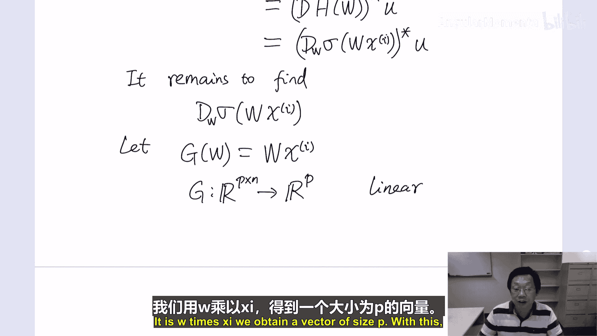
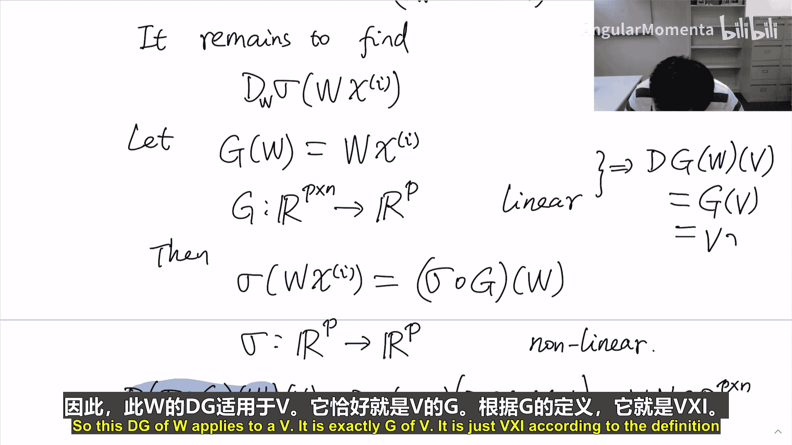
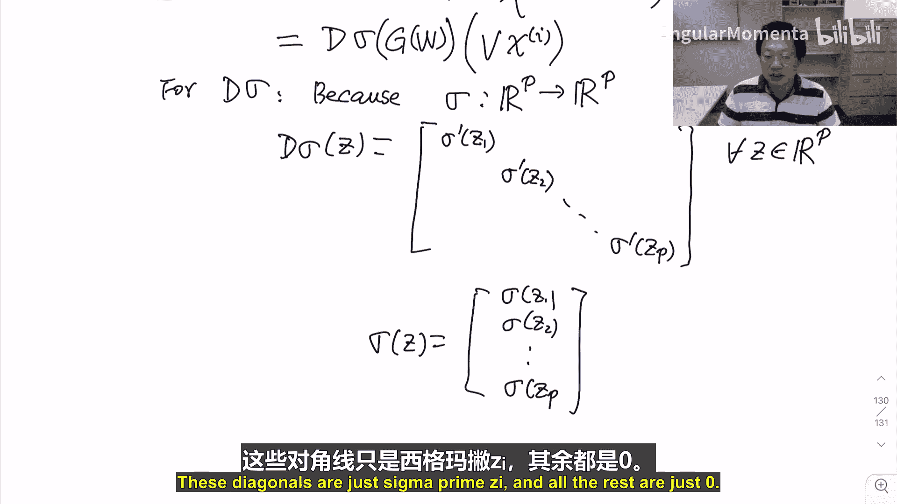
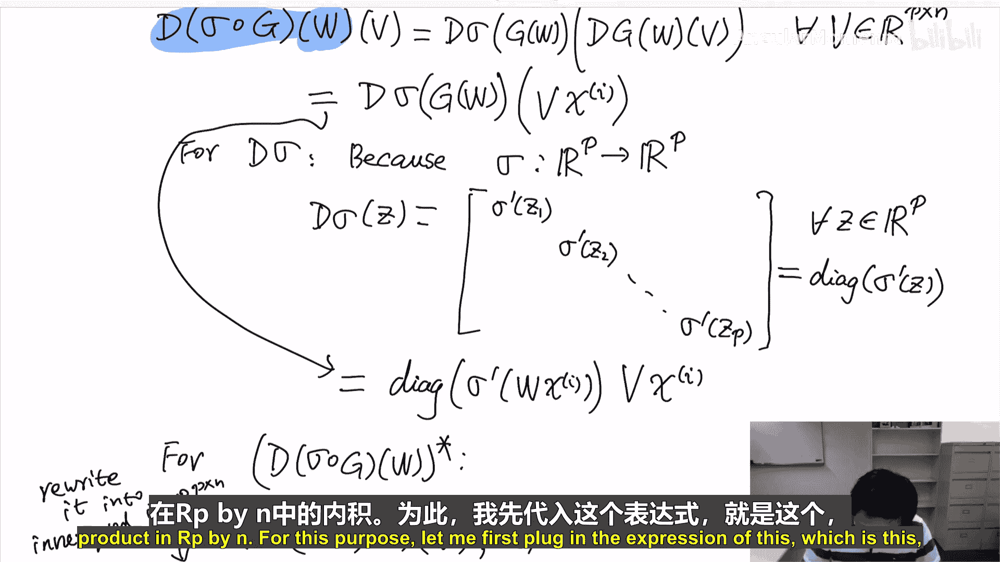
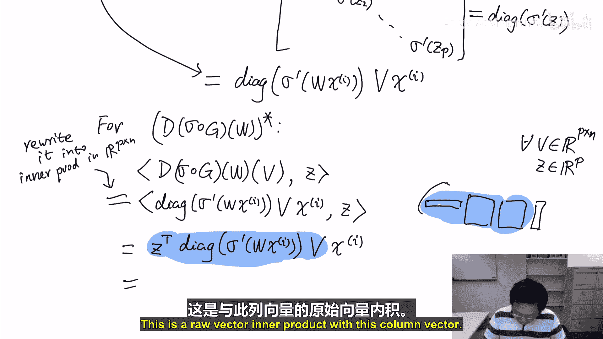
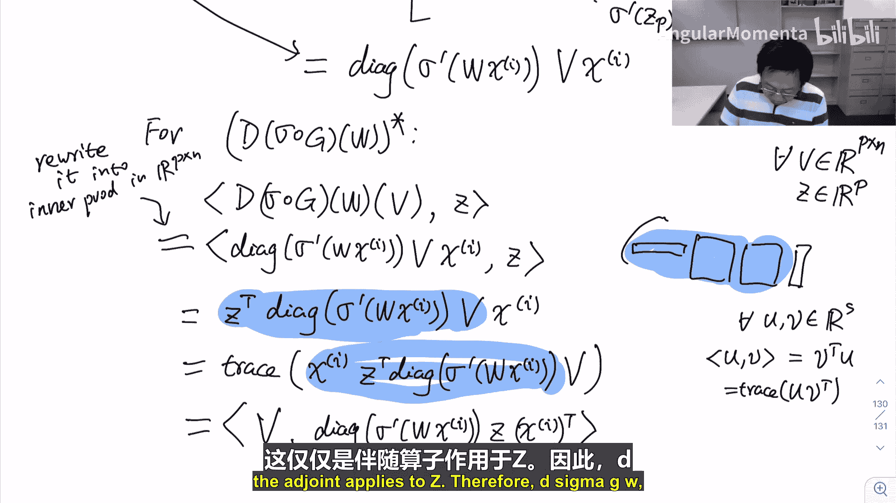
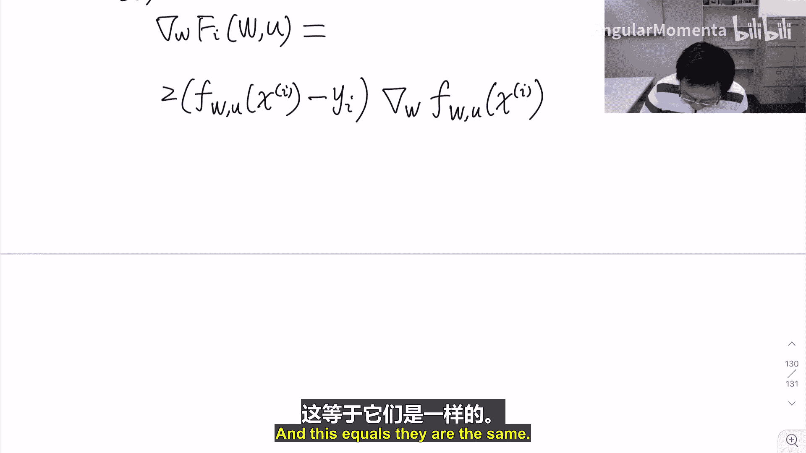
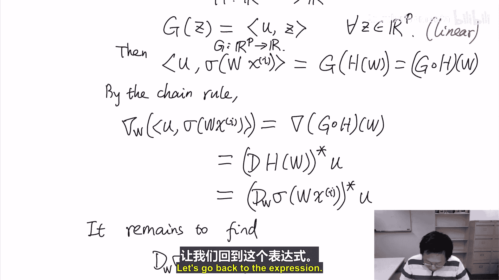
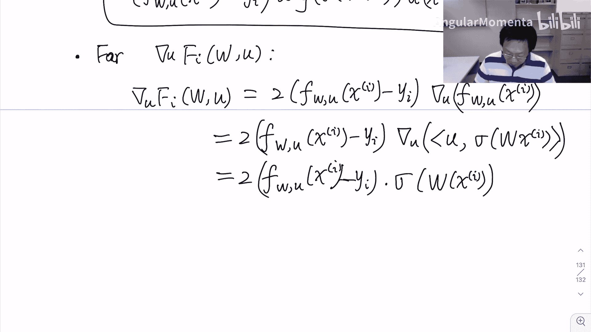

# 【香港科技大学】数据分析的数学方法 ｜ Mathematical Methods for Data Analysis p101 17-04-02-视频 -BV1DEFDzGEZW_p101-

To find the DW of sigma W X I again， I want to write this function into a composition of two functions。

Let。G of W。To be W X I。This is linear。Also， this G is from。W， which is RRP by N to RRP。

It is W times X， I will obtain a vector of size P。

With this， our sigma W X， I is now written as sigma composed with this G and W。

Where sigma is from R to RP。And sigma is non nonlinear。Now I would like to apply the chair rule。

D of sigma composed with GW。 This is a linear operator。 This is a linear transformation。

 It applies to a V。V is the same size as。W， which is P by N。For any V。This linear operator。

App to V equals。D Sigma first at GW。Applies to。DGW。Applies to V。Therefore。

 we need to find out D Sigma and D G respectively。For this d址。

Because G is from RPp by n to RP is a linear transformation。For linear transformations。

 we know that its differentiation is just itself so this。DG of W applies to a V。It is exactly G of V。

It is just V X， I， according to the definition of G。

Therefore， it is the sigma of GW。Applies to VX I。Let's find out the D sigma。for。D sigma。Because。

Sigma is a function。 It's an activation function。Entrywise activation function。 It is from RP to R P。

For RP to RP transformations， we know that there is an explicit expression for the differentiation。

 for the Jacob matrix。We just need to take the derivative of each components to the variables。

 We will get this matrix。 this matrix will be the D for any x。Therefore。The sigma。

At a vector Z for any Z on R P。It is the matrix by taking the partial derivatives of each component。

Sigma of Z equals， you know， Sigma Z1， Sigma Z2 and so and sigma Z E。

So we take the partial derivative of the first component with respect to all the variables。

 So the first variable is just the sigma prime。Z1。And for z2， because this is independent of Z2。

 so it is 0。For these3， also0， all the rest are just zero because of sigma z1。

Depends only on the one。And similarly， we have only these two two entries non zero。So this D sigma。

 Z is a diagonal matrix。E dis are just sigma prime Z。And all the rest are just zero。

With this expression of D Sigma， we can continue working on this equality。 it equals。The diagonal。

Of sigma prime at Z， Z is now G W。Or equivalently， it is just。W X I。Times， V， X， I。Now。

 this is a matrix of size P by P。 This is a matrix of size P by N， and this is the training data。

 which is n by one。 Therefore， this is a matrix times a matrix times a vector。 iss a vector in R P。

Therefore， this linear operator maps a matrix into a vector in R P。Now， in， in our final expression。

 we need the adjo of this operator。For the ajo D sigma， T of W this ajo。We just use the definition。

D西igmaジ。W applies to a matrix v。因而。P by N。And this maps the matrix into R P。

 Then we take the inner product in R， the innerRP。This is an inner product in R P。

 We want to convert this into an inner product in R P by N。We needed to rewrite。Each。

Into inner a product。嗯。而P byN。For this purpose， let me first plug in the expression of this。

Which is this just the diagonal。

Of sigma prime。V X， I。日。This is the inner product in RRP。 By the definition。

 it is just the transpose diagonal。Sigma Prime W X I。Times is the V times the X。This is a row vector。

 This is a matrix。 This is a matrix。 This is a column vector。Row vector， matrix。

 matrix and quantum vector。 So we get a number。Now。

 we need to rewrite this number into an inner product of V with some other matrix。For this purpose。

 I need to use a formula。This is a row vector。 You can see this three multiplied together is a row vector。

This is a raw vector in the product with this column vector。

I'd like to use this fact。For any you and V in R， C， R S。Then theyre in their product。

Is we transport you， It is。UV transpose the trees。I can rewrite this in the product into a trace form because the diagonal entry of this UV transse is just the UIVR。

 so the trace is just the sum of UIVR。Which is exactly the inner product。By using this fact。

I can rewrite this as a trace。Off。X I。Z transpose大家不 know。Sigma prime。W X， I。谁？

We know that matrix in the product is exactly trace。Then this is just today。

Transpose of this matrix in the product with V。Or really in the product with the transpose of this one。

The transpose of this blue matrix is。The transpose of the diagonal is still the diagonal。

The transpose of z transpose is， of course， z， the transpose of Xi is just the X transpose。

So we have rewritten this inner product in R P into an inner product in R P by N。 Now。

 this is just the a joint applies to Z。

Therefore。第しマし。W， these are the joints。Applies to Z。いいコース大の？Of sigma prime， I dropped the。Paraitus。

Zi。Thanks， hi。Transpo。Finally， we just plug in this expression。Yinqhu。Here。We obtain gradient， W。And。

By this one， we obtain a gradient WfiI。 So finally。We obtain our results， gradient W FI。Because。This。

And this equals。

They are the same。Under this equals this。Here I recover the parameters in Sigma prime。Which is W X I。

And Z here is。You。By this way， we obtain the gradient in W of FI。So from this calculation。

 you can see what we used is only composition rule。

 different versions of composition rules of differentiation。For this purpose。

 we need to write the function into the decompositionposition of many， many functions。

 At least we have done it for three times。What a greeting to you。Of F I W， this is relatively easier。

Let's go back to。

The expression。This F I W is like this。 Only this part contains you。

So similar to the calculation here， we just obtained that gradient UF equals2 times this times the gradient U of this one。

It is again， two times F W U X， I。Minus Y I times the gradient U of F W U。Next slide。

We know that FW is the inner product of U with sigma of W X I。This is a linear function on you。

Because W is fixed。Therefore， its gradient is just this vector。For any linear function。

 is gradient is just the vector in the definition of that linear function。Therefore， we obtain。

To F W U X I。Minus。Y I。Times， sigma， W。Next slide。This is a number。 This is a vector。

 So it's a scalar multiplication here iss a vector in R P。

This finishes the computation of the gradients in the training of one layer neural network。

