# 【香港科技大学】数据分析的数学方法 ｜ Mathematical Methods for Data Analysis p102 17-05-02-视频 -BV1DEFDzGEZW_p102-

Now we go to multi layer neural networks。The multi layer neural network is a generalization of one layer neural network。

We stack many one layer neural networks together to form a margin layer neural network。

In particular咧。This figure demonstrates a one layer neural network。In the multiier neural network。

 we don't use the output of the neurons to form the final output。Instead。

 we use the output of the first layer as the input of the next layer。

So this is an artificial neuron in the second layer。Its input is from the first layer。

And we place many neurons to the second layer。 The number of neurons in the second layer may be different from the first layer。

We get to the second layer。This is the first of the year。This procedure is done recursively。

 The output of the second layer will be input of the third layer and so on until the L layer。

Assume this is the output of the。Ealth layer。 Then we use a linear combination to get the final output。

This is a multieer neural network。Now， assume we have all layers。In one layer case， we know that。

This F W of X， it is the U in the product with sigma W X。In the multi year case， F W U of X。

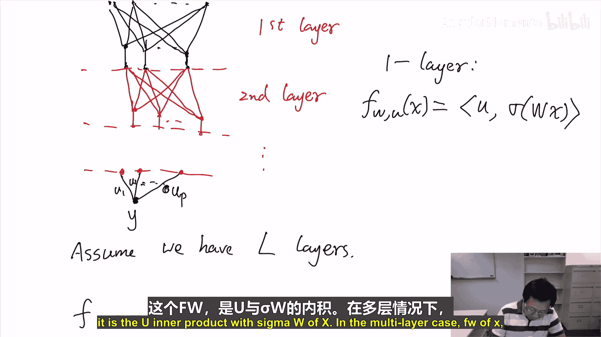

It is。The output of the first layer is given by this Sigma W X。This is the output of the first layer。

And since this W， it is now the coefficient in the first layer。

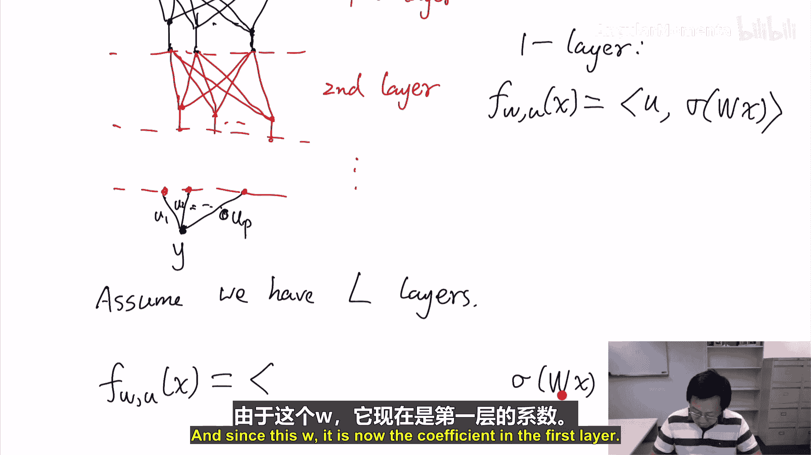

Therefore， I use a superscript one。It means it' the weight in the first layer。Now。

 this is the output of the first layer。 The output of the first layer will be the input of the second layer。

So in the second year， we just apply our W2 to this and then do the sigma。

This will be the output of the second layer。And this procedure is repeated until the earth layer。

W capital L applies to the output that L -1。Layer， and then we do the activation。

So this is the outputs of that else layer。This will be combined together to form the final output。

And the weight in this combination is the vector U。

 it is equivalent to take the inner product of you。With the output of the else layer。

This is the function in the else layer neural network。

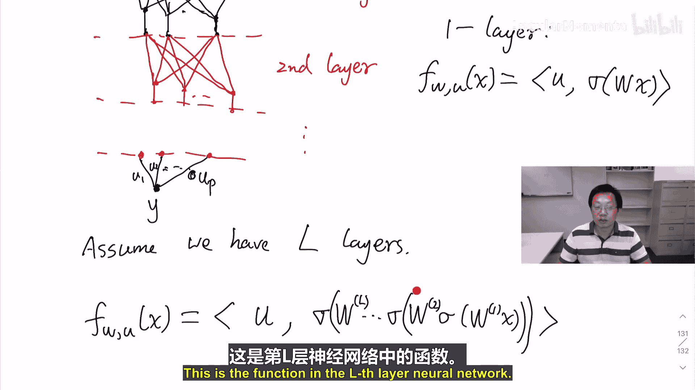

I now write this into a composition form。 I first apply W1 to x。

I will write W 1 x means W 1 matrix times x， because W1 can be understand as a matrix。

 It can be also understand as a linear transformation。After we do the W 1。

 we compose it with the sigma non nonlinear。Actation， and the way we compose it with W2。

The second and linear transformation。And then， sigma。Activation and as well。W L。On the sigcama。

In a composition form， this FWX is in this form。So much in your neural network is just we recursively use linear transformation。

 Long linear activation， linear transformation， long nonlinear activation。For L times。

 And then we do the final inner product to get the final output。Here， this W parameter。

 it is just the combination of all coefficient matrix together。Where。W is just W 1。Avenue 2。

And all coefficient matrix in the neural network。This is the function represented by a multiier neural network。

文。😊，The number of layer L is very large。Which means to that。This neural network is very deep。

In this case， we call。

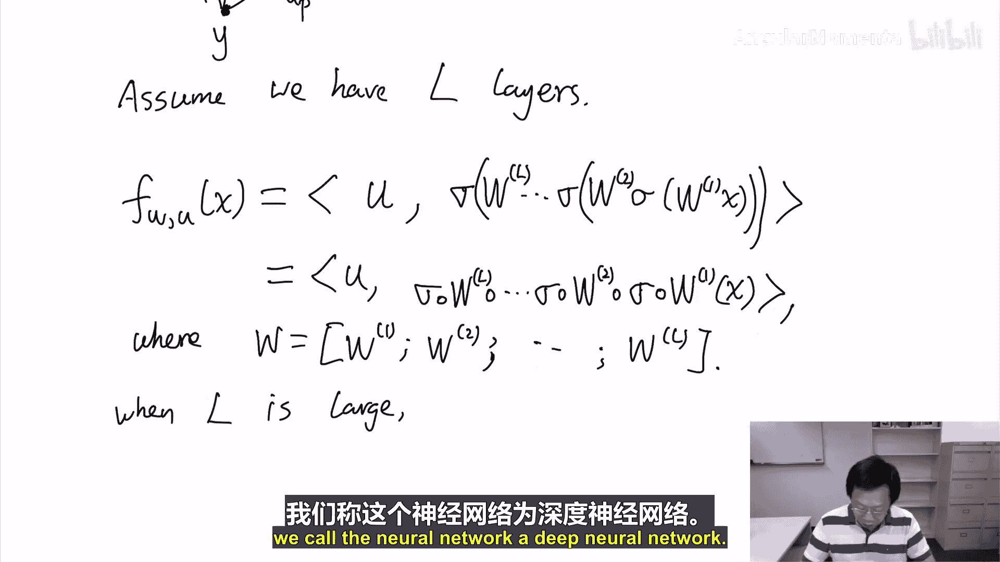

The neural network， a deep neural network。When we use deep neural network to do machinery tasks。

We get that so called the deep learning method。Therefore。

 deep learning is just multier neural network for machine learning。

Let's see how to use deep learning to solve the regression problem。For other regulation。

We just use F W as our F function。Then， we find。W and U such that。F W U X， I。

Is about why I for all I。For all the training data pairs。For this purpose。We just minimize。

W and U are the parameters。Sigma of I from 1 to M。Again， we will use the sum of squares as thearrow。

 F W U。X I。Minus Yi squared then。You can choose other error functions， or called loss functions。

For the regression。For example， if our YI， as we have demonstrated， if YI are just binary。

That is for classification。In this case， we should replace this difference squared function by some other function like the logistic function。

To get the logistic regression。Anyway， we wanted to solve this minimization for the regression。

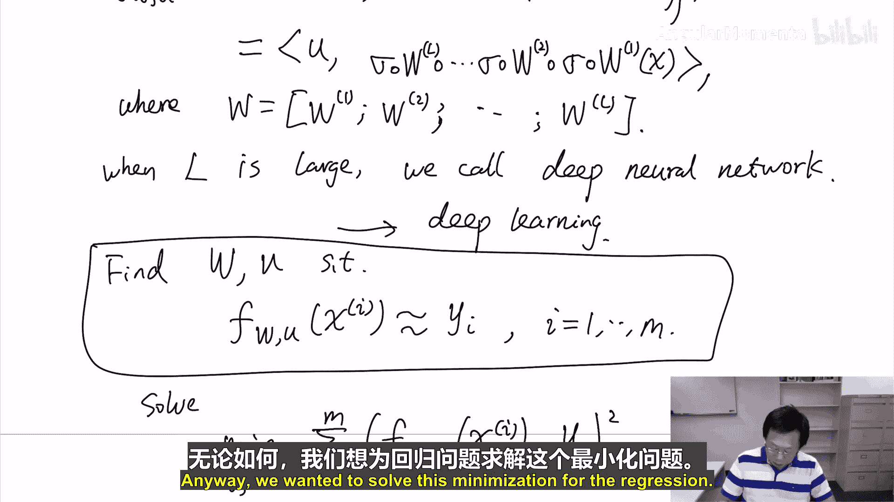

Therefore， training a neural network。It is the equivalent we find。W and U。We minimize W。

Of this function。Here again， I would like to denote。This function。In W and U by F I of W U。

Because in this optimization， the W and U are the parameters。

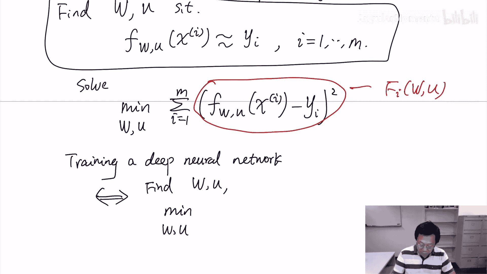

We obtain F。W U Sigma， iPhone from 12 M。Where F I W。Of course。FW U。X I。Minus Y I the squared。

Therefore， in order to train this deep neural network for our regression。

 we need to solve this minimization。In W and U。 Now， W is a collection of many。

 many matrices of L matrices。 These matrices may have different sizes。

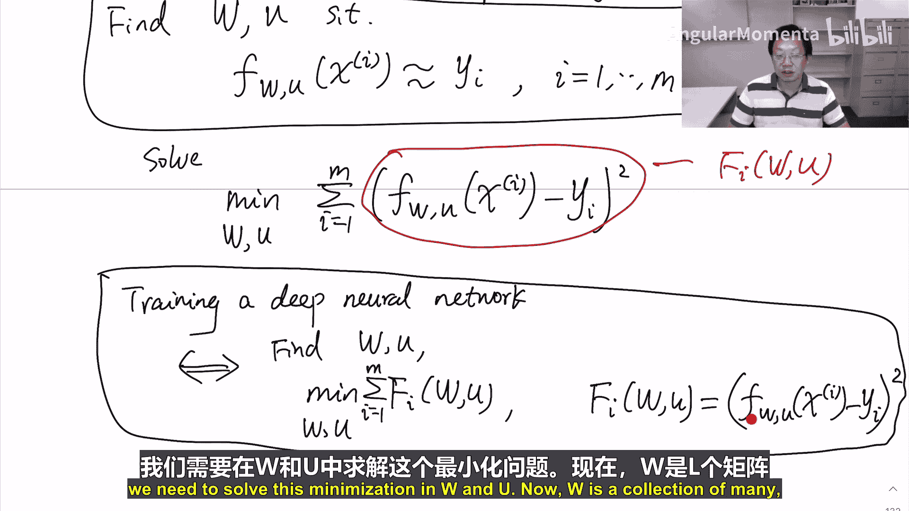

But it。All the W still forms a hereber space because we have L matrices and each matrix is in the Herber space。

 we can do the product of this L Herbo spaces to form a new Herbo space。For this W。

 then this optimization。

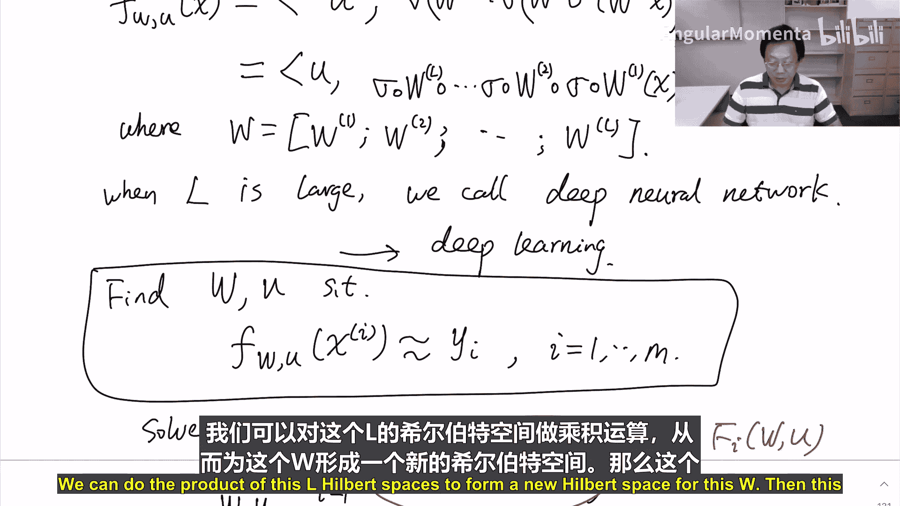

Is in the hereboard space。Then we can use the gradient descent or stochastic gradient descent to solve this optimization。

Again， this function， sigma I F I is smooth If sigma is smooth and it is non convex in general。

Therefore， gradienting the descent does not guarantee the global minimizer automatically。But however。

 because our deep neural network has a very special structure。

 gradient the descent or stochastic gradient descent works very well in practice for the training of the neural network。

It usually gave us a very good solution to them。Global minimizer of this minimization。

In both stochastic gradient decent or gradient descent， we need the gradient of F I。

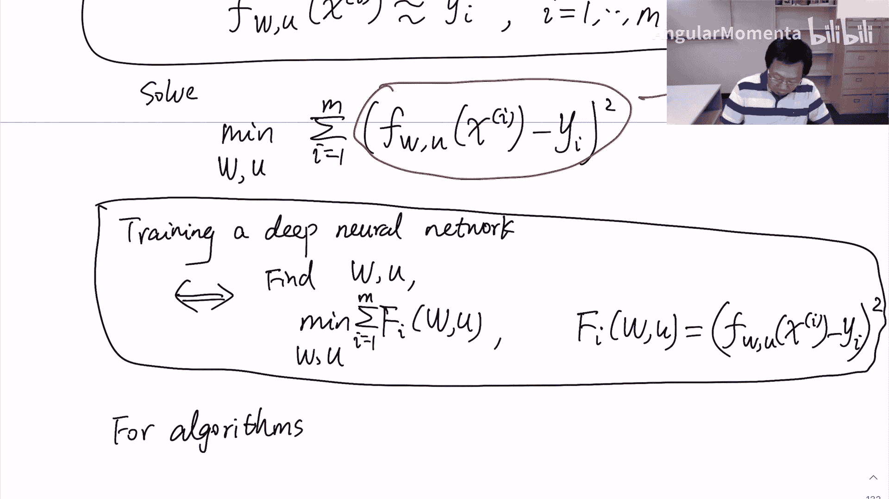

Which means that we need the ingredients。Of F I。In W under the gradient of FI。Yinyu。

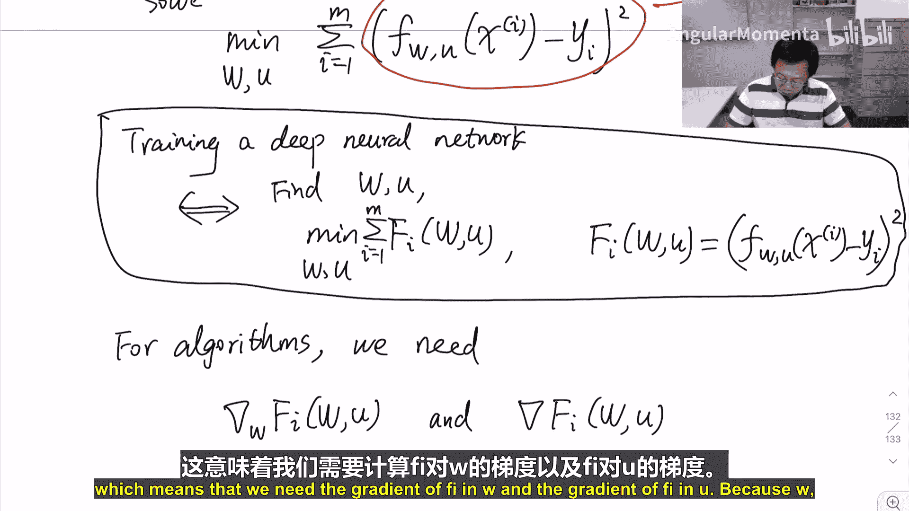

Because W now it is W1 to W L。 We can further decouple this into the gradient of W I or W little L。

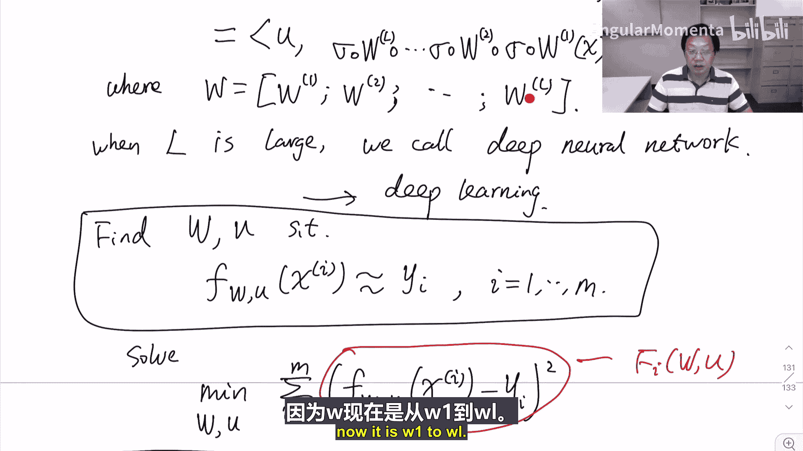

This initial L is from1 to2 capital L。

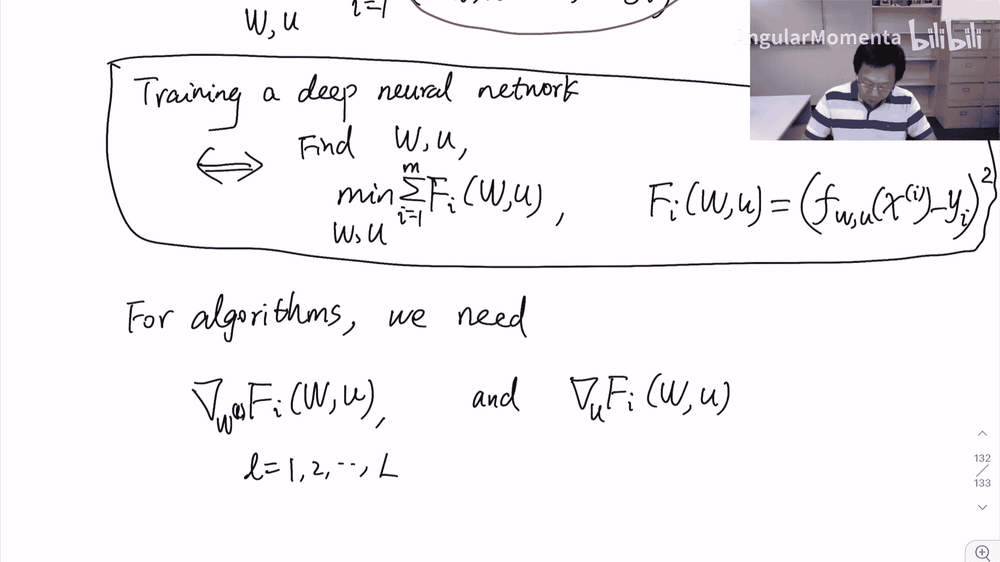