# 【香港科技大学】数据分析的数学方法 ｜ Mathematical Methods for Data Analysis p103 17-06-02-视频 -BV1DEFDzGEZW_p103-

Let us calculate the gradient of FI with respect to WL and with respect to you。For this purpose。

 we need introduce some notations。We you find。V 0 to be that。XI。

 that is to be the input of this neural network。And we want to be。

The output of the first layer that is sigma of W。V 0， W 1， B0。

And V2 to be the output of the second layer， sigma of W 2。V1。And so on on this VL。

The output of the L layer to be sigma of W。L applies to V L，-1。Or in general。

 we just have that V 0 equals X I， and we define V L recursively by。sigma w。L， V， L，-1。

for l e course。1，2。

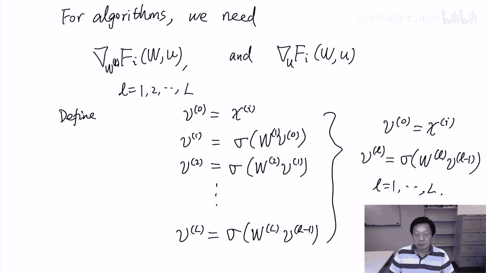

This VL。Is the output。Of the。Elf。La。

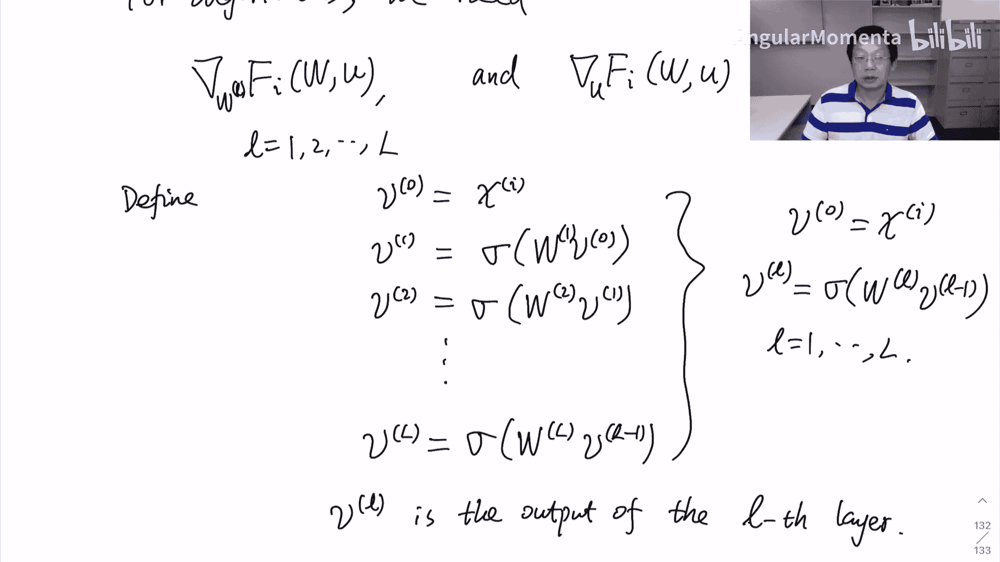

Go back to the picture。This will be the。Our V0， which is just X I。 the inputs of this neural network。

Under this will be our V1。And this will be our V2。Until this will be our vular。

The BI is just the output of the else layer of the neural network。

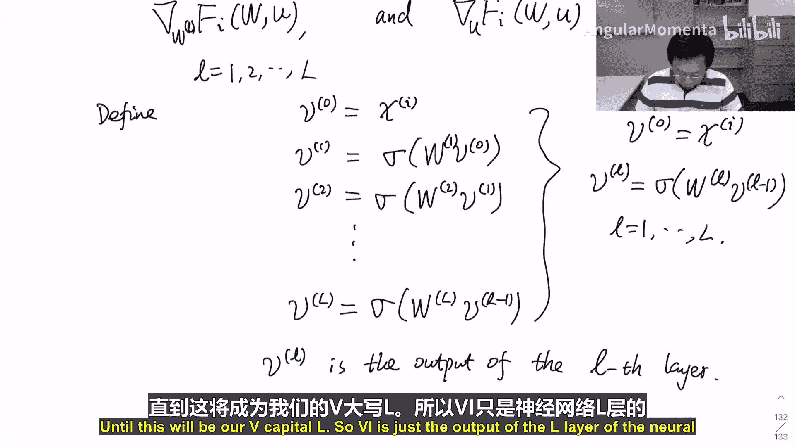

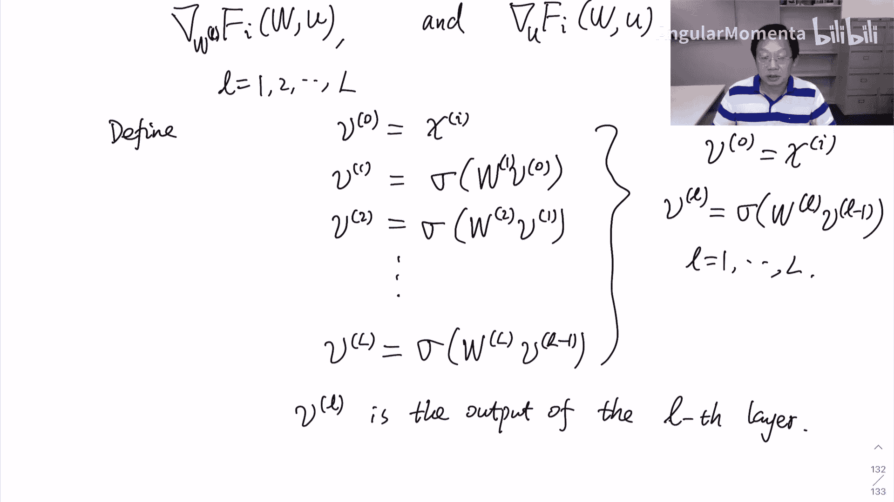

We also define。Operators。S of capital L equals sigma。

 This sigma is the activation in the Earth layer。Under S L， -1。Equals sigma composed with WL。

 composed with sigma。So that this sigma is the activation at the L layer。

 this is the activation at the L minus1 layer。안です。이 구레이버。Our F W of x。I。

Because our F W U X is written in this。

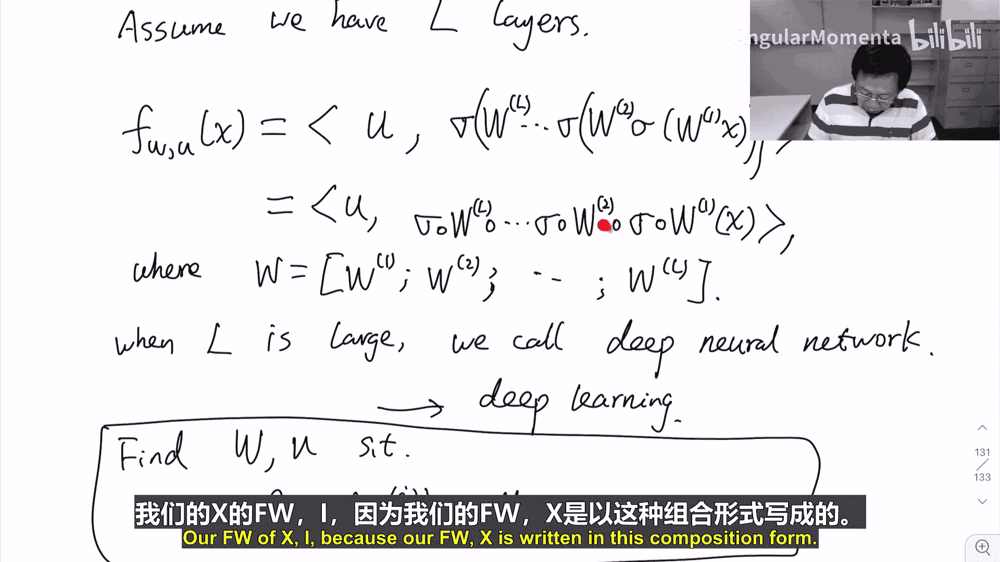

Composition form。

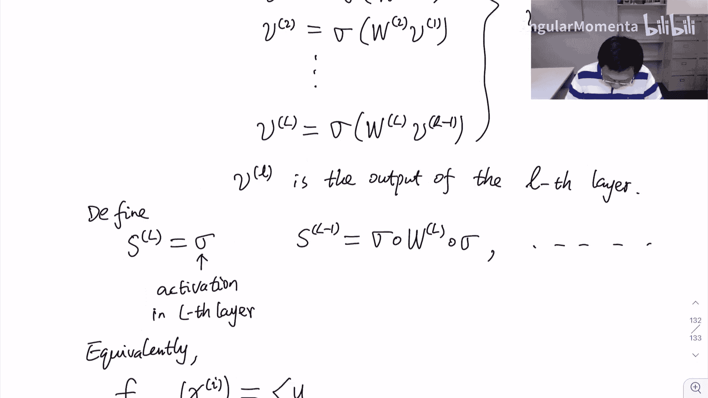

We use the composition form of the definition of FW U Sigma composed with W L， composed with sigma。

Composed， composed there was a sigma composed， that was。W little L， composed with sigma。

Composed with sigma， composed with W1。And finally， it is applied to X。Then in our definition。

 we have defined。Thisace。The sigma sew on this one to be the vector。V L 1。And the operator。

This operator， we called it as DL。Therefore， with our new notations， the F W of x。

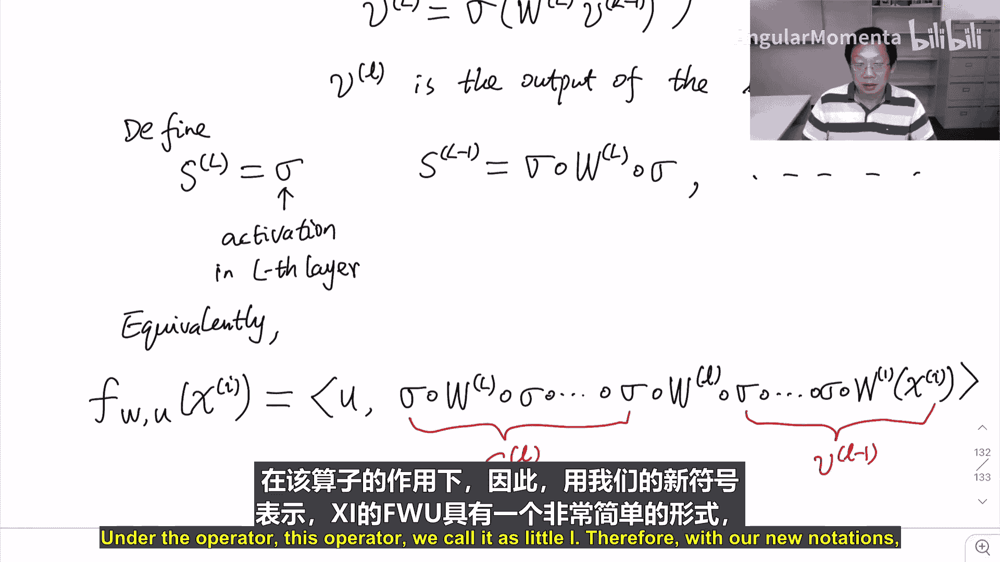

A。Is in a very simple form， which is。U of V L。It is also U of S character L。Offer。WL。

Applalies to V L -1。And the so on。At the little L layer， it is just U of S little L。

Applies to W little L applies to V L，-1。4 L equals 1，2， to count L。

We are ready to compute the ingredients。For ingredients。F I W U with respect to you。Grient U， F。

 I W U。 It is the gradient U to the。F W， U X， I。Minus Y I， the squared this function。Again。

 by the chain rule， we wanted to treat this part as an inner function。

And the outer function will be this blue and minus Y I squared。

The inner function is a function on hubbal spaces。 The other function is a function on R。Therefore。

 by the chain rule， derivative of this outer function， which is two times F W U X I。

Minus y n times the gradient of the inner function， the gradient in U of FW U of X。

This is the same as。Because our F W， it is now in this form。 Its the inner product of U and V， L。

Obviously， this is a linear function in U。Therefore， with respect to you is just this vector meal L。

Or in other words， the gradient in U is just two times the error of this equation times the outputs at the else layer。

For the gradients。Of F I。W U with respect to W of L。The computing of this gradient is more involved。

First， by direct calculation。This gradient is just。F W， U X， I。Minus Y I， this square。And again。

 we treat this as an inner。Function， and the alterer function is again。

 a functioning from R to R so that this is two times F W。X， I。Minus y I times the gradient。

With respect to W L of the。F W。X， I。We need to take a proper form of this F W U。 Let's go back。

We have many representations of this WU。When we take the gradient with respect to this WL。

 we take this form because this is independent of WL。This V L -1， according to our definition。

 it relatess only W 1 W2 until W L -1。 So this is independent of W L。 That's why we use this form。

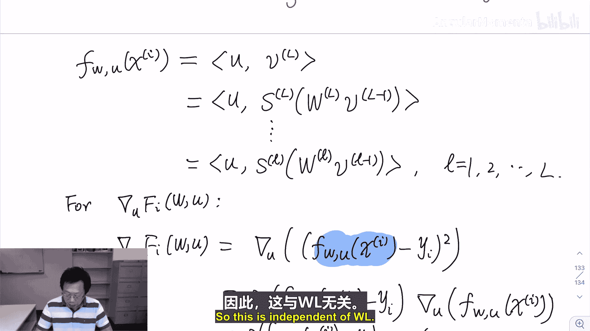

This gradient WL。Of that you in product with。S， NA L。W。系呀。V L -1。

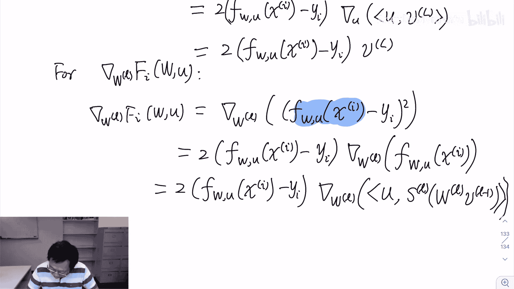

We needed to find out this gradient。The computation of this gradient is very similar to the one layer case。

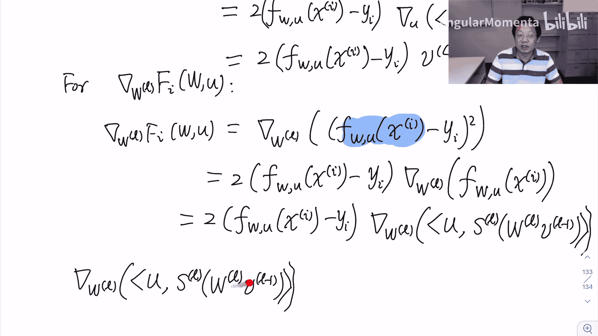

In the one layer case， we need to compute。This gradient with respect to W。

If we compare this with this， we can see there are many similarities。 First of all。

 these two are all independent of the variable。Here， this VL -1 is independent of WL。

 which is also linear， applies to this VL minus1。This Xi is independent of this W。

 it is also linear to this Xi。This WL here in the margin layer case correspond to the W in the one layer case that both are neural network coefficients。

Under this S L。In the multilayer case is similar to this sigma in the one layer case。

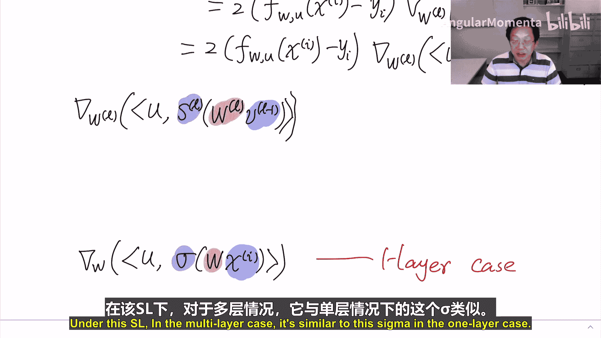

In the one layer case， this sigma is from R P to R。

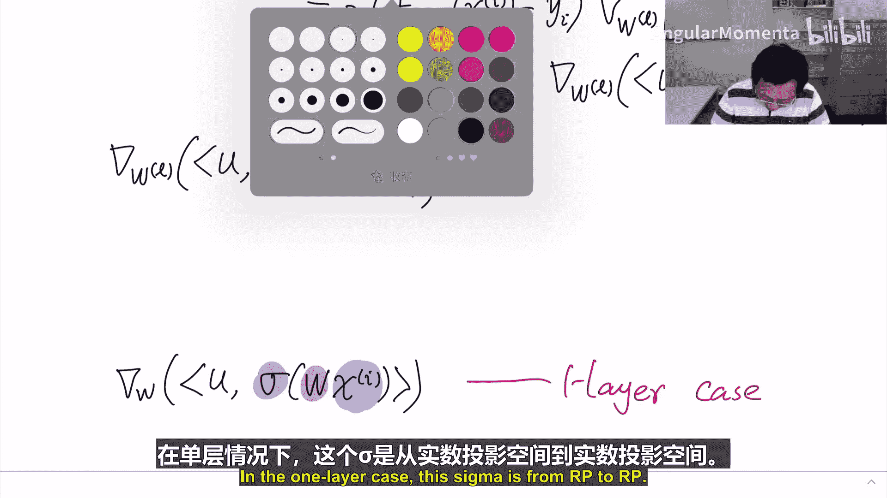

It's long nonlinear。In the multilayer case， this S L。It maps。From here。

 we see that this SL applies to a vector。That has the same size as the number of neurons in the earth layer。

And the output is the number of neurons in the earth layer。Is its from our。N L to R。

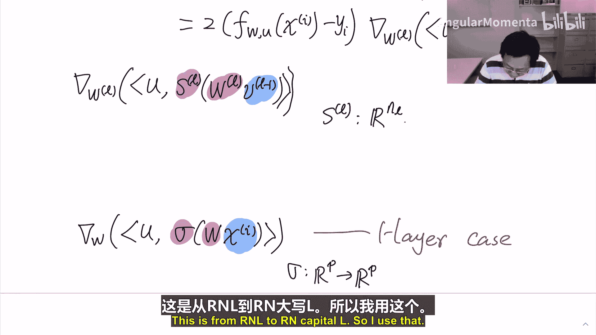

And capital， so。I used that。 This means the number of neurons。In layer。Yeah。

So it just maps a vector to another vector， though these two vectors may be in different size。

It is just a transformation between two Euclidean spaces。

 This is also a transformation between two Euclan spaces。 The both are non nonlinear。Therefore。

 this function in the margin layer case is very similar to the function in a one layer case。

The only difference is that this VL -1 is replaced by X， and also this SL is replaced by sigma Here。

 this sigma is an entrywise activation function。But in the multi layerer case。This S L。

 it is still a transformation between two Eucinian spaces。

 but it might not be entryized transformation。 The information will be mixed。

That's the only difference。Therefore， the results in the one layer case can be extended to the margin layer case。

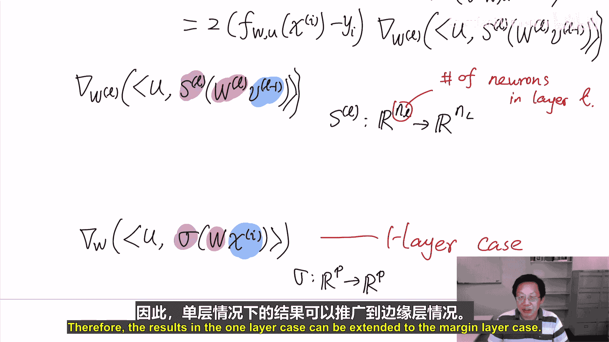

In the one layer case， these gradient with respect to W equals。This。Now。

 we extend this to the multi layerer case。We notice that this diagonal of sigma prime comes from the differentiation of this sigma function and then take the transpose。

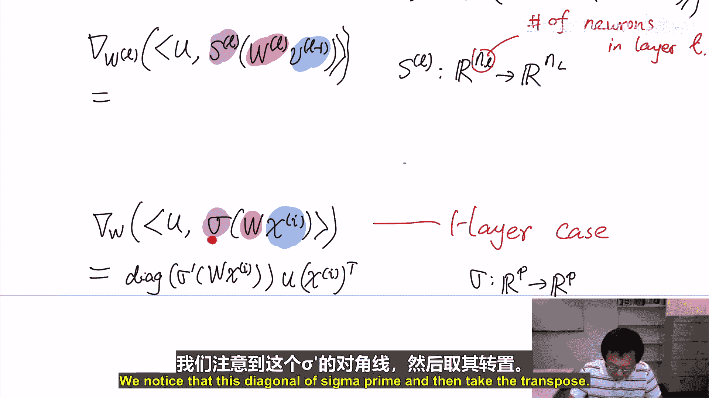

From here， we see that D Sigma is this a sigma prime at Z。

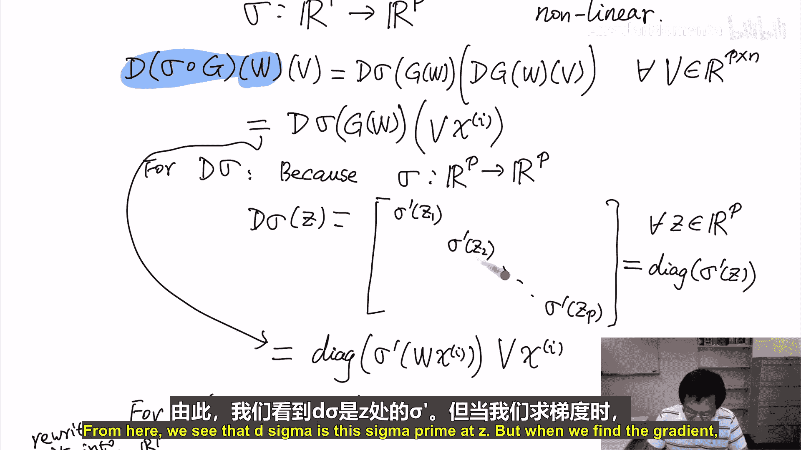

But when we find out the gradient， we need the a joint of this operator in order to find out the adjoin of this operator。

 we。Use the joint of this diagonal sigma prime， which is the transpose of this matrix。

That's why we obtain this one， This one is the transpose of this D sigma。

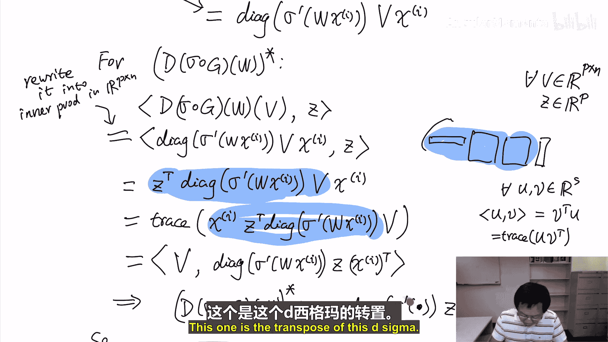

Therefore， we should use DSL the transpose。Since S， L is a transformation between R， N， L and R。

 N capital L， DS SL should be a matrix， A linear transformation between R， N， L and R， N capital L。

 Therefore， this DS SL is a matrix。 Its a joint will be its transpose。

This U is a silla the same here。The X I in the one year case will be the VL -1 in the marginal year case。

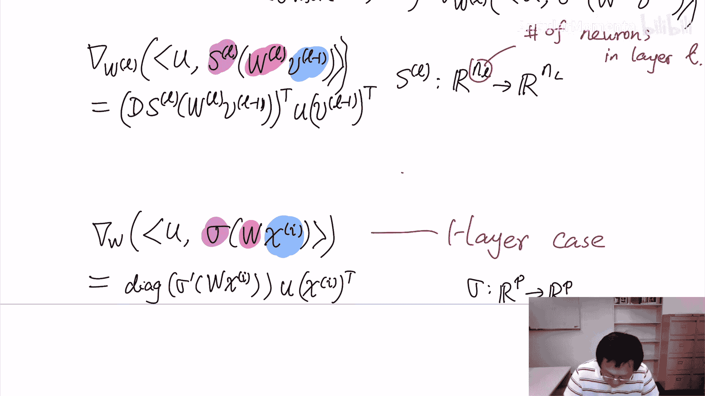

Of course， you may find out this expression of the gradient in the marginal year case。

By directly applying the differentiation rules， by directly applying in the Q rules。

I will skip this because they are completely the same as the one layer your case。

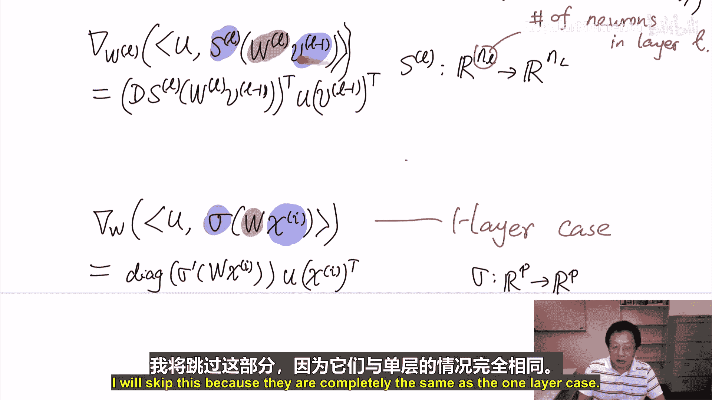

Therefore， in order to find the gradient of this function in W L， we need this matrix。

I will call this matrix， the M， L。It is denoted by ML。

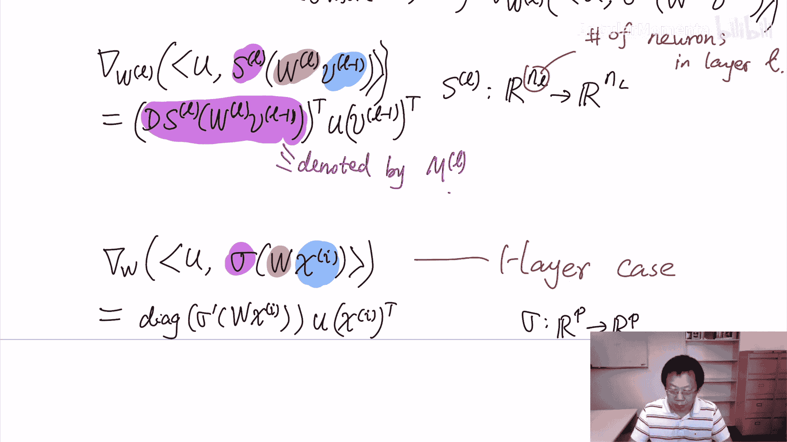