# 【香港科技大学】数据分析的数学方法 ｜ Mathematical Methods for Data Analysis p104 17-07-02-视频 -BV1DEFDzGEZW_p104-

To find out M L。We use recursion。L equals 1，2 capital L。We start with M K L。Which is DSL of W L。

V L -1。S， capital L is just the sigma。 The activation at the Earth layer。It's just the sigma。Of W。

 L V L，-1。D sigma is only the diagonal matrix。Whose diagonal entries are a sigma prime of W L。V L -1。

We obtain M capital。In order to obtain M little L for any L。We use the recursion relation， things。

This S。L。Of course。

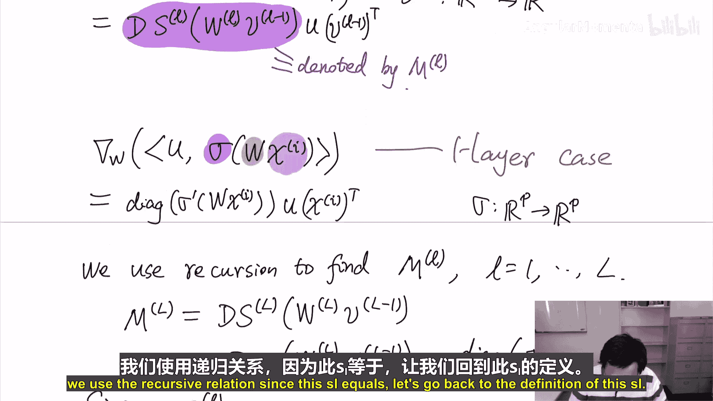

Let's go back to the definition of this SL。We can see if we compare this S L， it is just。S L plus 1。

Composed with W。L plus 1， composed with sigma。Because here from the first to。

To the sigma before W L is S L。 So starting from the first sigma to the sigma before W L plus1 is just S L plus 1。

 And then we apply W L plus 1。 And then we apply this sigma。Here。So we're having this relation。Now。

 in order to obtain DSL。We use the Qin rule。DSL will be。D SL is just DS SL plus1 composed with D W。

L plus 1。Composed with D sigma。In this expression， I just dropped all the variables here to get a precise expression for this DSL。

 I needed to recover the variables here。

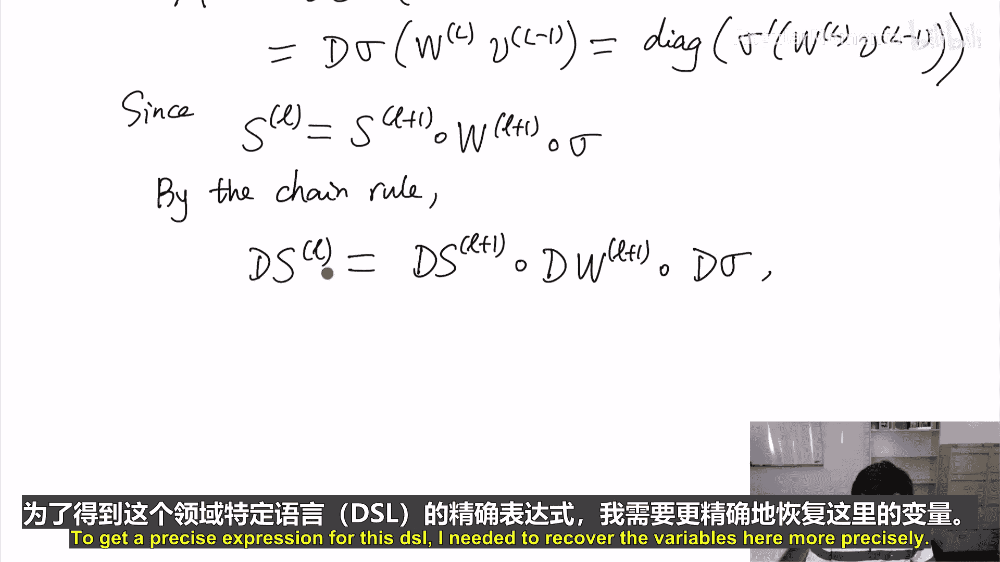

More precisely。D SL。WL。V L -1。

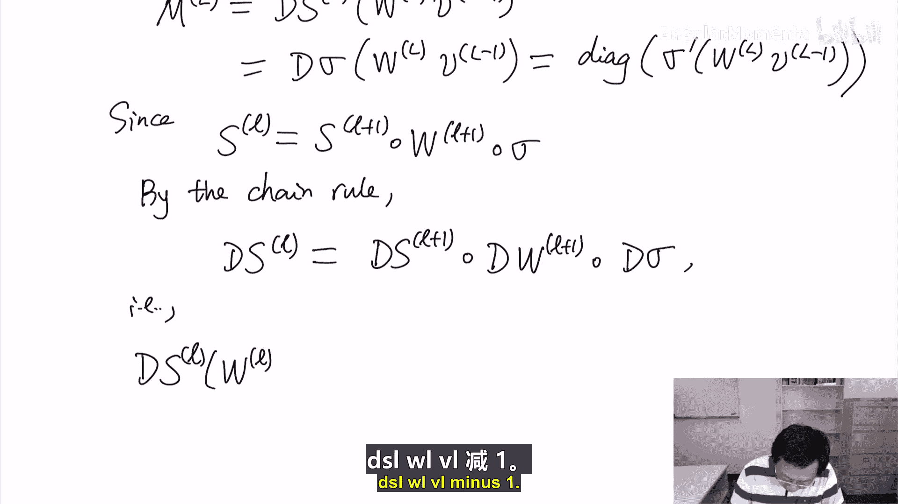

Since our S， L is from R， N， L to R， N capital L。Therefore。

 DSL will be a linear transformation from R NL to RN character L。

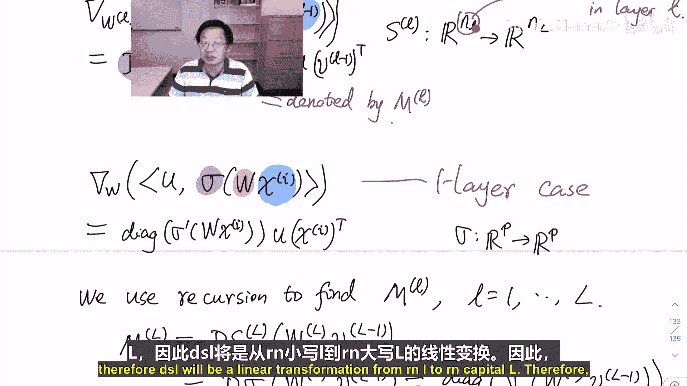

Therefore， it's a matrix。 So this is a matrix。

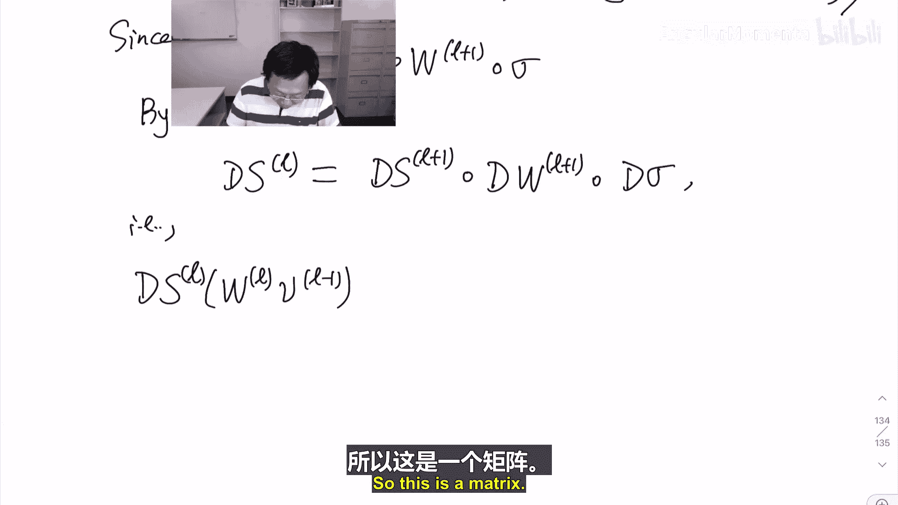

It's a matrix in R， N capital。By R L， it maps a vector from R L to R N capital L。This matrix equals。

D SL plus 1。W L plus 1 V L。Again， this DSL plus1 is a matrix because SL plus1 is a transformation between two Ekkuadian spaces。

S， L plus1 is from R， N L plus1 to R， N capital L。Therefore。This is a matrix in。R， N capital L by R。

 N little L plus  one。Here， an L little L plus 1 is the number of neurons in L plus1 layer。Now。

 since this is a matrix， we can also show that this WL plus 1 is an linear transformation between two Ukadian spaces。

Therefore， this DWL plus1 is a matrix， this D sigma is also a matrix， All these are just matrices。

 therefore their composition are just matrix match applicationss。

Because matrix multiplication is exactly defined by the composition of linear transformations。

Times D W， L plus 1。At VL。Times the sigma of WL。V L，-1。Both these two are matrices。

This is a matrix in our。N， L plus 1 by N， L， because it maps a vector in R， N， L to R， N， L plus 1。

And this is in。R N， L by N， L， because it's the activation in the L layer。 So it just maps。

A vector in R N L to R N L。 So this is a square matrix。

So eventually we get a matrix of size Rn capital by R little L。

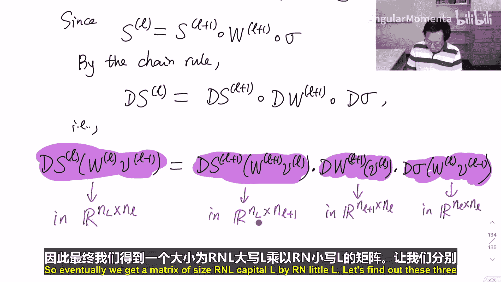

Let's find out these three matrices respectively， for this matrix。

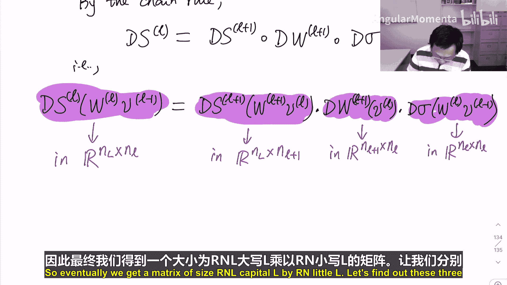

The first matrix by definition， we just defined it to be MLL plus 1。

 thus' our definition it is obtained from the previous step by recursion relation。

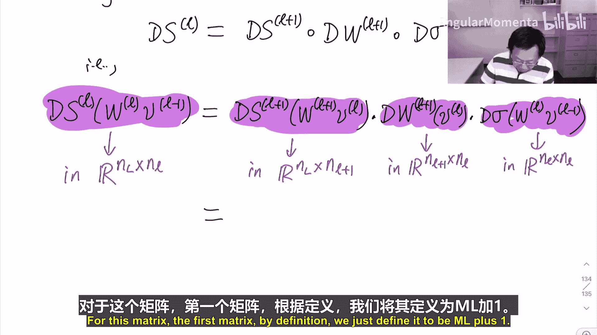

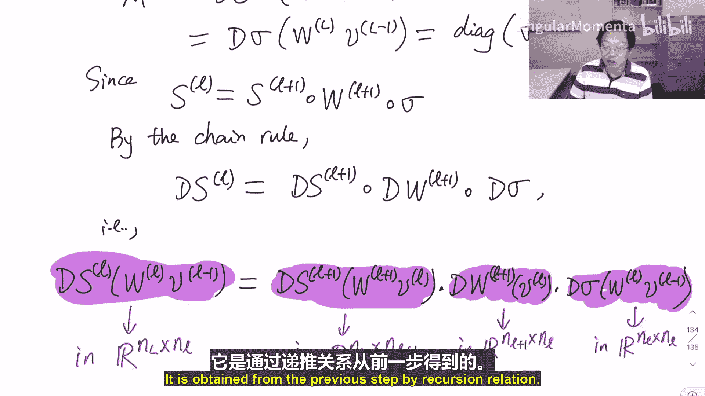

It is。L plus 1。Times。Now this matrix is the differentiation of the linear transformation WL plus 1 is the WL plus 1 applies to a vector。

Then the differentiation with respect to that vector will be exactly this matrix。And for this one。

 the sigma we have it from the one layer case is the diagonal。Of sigma prime。

Applies to the parameters。So we obtain that。This M L matrix。Which is this one equals M L plus1。

 this one， W L plus1， this one times the diagonal of sigma prime， this one。Therefore， if we know。

M L plus1， We can get the M L。

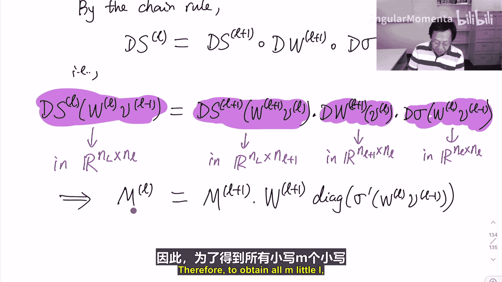

Therefore， to obtain all M little L， we need to start with little L equals。Capture L。

And with M capital L， we can obtain M capital L minus1 by using this formula。

And then M character L-2。By this formula， by using M character L -1。Andです well。Until we get M1。

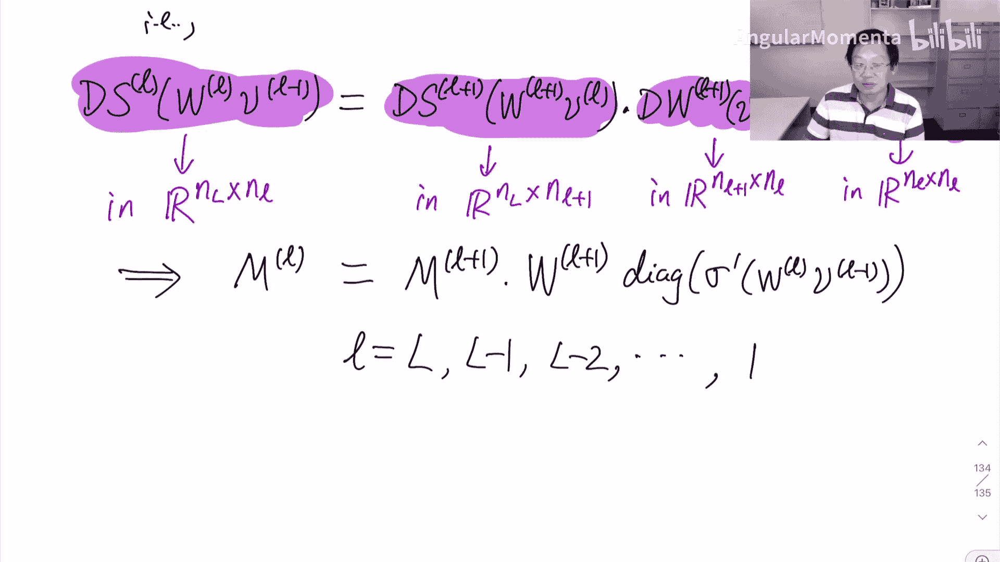

Then we obtain ML。With MLL， we have the expression of the gradient of FW。

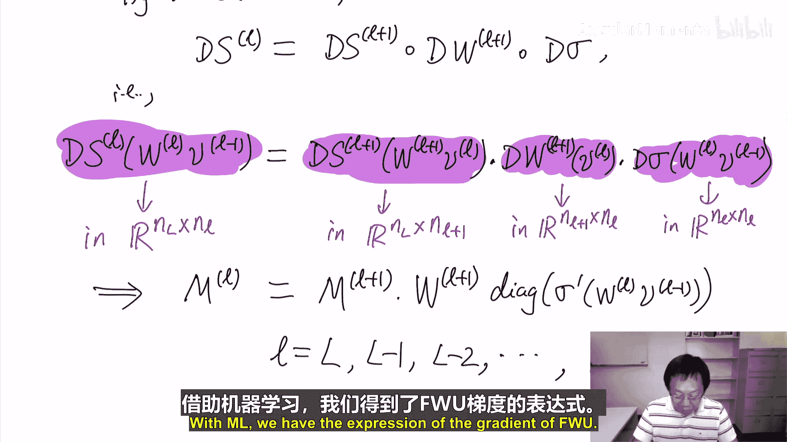

With the gradient of FW， we can obtain the gradient of capital F I。

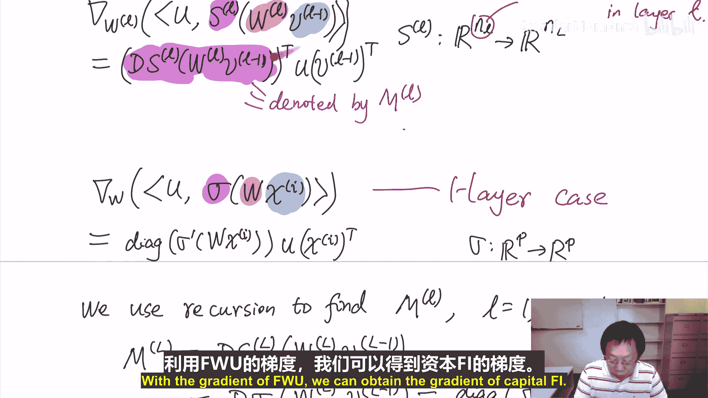

Therefore， we have。

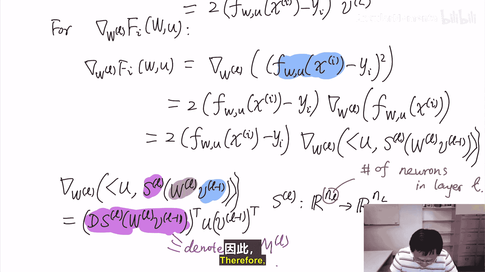

Grient。F， I W U。以 course。Two times this residual of the equation times the gradient of F W。

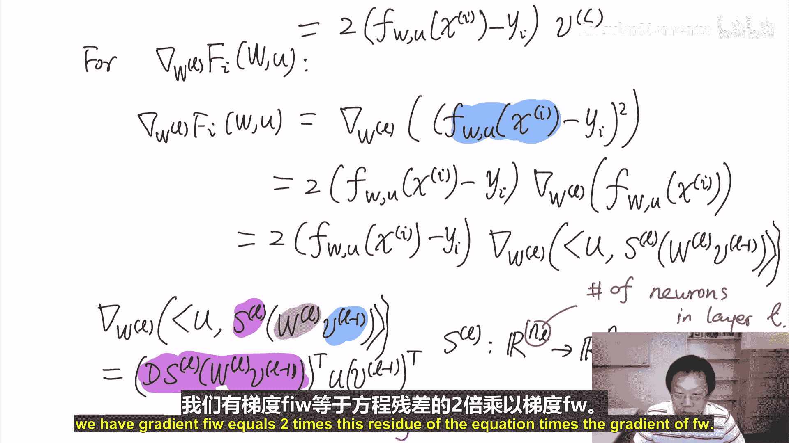

Two times that residue of the equation， F， X， I minus Y， I。Times the gradients of。F W。

 which is given here。 M， L transpose U V L-1 transpose。

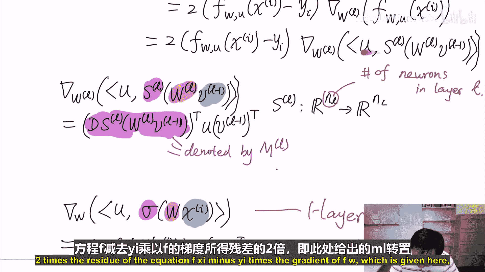

Where M L is given in this form recursively with M capital L。

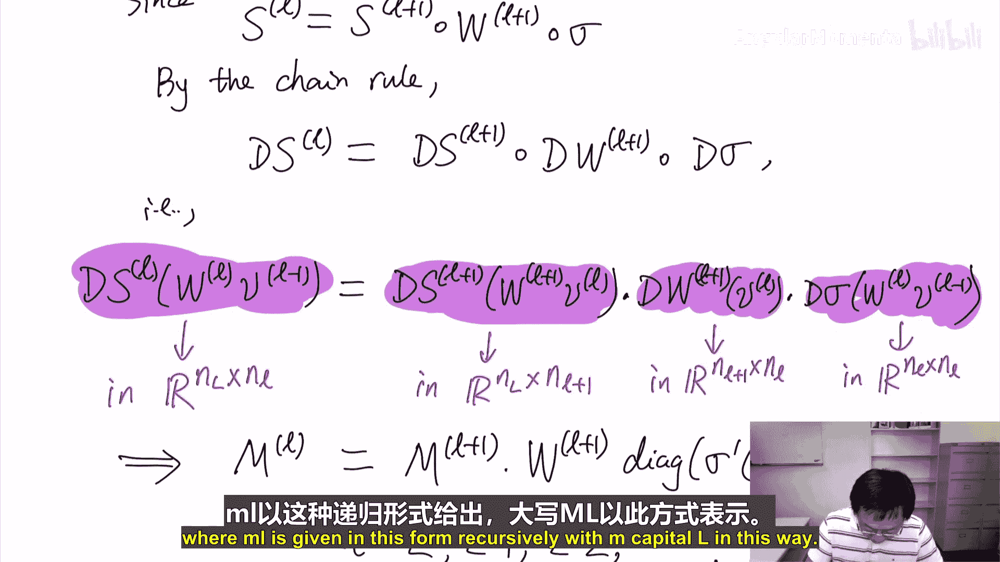

In this way。

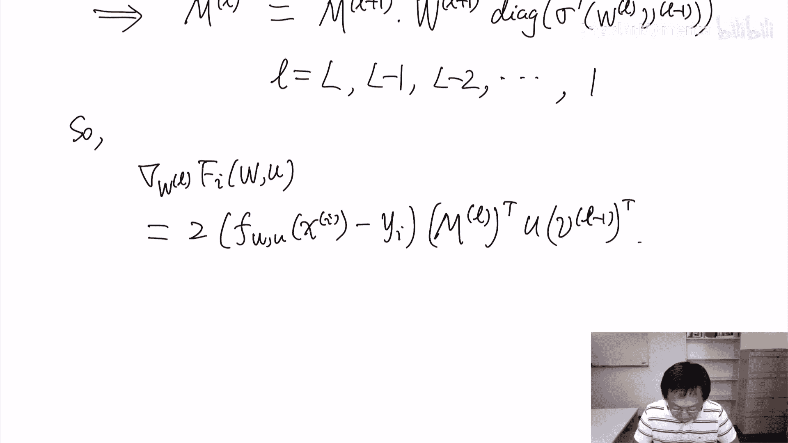