# 【香港科技大学】数据分析的数学方法 ｜ Mathematical Methods for Data Analysis p105 17-08-02-视频 -BV1DEFDzGEZW_p105-

The gradient in this form is still too complicated。I want to simplify it。To this end。

 I want to introduce some new notations。First of all， because in this MLL。

 we need the diagonal of sigma prime at this vector。Now。

 I would like to denote this vector to be P L。Do you note？P， L equals。WL。V L， -1。Recall that。

VL equals sigma of， by our definition before。Sigma。W， L， V， L，-1。Which is sigma of P L。Now。

 this VL is the output of the else layer in this multi layerer neural network。Therefore。

 this P will be this VL before activation。So it's a pre activation output of the earth layer。

It is just the output before the activation。Let's go back to the picture of the multier neural network。

In this picture。Actually， this part will be the P1。This will be P2。Under the vector， before the。

Activation of this V L is called the P， L。Therefore， P， I。Therefore， V L is the output of layer L。

 and P L is the pre activation output of layer L。To simplify the notation。

 I also want to denote this into a new vector ZL。

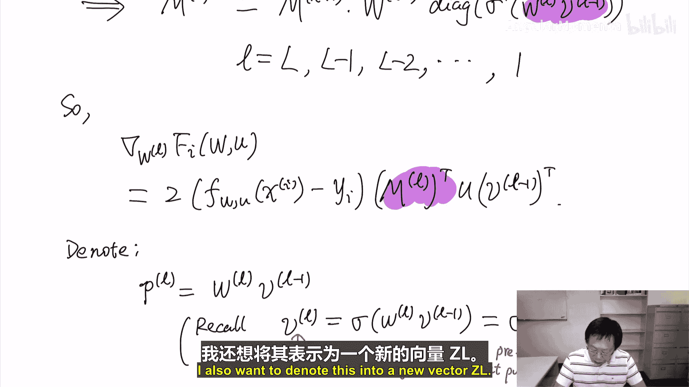

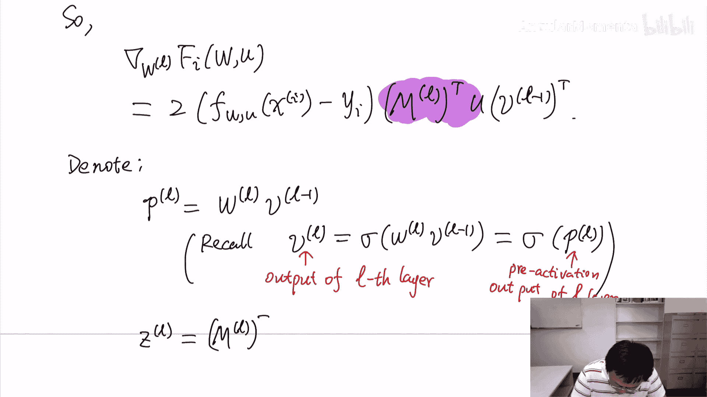

Now， according to the recursive relation between ML L。

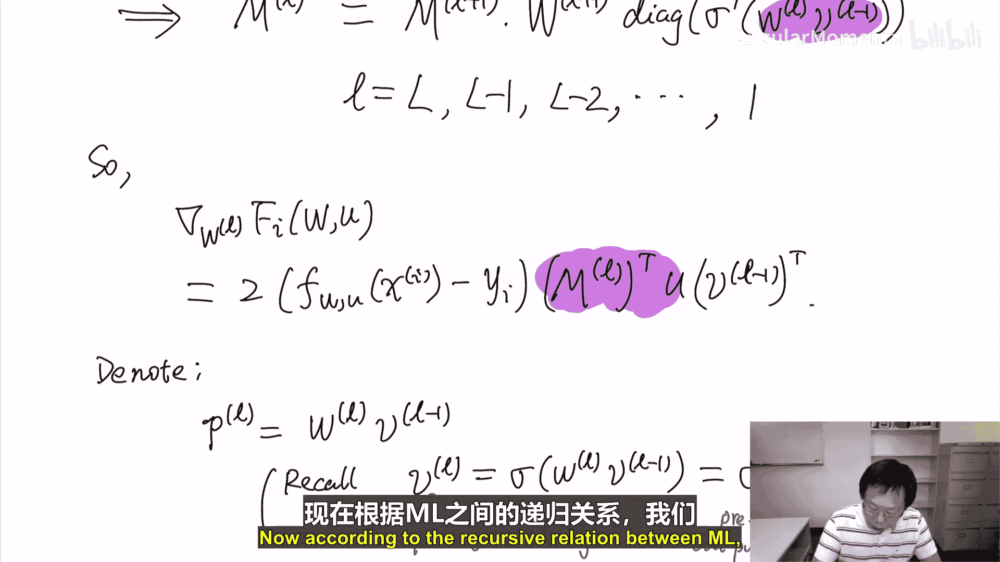

We know that these M L transpose， you will be。Dagonal of this matrix transpose。

 which is still itself， the diagonal of sigma prime。But now， according to our new notation。

 this is exactly P L。Times。The W L plus1 transpose。Times the transpose of this M， L plus  one。

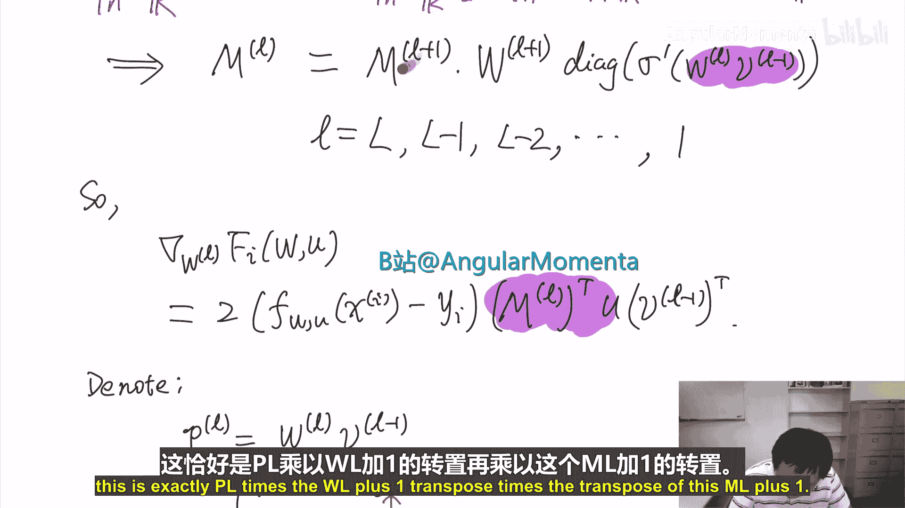

Times you。Because Z， L is defined in this way。 This is exactly Z L plus 1。This is a matrix。

 applies to a vector。 This is a vector， and this is a matrix。

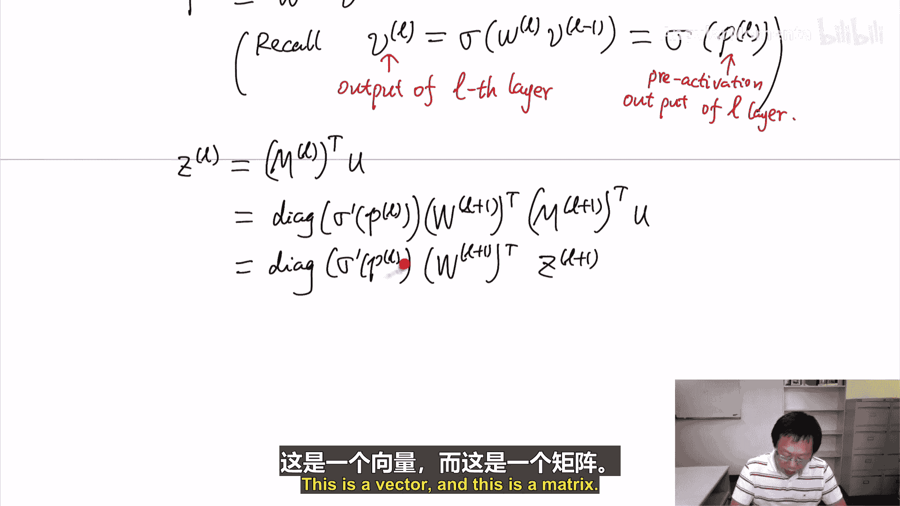

But this is a diabal matrix。For the multiplication by a diagonal matrix。

 it is equivalent to an entry wise multiplication。Indeed。We consider diagonal of。

A vector A times a vector B。Where A and B are both in R S。Then this is just a 1，2， A S。

 this diagonal matrix times B12 B S。By using the matrix vector product rule。

 we find that the result will be A 1， B1， A 2， B2， to A， S， B， S。That is。

 it exactly the entry wise multiplication。 Each entry is just multiplied together。We call this one。诶。

Entryvis， multiplely B。So I introduced this notation。

 a circle with a dot means the entry wise matchmun。

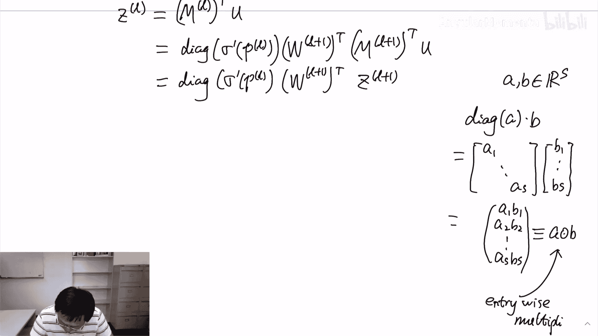

Nerform。With this new nottation， I can simplify this。 It is just the Sigma prime P L。

Enterice much make kit is W L plus 1。Transpose。Times Z L plus one。

We have this relation between ZL and ZL plus1。For simplicity， I will denote this operation。

 The entrywise muchplication by sigma prime at P， L by。capital s个嘛。

And now this is kind of sigma with。W， L plus1。The transpose。And then applied to Z L plus1。Here。

 this capital sigma equals sigma prime。Enterise， muchplication。

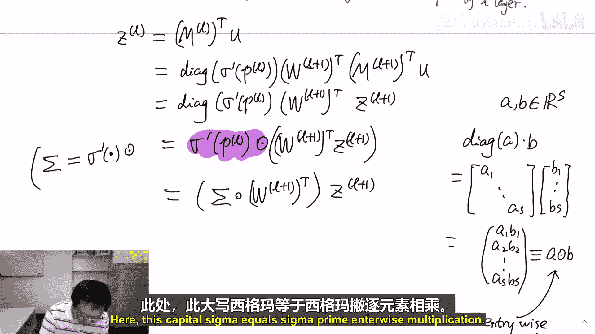

We can further expand Z L plus Y in terms of Z L plus 2 and so on。 Eventually。

 we will obtain that this。

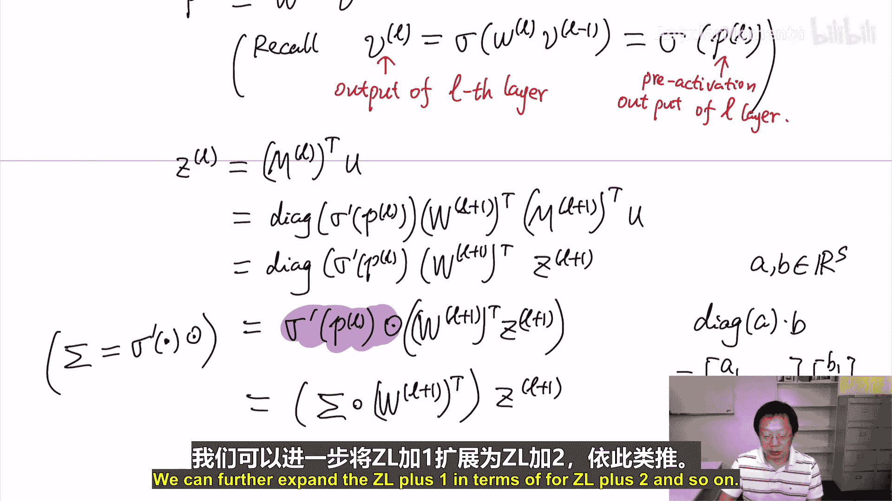

Z， L equals sigma compose with W L plus 1， The transpose compose with sigma and so on Comp with sigma composed with W capital L transpose。

And then the。看咋呀。For this Z capital L， it is just M capital L transpose times U。

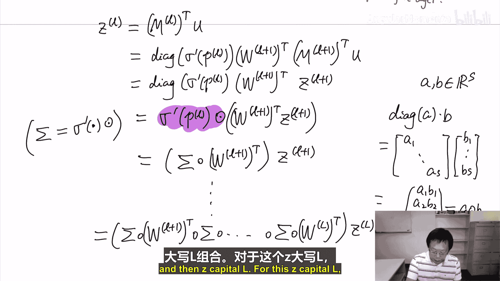

M capital L is given by。

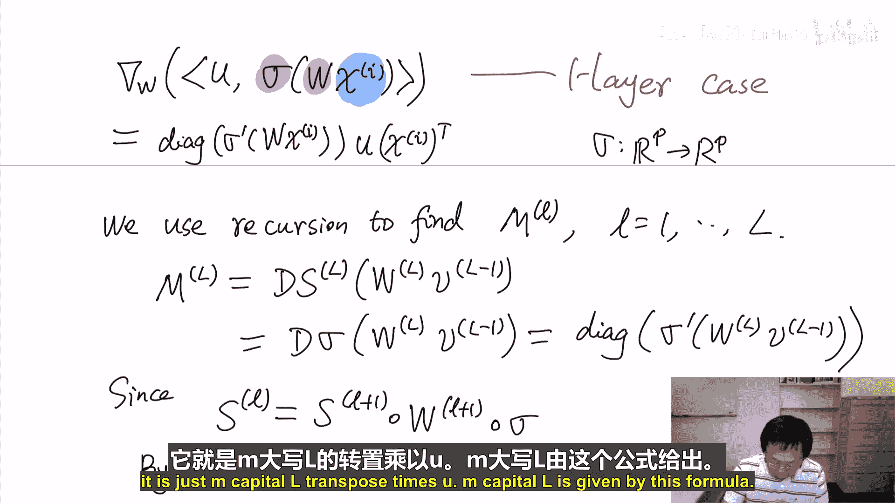

This formula。Therefore， we obtain Z capital L equals。Capital L times U， which is。Sgama prime。

At P capital L。Multiply entroworthly to you。Then we just obtain this equals sigma composed with W L trans plus one transpose。

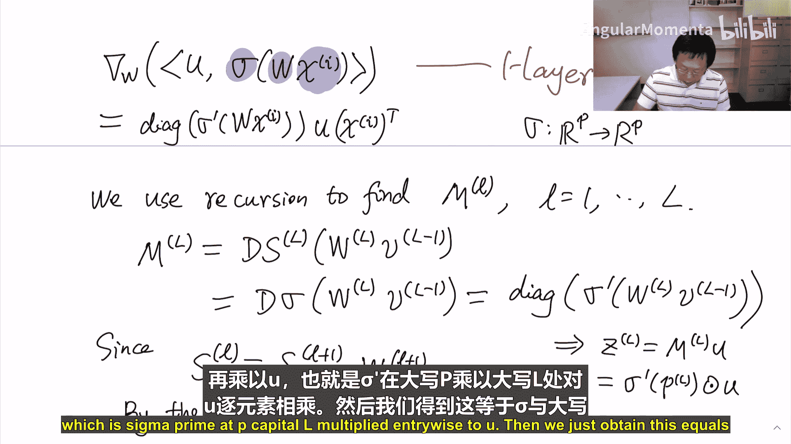

Composed。Composed though a scama。Compposed with W L transpose。Composed with sigma。Yu。

So this ZL is given in this form。

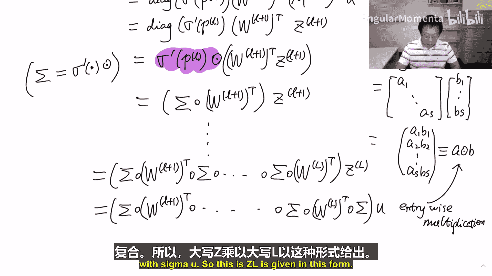

Though it looks very complicated， but actually it's very simple， given you。

 we just apply sigma and WL Transs alternatively， starting from capital L to little L plus1。

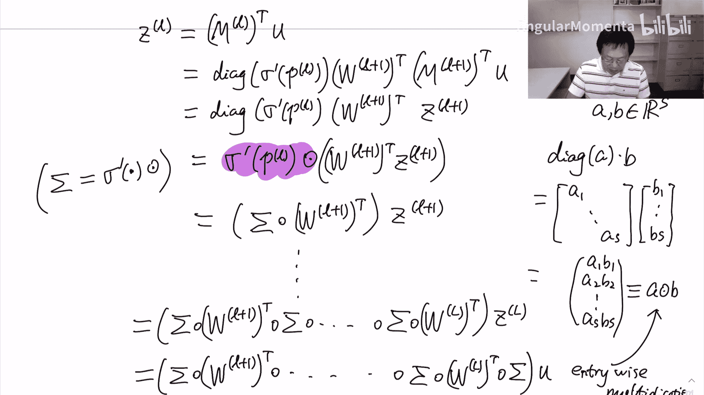

With this expression of Z， L and P L。 now， we can obtain the gradient of。Capital F。

Equals two times the residue of the equation。 That is F X I。Minus Y I times。This we called Z L。

Just Z， O， V， O，-1 transpose。Z。V L，-1 transpose。This VL -1 is the output of the L -1 layer of the neural network。

It is given by。the input is X I。 We start from X I and we apply W1。

And then apply the activation and so on。W， L-1， and then activation。So this is from the input。

 we started from the input， and then the first layer， second layer until the L minus1 layer。

But for this ZL。

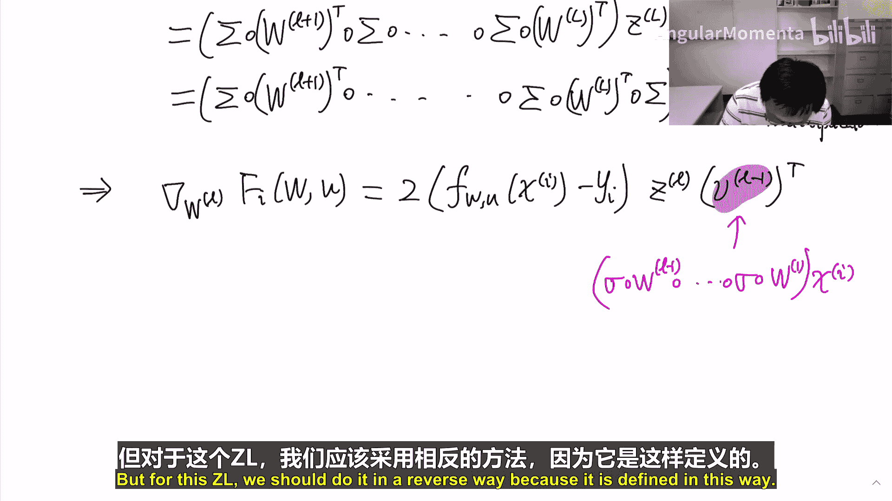

We should do it in a reverse way because it is defined in this way。We start from a U。

Which is in the last layer of the neural network， is that。Coeffficient in the final output。

 So it's in the last layer。 And then we first apply the sigma。Sigma means the sigma prime entryY。

And then we apply that。W。L， the trise。The coefficients in the last layer transse。And this one。Im ti。

W L plus one， the transfers。안돼。The Sigma prime entry wise matchmun。So， this。

Vor is obtained from the last layer of the neural network。Until the L plus one layer。

While this V L -1 is from the first layer。To the L -1 there。 So this is a forward propagation。

 This is a bank。Okay。By this， we can obtain the final algorithm to compute the gradient of。

F I in the training of the neural network。We need first to obtain the intermediate output。

And the pre activation output。For this， I needed a loop for L equals 1，2，2 L。

And we first obtain our P， L。 P， L is just W， L。Times。V L，-1。Therefore， I need to specify with0。

V0 is just the input of this neural network， which is X。With the output pre activation。

 then we just obtain the output by activate this P。So by this way。

 we get all the outputs and the pre activation outputs of this neural network。

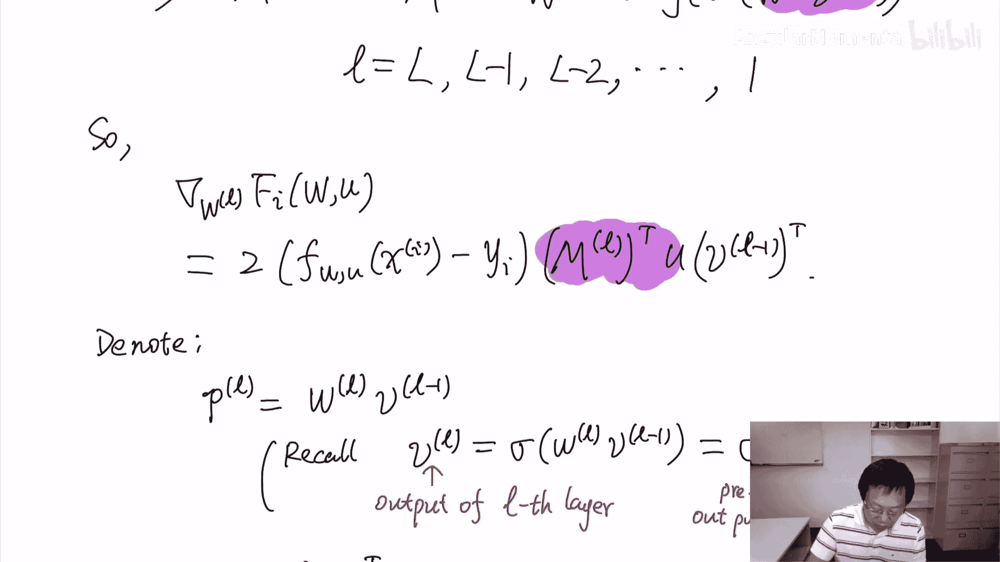

All those are just。Intermediate output of the neural network。

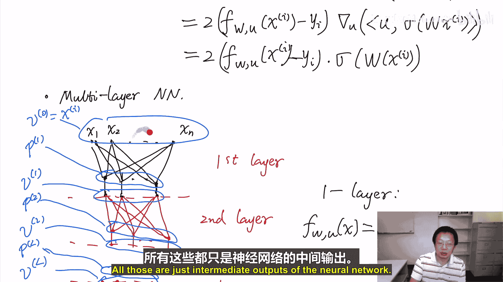

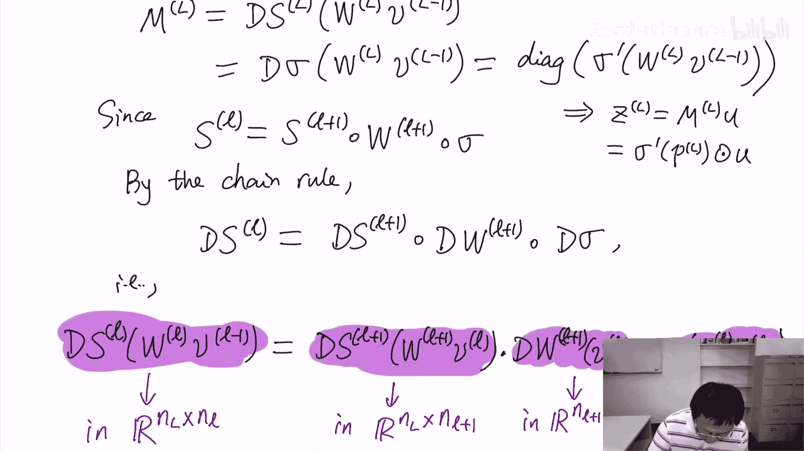

With the intermediate output of the neural network， we get the final output of the neural network。

It will be you in the product with them。V L。This is。The FW U X I。Now。

 I will use a letter to deote this number。 I call it a。

A is just the final output of this neural network。With A， we can。Obtain their gradient。First。

 the gradient with respect to you of M。Yes。Two times the F X I， which is a minus y r。Times V L。

The computation of the gradient WL。Of F I is more evolving。 Now we have B L-1。 We have all this。

We just needed to calculate this is the little L。Then we need a loop。

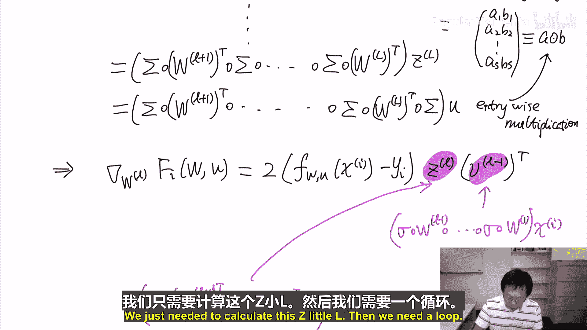

Because we wanted to use this recursive relation。4。L equals。Now this loop has to be backwarded。

We just use this formula for Z L。So this Z L。

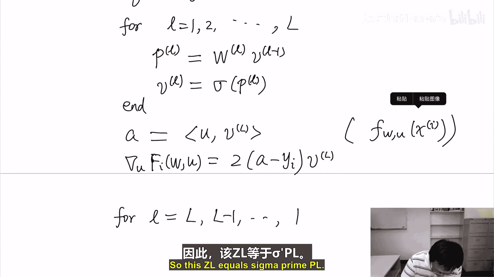

Of course。Sigma prime。P L。P， L is obtained here。Times。Entra West， much communication。W。系。Plus， one。

 the transpose。Times。The al。So we obtain the nito l。With the Ne to L， we can。Get this gradient。

It is just two times this。A minus white I。Times。ZL。Times v。Or minus1， the transpose。And。In this loop。

 we need the capital L plus1， W capital L plus1， we don't have them。

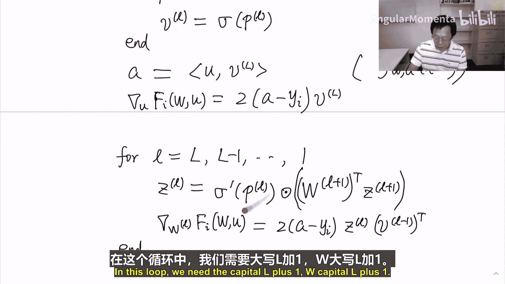

Therefore， I want to single this out。I want to set the capital L and gradient with respect to W capital L manually。

This is Z capital L。According to our formula， it is。

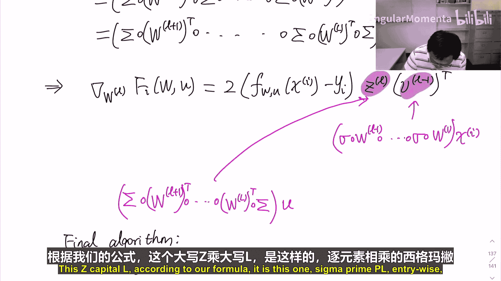

This one， Sigma I。pL。Entroice multiplied with you。And this， W， K L， F， I， W。

It is just two times a minus Yr。Times0。Times v。And or -1。The transpose。Therefore。

 this is a full algorithm to compute the gradient of FI in the training of the neural network。

And we notice that this can be separated into two parts。From here to。Here。For this part， actually。

 is a forward propagation step。 We start from the input and the first and layer second layer until。

The last layer， and the final output。So this is a forward propagation。

And for the parts starting from here to here。We start from layer L。

 and then we go back to obtain the gradient of W capital L。

 the gradient of W capital L minus1 and so on。So this is a backboard。Propagation。

Or back preparationation。This procedure to compute the gradient of F I in the training of a deep neural network is known as the back propagation。

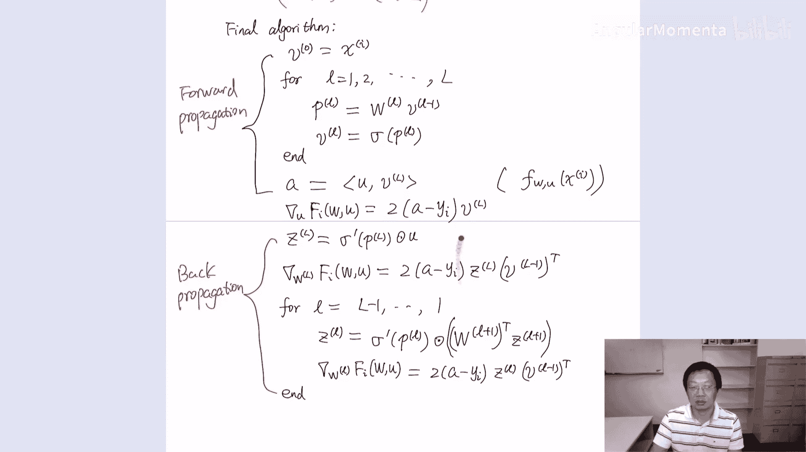