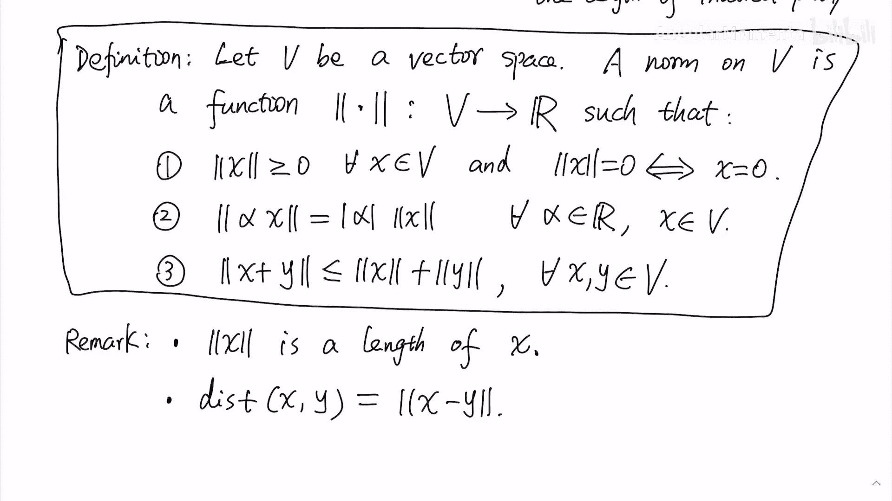
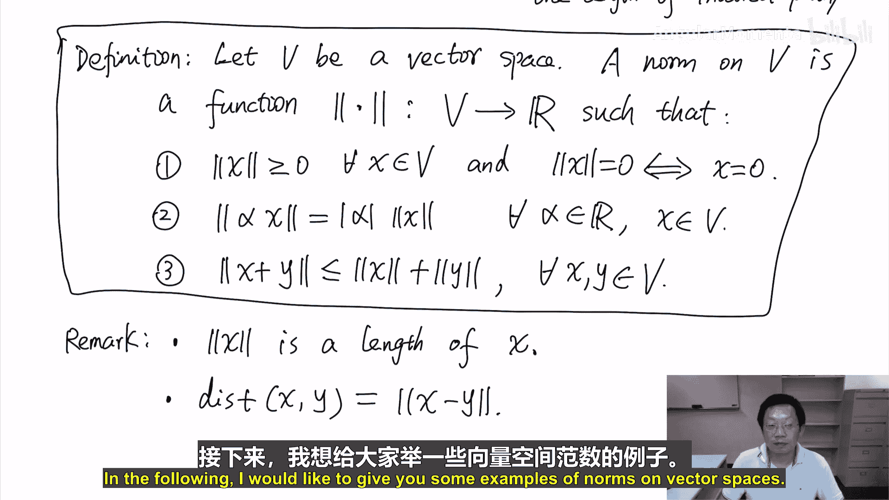
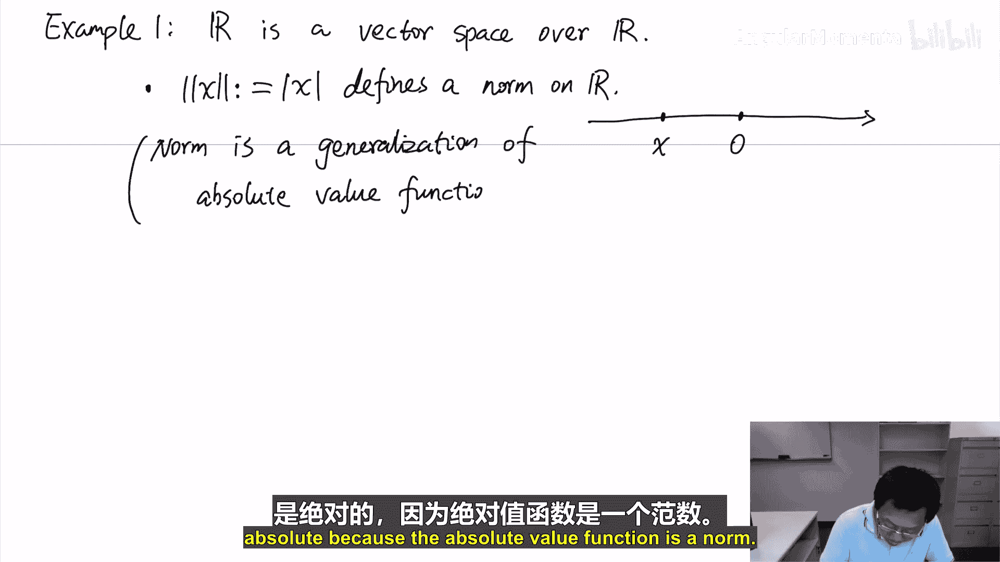
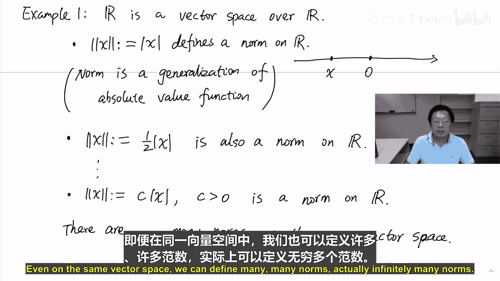
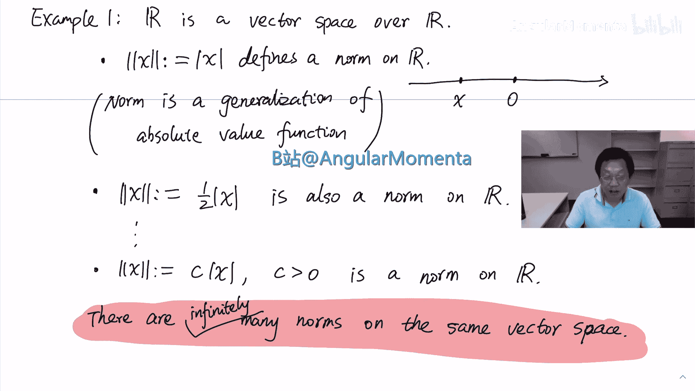
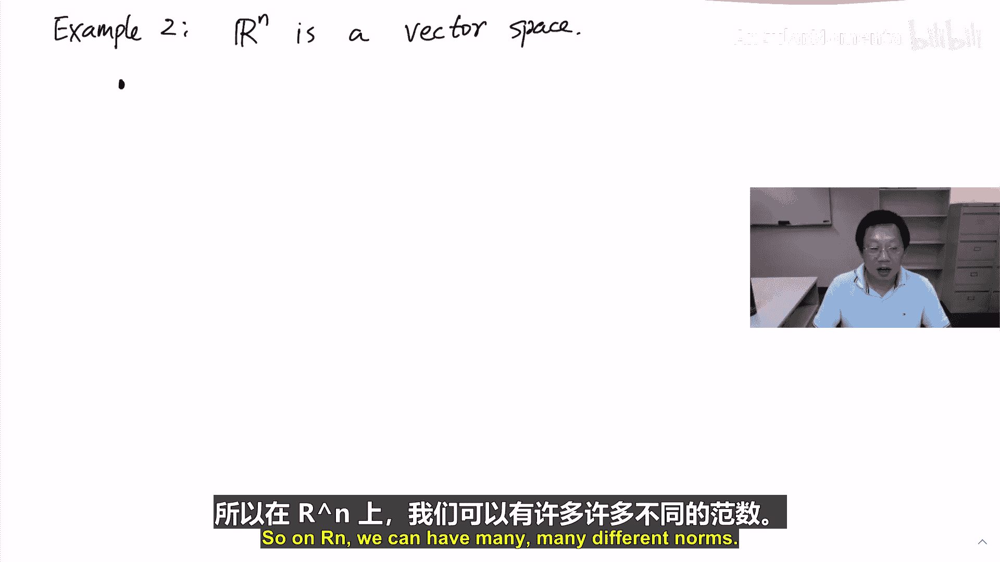
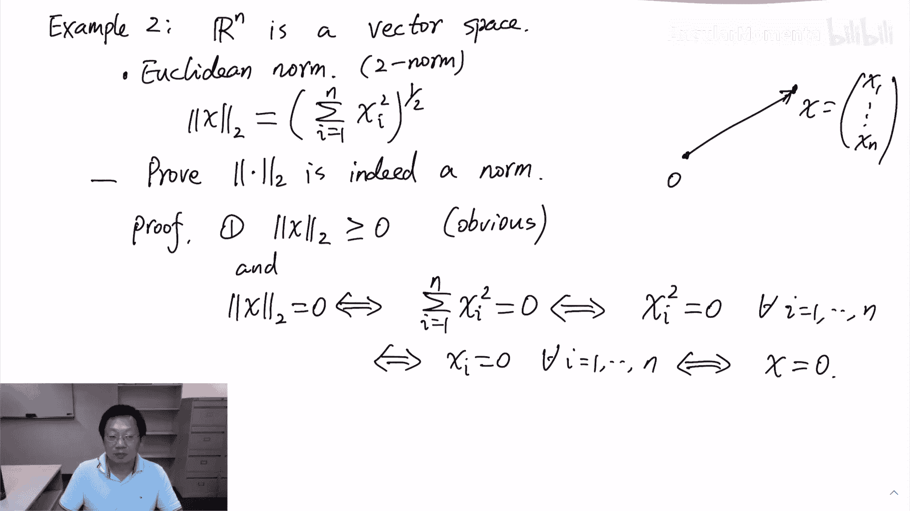
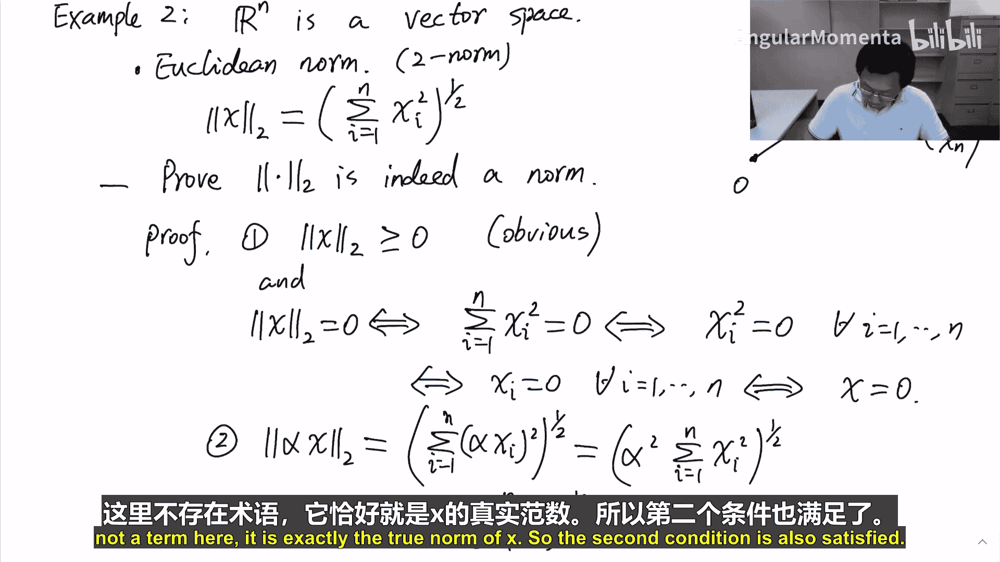
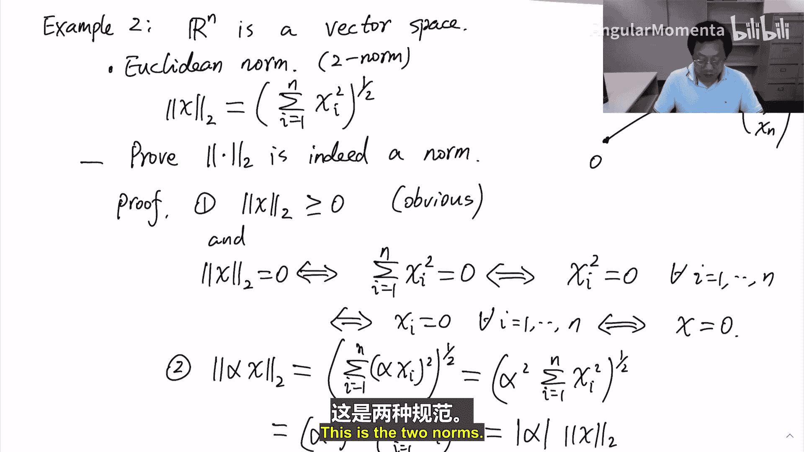

# 【香港科技大学】数据分析的数学方法 ｜ Mathematical Methods for Data Analysis p11 05-02-02-视频 -BV1DEFDzGEZW_p11-

In fully， I would like to give you some examples of norms on vector spaces。

Our example  one。Is on R。The set of real numbers， we know that this is a vector space。Over R。

 of course。Then we need to define。What is the norm on this R？As we haven't mentioned before。

 norm is only the length of x to the zero vector。If x is here， then what is the distance。

 What is the length of this。Of this X。Number X。It is just the absolute value。So， then。Re defy。

The norm。To be the absolute value of x。Indeed， you can check。 This is a norm on R。In this sense。

 norm is the generalization of Ab value functions。off。Absolute。

Because the absence of the value function is a norm。

 but this option the value function is not the only norm on R。 We can find out many other norms on R。

 For example， I can define a norm like this。N at the half of x。It's also a norm on R。

I can also do some other scanning。Where C is just a positive number is awesome。Norm on。

You can check this the N two facts very easily by using the definition of norms。

This also tells us that there are。Many。Norse。On the same vector space。Even on the same vector space。

 we can define many， many norms， actually infinite many norms。

Because here you can see our C can be choosing any positive number。This is very important for norm。

It is like to measure our word， we can use meter。We can use kilometers。 We can use millimeters。

 They all are metric in our world， right， so the NR， we can use the absolute value。

 We can use the half of the absolute value。 We can use C times the absolute value as metrics on R。

This is example 1， a very simple example。

You can example 2。We consider the R。The n dimensional Ekuadian space。It is a vector space。

As mentioned from example one， there are independentlyly many norms。On the same vector space。

 So on R N， we can have many， many different norms。

The first norm here is the Ukinadian norm。Because we have said that norm is the length of a vector x。

 So this is origin。This is a vector x， which is x1 to XM。In n dimensional euclan space。

Then what is the Ukinadian length of this vector。That is what's the Uuclinadian distance from zero to the end of this vector？

So this is easy， right， It is just the sum of the squares and then take the square root from the pythorra theorem。

Some of the squares。And then take the square root。We call it the Ukinian norm。

 usually we add a small subscript to here because this is also known as the two norm。

Because we use the square here and then take the square root。The power here is2。

 we also call this norm a two norm。The Ukkuadian length of this vector by pythor theorem is just the sum of the squares and then take the square root。

Now， I want to check。This。Is， indeed。Unorm。So let me prove it， prove it。

So we first check this tool norm。Of course， it's larger than zero obvious。

Because squares are not negative。Square root。Is also non negative and。If this。Equals to0。

 then we should have that sigma of i from1 to an Xi squared equals to0。So this just means that。

Because the terms in this summation are all non negative。 Their summation is， is 0。

 so that each term。It is just a zero for all I。So this just means that X I equals to 0 for O I。

So this is the same as x is the zero vector。Now we have approved that。

0 vector is the only vector with norm 0。

They're the second。We need to check the screeninging property。Now we consider alpha x the2 norm。This。

You can see it is just the sigma of this alpha X， I squared。I from one to n。

 and then take the square root。By definition of this two norm。So of course。

 this is just alpha squared Sigma i from 1 to an X I squared and then take the square root。

This is further alpha squared square roots。And sigma I from one to n。X， I squared and square root。

This is just。No， you should be careful when we take the square root of alpha squared。

We should obtain the absolute value of x of alpha， instead of alpha。And this latter term here。

 it is exactly the two normal of。

So the second condition is also satisfieding。Now， the third one。The triangle inequality。

Not easy to check。 Not too easy。To check。Do it later。

So we will do it when we introduce a new tool called the innerner product to prove this third inequality。

The triangle inequality here。So from this three。We have seen that indeed。

 this Ukinian law satisfies the one these three conditions。In the definition of a norm。

So this eucanadian norm or the two norm defined in this way， is indeed a norm。Actually。

 we used it in the Euclideian spaces。This is the tu norm。

