# 【香港科技大学】数据分析的数学方法 ｜ Mathematical Methods for Data Analysis p12 05-03-02-视频 -BV1DEFDzGEZW_p12-

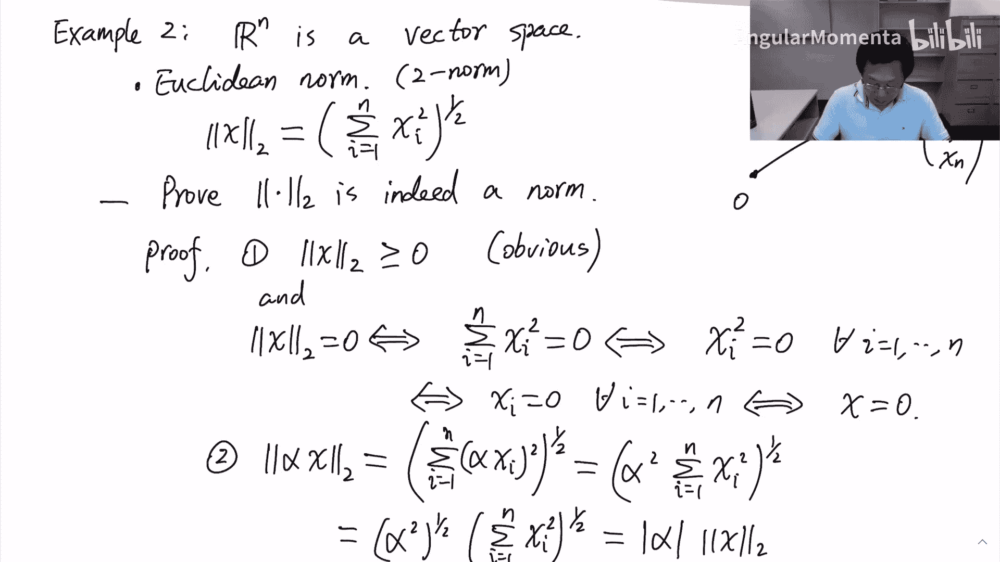

We can also define the one norm。Of R， N。Of vectors on R N。It is just the define in this way， X。

One norm， we define it to be。Sigma of I from1 to n。Just change this power。This。Power2 to power one。

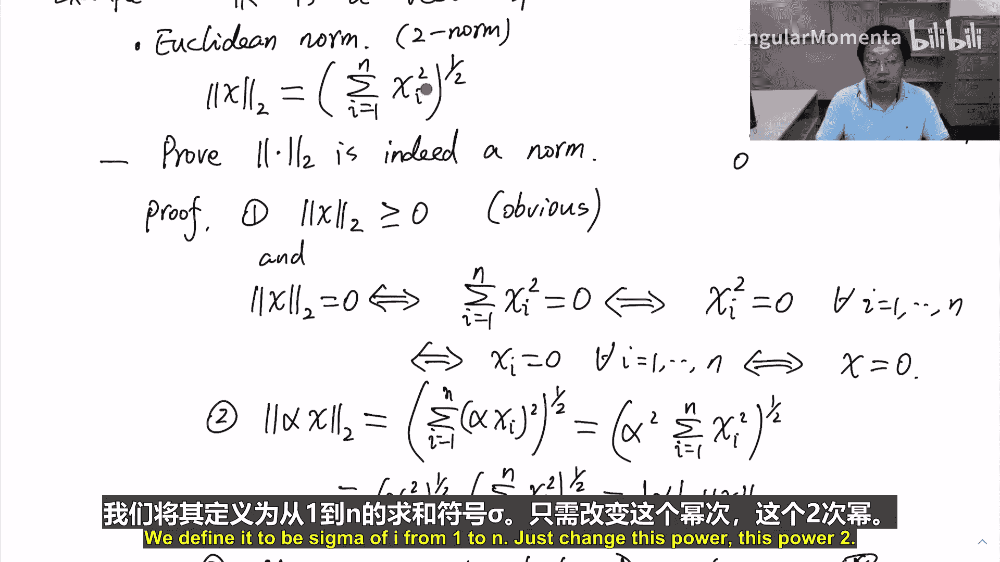

Then it is just a this。But we need to take the absolute value first。

So this is the definition of one norm， of course， for any x。In the form X 1，2， X N。So again。

 let me check。This， indeed。Is a norm on R。This is relatively easier actually， so let me do it。Proof。

The first condition is the negativity， which is very obvious。

Because the absolute values are non negative。And。If this one norm equals to zero。

Then we just have that salvation。Of absolute values is0。Then。

You see each term will be zero because this is a sum of non negative numbers。

 but their sum is just zero。Then each term should be zero。For all， I。

Since the absolute value is zero， of course。This Xi is also zero for all i from1 to end。

This is exactly x is the zero vector。Easy。Second condition， the scanning。Apha x， the one norm。

This it is just the sigma of I from1 to n。Apha X， I。The absolute value。 So this is， of course。

 the absolute value times sigma from one to I from one to n。Xi。Wei。

Can easily see that this is exactly alpha times that。One norm of x。Third condition。

We need to check this。Triangle inequ quantity。Then。By definition。

 this is just a summation of I from one to n。です。Absolutes of values。Of X， I plus Y， I。

From here to here， we use the definition of vector addition。And the definition of this one norm。

Then for each term， for each term。The absolute value of X I plus Y， I， we know that's the。

The absolute value function satisfy the triangle E quantity。

 So this is just smaller than equals to I from1 to M。X， I plus Y， I。

The absolute value of Xi plus the absolute value of Yi。This is exactly the same as。

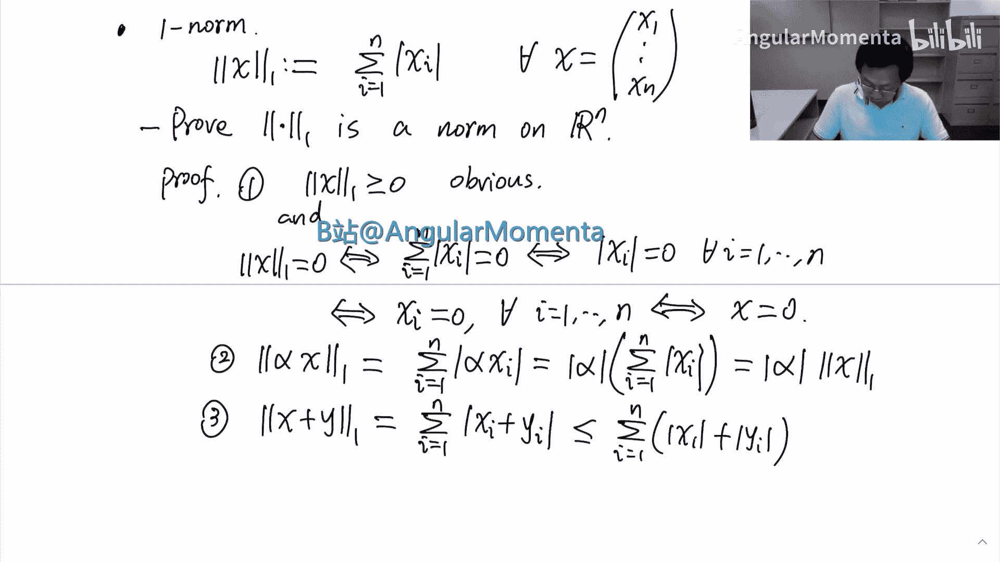

And对。Waii。right， so this is exactly the same as。1 norm of x plus one norm of y。So。

 we finished the proof。We see that this one norm defined in this way。

 the summation of the absolute value of the entries。

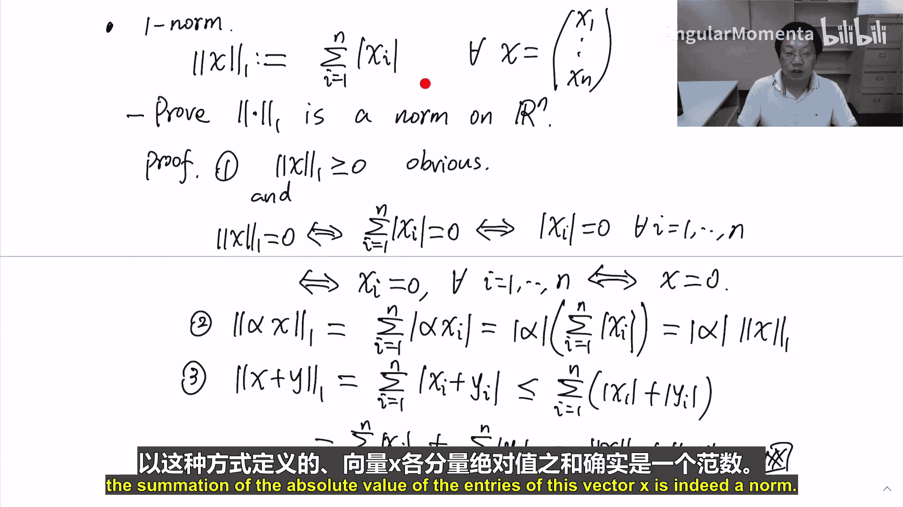

Of this vector X is indeed a norm。 Actually， there are many different norms of vectors on R。

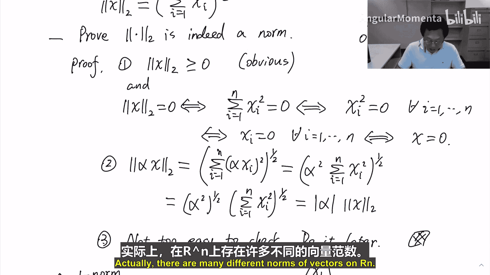

In general， we can define the P norm indeed。

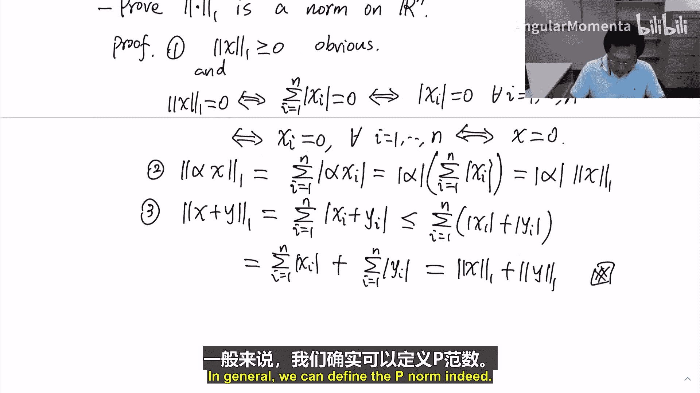

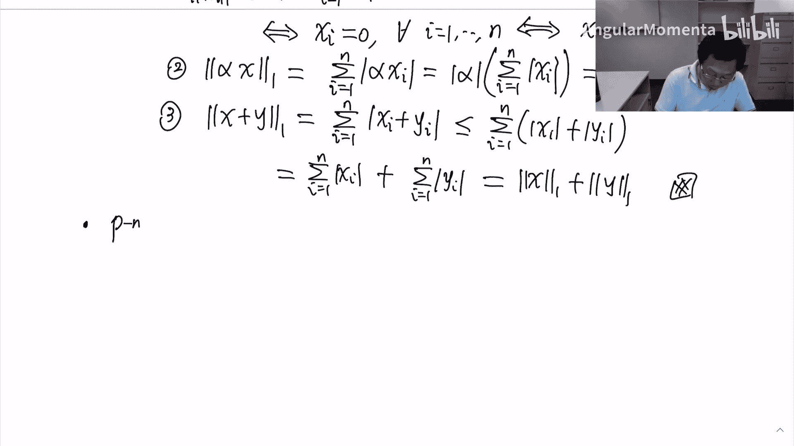

This P norm is just defined by replacing。

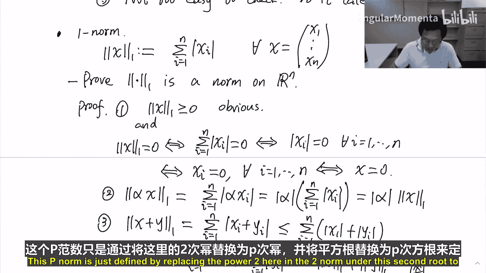

The power two here。In the two norm。And this second route to the P route。

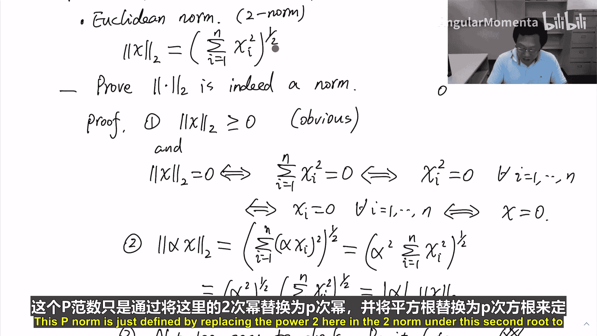

It is。Defining in this way。Sigigma of I from one to n。The absence value of X to the P power。And then。

 take the P route。For P larger than all equals to one。So we have a requirement。On this P。

P has to be nar than all equals to1。

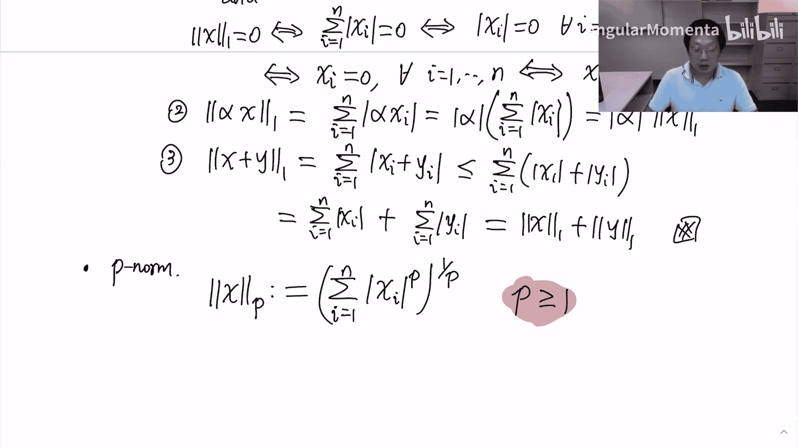

Then the spin norm is。A norm。On this R N。IfP larger than or equals to one。Of course， for any P。

 for any positive number P。You can define this P， but only if this P larger than or equals to one。

 this is a norm。This should be if and only if， actually。So this is called a P norm。

So if we take p equals to1， we just get the one norm。If P equals 22， we just obtain the two norm。

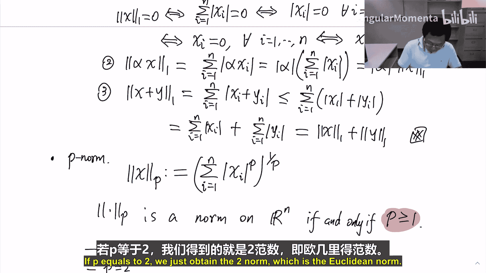

I wish it the you Canadian one。You can take P equals to any number。P larger than all equals to  one。

A just any P larger than or equals to1。You get a norm。 This P is not necessary。

 An integer can be a fraction number can be。Can be pi。Any any number， it is just a norm。

 as long as P is larger than all equals to one。Integer or non integer。

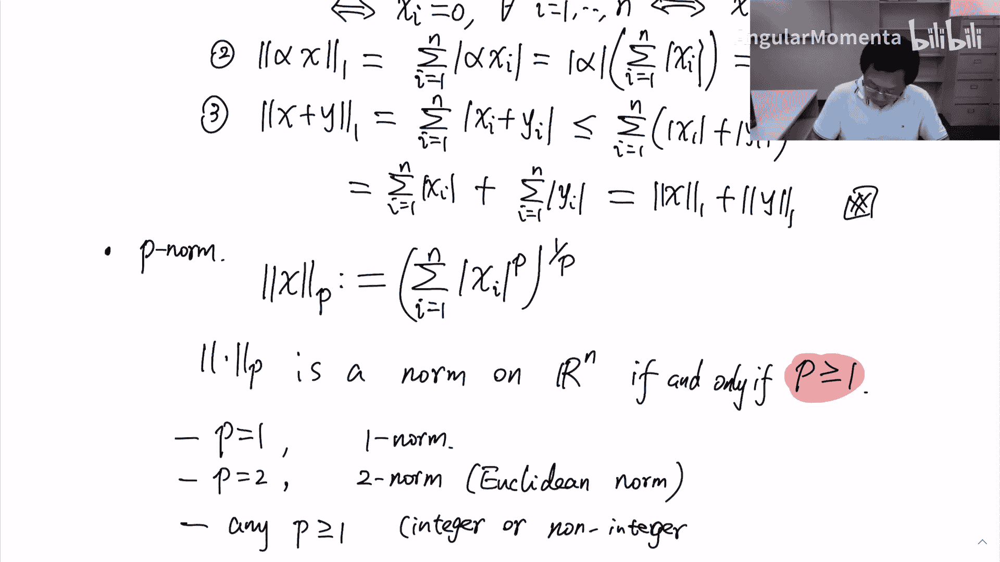

We just created the gene norm。

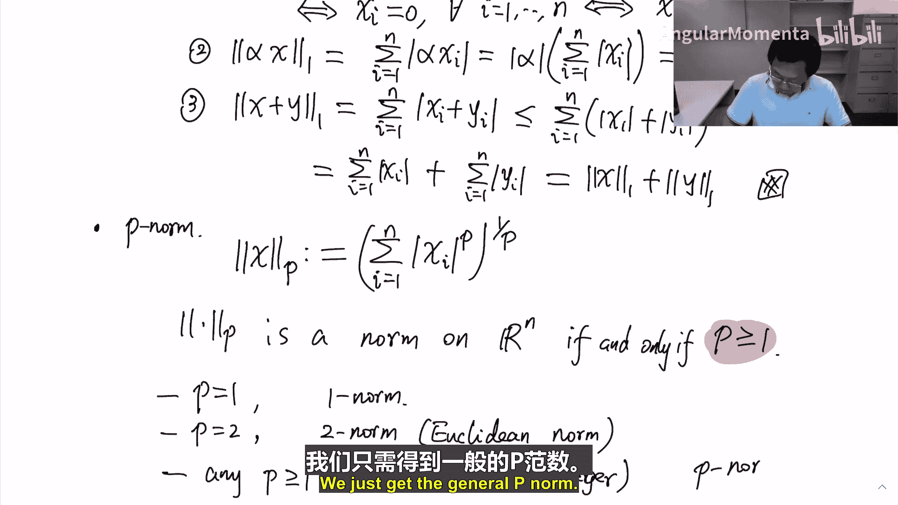

We can even do a very interesting thing。 That is， we。Seet。This P goes to。Infinity。What will happen。

Indeed， when P goes to infinity， it is also a norm。You can check that when P goes to infinity。

This limit。We can check。This for any x in R N。This。XP norm。I said we said she goes to infinity。

If we set this P goes to nefinity， what will happen？Actually。

 the largest entry in X in magnitude will dominate this sum because P goes through u。

And when you take that。Pe root。P is very large because now only this largest term dominant this sum。

 When you take the P through， actually， you will get the maximal。

Entry of this x in in magnitude in absolute value。this you can check。

 this is indeed the max of this Xi。I from one two。The maximal absence value entries of x。

This is the limit。So for this reason， we define， so we define。

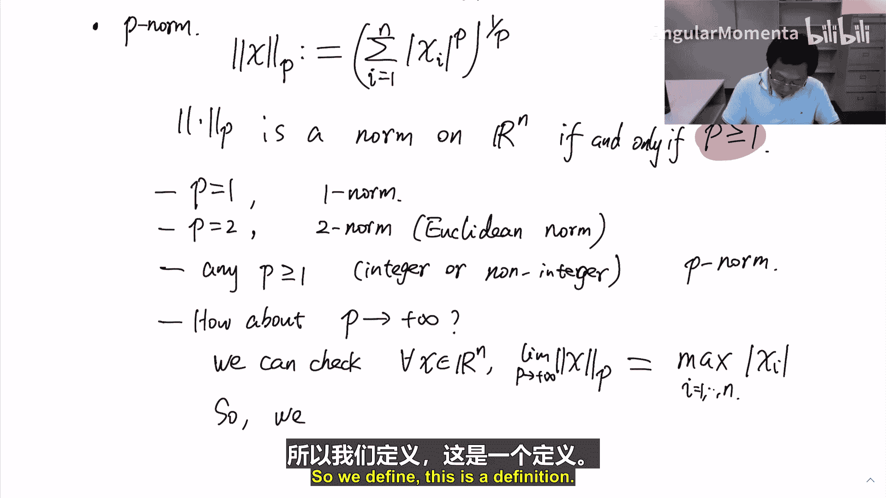

This is a definition we just define the infinity norm。

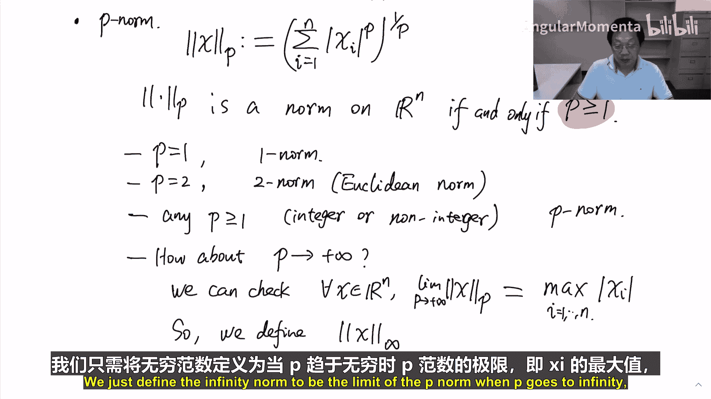

To be the limit of the p norm when P equal goes to infinity。Even max。Of X， I。I from one to n。

So we can get at this。She goes to infinity， we get this one。

You can also easily check that it's a norm。It is indeed a norm on R N。

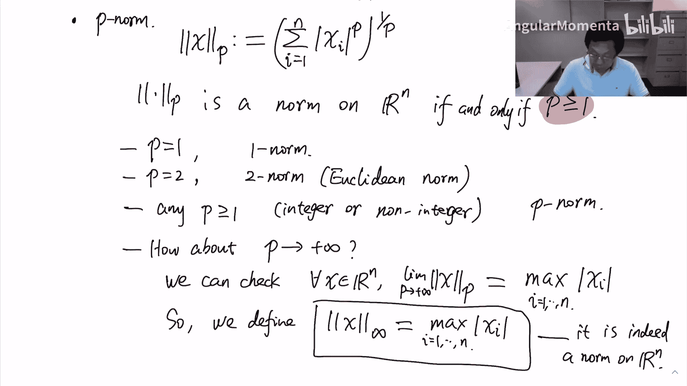

So this is the P norm。