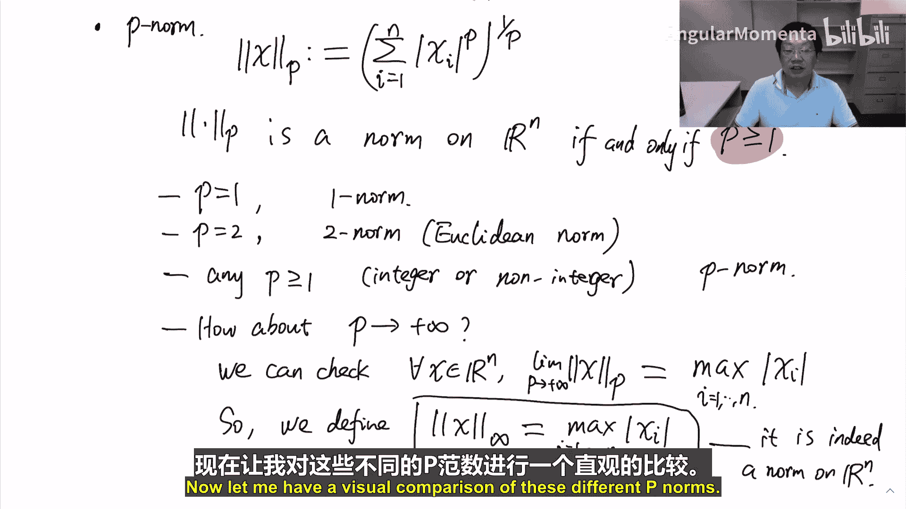
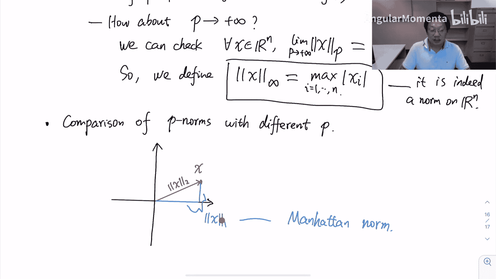
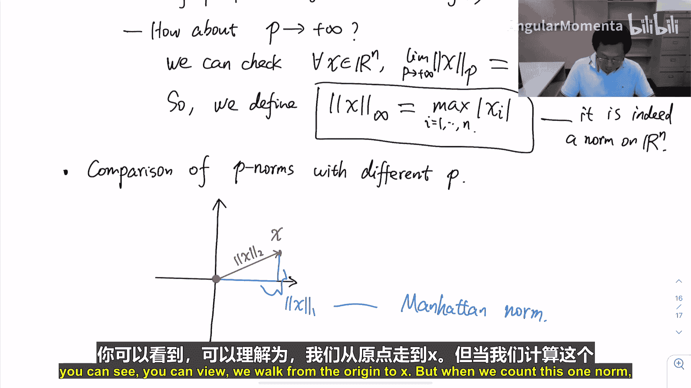
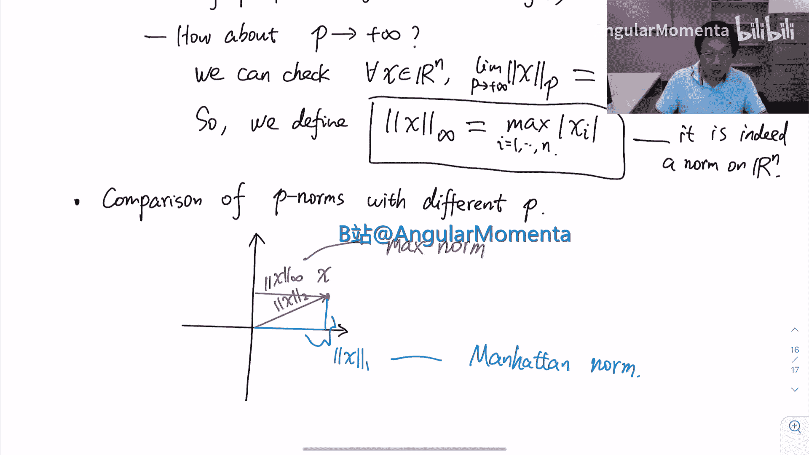
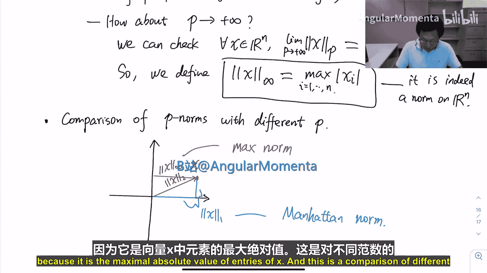
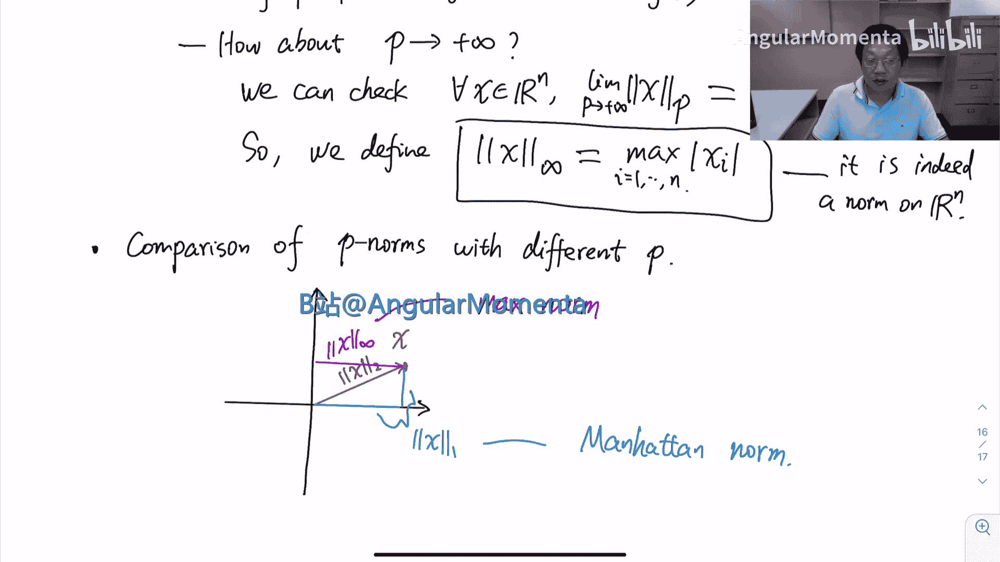
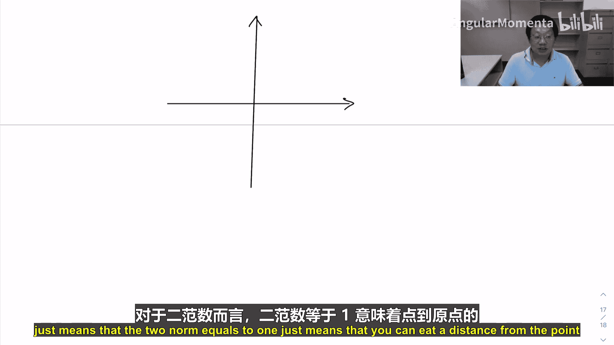
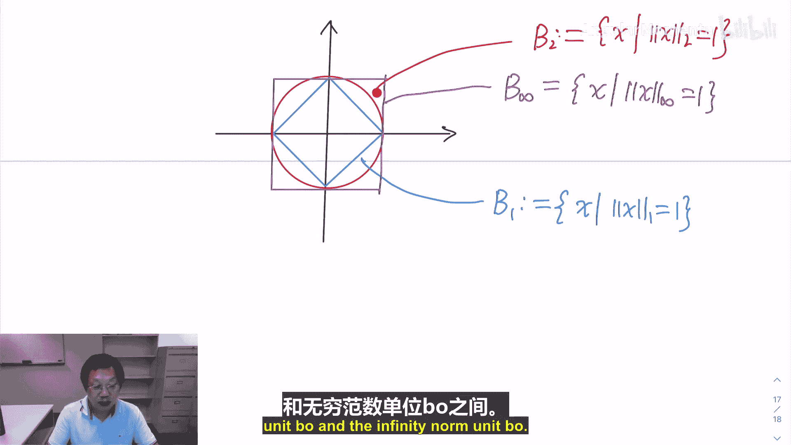
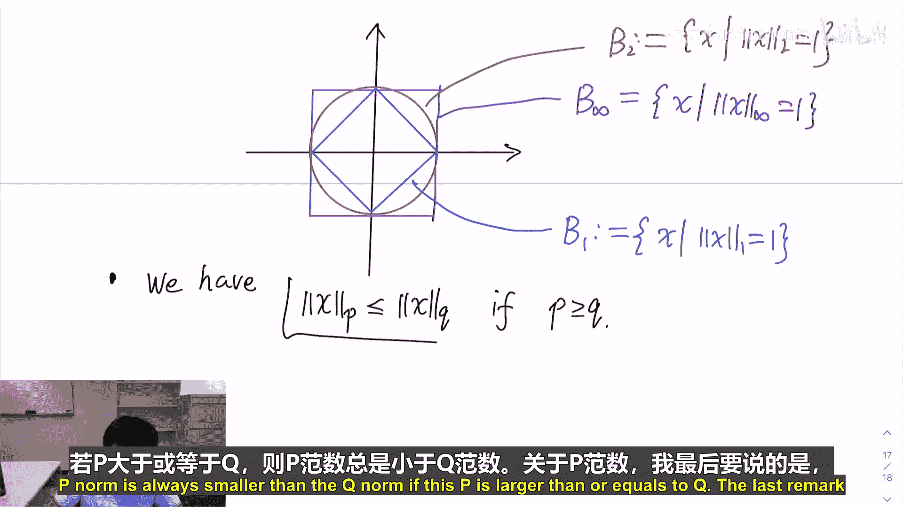
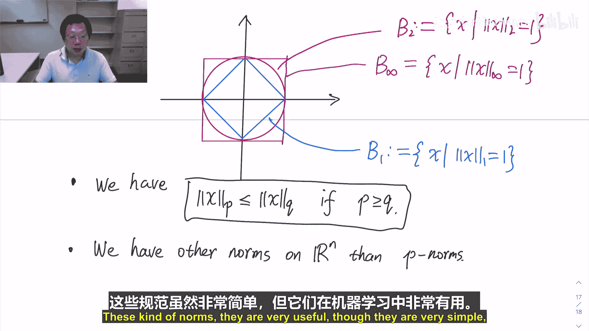

# 【香港科技大学】数据分析的数学方法 ｜ Mathematical Methods for Data Analysis p13 05-04-02-视频 -BV1DEFDzGEZW_p13-

Now let me have a visual comparison of these different P norms。

Comparacy。off。P norms。With different P。Let me just。Give you this。And this are two。In this article。

 now， I have an X here。They see the x vector。Now， obviously， this length。The length of this。Red line。

 It is just the。Euck Canadianadian norm， which is the two norm， so this is just the two norm。I mean。

 this length is just。The two normal opts。What is the one norm。

The one norm is the absence value of x1 plus the absence value of x2。So you can see it is just the。

This。Class this。So this the sum of the length of this two blue one is2。Together。

 it is just the one norm。Of x。So for this reason， this is also called the Manhattan。Norm。

Because won't we。か calculateれ。Computing this one norm。

You can see you can view we work from the origin to X。

But when we count this one norm， we can go only。Go either horizontally or vertically。

It's like you work in Manhattan。Because the street。Is either？Horizontal or vertical。

 So you can only go from the origin to x， either。Horizontally， or vertically。

Then the total distance you have traveled from the origin to x is the one norm。

So that's why this one norm is also known as the Manhattan norm。T norm is just known as that。

You Canadian norm。And for the infinity norm， it is only the， you know。

It is only the largest coordinate。Of this X。 So obviously， this coordinate is larger， so thats。This。

Purple1 is the infinity one。So for the infinity norm， we have also known that it's the maximal。

Of the absence value of entries in x。So for this reason， the infinity norm is also known as the max。

Because it is the maximumimal absolute value of entries of x。

And this is a comparison of different norms。

Youmission learning。Sometimes we may also interested in them。In the unique boss of the。Of。

 of different norms。Let me。Give you that。Comparison here。Of unit boss。Of p norms。

Un need bomb is that set。Such that the norm is one。Accordingly， the system。So for the two norm。

 let's consider this。So for the two norm just means that the two norm equals to one just means that you can eat a distance from the point to the origin is one。

So this is just a circle， a very round circle。So this C is a eigzate。The two normal unitsable。

Just this， I call it B2。Which is just the。The set of all X。Suchly that is two norm equals to one。

 So this is a two norm unit ball。And the one normal unit ball， what is that one？You can。Action。

 you will see。 It is just this。This one。Is blue lie？This four nine segmented together is。Square。

 right， it's a rotated square。Okay， this rotated square actually， it is the。One normal unit pool。

The one norm equals to one， the set of all vectors whose one norm is one is a rotated square。

In high dimensional， it is just a polyhedral。And for this infinity norm。Actually， it's。

It is just a square。Yeah， this purple square。This is the beef infin， the infinity。B。

 unit pool just means that the infinity norm。Equals to one。

 the maximum coordinate is one right in absolute value， of course。

So this is a comparison of different norms。Now， how about other P。

If P is smaller than in between one and2， it will be in between the one norm units ball and the two norm units bo。

 If P is larger than2， it is just。In between the two norm unitspo and the infinity norm unitspo。

And also， we have a very nice property。P norm。Is always smaller than the Q norm。If。

This p is larger than all equals to  Q。

The last remark I would like to see about P norm is that。We have other norms。On R， N。Then， Shior。

We not only have these P norms， but also some other family of norms。

So the set of all possible norms are really very， very。Ber。Besides P norm， we can have other norms。

Actually， all these are three norms， they have numerous applications in machine learning。For example。

 in this so called NAau， we use the one norm regularization。These kind of norms。

 they are very useful， though they are very simple， they are very useful in machine learning。

