# 【香港科技大学】数据分析的数学方法 ｜ Mathematical Methods for Data Analysis p15 05-06-02-视频 -BV1DEFDzGEZW_p15-

There is another way to define matrix norm。From linear algebra。

 we know that M by n matrices can be viewed as a linear transform from RN to RM。Therefore。

These are M by N can be。没的。As linear transforms。From R N to RM。In other words， if we have a matrix。

Of size。M by N。Then， it can be identified。To an linear transform。Still denoted by a。That transforms。

A vectors in n dimensional ek Canadianadian space to vectors in R M。According to this understanding。

 we can define matrix norms。We just define。Matrix。Por。In this way。Would you find the P norm of a。

This is a definition。To be。The ratio。Of。The image， the no p norm of the image。

And the p norm of the domain。Of course， there are many access。 So then we just。Take the maximum one。

Of course， in this definition， because the norm of P appears in the。Gorator。So this x cannot be 0。

This is just the definition， of course， oxygen。And。This is the definition。And for this definition。

 actually， we can further simplify it， we can prove。That this is equivalent to。The max。off。AX。

TheP norm。And we restrict x with a fixed pen norm。The p norm equals to one。

This is the definition of the matrix P norm。You can see in this definition。

 we view this a as a linear transform。 Then we just use the ratio of the。

APP norm of the image over the p norm of the domain。And then we take the maximum one。This is the por。

To understand this， let's take a look at when P equals to 2。

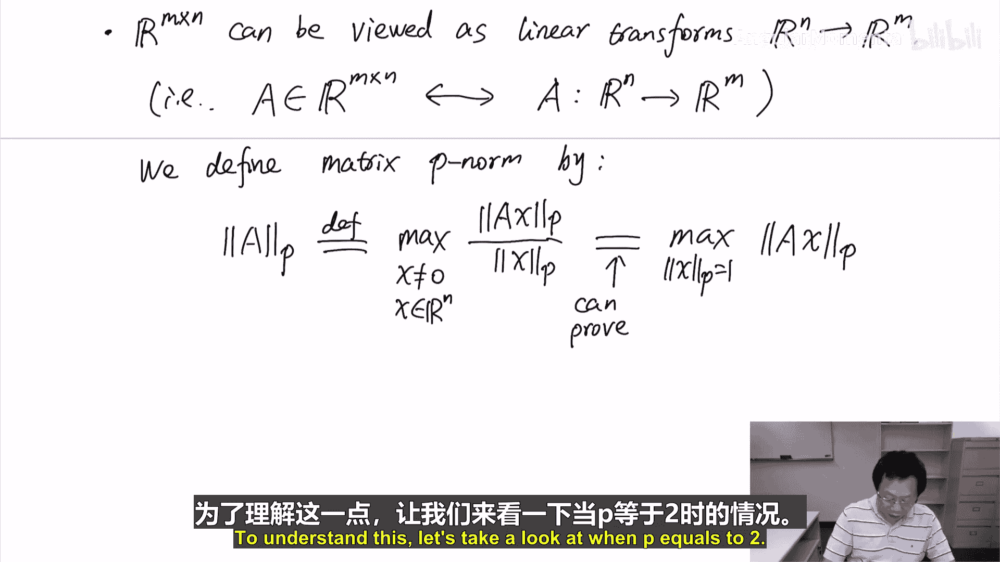

1 p equals to2。Let's see， we I will use this formula。2。Visionize the P norm of a。

Then we needed to consider this。Doomain of x。This is what is a P norm units for。When P equals to 2。

 it is just the B2， the two norm unitable。We have seen that the p norm unitable in RN is a sphere。

So this is R N， and we have the P two norm unit ball， which I call it B2。Which is just O X in R N。

So I should that's。Is too normal。Equals to one。This is B2。Then we do a linear transform。

 We consider the image of this B2 under the linear transform。Because a is an linear transform。

It will keep the straight lines， a straight line。Under afternoon transformation。

 it is still straight。SoW whichch means that a sphere will be transformed in general to an eipse。

To an eipoid。Therefore， the image of this B2 under the linear transform a。It just looks like this。

This is， of course， in R M。Then according to the definition。

 we just take the maximumim two norm on this image。From this picture， obviously the maximum two norm。

Happens at this point。So this point has the largest two norm on the image。 so that this length。

The length of this longest axis of this eipoid。It is just the two normal of。

this is a visualization of that matrix2 norm。

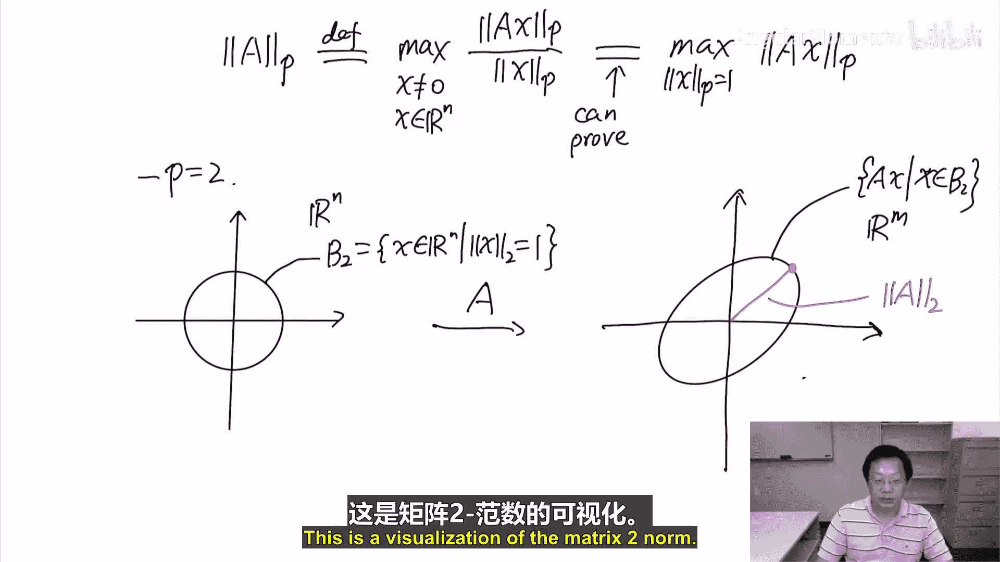

When p equals to1。We can do similar things。We first draw the one Nor unitable。

It is a rotated square as we have seen before。Which is， of course， a special case of a polyheedral。

In R， N。 So this is B1。In R N。Which is O X such that the one norm equals to1。

Then we apply the linear transform a to this。B1， then we get an image。

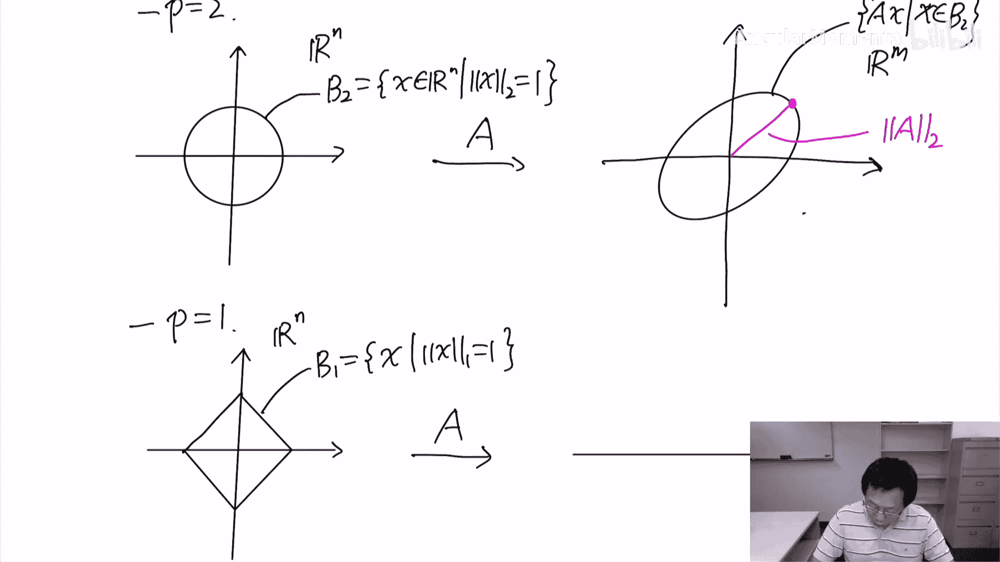

This image is still a polyhydral because linear transform keeps straight lines。

So that it may looks like。Now that this is the image。Of this one dorm unit ball。InRM。

Then we just look at all points on this image and find the one with the largest one norm。

For this example， you can see the largest one norm happens here。

So then the one norm of this point will be the one norm of the matrix。It's just。

So these two red lines together。It is just the one norm。Okay。This is a visualization of that。

Mattrix 1 norm。

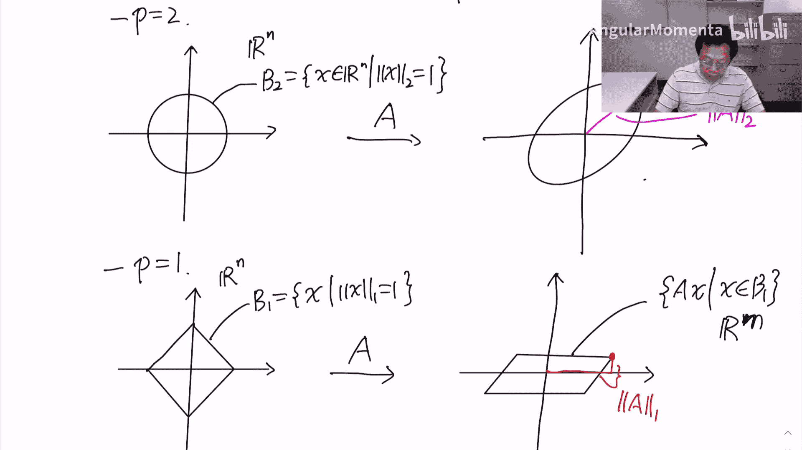

For the infinity norm， you can do similar things。

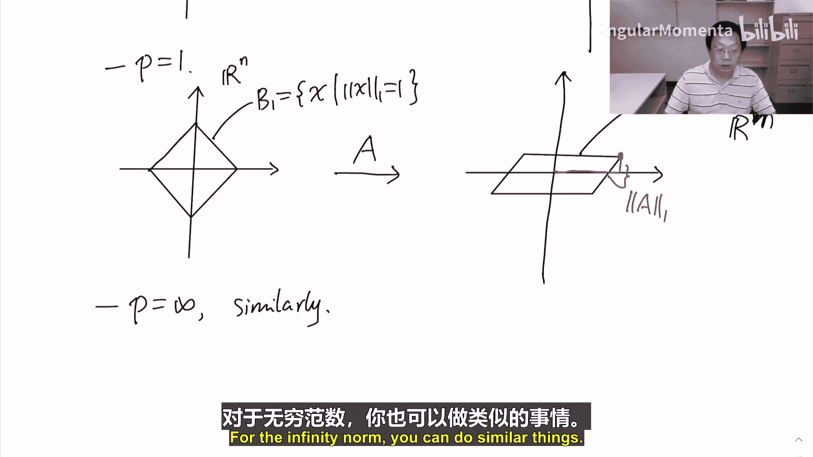

If you are interested in that， you can do it by yourself。

There are also many analytical results for matrix P norms， when p equals to 2。

You can see thats the matrix。Two norm equals to the max。Of x 2 norm。Equals to one。This Ax2 norm。

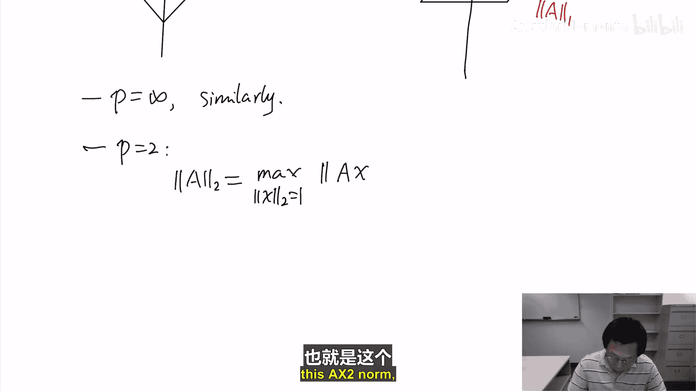

Which is the same as。The A2 norms squared equals to the max。

Of x 2 norm equals to one of this Ax 2 norm squared。

 because the square function is monotonically increasing。

So the maximal of a function is the same as the maximal of the square of the function。

Then this is just。If we transfer， transfer this to。In the products。

 this is just A X X transpose a transpose A X。If you are very familiar with linear algebrabra。

 you can you know， you must know this。This is exactly a variational form for the maximum eigenvalue of this a trans a matrix。

So， this is the max。Een value。Of a transpo a。Therefore。

 we just have that is two norm of a equals to the。Max eenvalue。好。A transpose a。And then。

 take the square root。Which is also known as。The maxim singular。Value。我。诶。

This is the analytical form for the two one。

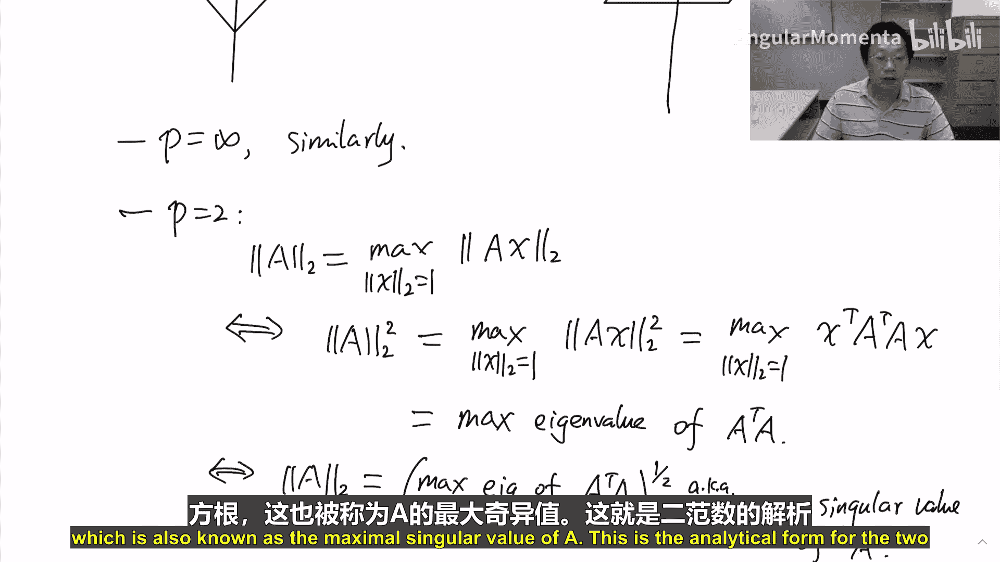

The matrix2 norm is also。Card。The operator norm。好肥。In many textbook， like in Newmer Indian algebra。

 this two norm will be the default norm in RM by N。One p equals to1。

We have also an analytical form for the matrix 1 norm。

You can prove that it is just the max J from one to n。Sigma I from1 to M A the absolute value of AIJ。

From this exploration。You can see that。This part， it is just the one norm of the J column of this matrix。

And we have many columns。 so then we take the maximal one norm of columns。

So that this one norm is the。まくしも。可能。One norms。YouFor a given matrix。

 you just take the one norm of each column of that matrix， and then you get the maximum one。

That one is actually the matrix 11。For the P equals to infinity。This infin norm。

It's very similar to the one norm。But we need to switch this I and J I from1 to M。

 sigma J from one to N， AI J。In this case， we just take the one norm of each row and then take the maximum one norm。

Then you will at the infinity norm。 So this infinity norm is just the max。Zo， norm。1 dorms。

Given a matrix， you take the one norm of each round vector， and then you obtain maximum one norm。

 You will obtain a matrix infinity norm。

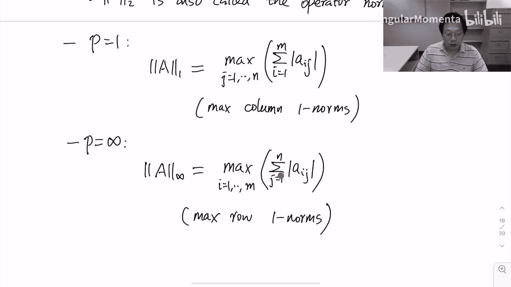

Actually these matrix of p norms are very widely used。In not only machine learning。

 but also in many other situations。The default norm of a matrix， when we say a norm of a matrix。

 usually we just referred to。That matrix to norm of that matrix。对。Defat。Norm。Of a matrix。I。

Matrix2 norm。We have some other norms。We can。系。Other。Matrix norms。For example。In the definition。

 in this definition。

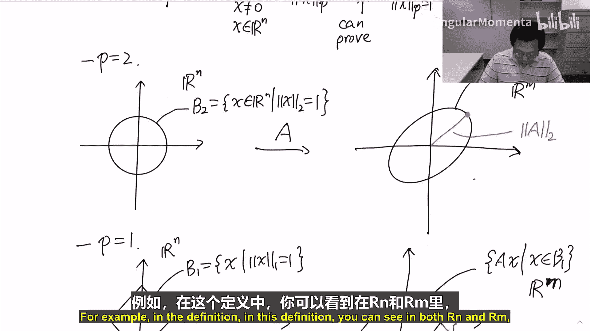

You can see in both R N and RM， we use the two norm Here we use the two norm unit ball。

Here we find the maximum two norm on this image of the unit2 norm unit ball。

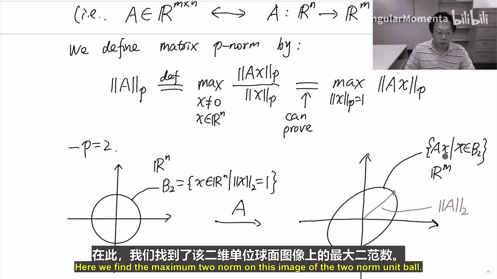

When P equals to one in R N， we used the one norm in R N， we also used the one norm。

 both the domain and the image。 we used the same P norm。When we define that。

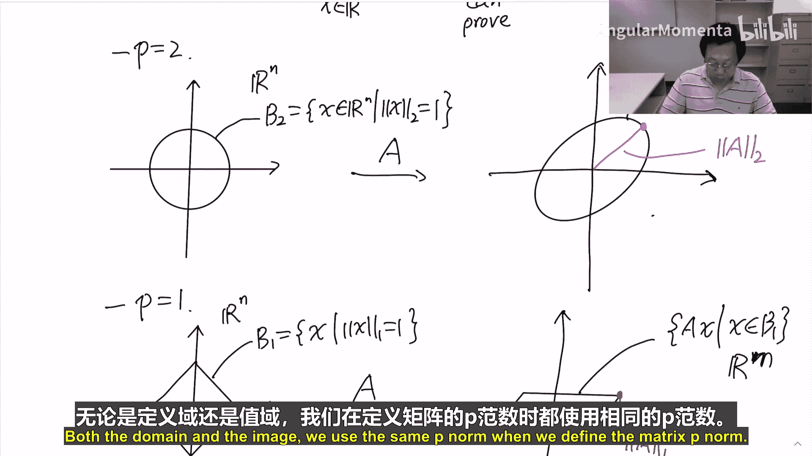

Matrix P more。Actually， in RN and RM， we can use different norms。We can use。Differenterent norms。

In RN and RN。Because when we define the P norm， like the infinian norm。Both this and this。

 we use the。因费米诺。Both this and this used the P norm we just used the same norm for both the domain and the image。

But we can use a different norm。For example， we can use。皮农。InRRN。And we may use a Q norm。ERM。

Then in this case， we just get a new。Matrix norm。It is just the max。

I will call it because we are from R N to RM in R N， we use the P norm in RM， we use the Q norm。

 So maybe I use a P to Q。This to be。In the。Doomain， we use the P norm。

 So we consider the P norm unitable。But for the image， we use the Q normal。

You can see we use the different norms in the domain and the image。

So then we get different matrix norms。Actually， all these norms are very， very useful。

In machine learning， sometimes we need to find out a low rank matrix。For lower rank matrices。

If the factor has some special structure， we may use this kind of。Mixて。P Q norm。

To solve our machine learning tasks。

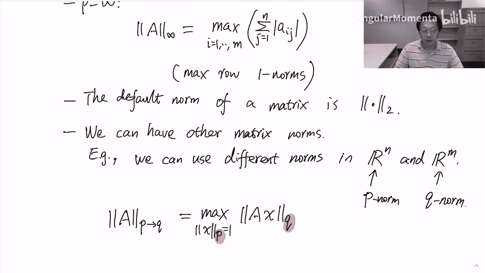

Any summary。For matrices， we can first view matrixes the very long vector so that we can apply vector p norm to obtain the。

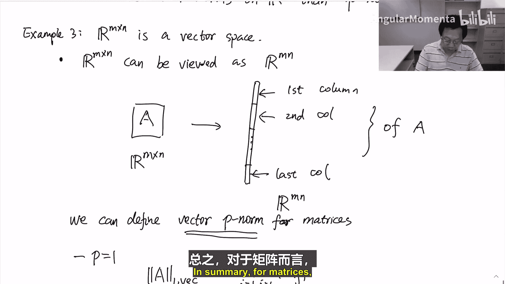

Vectctor penome for matrices。

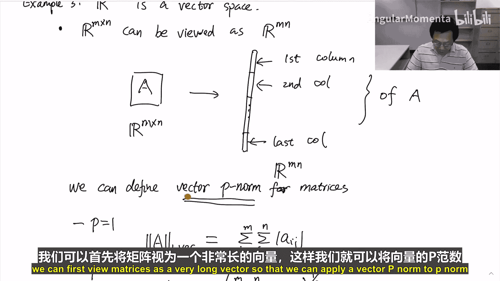

Or these magrices can be viewed as linear transforms。Then we can define the matrix of P norm。

 or even we can define the matrix mixed P Q norm。

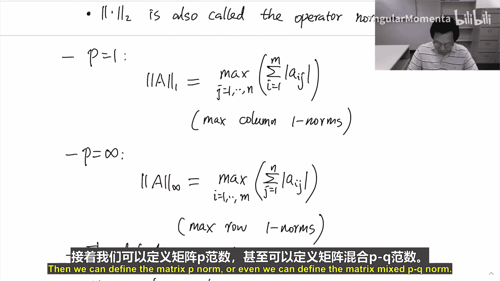

You may wonder do we have some other definition of the matrix norms， indeed we can。

This is the third of the class we can。Define。Other。Matrix。Norms。For example， the nuclear norm。

So you use a star here。I will not give you the definition of the nuclear norm because it involves too many。

 too much mathematics， but I'd say that this nuclear norm is very， very useful in machine learning。

 especially when we deal with some low rank。Matrixs related the problems。

If we use convex of transition， then we usually just minimize this nuclear norm。

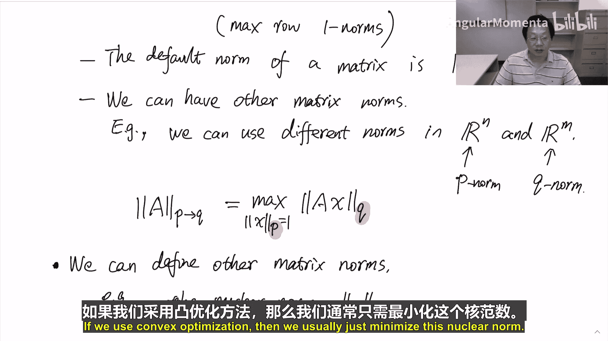