# 【香港科技大学】数据分析的数学方法 ｜ Mathematical Methods for Data Analysis p16 05-07-02-视频 -BV1DEFDzGEZW_p16-

Let me give more examples of norms on vector spaces。 The previous three examples。

 they are all on discrete object。

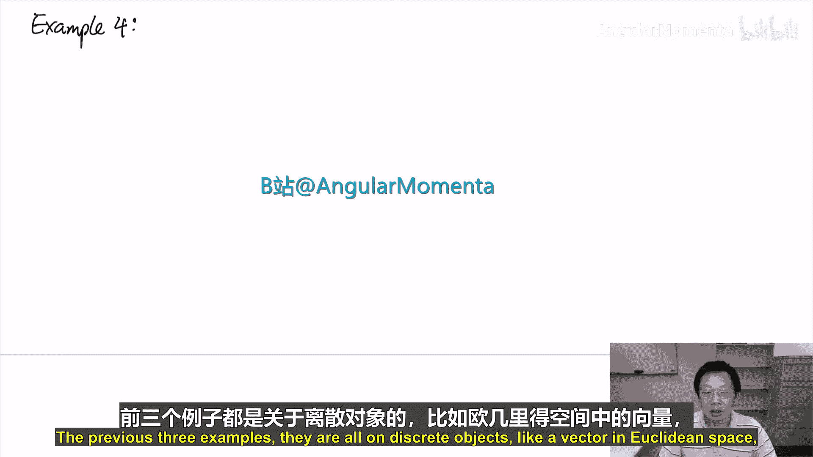

Like。Vector in Uk Canadian space， like matrices。Actually， the norms can also be applied to。

Function spaces。Let's consider the continuous function space。C a b。Which is， by definition。

 F is a continuous。Function。On the closed interval from A to B。

This set with addition and scale of identificationplication， we have shown that it is a vector space。

We can define a norm on it for any f。In this set， in this vector space。We can define a norm。

We call it the infinity norm。It is the maximo。Function value of this function。

Maximum of the absolute value of F T over O O T in A B。You can check。Indeed。

This infinity norm is a norm。M C A B。So this is one example of norms for functions。

Now with this norm。We can compare the closeness of two functions。

 two continuous functions in CAAP P then。For any F and G in CA AB。The distance。Can be。Define the by。

I just let this F minus G the evenfin norm。To be the distance between F and the G。Then by definition。

 it's just the max of this F T minus G of T。

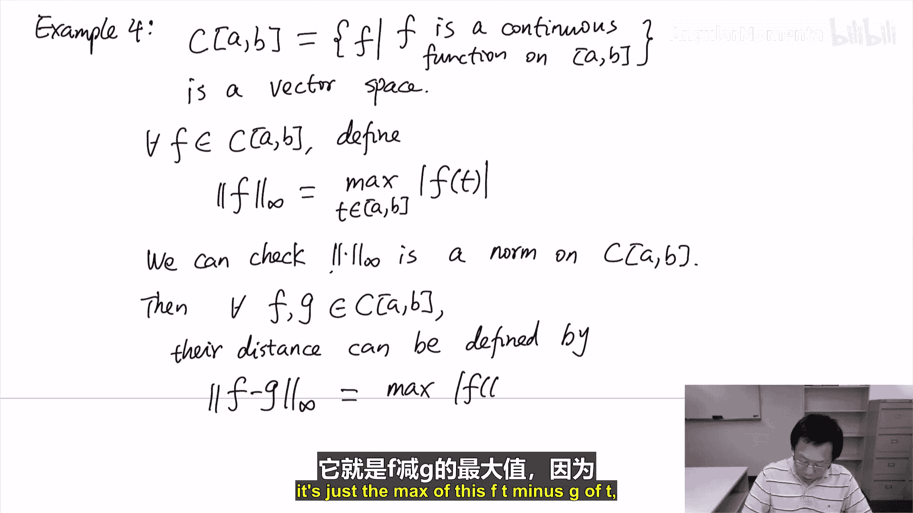

Because F minus G is a new function whose value at T is just F T minus G T。

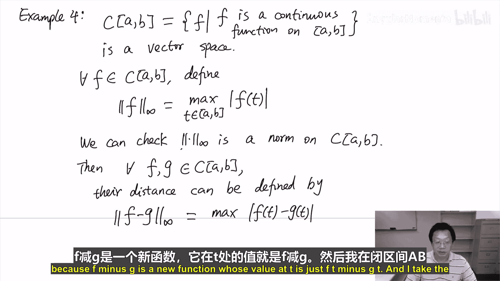

And I take the maximo overall。T in a B。This can be a distance between two continuous functions。

 F and G。

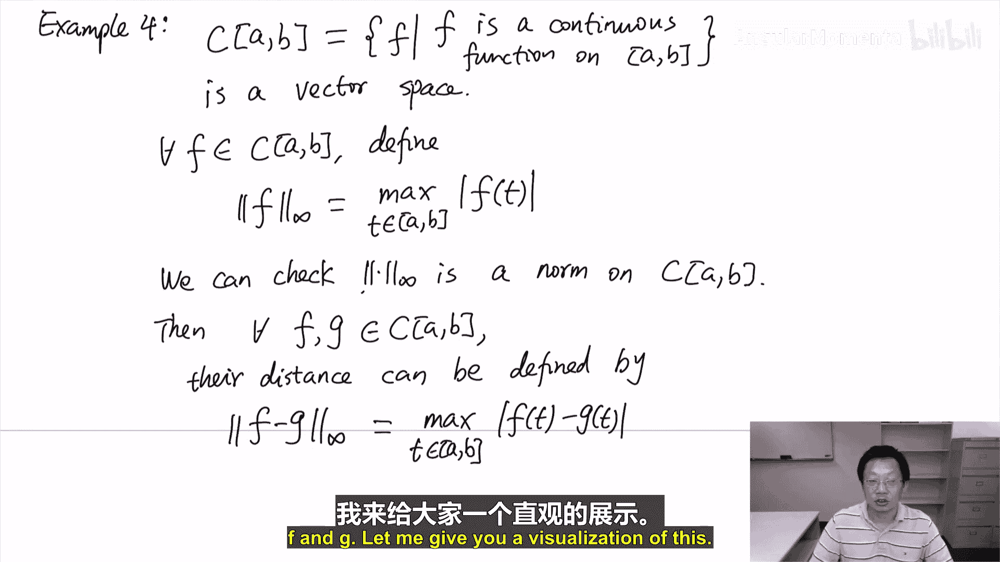

Let me give you a visualization of this。We have a function， F。Mate looks like this。This is F。

We have another function， continuous function， I call it G。

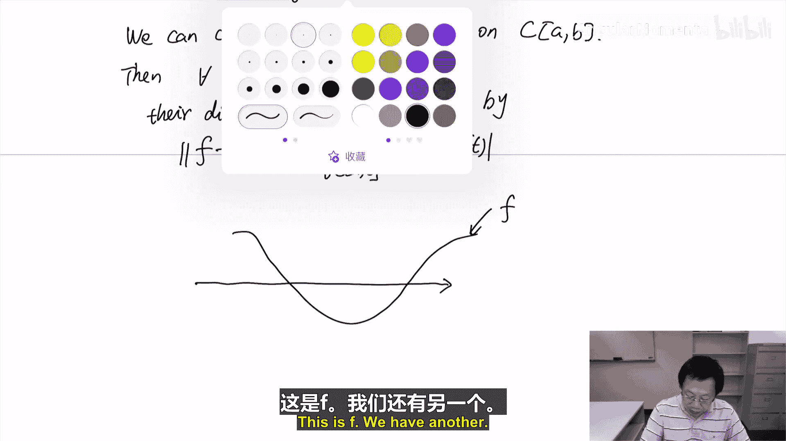

Now， in order to compare how far this G is from。

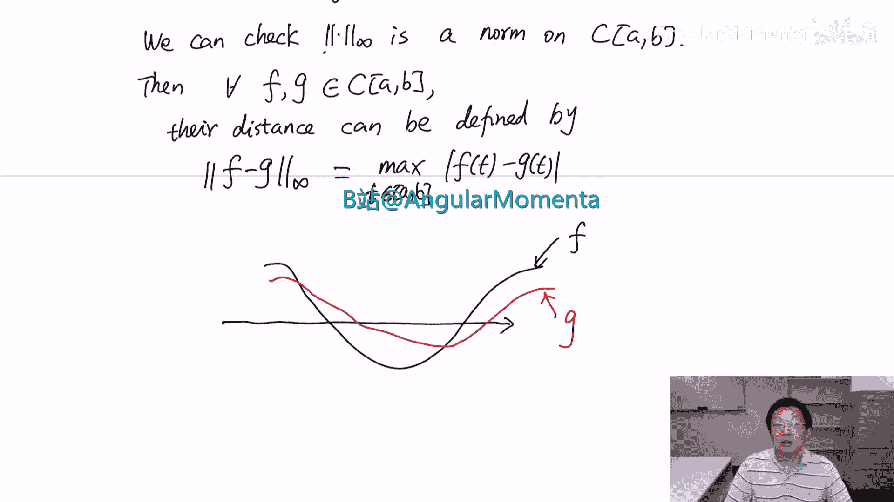

F。Then what we do is that we just make the difference of F and G and find out the max difference in absolute value。

 We just take the difference at each point。At this point， I have a difference。 at this point。

 I have a difference At each point I just have a difference。Then I find the one with the maximum。

Difference in absolute value。 So here maybe the maximum happens here。

 So then this one will be the F minus G。The infinity norm。Obviously， if this maximum is 0。

 if F minus t， thefin norm is 0， just means that F T and G T。

 their difference has a zero absolute value for all T。

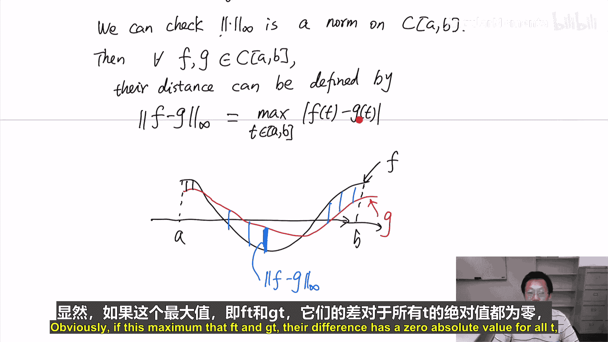

So that F equals2G。

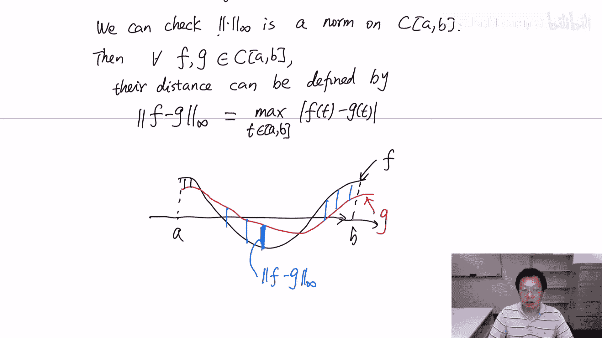

So by this way， we can see indeed， F minus G， the infinity norm is a distance between F and G。

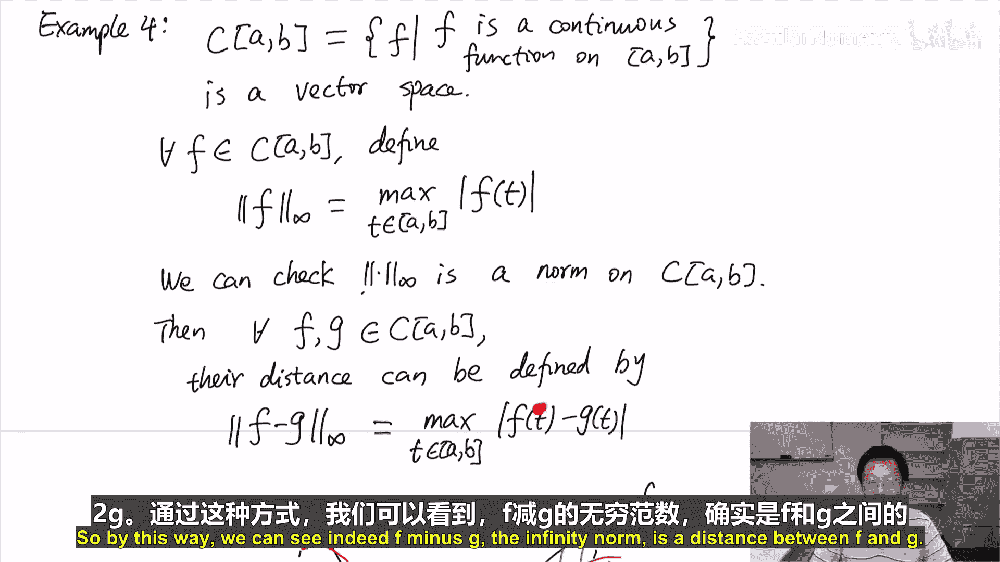

This is the infinity norm for functions。

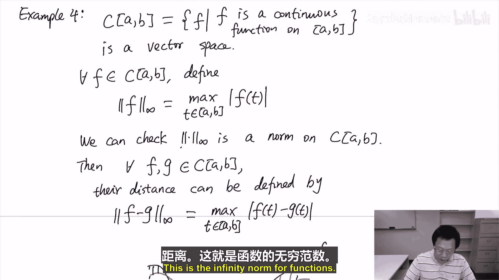

We can define some other norms。For functions啊CB。Sound。Other。Norms。On this is C， A B。Indeed， in fact。

 we can definey。Just similar to the P norms for Econian spaces， we can define p norms for functions。

So， for one norm。We just define it to be。You know， for the one norm of vectors。

 it is just the sum of the absent values。Now， we are considered a function on the continuous domain。

Then the summation is just replaced by integral。So we just considered the integral from A to B。

 the absolute value of FT， Dt。This is the one norm。

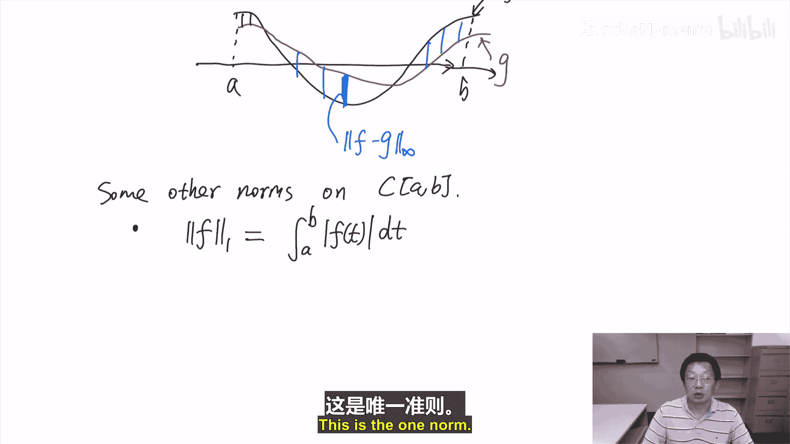

Similarly， we can define the two norm。In a discretereet Ekkuian space case。

Some of the squares of each entry and then take the square root here integral of all FT squared。

And then， take the square root。This is the tunnelr， similarly。We can define the P norm。

 just the integral of a to B。 this F T， we take the P power of the absence value。

Then we take the P root。This is a P norm， of course， to be a norm。

This P has to be larger than or equals to one。Otherwise， it is not a norm。

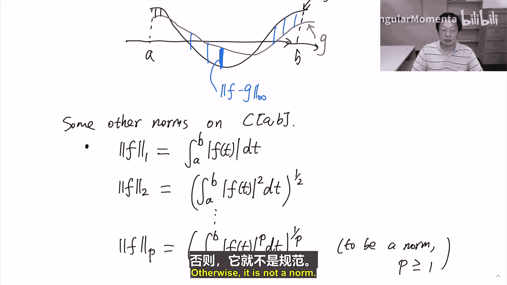

You can also check that when this P goes to infinity， actually， this。

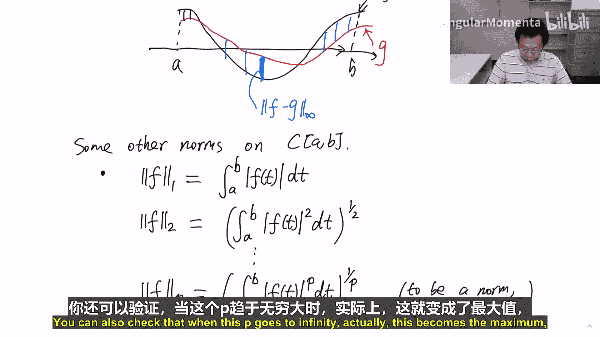

Becomes the becomes this， this norm， the max of FT。

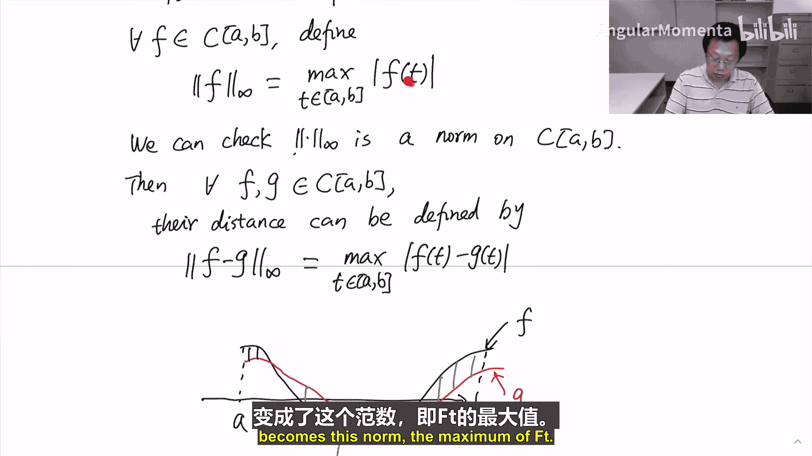

So， then we can also this。

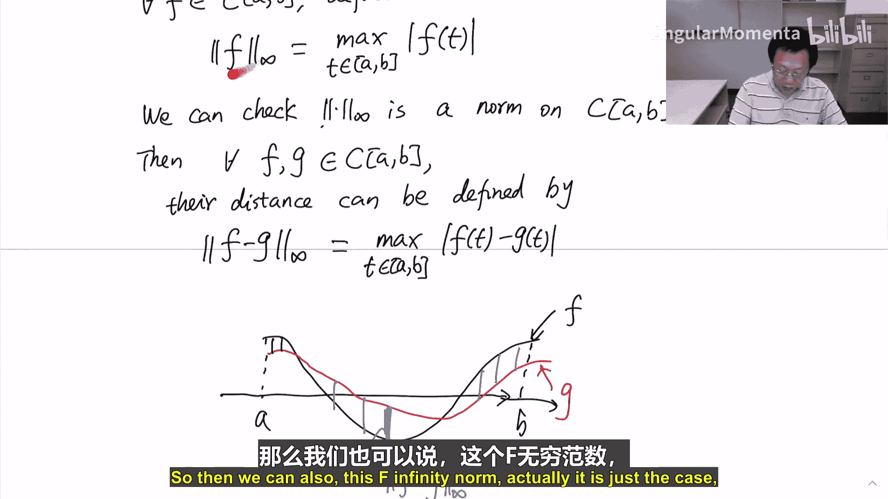

F infinity norm， actually， it is just the case， the P norm when P goes to infinity。

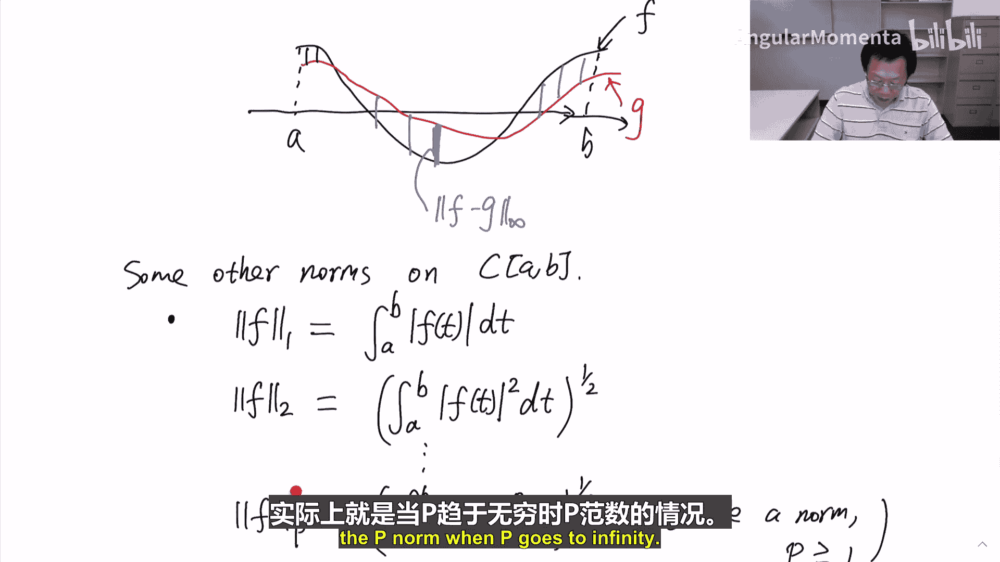

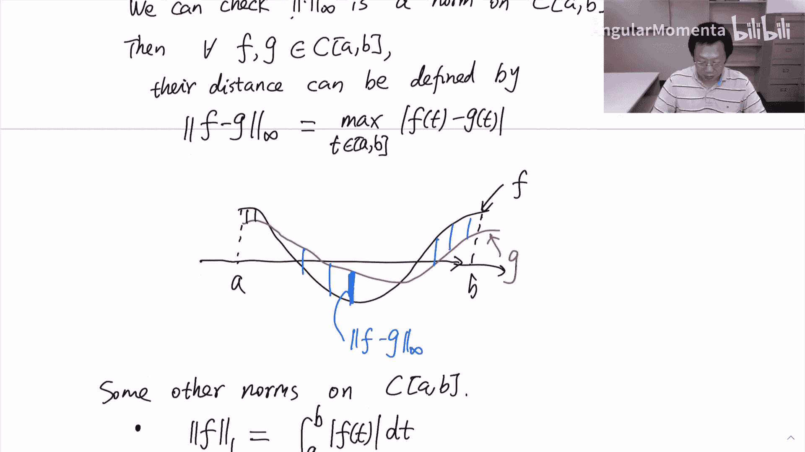

These are the norms on。Function space on this continuous function space。

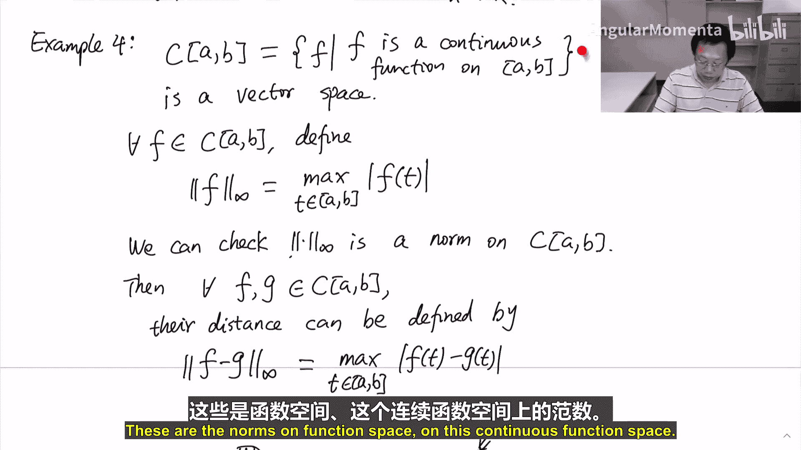