# 【香港科技大学】数据分析的数学方法 ｜ Mathematical Methods for Data Analysis p17 05-08-02-视频 -BV1DEFDzGEZW_p17-

The last example。Maybe more interesting。

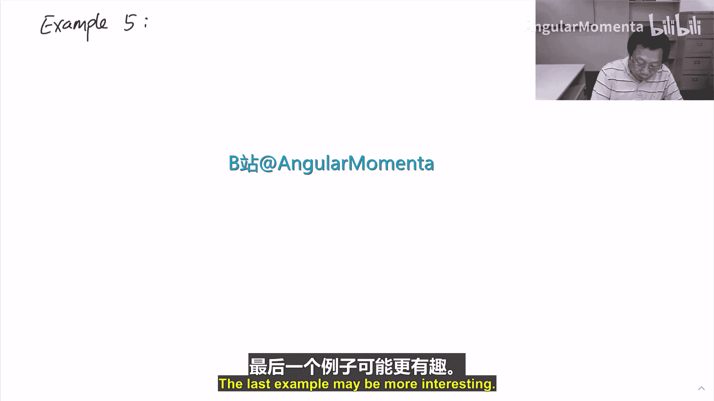

We can see some new features about norms。 We consider this。Our infinity。

 this set of infinite sequences。In our example file， to demonstrate vector spaces。So it is just that。

Infinite sequence。A is。You find night。Sequence。Which means that we have infinitely entry in this A。

And 돼。Should be bonded。 I can find a C。Such of that。This AI smaller than or equals to C for any eye。

This L infinity， we have shown that it is a vector space。Now we can define norms of this space。

For any A on L infinity， things for each infinitefinite sequence in this space。

All the entries are bounded by C， I just use the sume of AI to define this an Infinity norm。

We can check。 It is。Indeed。A norm。On this L finish。Now， you may wonder why I don't write a max here。

 Actually， this one cannot be replaced by Max。And remark。This soup。Cannot be。Replaceed。Bye。Max。

Because。For example。We just consider this sequence。0，1 half。2， third。And so on。

 which means that the I entry， it is just I minus1 over I and so on。Then。If we use Max。

in the definition of thisfin norm。

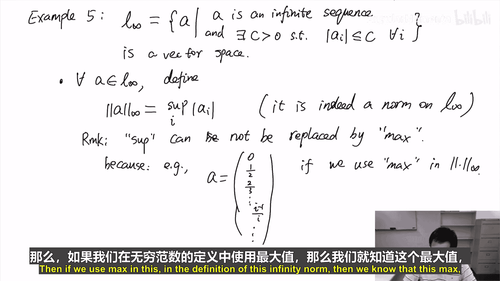

Then。We know that's this max， we needed this max I。Of AI。All， so we need this max of this I。

 I minus-1 over I。We needed least one。But。This does not exist， because for any eye。

I have an I for any fixed I， I minus-1。Over I is1 minus， which is just。The max of I。1 minus1 over I。

So for any fixed eye， this is a fixed number。 I can always find another eye， such that。

Say I prime such that 1 minus1 over I prime is larger than this 1 minus1 over I。

This max is not attainable。This max actually happens when this eye goes to infinity。

That's why we write a soup here。

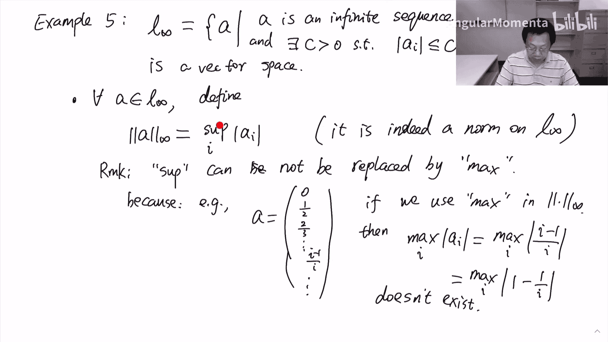

This is the in norm。You may wonder， can we define the p norm for this？

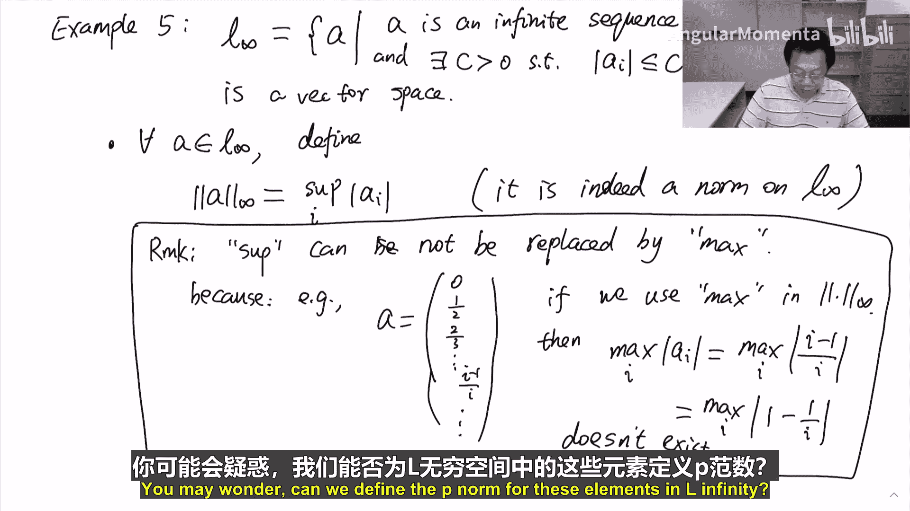

Animimatements in our infinity。Similararly。We can define。This P norm。

Just the sigma of this I from one to infinity， this AI the peace power， and then take the P root。

For any A in you finish。But。We should be careful， but this。P农。Is not。A norm。On然 in finish。Why。

 let me give you a account example。What you your example。A， I we consider this sequence。

 the sequence of。I1 over I，1，1 over two，1 over three。

 and the I entries is there's a one over I and so。We consider this a sequence。This sequence。

 obviously， you know that it's。Its its entries are all uniformly bounded by one。

 right so that this is in L infin。Is in our infinity。But。Let's consider this a1。P equals to one。

Just consider P， E equals to one。Then we just have that this is sigma I from1 to。Infinity， this AI。嗯。

And then take the first routes wishes。Okay， just the sum of the absolute value of entries。

 So this is the sum of。I from 1 to plus infinity is1 over I。It is well known that this sequence。

It's not convergent。 It is just divergent。So that this number， it is just infinity。

Which means that for some entries， for some elements， for some vectors on this infinity。

This a1 equals to infinity。So that this one norm here is not a function。

 recall in the definition of the norm， we want this norm is a function。

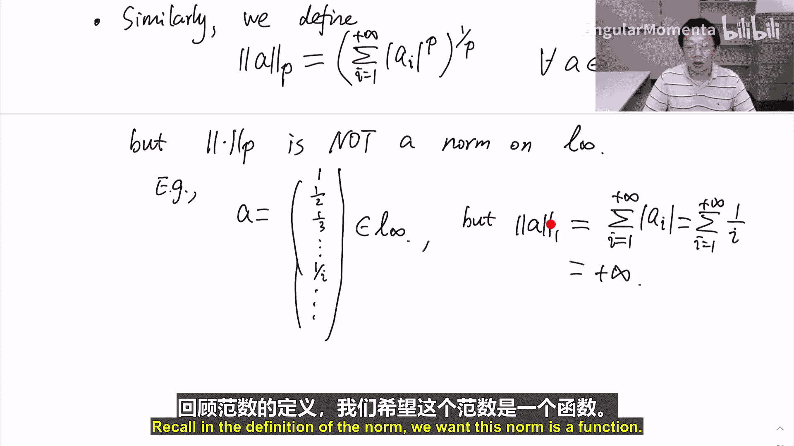

When we define the norm， the norm should be a function from V to R。

 this just means that for any given element， given vector in V。

This norm should be R should be finite， armies R is a set of finite numbers。

It does not contain the infinity。

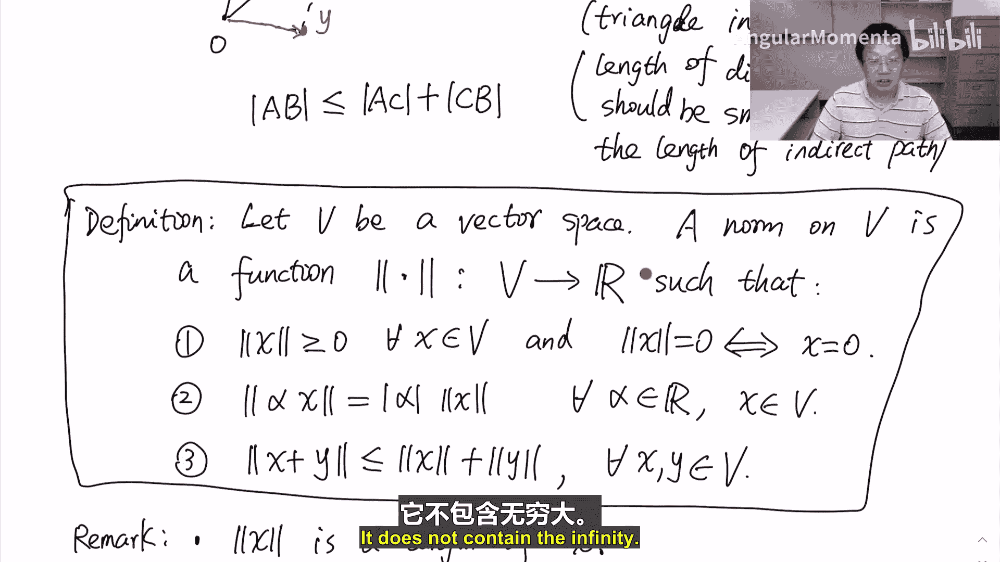

But if we define the one norm on this L infinity。For this。

Vector in L infinity is one norm is infinity。So so that this one norm maps some vector to infinity。

This is not allowed in the definition of the norm so that this one norm is not a norm。

It's not this this defined in this way。Is not a norm on our infinity。So。This。Is not。A norm。

On our infinity， it is not even a function because it maps this。Vor to infinity。

Then usually we instead we consider this set。

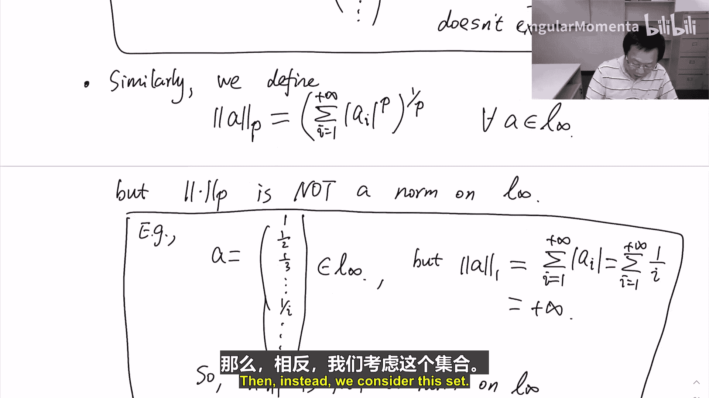

Instead。We consider。We consider this space the so called LP space。

This space is just all A in L infinity。But we wanted to filter those。Infinity。P norm， vector out。

Just， we just don't want this P norm to be infinite。

So we just take out all vectors in alpha infinity， such that its p norm is finite。

So this LP is only a subset of this L infinity。So now with this， you can see。The皮 norm。Is a norm。

On this LP space。In order to make P norm a real norm on this infinitefinite sequence set。

 what we do is that we just exclude those infinitefin sequences whose P norm is infinity。Yeah。

This is different from。RN right in RN。I mean， this RN with one norm RN with two norm RN with p norm。

 they contains the same elements。

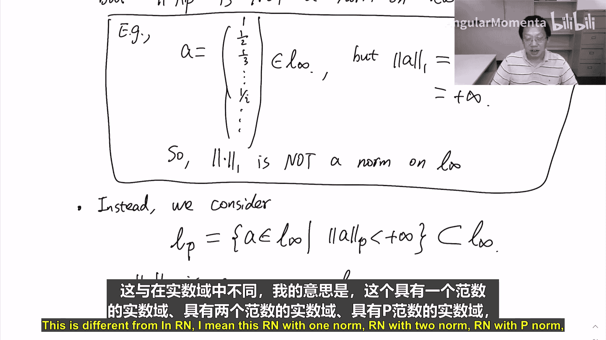

But in this infinite sequences space。With one norm， with two norm。

 with an infinity norm that contains different elements。Example。Again， I consider this a。Equals to 1。

1， half，1， third。 And so oncon this embedded sequence。 So this sequence， of course。

 is in L infinity because its element is bound。And this a infinity is just the what， right。

 the maximo， the soup。TheSmo of this absolute value of AI， it is obviously one。And its a two。To norm。

 it is just the sigma of i from 1 to infinity。This I squared。And then， take the square root。

Because the I term in this embedded sequence is1 over I for this summation。We have an expression。

This is solved by Ola， so this one it is high squared over 6。

 the summation of1 over i squared i from 1 to infinity。It is pi squared over 6。

And then take the square root。 So we get its pi over square of 6。

And this is the two norm and the one norm。As we have demonstrated here。It is just the infinity。

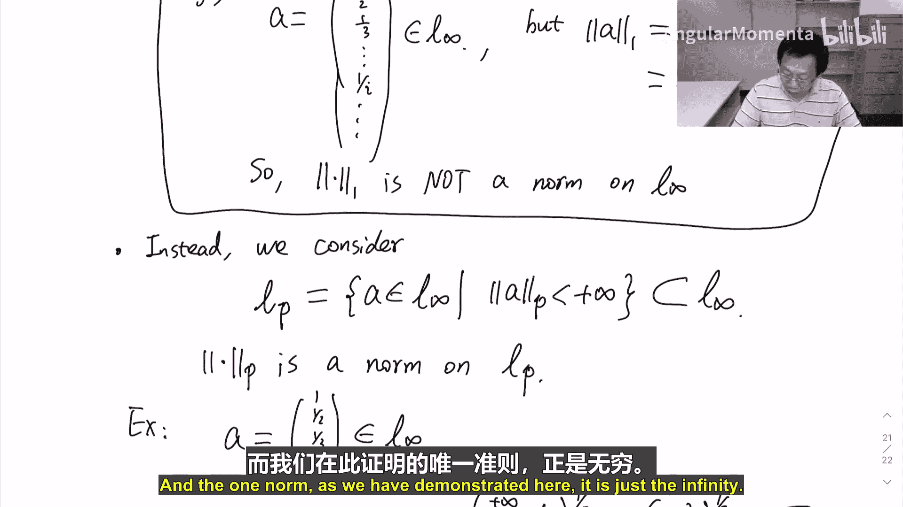

So for this A。It is in all infinity， because it's our infinities。Ondia is finite。 It is in L 2。But。

This a is not in L 1。Indeed。You can also check that this A is in LP。For any P larger than what。

 Because1 over I to the power P I from one to infinity。

This is convergent so that the P or P larger than one。It is just finite。

 So this L A is in LP for all P larger than one， but it's not in L1。

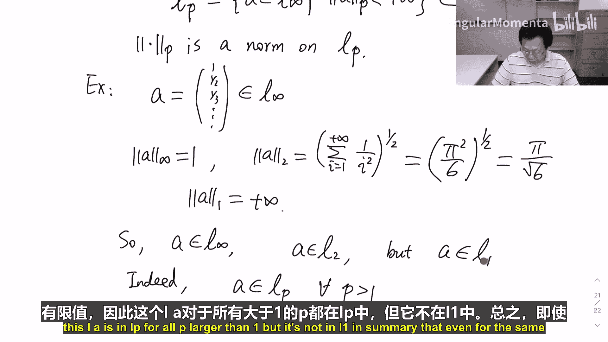

In summary， for all these examples， we have seen that even for the same vector space。

 we can define infinitely many norm ons。 the second one is that， as I have mentioned for many times。

 a common technique in machine learning is to optimize some norms。Of the unknown vector。And actually。

 if you use different norms， you will get very different results。For example。

 if we want to find a spae。Vectctor， we usually choose the one norm minimization。

But if you use the two norm， you will never obtain a sparse vector。

 You have to use one norm to obtain a sparse vector。

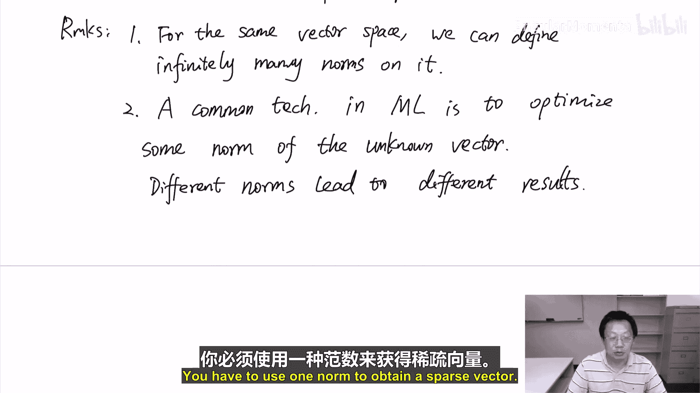