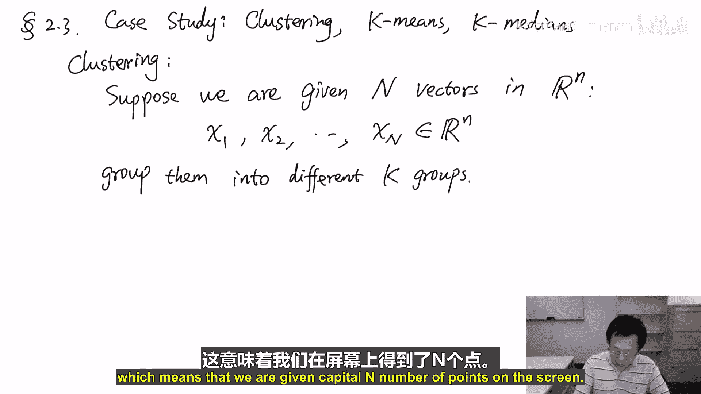
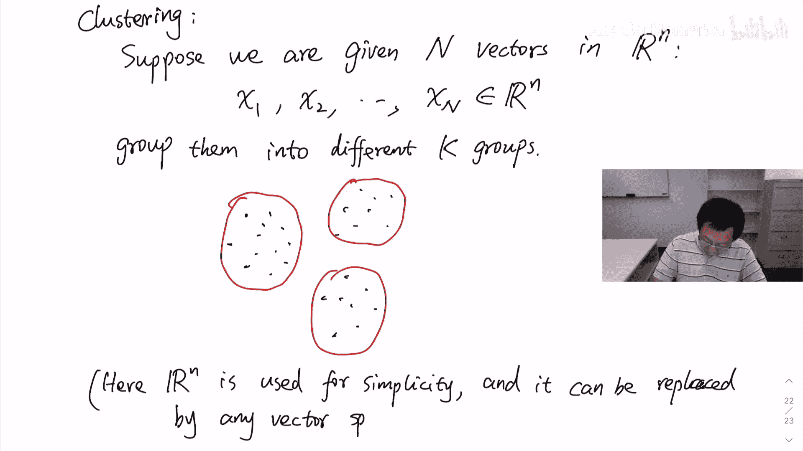
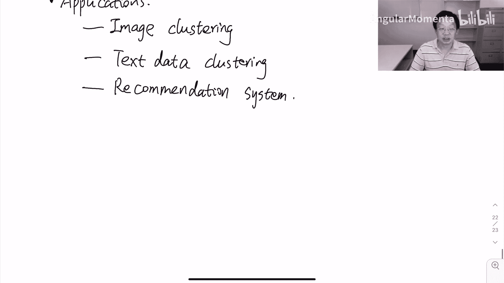

# 【香港科技大学】数据分析的数学方法 ｜ Mathematical Methods for Data Analysis p18 06-01-02-视频 -BV1DEFDzGEZW_p18-

Now， I'm going to present an application of the vector spaces and norms on it。Section 2。3。

On case study of。Cllustery。And we will present the cameese algorithm。Under the came media algorithm。

To solve this problem。For clustery。The task is as follows。 Sose we are given M vectors。Canada and as。

Yin。The space in the vector space。RN。Assume these vectors are denoted by x1， x 2 to x character。

 and each of them is just a vector in R N。Then we wanted to group them into different groups。Group。

Then。Yinqu。Different。K groups。 I know the number of groups。This is called the clustery。

We can use a figure to demonstrate clustery。Now， assume the plan。This screen plan is the R。

Then we are given capital N vector in R N， which means that we are given capital N number of points on the screen。

Now， I want to group them into。Say Ks equals to three groups。Obviously， for this a simple example。

A good。Grouping might looks like this。This is the simple clustering task in machine learning。

You may have noticed that I used RN。This vector space RN， but this RN is not necessary。 Actually。

 it can be replaced by any vector space。Here。RN。Is used。Just for simplicity。And 돼。

It an can be replaced。Bye。Any。Vectctor space。

The application of class terraining can be everywhere。 I think you must be very familiar with them。

For example， we may have that。Image clustering。For example， we are given a database of human faces。

 We want to group them according to different people。And we may also have the text data。Cllustery。

We are just given many， many articles。 We want to group them into different categories。

So that we can recommend them to different readers。But of course， for the text data clustery。

 the first thing we need to do is to do the vectorization。We need to use a vector to represent each。

Text first。Maybe even in the recommendation system。Even in the recommendation system。

 we may cluster our users。According to their ratings to the movies。

Then the users will be grouped into different groups。For the users in the same group。

 they may have the same taste so that we can recommend similar movies the to the users in the same group。

These are just some obvious application of clustering。

