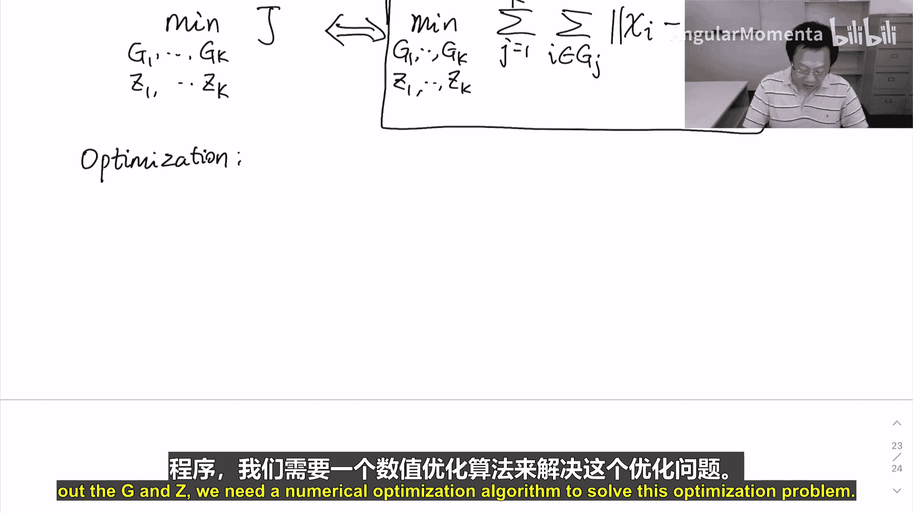
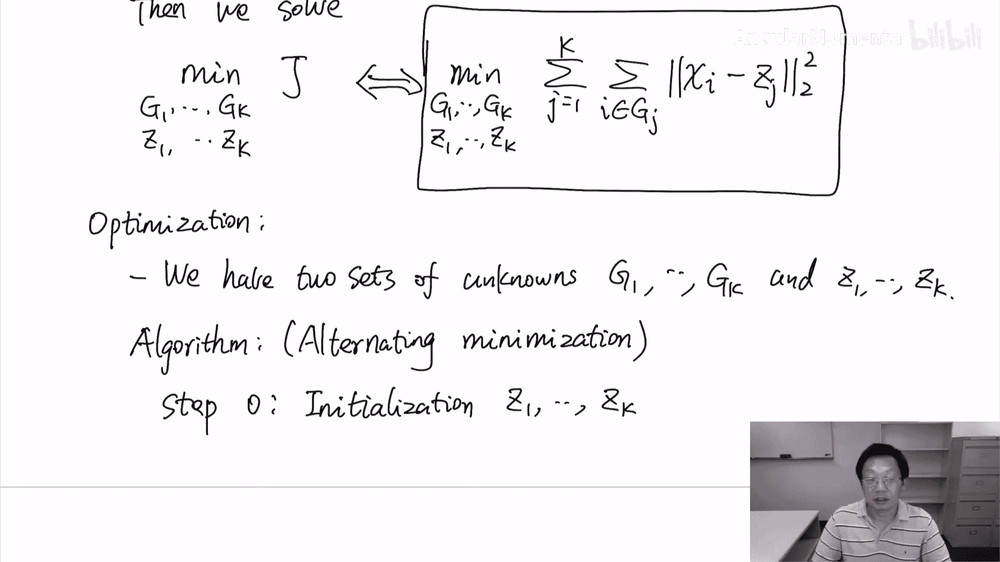
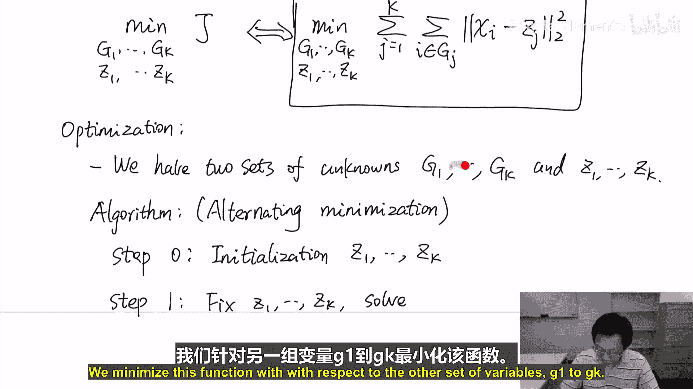
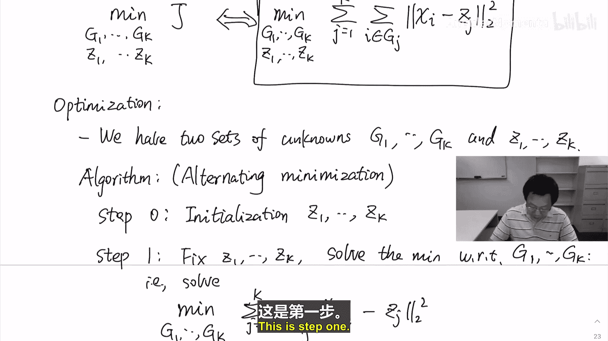
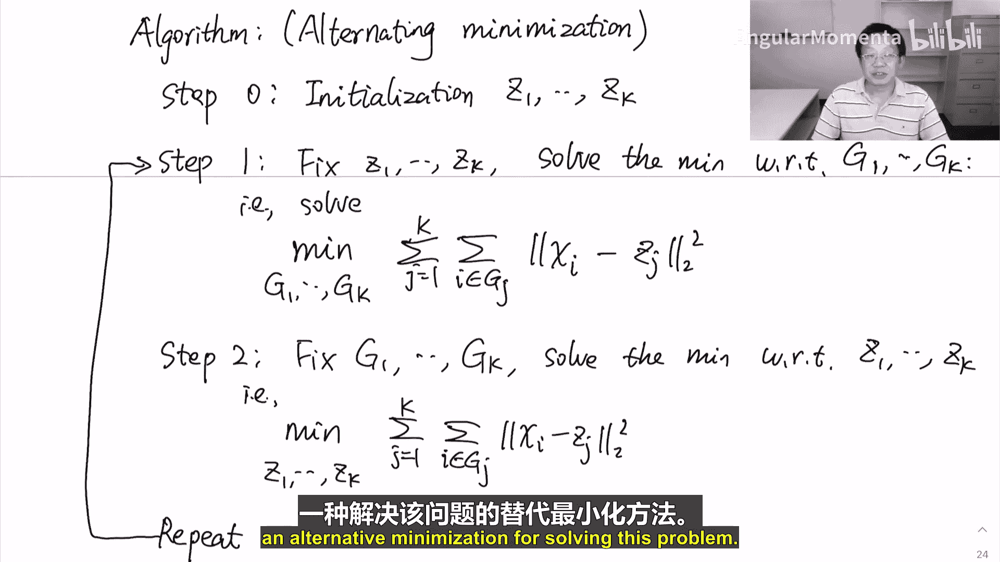
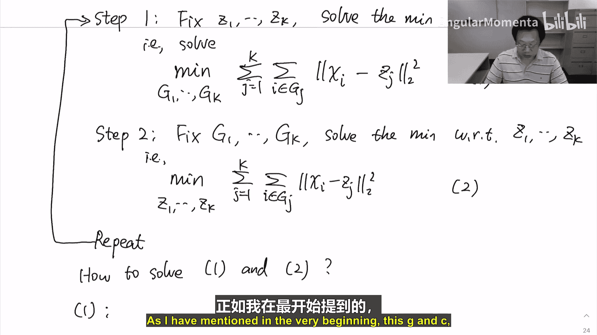
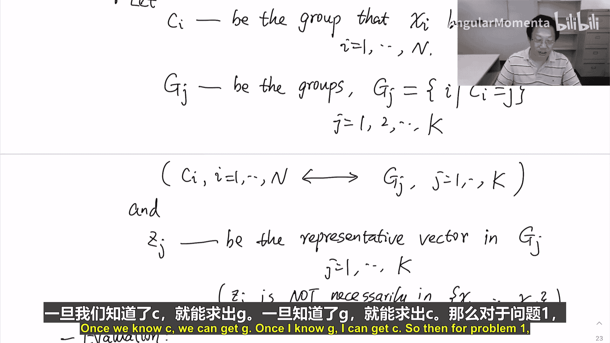
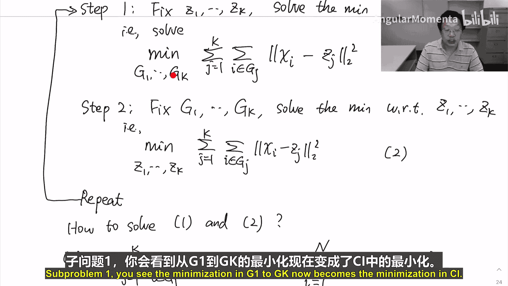
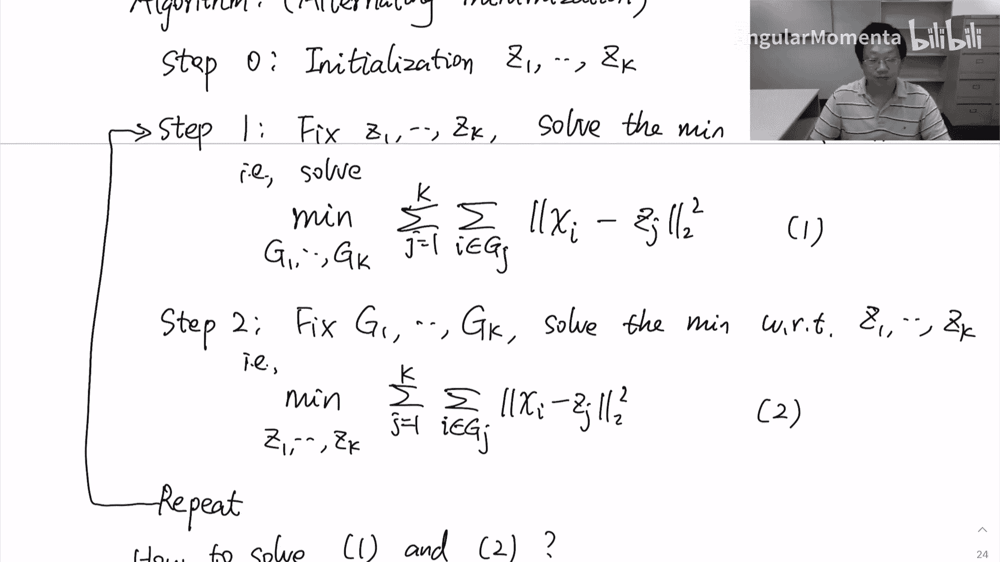
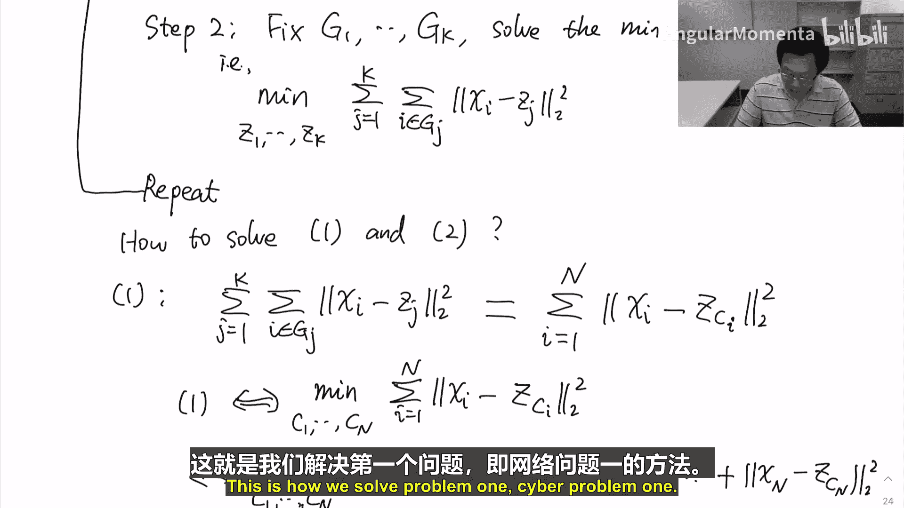

# 【香港科技大学】数据分析的数学方法 ｜ Mathematical Methods for Data Analysis p20 06-03-02-视频 -BV1DEFDzGEZW_p20-

Then the last step will be the optimization。So far， if we have only this objective function。

 is's not an algorithm。It's just a mathematical formulation。

 and we don't have a procedure to find out G and the Z。

In order to have a procedure to find out G and Z， we need a numerical optimization algorithm to solve this optimization problem。

Let's see how to minimize how to optimize this problem。Now you can see here in this minimization。

We have two set of。Variables， one set is on G。 The other set is on Z。So we have two。

You can see we have。Two groups of unknowns。Two cents。G1 to G， K。 This is one set and Z 1 to Z， K。

 This is the other set of unknowns。In the minimal， in the minimization。Then one， usually。

 if we have two set of。On variables in a minimization。A commonly used technique。

 it is the so called alternative minimization。 I fix G。

 minimize this objective function with respect to Z， and then I fixed Z。

 minimize this function with respect to G。 I can present the algorithm now。

We just use the alternative minimization。Step 0。Because we are using now using a so called iterative procedure。

So we just get the solution better and better gradually。

So we needed to first have a guess of the solution， which is called the initialization。

Maybe you can just guess an arbitrary one， Z1 to Z K。This is only a guess。

And then， step 1。Once we have the G this gas， then we we fix， as I have said。

 we fix one set of variable， for example， if now I have Z right， So then I just fix this Z。We saw。

We minimize this function。Was。With respect to the other setup variable， G1 to GK。

Sove the minimization。With respect to。G完 to几克 only。That is。We saw this。

The minimization of we have only G12 GK。Because Z1 to ZK， we have a guess。We know some in any case。

 no matter how accurate this Z 12 Z is。After all， we have a Z1 to ZK。Then we just fix those Z 12 Z K。

 We solve this minimization with respect to only G12 G K。J from one to K， Sigma I in G J。X。

 I minus E J。The two enormous squared。 This is step one。

And then step 2。We do the reverse because now we have a G now， right， So then we just fix our G。

We saw the minimization。With respect you。Z 12 Z K。I to expect to get a better Z1 to Zk。So that is。

 we solve the minimization。 Now we have only Z1 to Zk。So then。Objective。

 the function is still the same。And then repeat， because we just finished one updating of this Z and G。

Of course， when updating is not enough。 We should。Repeat this procedure until we get a satisfactory solution。

But of course， this rep only goes back to step one， step zero， the initialization。

It's only done for once。This is just。An algorithm， an alternating minimization for solving this。

For solving this problem， but。This s is a s， not practical because in this algorithm。

 we s have a minimization here。 We have two minimizations actually here。

We don't have a formula so far for this solution and this solution。To have a practical algorithm。

 we need to find out a formula for the solutions of this and this respectively。Now， I call this。

Equation problem  one， this equal problem 2。No。We needed to answer how to。傻。Thiss one and2。Directing。

I need to find a formula for one and2。For this purpose。Let me start with one。Was the first one。

For the first problem， then I would like to。Introduce， because， as have said。For for problem one。

 you know that the unknown， the variable here is G12 GK。As I have mentioned in the very beginning。

This G and C solving G is the same as solve C， because G and C， they have a one to1 correspondence。

 Once we know C， we can get G。 Once I know G， I can get C。

So， then。For problem 1。I want first， to rewrite。This objective function。燕子。

RightThis is a function in G。No， I want to rewrite it in C。What is that。Then this is the same。Yes。

You know， in this summation， each XI appears only for once。Because GJ is a partition of X1212 n。

All right， so each X I。I mean， each XI appears only in one group。

It will never comes up in two groups， two groups。 Otherwise， it's not a good G。

So then I just count for each eye for each eye。Then I write this。

 rewrite this as a sum i from1 to cap。哎，回侠。Then X is still the same。 but how about this Zj。

What is this， ZJ。J is just the group that X I belongs to。Right。

 this J is just the group that X I belongs to because each vector is subtracted， is compared with。

The representative of this group。So then this J is just the group that XI belongs to。

So then this is actually Z of CG。Of C。Two놈これ。According to our definition， C I8 is。It is you exactly。

The group without XI belongs to。So that， when X appears， the J here is just C。

Then this one is equivalent to。With this observation。Now， this one。So problem one。

 you see the minimization in G1 to GK now becomes the minimization in CI。

So it is just the equivalent to minimization on C12 C capital N。This is Samation。Of I from one to n。

X， I minus Z， C I。The two norm squared。Then。This is further the same as the minimization of C12 C。

I just expanded this summation。It's a。X 1 minus Z， C1，2， Nor squared plus。

X 2 minus z C2 x2 Nor square root plus。Plus。X capital n minus Z c capital N2 norm squared。Now。

 if we check each term in this summation， you may have noticed that。

This C 1 contains only in the first term。C 2 contains only in the second term， and C。

 N contains only in the last term。It's a summation of these n terms together。

 and each term depends on only one variable。So then this just means that the the joint minimization on C 12 C。

 N is equivalent to。The minimization of each term independently on only one C。So， this is。

Just because C1 involved only in the first term。 So only the first term。Depends on C1。

 And this first term does not contain any other variable。

So that the joint minimization is equivalent to the minimization separately。

It is equivalent to minimize。Only one C。X， I minus Z C， I。The two norm squared。 and I we have。

Capital N， small problems。We just have this。You I have this。So then this actually。Now， I can。

What does this CI belongs to， The CI is the group that XI belongs to。

 So So we have only K possible choices。CI is either one2 or K。It has only key possible choices。Then。

We get such a minimization。 This is just a discrete minimization because we have only K possible K candidates for this C I。

 Then what we do is just we just try C C I equals to1 C I equals to 2 until C I equals to K and then compare these K values。

So this is just equivalent， equipment that this C， I is that。I just try this X， I minus Z J。

For all Jay。Right， and then I take the minimum1 J from one to K。I just try each。Try each C， I 1，2。

2 k。 So if C， I equals to 1， I get X， I minus Z 1。 If C， I equals 2， I get X I minus。Z2 and Su1。

 So then I have K possible choices， and I pick the minimum one。This J Yin。1， two k。

And I picked the argument。I pick the minimizer， the minimizer is just our CI。

 so this is I from one to n。So what does this mean， This is very simple， just means that given X I。

 and I just calculated the distance from X I to its to each representative and pick the。

Pick the closest one。Right， just use a picture。It is just to assume now I have X I。Now I have Z 2。

 Z 1， Z2 and Z 3， for example， I have Z 1 here。 I have Z2 here。 I have Z3 here。

Then what we do is that we just calculate。We just calculate the distance of this X I to z1。Z2。

And these three。Then I get three distances。 I just picked the one with the smallest distance in the Ekian in2 norm。

Because two norms squared is the same as I can remove this square， it is still the same。Maybe。

I write here。I mean， with or without these two。It just does not matter。

So then I just calculate the distance from X to Z1 to z2 and to z3。

And then I should take the minimum， obviously here， the minimum is X to Z2。So in this case。

 we just have that to this。C I equals to 2 In this example， I mean， in this example。

So this is how we obtain C I。 I just， for each eye。

 we just test the distance of X I to all the representative vectors and pick the minimum 1。

 The minimum one is just。XI belongs to。So。In words， this step is just X I is assigned。To the group。

Who's。Representative。Is。The closest to Xi。So by solving this。One， this problem。We just get a C。

 I should be。Should be。I mean， XI should be assigned to the group whose representative is the closest to XI。

 It is just the solution of this of this minimization。

It is just the solution of this minimization by fix Z12 zk， fix the representative， then for each XI。

 I just check the distance of Xi to all the representatives and pick the closest one。

This is how we saw。Problem  one。 cycle， Pro 1。

