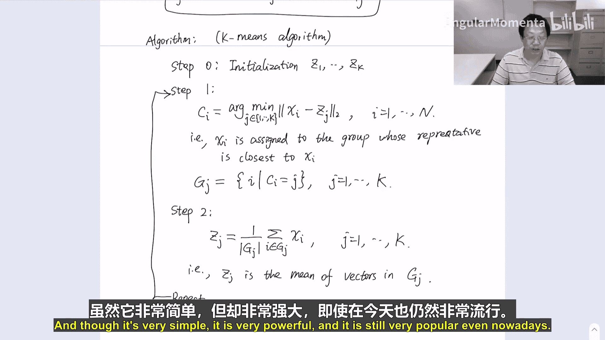
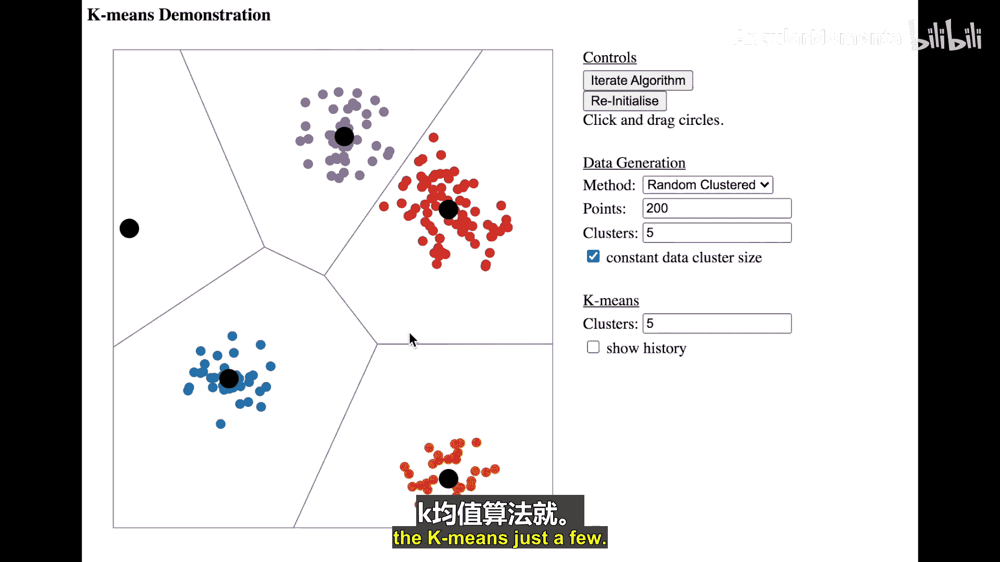

# 【香港科技大学】数据分析的数学方法 ｜ Mathematical Methods for Data Analysis p22 06-05-02-视频 -BV1DEFDzGEZW_p22-

So， then。We have two steps now let's go back now for this step。

 the solution is given by the closest representative。The solution of these two is given by。

The mean of vectors of GJ。so now we get a practical algorithm。

Just step zero is still the initialization。Sep 1。Now you can see we just have this。

Solution like this。This is just a step one for any eye， I just assign。This X I to。

To the representative that is closest to X I。So which means that。X， I is assigned。To that group。hos。

Representative。Is closest。To X I。This is the step 1。 and after step 1， I needed to redefine G。

In this way。So now I get the G， then in step2。We saw this sub minimization too。

 the sub minimization2 gave us this solution。This is for。J equals to 1，2， k。In other words。ZJ is the。

民。Of vectors。燕知者。Then， we repeat。Of course， we just repeat starting from here to repeat。

So this is the algorithm， the final algorithm。The final algorithm first。

 we have our initialization on the。Representative， for example。

 you just pick randomly K vectors from x1 to X N。 That's quite random。And then you just to。

Start the iteration。 Oh， sorry。Here， we should go back to。Step 0。And then we just start iteration。

And with Z with representative， we just search for each XI。 for each XI。

 we assign it to the group whose representative is closest to XI。Then we define GJ with GJ。

 I just take the mean of vectors in GJ to get the new representative。

So this is a very simple algorithm， right， Only two steps。

 One step is assign each each vector to the nearest representative。And then， read group。

After the regrouping， then we just calculate the mean of each group to form the new representative。

So for this reason， you can see that the mean is very important after we have a new group here。

 we need to compute the mean of each group。For this reason。

 this algorithm is called the K means algorithm。It is just a very fundamental clustering algorithm。

 and though it's very simple， it is very powerful， and it is still very popular even nowadays。

A simple demonstration of the K means algorithm。These small dots， they are just X Is。

 So I have chosen X R n capital n equals to 200。 We have 200 points here。 And these big dots。

Big black dots。 They are just representative。 So initially we have these， these。

 these three representative vectors， which are chosen randomly。Then once this is chosen。

 then we just compare the distance of each point to the representative。

 so you can see in this region， all the dots， all the points are just closer to the first representative so that they are all in red and this is closer to this and in this region。

None of the points is the closest to this point， so currently in this group there is no dose。

Then we iterate the algorithm。So you can see this representative moves because we reccalculated the we used the mean to calculate the representative。

So then this is a new representative。 and then all the points are immediately updated their groups。

And then we do one more time。Oops， in this example， our K meanss algorithm just does not work。Now。

 let me re initialitize it。 So you can see I have another example again，3。

Initialized representatives。Iterate。One time。We get the new representative， and the new group。

Another time。You can see now this representative is recalculated and the grouping is also recalculated。

One more time。One more high。我唔爱睇。So you can see after several iterations。

 this K means algorithm are able to give us a good cluster。Maybe we can do more challenging problem。

 I have more grooves here。Initialize， you can see we run。

 Now we have five initialized representatives。 and then we first calculate the center of each group。

 So you can see now this will move。 This will also move。

 This three will not move because there is no point in these three groups。si。And， but after the。

Regrouping now， there is one point for this group because this this purple dot is closer to this point than this point。

 So then this will change。 this and this will still not change because there is no。

There's no members in this group， and this will change。 This will change。

So then because this representative moves from here to here， and now there are more purple。

A those here， because。This point becomes closer to this one than this one。Will you keep iteration。

K iteration。Keep iteration。So you can see that we can have three clusters， though we expect a 5。

 but this。I think this looks good。Let me do one more time。You can see clearly we have one，2， three。

 for these four。Groups see whether or not the key will give us the expected answer。

Like the result looks quite good。So in summary the came means it is very powerful。

 it works in most of the cases， but indeed。Indeed， there are some cases the K means does not work like in our very first example。

 the K means just field。

Okay。