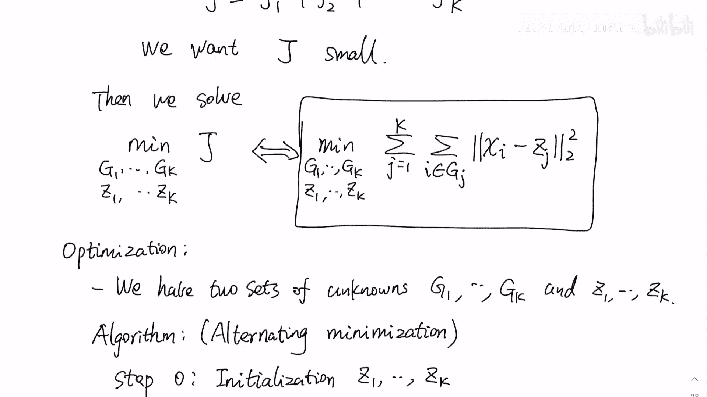
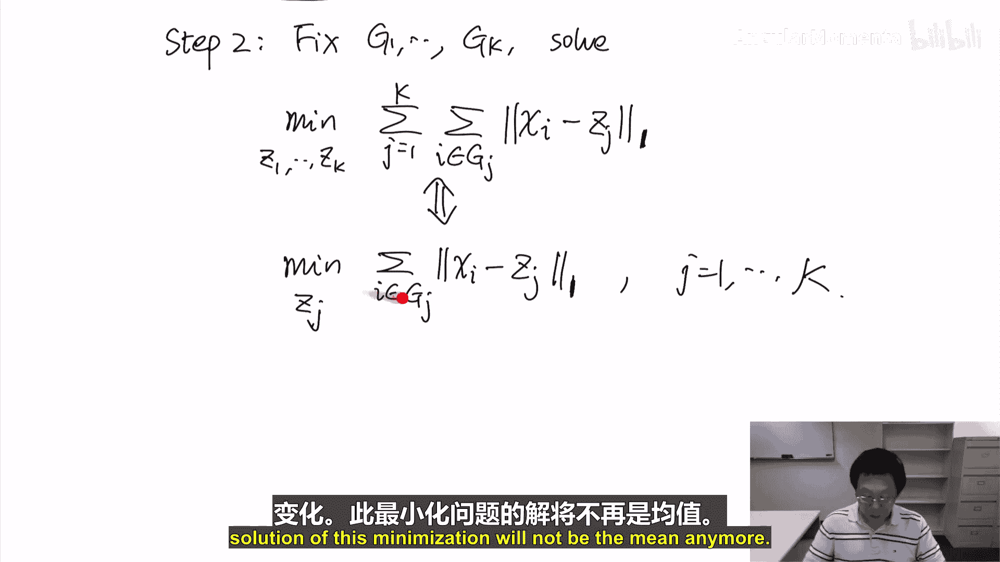
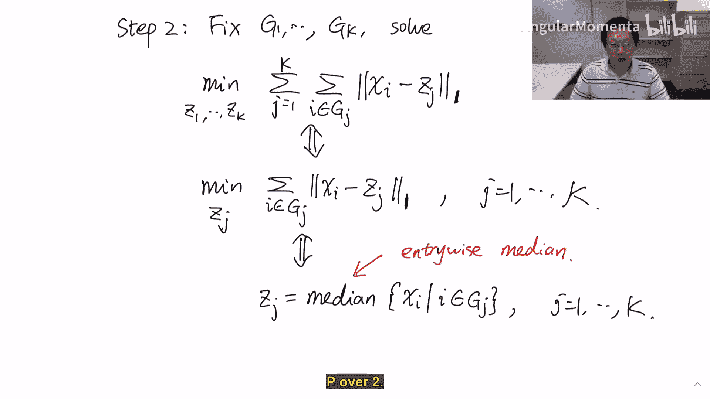
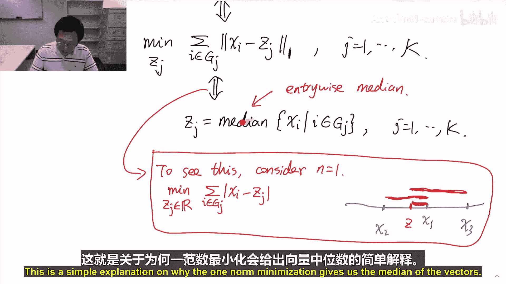
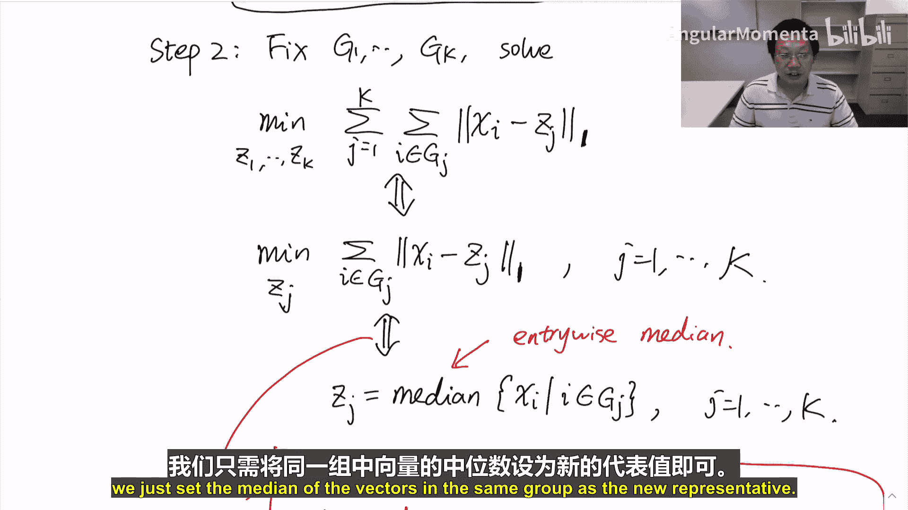
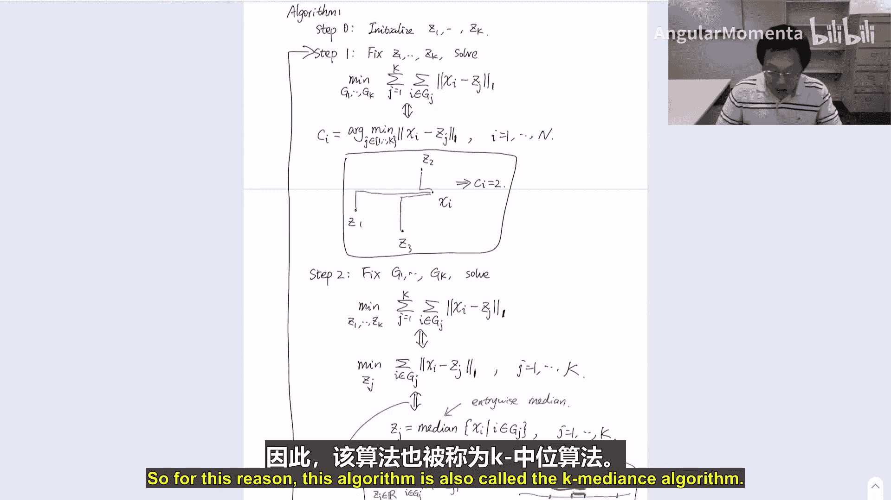
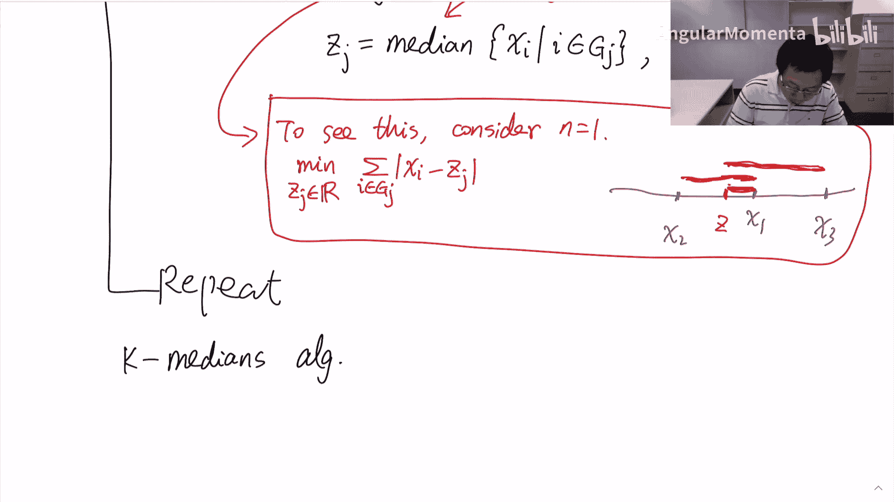

# 【香港科技大学】数据分析的数学方法 ｜ Mathematical Methods for Data Analysis p23 06-06-02-视频 -BV1DEFDzGEZW_p23-

In the Ks algorithm， we have used two norms squared as a quantitative description。

Of the closeness of two vectors。As we have mentioned before。

 any metric on the vector space can serve on this purpose。Therefore。

 the two norm squared here can be replaced by any norm on RN。For example。

 we may replace this two norm squared by the one norm。Without square。Then。For class， we。

So the same minimization。But。This two norm squared is replaced by the one norm。For class。

Then we need us to solve this minimization。Again， here in this minimization。

 we have two set of unknowns， G1 to G K and Z1 to Z K。We still can use this alternative minimization。

 fix one set of the unknowns and then minimize it with respect to the other and vice versa。

Step  zero。W the deal need to be initialize。Z12 Zk。Under step one。We fix。Z1，2 Zk。And the soil。

Thus minimization with respect to only G12 TK。So here this is the one norm。

And we have only one set of unknowns， which is G12 GK。We just solve this minimization。

To get the solution of this minimization， let's just go back to the corresponding part of K means。

Where we needed to solve a similar problem。Sub problem  one。With two norm squares。

So here you can see the only difference is that two norm squared is replaced by one norm here。Then。

Everything here， the two norm squared is replaced by the one norm。

Then this subproblem one will be equivalent to this one with the two norm squared replaced by the one norm。

This is equivalent to。So from here， it's just to say that we compare our Xi with all ZJs under the one norm。

And then we pick the minimum one norm distance。That closest representative under one norm to Xi。

That will be the group that XI belongs to。For example， if I have an XI。Here I have Z1 here。

I have Z2 here， and I have Z3 here。Then I just compare X I with all these Ds under the one norm。

So the one norm from X I to Z 1。This is the summation of the length of these two nine segments。

And Z2 is just this one plus this one。And the oneor distance to this three is this one。

Then we just to compare these three one norm distances and pick the。Small is to one， obviously。

 in this example。Z2 is the closest to X under the one norm。So then C here is just two。

In this是 example。So in step one。For each X， we just compare the one norm distance of X to different representatives and pick the smallest one。

Remember， this distance is under one norm。Different。From the Kaens case， in the Ka means case。

 the distance is compared under the tunnel we have changed。The metric in this vector space。

This is step one， step 2。We needed to fix。G one to gK。 now we have a group。

And then we solve this minimization with respect to only Z K， Z 1 to Z K。Again。

 in order to get the explicit solution of this minimization。

 let's go back to the corresponding part of K means。

Everything here will be just replaced by the one norm， two norm squared replaced by one norm。

Then you can see this subprom is equivalent to this with the two norm squared replaced by the one norm。

It is equivalent to。But this two norm squared is replaced by one norm。J from12 k。

Because the norm here is changing。The solution of this minimization will not be the mean anymore。

The explicit solution of this minimization is given by the median instead of the meat。

The medium of O X I， I in the group J J。For J from1，2 k。Here this median is entry wise median。

For example， the first entry of this ZJ。Is the mediumn of first entries of X I。

Second entry of ZJ will be millions of second entries of XR and so。You know what a million is。

For example， the media of P numbers， it is just we first sort those P numbers and then take the value of the number that is ranked at P over2。

To see why this one or minimization gives the media。

 let's consider a simple case where n equals to 1。In this case。

 the minimization is just minimize ZGA in R。Sigma of I from G J。X I minus Zj， the absolute value。

The only difference。To the cameens case is that in the came means case， we have a square here。

Now here we don't have a square， we have only the sum of the absolute values。Let's see。

 What will happen。Now， I use a simple example。Assume this is x1。This is x 2， and this is x 3。

If they is here。Then we needed to compute the sum of the。One norm distance of Z 2 X I。

 Z 2 X 1 is just this。 Z 2 X 2 is just this。 Z 2 X 3 is just this。

So now we want to minimize the sum of the lengthes of these three nine segments。

You can see if this Z is not x1。Then at least we have some overlapping of these three nine segments。

So that this part will be counted。For three times。 But if z equals to x1。

Then the overlap part will be0。So that the summation of the absolute value will be minimized。

 so from this simple example， you can see the minimizer of this problem， it is just z equals to x1。

Which is exactly the median of these three numbers。

This is a simple explanation on why the one norm minimization gives us the median。

The vectors。Now， step 2 becomes very simple， given grouping。

 we just set the media of the vectors in the same group as the new representative。

Then we just repeat these two steps。On your convergence。This is a new algorithm。In this algorithm。

 you can see there are two main steps in this new algorithm， the first step is that for any X I。

 we just compare its distance to all the representatives under the one norm and pick the minimum one。

To obtain a new grouping。Once the new grouping is formed。

 we just use the median of each group to form the new representatives。

These two steps are repeated until we get a satisfactory result。Compared to the K means algorithm。

 the main difference is that in the K means means， we used the mean as the representative of each group。

In this new algorithm， we used the median as the representative of each group。So for this reason。

 this algorithm is also called the camedience algorithm。

