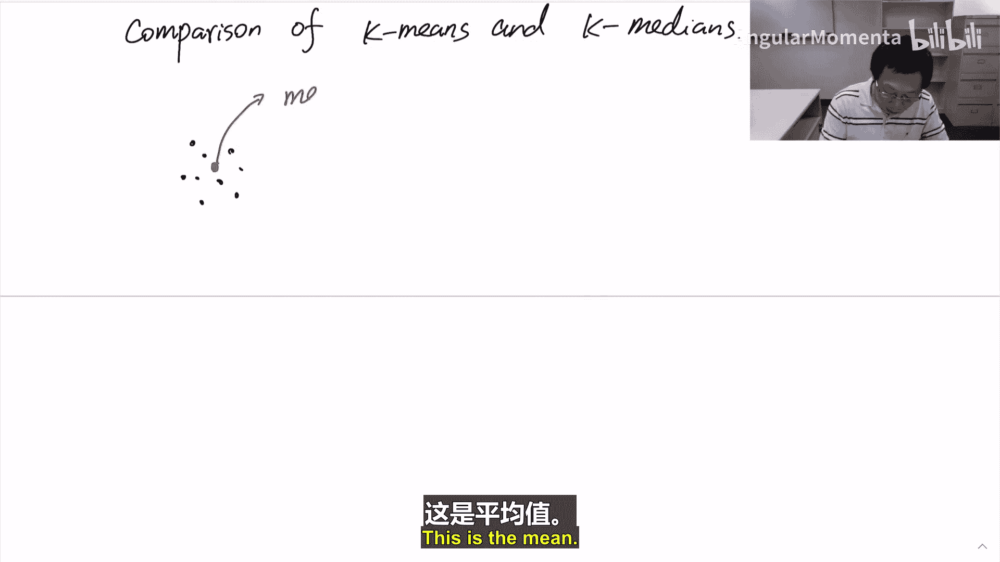
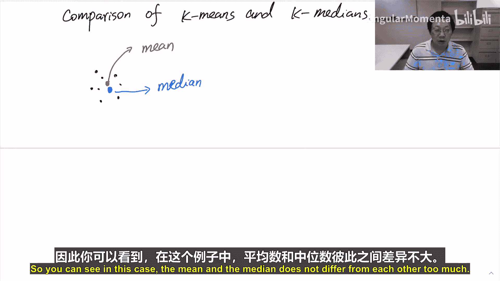
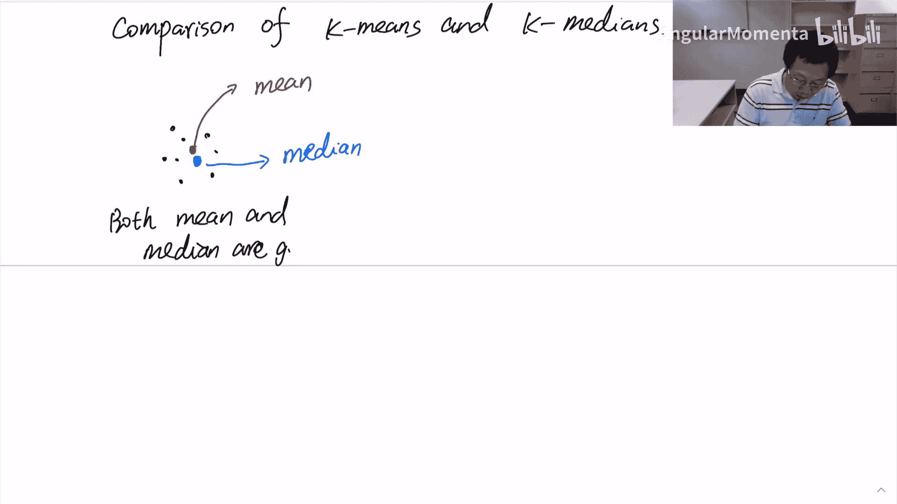
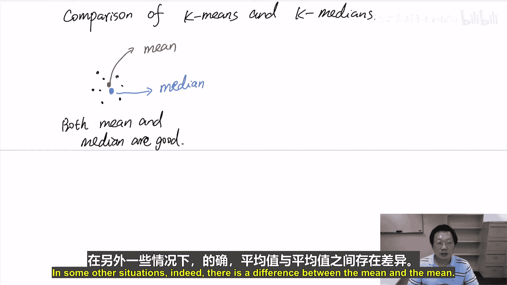
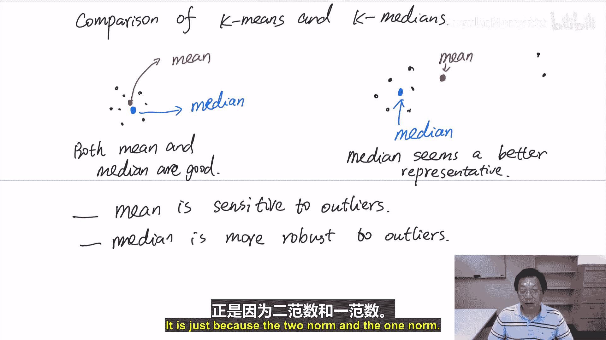
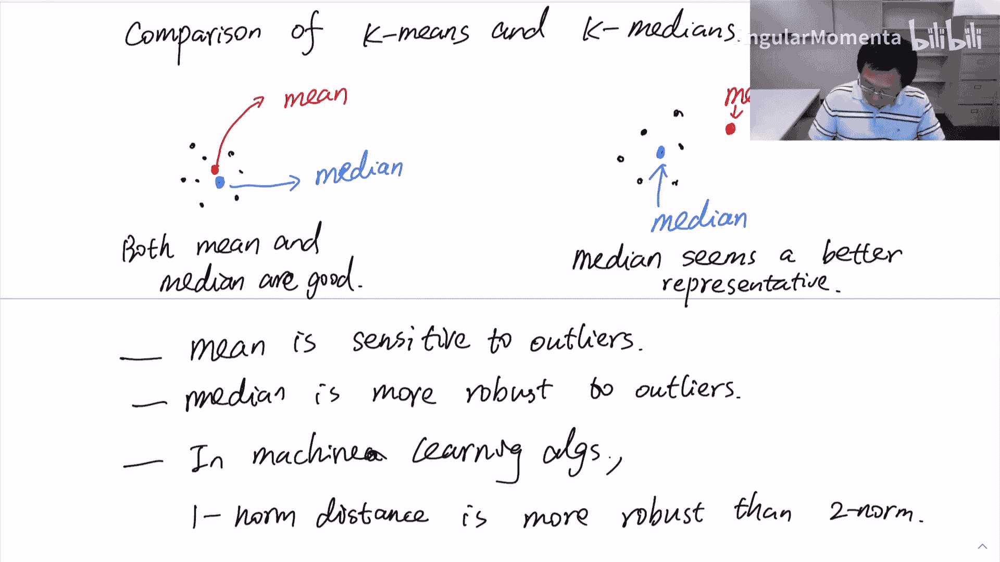
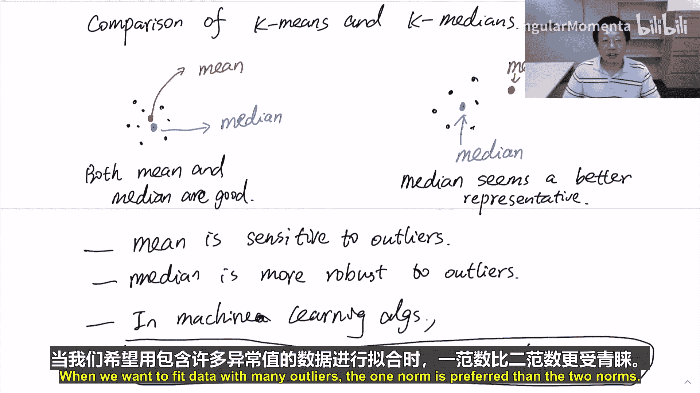

# 【香港科技大学】数据分析的数学方法 ｜ Mathematical Methods for Data Analysis p24 06-07-02-视频 -BV1DEFDzGEZW_p24-

You may wonder which algorithm will be better。So let me have a comparison of these two algorithms。

Under cameed。The main difference between these two algorithms is the min and media in the forming of new representatives。

Now， let's just consider this situation。Assume at a particular iteration。

We have these points in the same group。Now we would like to form the new representative of this group。

For the cames。We used the mean。 The me might be here。 This is the meat。

For the comedians。We use the media of this group。2。Form。The new representative。

So you can see in this case， the mean and the median does not differ from each other too much。

Min and median are similar。 They both are good。

In some other situations。

Indeed， there is a difference between the mean and the mean let's consider in this case。

Assume now the group。Is in this form。All these points are in the same group。

The other groups may be here。So that though these two points seems far away from most of the points in this group。

It is still closer。Then to this one， then the other points。

 So these two points still grouped with these points。And in this case， let's see where is the mean。

Might be here， right？Because these two plants， though they are in the same。Group as the other points。

 So they have a weight when we calculate the mean。But if we consider the media。

 because media is the point that is ranked in the middle。So here we have nine points。

 so then we care only the point that is ranked at five。It seems that at this point in rank  five。

 so that this point will be the meeting。Then。To be the representative of this group。

Which one is better， The mean or the mediumn。It seems now the media is better because it is close to most of the points in this group。

The mean might not be so good because it is in the middle of these two groups。

 it does not close to either this group， this subgroup or this subgroup。So in this example。

The median。Seems better。Why at least to happen。The reason is just because we have these two points。

So these two points we call them outliers because their behavior is different from most of the points in the same group。

Then from this two examples， we see that the meme。Is sensitive。To outliers。

And the median is more robust。To allmiers。Why this happen。

It is just because the two norm and the one norm。

You mentioned there any algorithms。Usually， the one norm distance is more robust to outliers than the two norms。

This is a common knowledge in machine learning。When we want to feed data with many outliers。

 the one norm is preferred than the two norms。

