# 【香港科技大学】数据分析的数学方法 ｜ Mathematical Methods for Data Analysis p25 07-01-02-视频 -BV1DEFDzGEZW_p25-

In the evaluation stage of a machine learning algorithm。

 we have constructed function on vector spaces， and then we optimize that function。

To analyze the function or to construct numerical algorithms for optimizing that function。

 we need to know how the function changes with respect to its。Variable。For this purpose。

 we need to study the convergence of a vector sequence。Also， as we have seen from， for example。

 the Ka means algorithm is an iterative algorithm。We constructed a sequence of vectors through the algorithm。

And， of course， we want to know whether or not the。Sequence of vector converges。Again。

 under this situation， we need to study the convergence of a sequence of vectors。So in this section。

 we started， we defined the convergence and the limits in vector spaces with the help of metrics on vector spaces。

Limit。And the convergence。On vector spaces。In particular。

 we want to define what is the convergence in。A vector space with norm。

Here I use the norm the vector spaces。Which means that。Vectture spaces with norm。

Let the be a vector space with norm。Assume we have a norm a vector space with a norm on it。

 and we have a sequence of。Vectctorors on that space。Denoted by X K。Exa soupcake。K is just some。

Natural number。Be a sequence。On兵。And assume， we have another。Vctor onbi。

Then we say the Xk converges to x。Converges。2 x。This is denoted by。

Similar to the notations for single variable functions。We just use X K， go to。X。

 were used this notation。

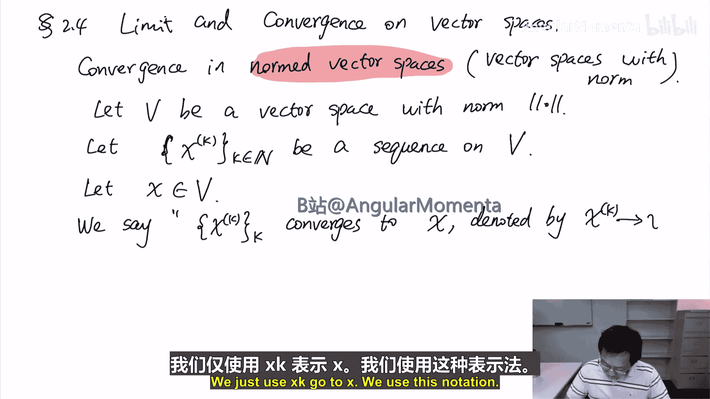

If this happened。If the。Limit。

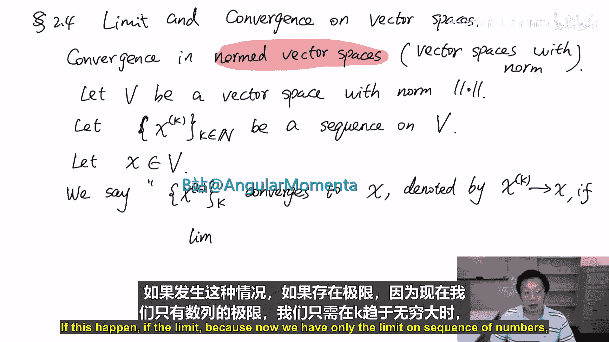

Because now we have only the limit on sequence of numbers。We just use this。

Limit of X K minus x equals to 0。 when K goes to infinity。This is the definition of。Convergence。O。

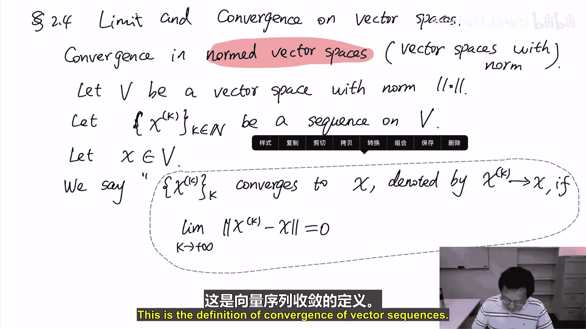

Vector sequences。

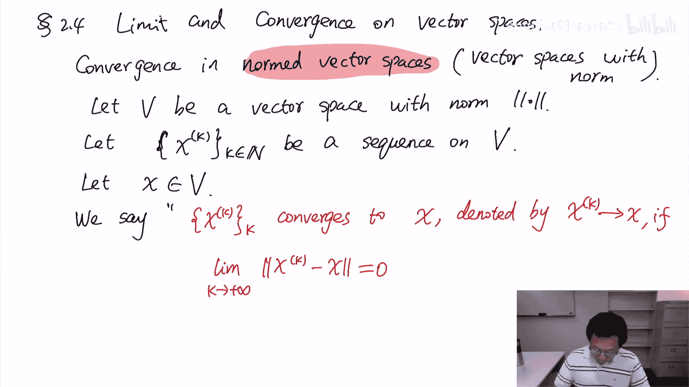

X， K converges to x。 If the limit of the distance between X， K and X goes to 0。

 as K goes to infinity， X， K converges to X。

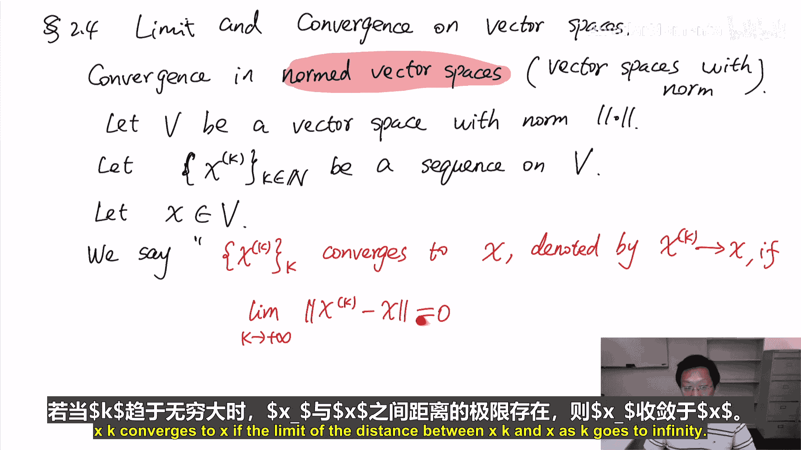

If and only if their limits。Of this distance between X，k and X measured by the norm in the。

As K goes to infinity。This limit becomes0。This is the definition of convergence in the norm vector space。

 It's quite natural because we used a norm to measure the distance between X， K and X。

The X K minus x， the norm is the distance of x to K to x。Now， this distance becomes。Very， very small。

 the distance converses to zero。Then we just say the vector sequence xk converges to x。

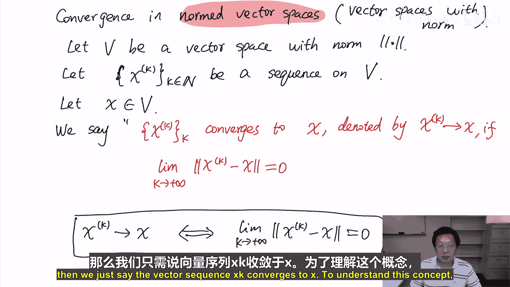

To understand this concept， let me give you some examples。Example  one。We just consider。The R N。With。

The two norm。Now let's just consider a sequence of vectors Xk be defined in this way。

It just one over K，2 over k and n over k。This is in R end。And now I consider an x be the zero vector。

 which means that all entries of this vector， it is just 0。Then let's just consider the limits。

The x K minus x， the2 norm。The distance between X， K and X。Because x equals to0。X K minus x。

 that2 norm is just。2 norm of X， K， which by definition， equals sum of squares。Of entries of X K。

 which is。I over k the squared。And then， take the square roots。W choose。Because。Here。

 K is independent of I。 So then we have a common factor。

1 over K squared and then take the square root。 So it's just one over K。

Times the sigma of I from  one to n。I squared。And then， take the square roots。

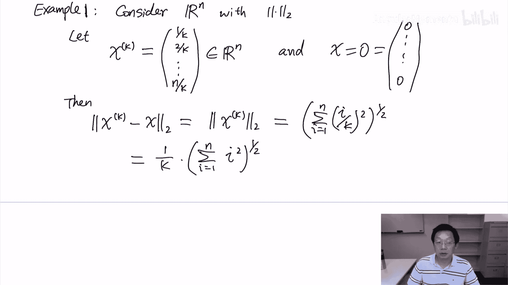

This is a constantstance。So then when K goes to infinity。Xk minus x， the two norm。

 It is just the limit of this K goes to infinity。1 network K times this constant。

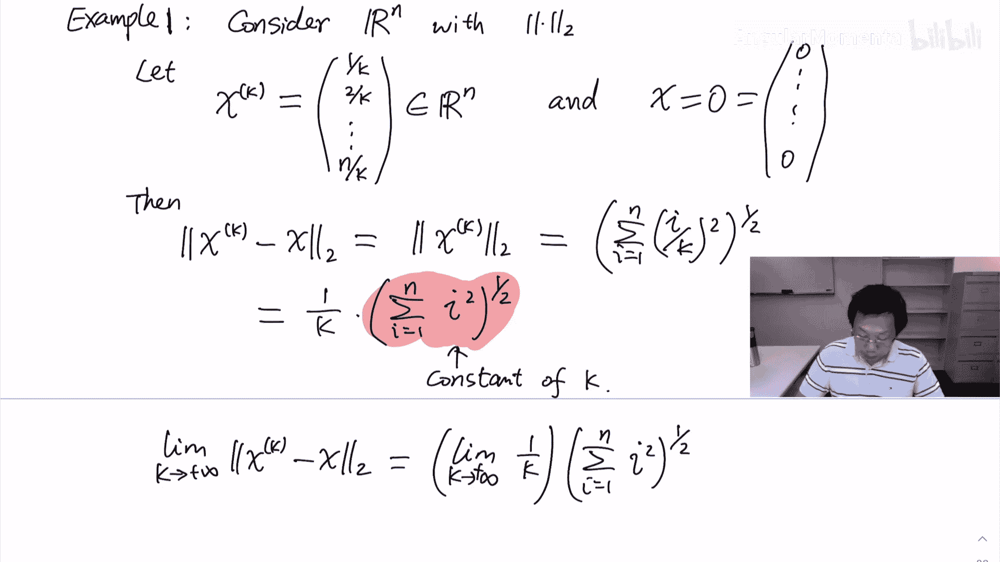

Then obviously， it is just zero because this limit is0 when k goes to infinity。

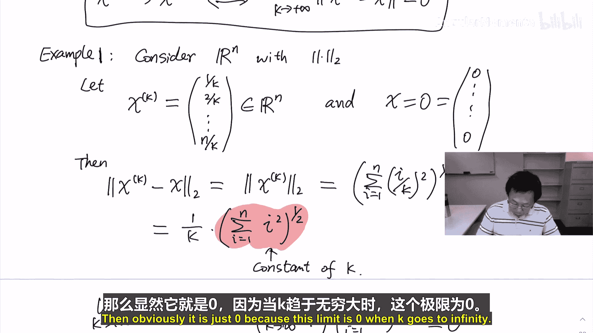

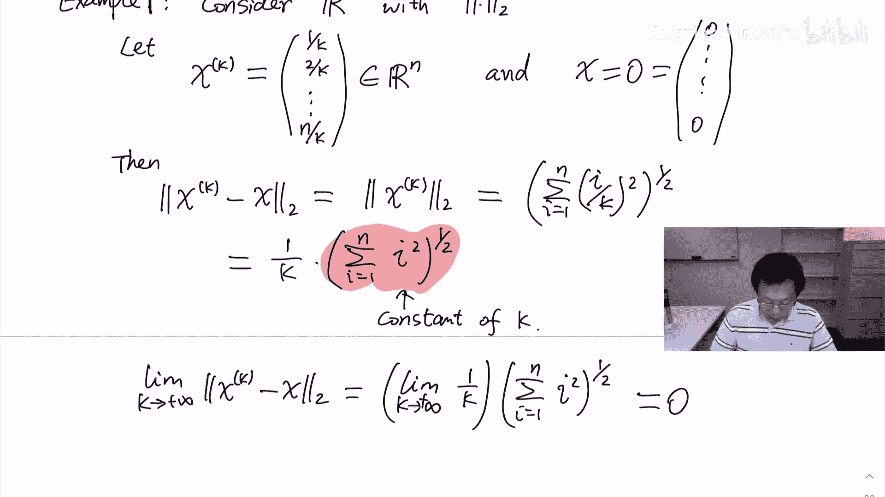

Therefore。We have seen that this。The limit of this xk minus x， the2 norm equals to 0。And also。

 because this X K is in RM for any K and this x， the zero vector is also obviously in R。

So that this X K just converges to x。

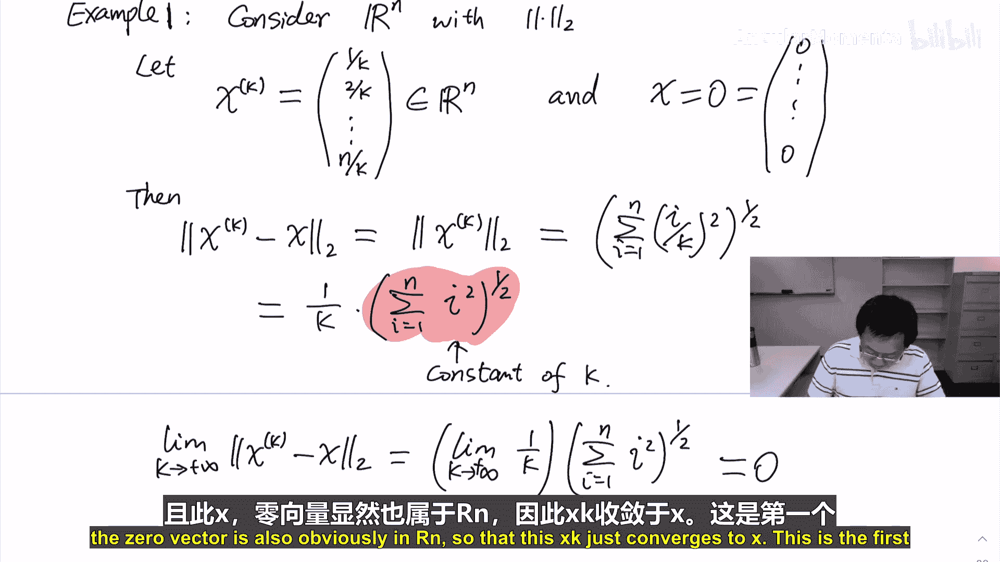

This is the first example。Example 2。Because we know that functions may form a vector space like this。

The set of all continuous function on the close the interval， like this is C01。Which is just the F。

 the set of a or F such that F is is continuous。On this interval， from 0 to one。Now， on this。

Vector space， as we have seen， that the infinity norm is a norm on this vector space。

Recall the infinity norm is just defined to be the max。Of this F of T。Overall， T in this interval。

This is a function space。It's a vector space consisting of functions。

Now we consider a sequence of functions on this vector space。I just just have a very simple function。

 I call it FKT。Equals to the sine of。2 pi kt。Divided by this K square。And the let。

0 be the zero function。0ero function means that it maps everything to 0。

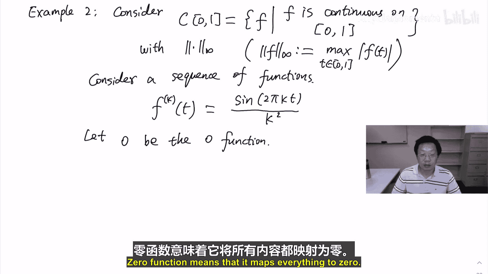

Of course， we have that。This。0 is a function on c 0，1。Zero function， of course， is continuous。

Now let's just consider the distance。Of this FK and the zero function， we consider the infinity。

Distance。Again， by definition， it is just the FK。You norm big。

Any vector subtracted by 0 is that vector。Then by definition， it's just the max of this T on。0。

1 of this absolute value of this sine 2 pi K T。Over K square。Obviously， we can have a common factor。

This K squared， because this K squared is independent， independent of T。

And the maxim of this society。On this interval is one the absolute value。

 The maximum absolute value of this one is one。So， then。This。

Infinity norm of this difference is just one lowercase squared。Then obviously they name it。

K approaches infinity FK minus0 the infinity norm。 It is just the limit of this K approaches infinity 1 over K squared。

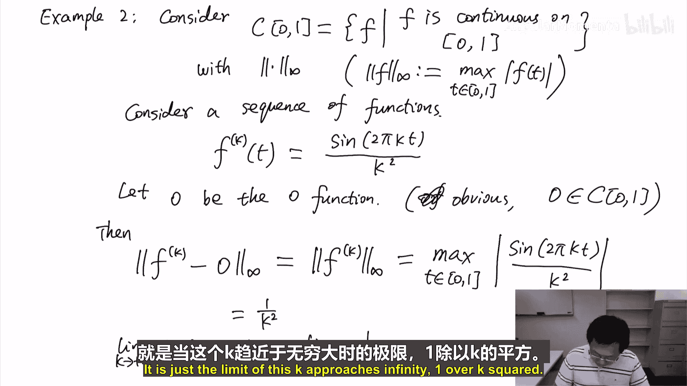

This is just zero。So。We see that in this example， the FK is in C01。

And this0 is also in C01 under this limit of the distance between FK and0。

Goes to equals to 0 so that according to our definition， FK converges to 0。

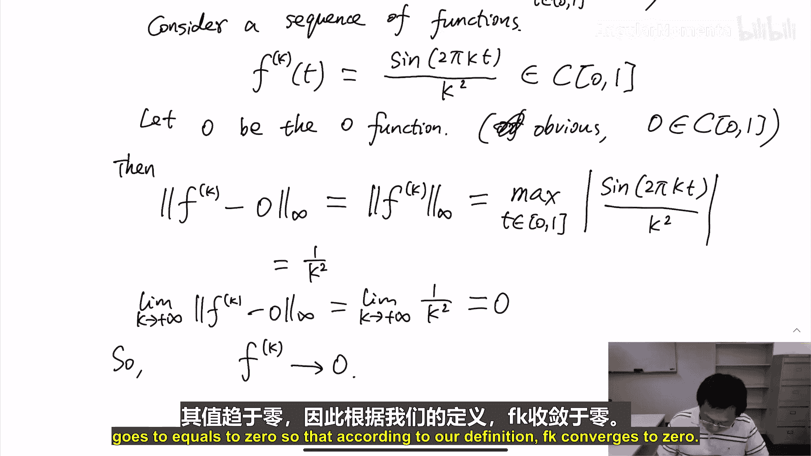

So this sequence of functions converges to the zero function。So visually， it just a see。

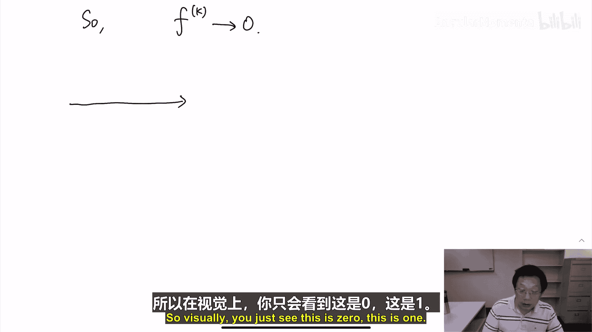

This is0。 This is one。 So for our F1， it is just。Sine to pie T over one， just the sine function。

It just it looks like this。 This is F1。And for this F2。It's signine 4 over 4。

So itss maximum absolute The value becomes smaller and。It becomes more alternate。Oating。

This is F2 and F3。Smaller， the absolute value becomes smallerer。

 and the function becomes more authorlative。And this is F 2。 This is F 3。

 So you can imagine that when this K goes to infinity， this function just becomes。

More and more close to 0。Maybe this is F in finish， F， maybe F 10。F 10 is already very， very。

 very close to 0。 So that's the limit。Is the0 function。

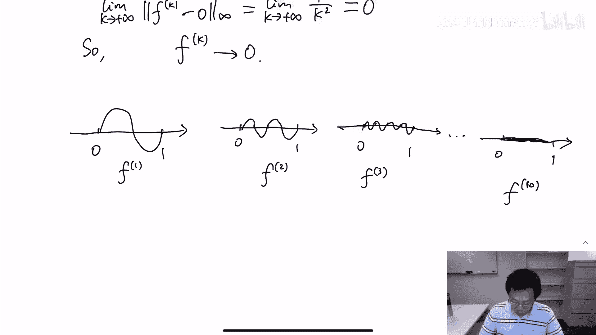

This is the second example。