# 【香港科技大学】数据分析的数学方法 ｜ Mathematical Methods for Data Analysis p27 07-03-02-视频 -BV1DEFDzGEZW_p27-

From our example4， we have seen that some normal vector spaces are not complete。

Which means that those normally mixed spaces is not closed under the limit operation。Actually。

 completeness is a big issue for norm vector spaces。In the following。

 I will give you a brief discussion on the completeness of normal vector spaces。First of all。

Completeness matters。Theoretically， because we are going to discuss。Functions on vector spaces。

To do the analysis or to do the optimization。Which means that we need to define calculus of functions on vector spaces。

If the underlying vector spaces is not complete， then we cannot define the calculus such as the differentiation。

This is in a similar situation to the single variable calculus。In the single variable clus。

 we need first to complete the number system。Our functions are all defined on real numbers。

Not defined on rational numbers。Because the set of all rational numbers is not complete。

And if we complete the rational numbers， we will get the real numbers。This is one reason。Practically。

 let's go back to machine learning。As we have seen in the Kese algorithm。

Many algorithms in machine learning are iterative algorithms。In those algorithms。

 we produce a sequence of iterations in a certain norm vector space。

We can make sure that each iteration is in the vector space。

But if that underlying vector space is incompent。Then the limit of the iteration may not be in the underlying normal vector space。

Which means that we get a solution that is not expected。

 We expect a solution in the underlying norm vector space。For this reason。

 the underlying norm vector space must be complete。But so far。

 this completeness is just a very big definition。Mathematicically。

 how could we define this completeness？Rgorously。This is related to the cosi sequence。

The definition of Ca sequence is quite mathematical evolving。Intuitively。

It's just to say that for a sequence。X K for sufficiently， K and L。Their distance， X， K minus X。

 L should be。Very， very small。

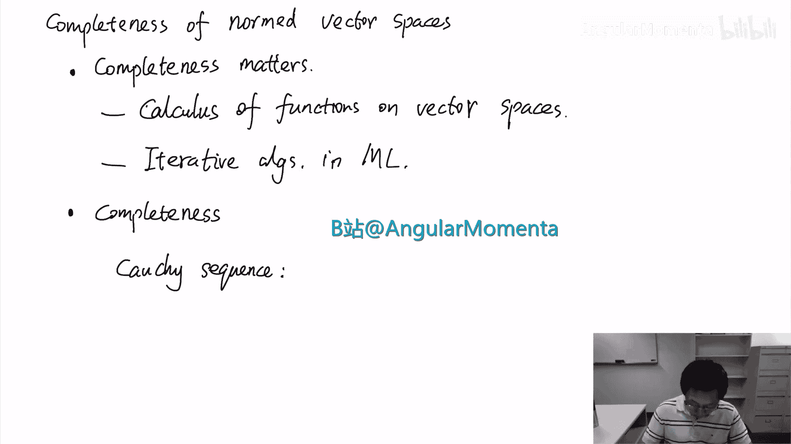

Xk。Is a cautious sequence。If。For any absinnal。Nerer than 0。We can find a sufficiently large K。

 such that for any K and the L。Larger than all equals to K。We have。X K minus XL。Some more though。

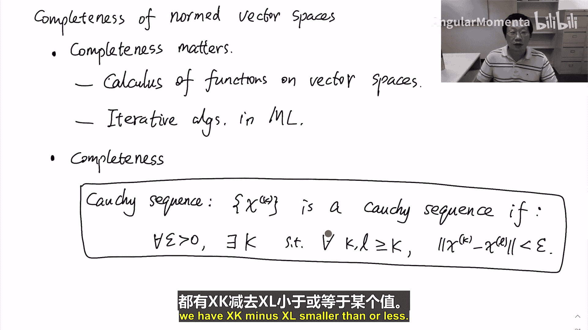

With the cos sequence， we can see that。First。If。X，k。Converges to x。Y为。And돼。Under the norm。Then。

This is sequence。Must be。A cautious sequence。This means that a convergent sequence must be a co sequence。

But。The reverse is not necessarily true。

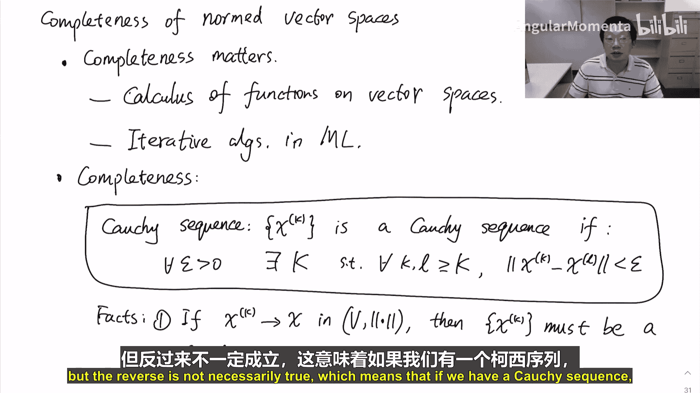

Which means that if we have a cas sequence， this ca sequence might not be convergent。Indeed。

 our example4 here。Is just such an example。 The A K here constructed here is a cautious sequence。

 You can check it。But。This Cas sequence just does not converge because the suppose the limit a is not in this space B。

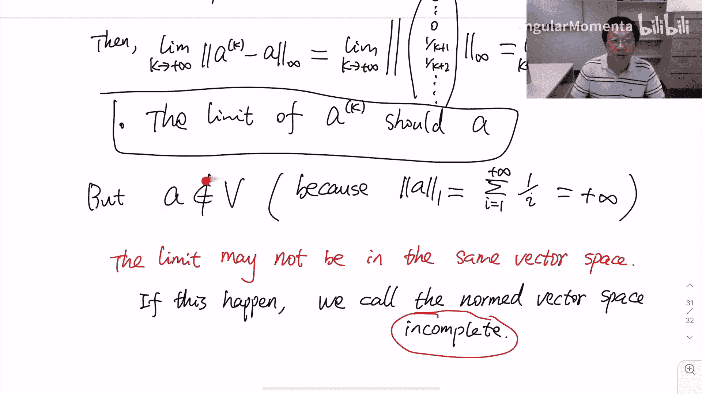

The examplele 4 is a concrete example。

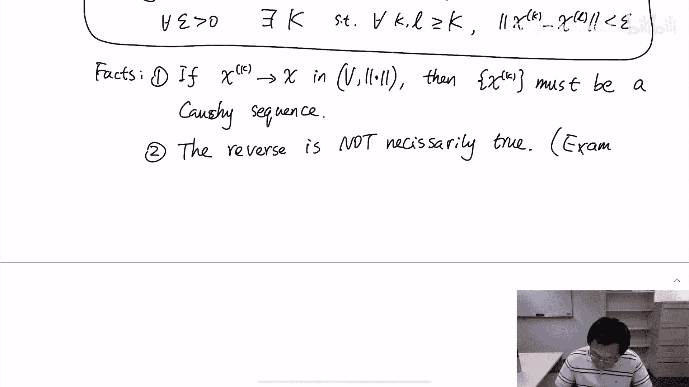

From these two facts， we see that the set of all convergent sequences is a subset of the set of all co sequences。

Which means that a cautious sequence is not necessarily convergent。

 but a convergent sequence must be a cautious sequence。

But let's go back to the definition of the co sequence。 In the definition of the qua sequence sings。

For sufficiently two large numbers， K and L， the distance of X， K and X。

 L becomes smaller and smaller。 This sequence should be convergent。And also。

Another good thing about the Cas sequenceency is that in the definition of the Cas sequence。

 we used only the sequence itself。We didn't use any information， besides。That sequence。

But this is different in the definition of a convergent sequence。

 in the definition of the convergent sequence， we need both X，K and X。But this X， we don't know。

 right， suppose in the practical situation， we just have the sequence。

We don't have the limit before we know it。So this conscious sequence is more proactive according into a check。

It involves only the sequence itself。For the convergenence sequence。

 it involves both the sequence and the limit， but the limit we may not have it。 Now。

 with the help of the Ca sequence， we can define。Companness。Actually， for this conscious sequence。

 intuitive， for sub sufficiently large K and L， this X， K and X L becomes small， closer and closer。

So this sequence should be convergent， but we do have some new examples。Saly that。

A cautious sequence does not conversege。So if this happened。We just say that that。Space is incompent。

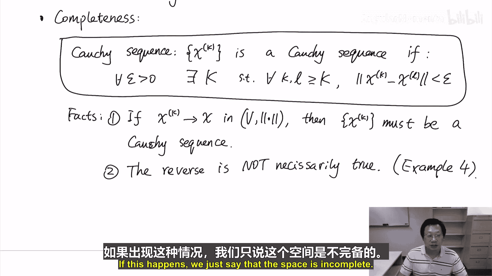

This is the definition of completeness。A vector space is complete if the limit of all co sequences in V is in B。

Now， for a vector space just means。The set of all cos sequences is the same as the set of all convergent sequences。

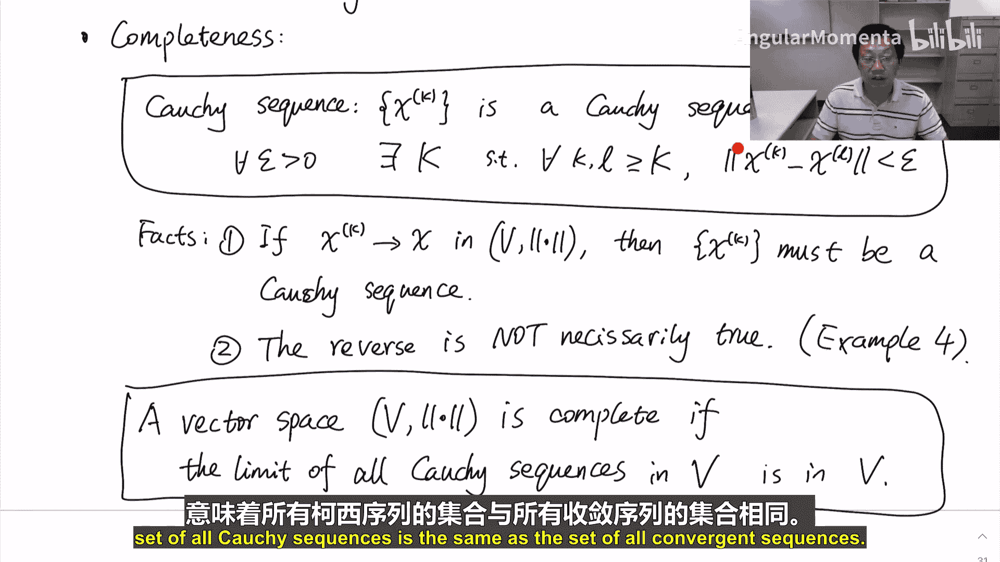

Actually， there is a name for the complete norm vector space。

Accompanied Norman vector space is just called a Baahe space。

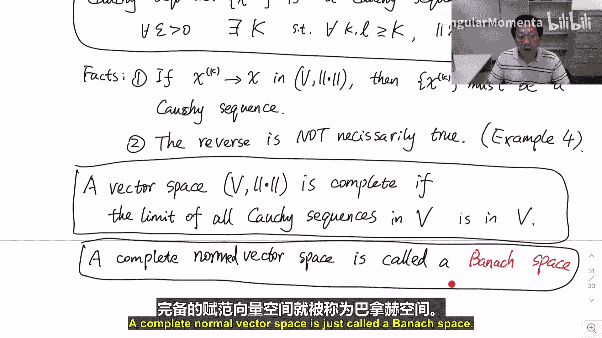

Also， a fact about the completeness is that we can always complete incomplete。Norm the vector space。

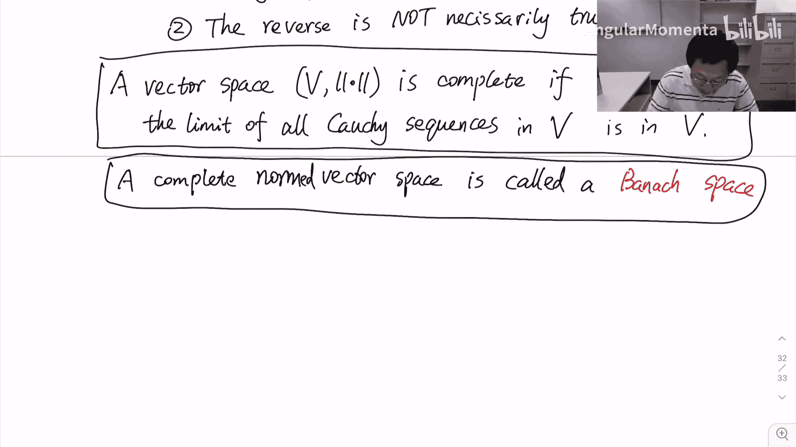

We can always complete a normal vector space by including all limits of the co sequences。

This is our good news。If we have an incompte vector space， we just accompany it。

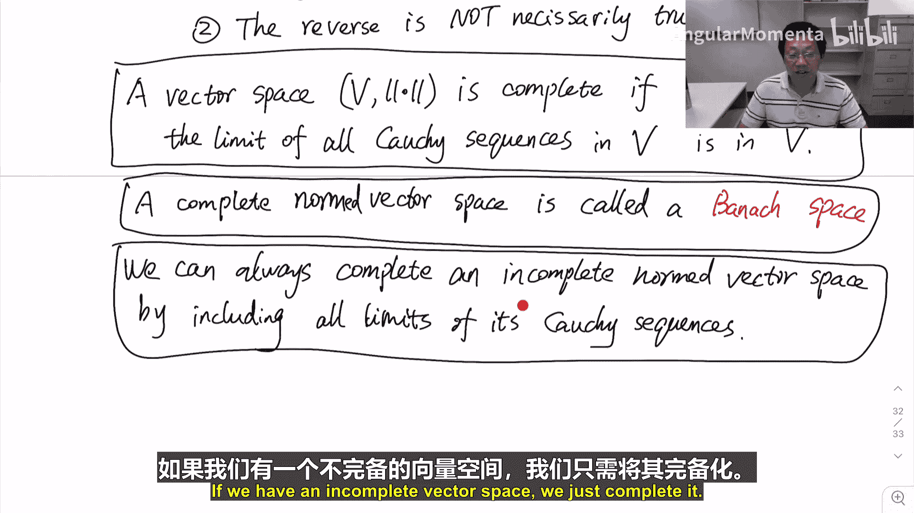

For example。For this space its incompent， but we can complete it under the infinite norm。

We will recover the L infin space。

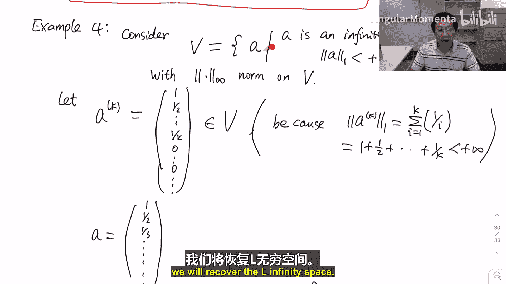

Now I give you some examples of complete Nor vector spaces or Baha spaces。

Because now we are going to work on only Baaha spaces。

Especially in the calculus of functions of vectors。They you Canadian space RN。With any norm。

A just the about h spaces。Notice that when we specify a banner space。

 when we specify whether or not a normal vector space is complete。

We should have both the space and the norm on it。The RN。With any norm， with one norm， with two norm。

 with p norm， with infinity norm， they are all complete normed vector spaces。

 they are all Baaha spaces。The second one is that's death。Marices spaces。Again， was any norm。

We can use the vector p norm of a matrix， or we can use the matrix P norm of matrices。On our M by N。

So RM by N with any norm are Baha spaces。

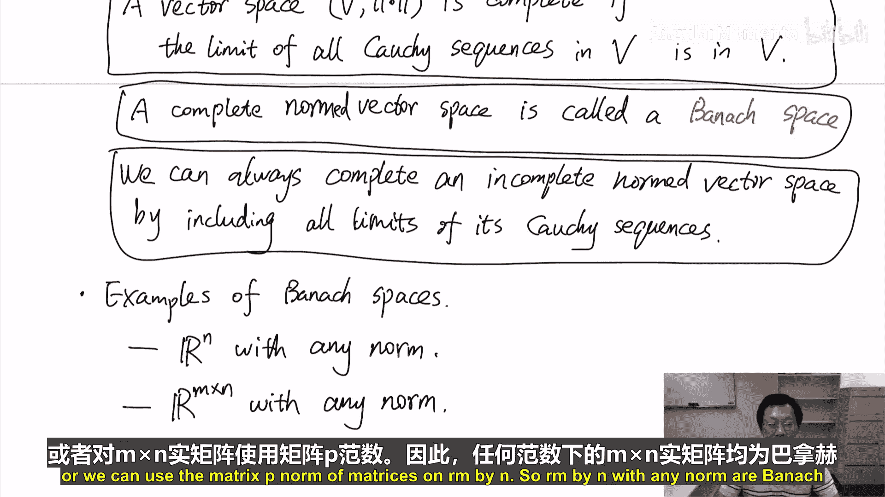

Similarly， the tensor space。R N by M by L with any norm。Also complete normal vector spaces。

These are some examples of complete normal spaces defined on discrete grid。For function spaces。

 actually some of them are also complete like this CAB。With。In非利其玩。

We should be careful when we discuss the competitiveness of function spaces。

We should be careful on the corresponding norms。The completeness of function spaces are very sensitive to norms。

The last example is the LP space with the p norm。Of course， for any P。

 that is larger than all equals to one。And P equals to infinity。

These are examples of complete norm vector spaces。Also， there are some bad examples。Of incomp。Spaces。

Examples of incomp。N么的。Vture。Spaces。These spaces are not good。

The first example of incomp space is the example4， or V is just。The infinite sequences。

 whose one norm is less than。finitity。But。On this space， we use the infinity norm。

This one is incompent。As I have mentioned before， we can always complete an incompan normal vector space。

What is the composition of this。This space with the infinity norm。So， actually， it's competition。

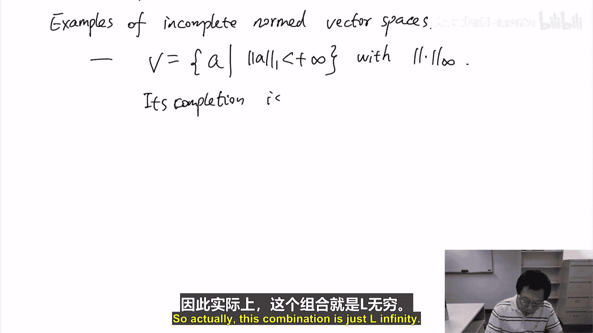

Is just our infinity。The second example is this CAAB。Again， as I have mentioned， the function space。

The completeness of function spaces are very sensitive to norms used there。For C A B。For C A B。

If we don't use the village norm， I use a P norm。Remember。

 the P norm is just defined in the way that the integral of this F。Tee。

D T the peace power and then take the peace route。The C A B was P norm。Actually， they are incomp。

Per than one， of course。Is incomplete。What is。Their competition。It's completion。

Is the so called large LP， capital LP space。AB。It is just this space。

This capital LP will study in real analysis， actually there the integral will also be changed。

WhenWhen we learn calculus， the integral may be just remainman integral。

 But when we define this LP space， we need to extend。

The re integral to the so called the bag integral。And it is very， very complicated。

We may need several semesters to learn。A single course of。Real analysis。

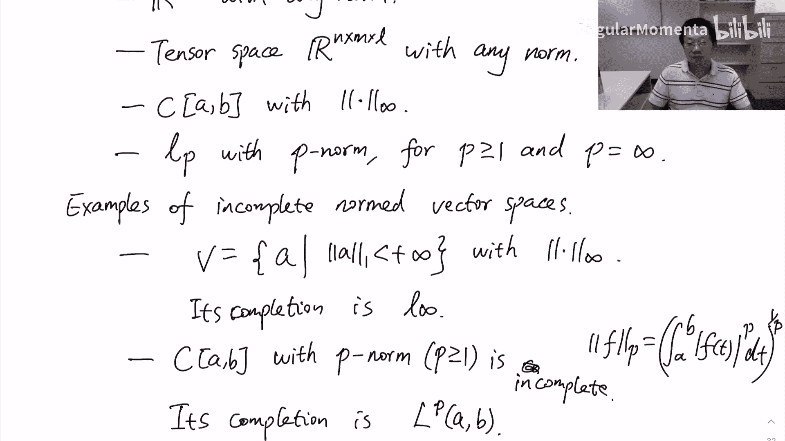