# 【香港科技大学】数据分析的数学方法 ｜ Mathematical Methods for Data Analysis p29 07-05-02-视频 -BV1DEFDzGEZW_p29-

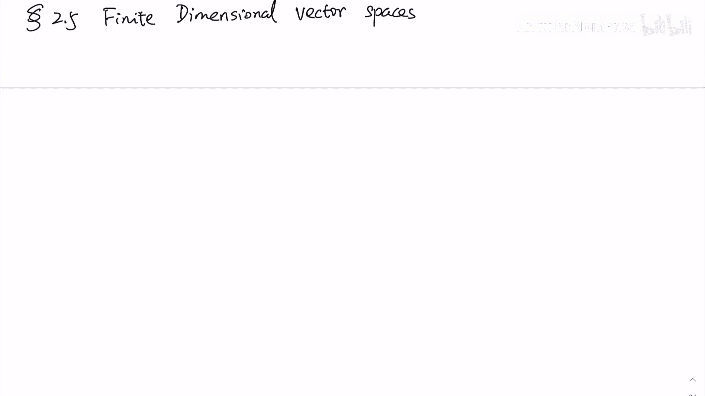

So far， we have seen some normative vector spaces really nasty。

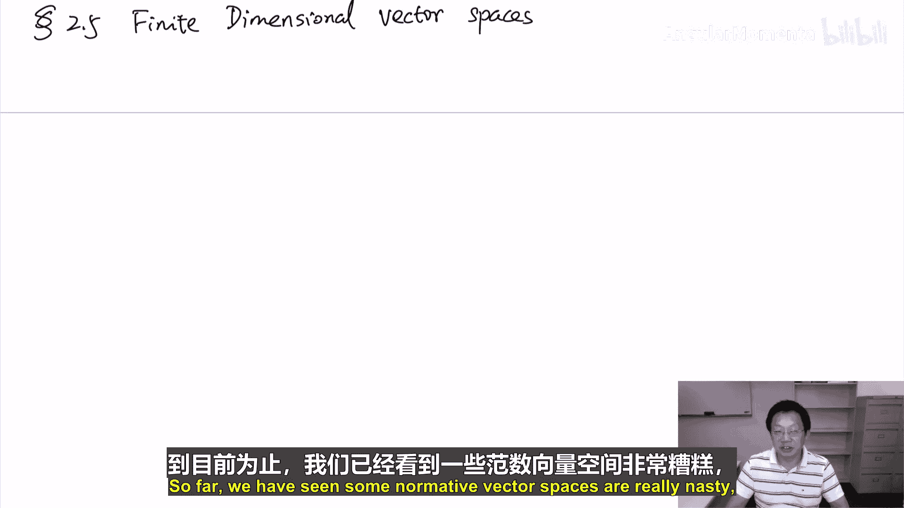

Especially on limits and convergence， for example， this CA AB space。

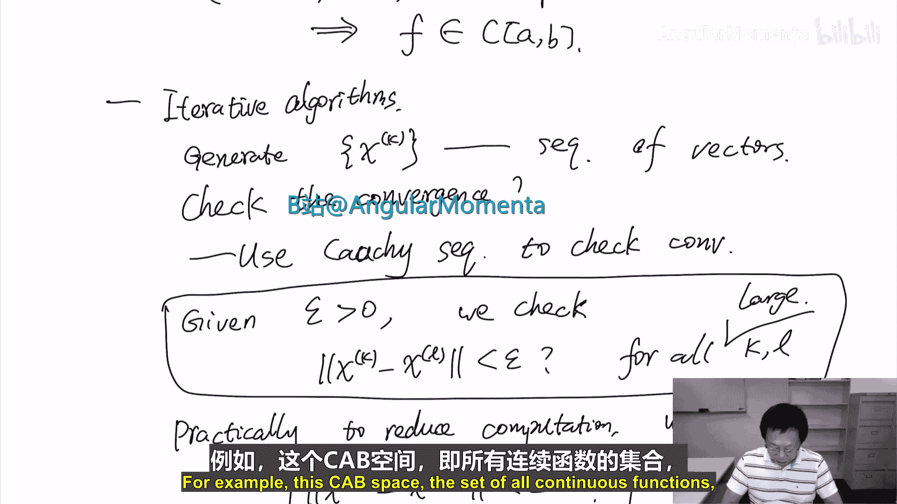

The set of all continuous functions。This space sometimes is complete when we use the infinity norm。

But sometimes it's incomplete if we use the two norm or if we use the P norm with P larger than or or equals to one。

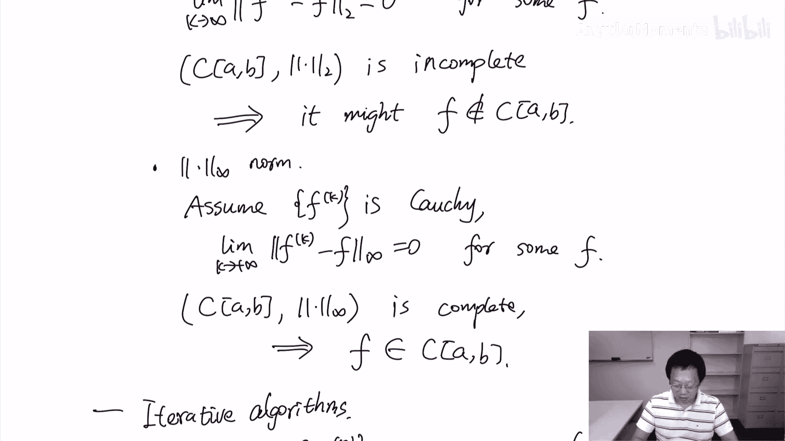

Also， when we demonstrate them。Convergence of sequences。

 We have seen that the limit convergence depends on norms。

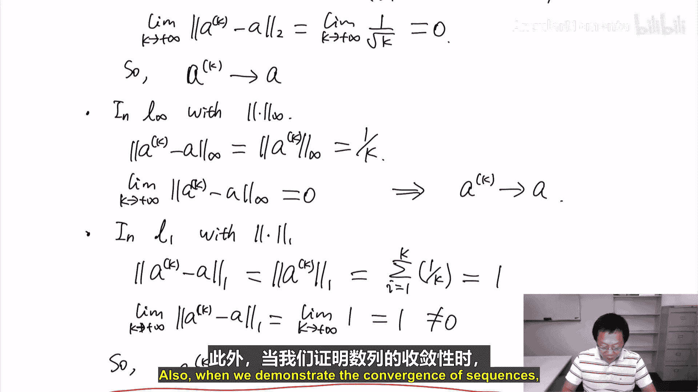

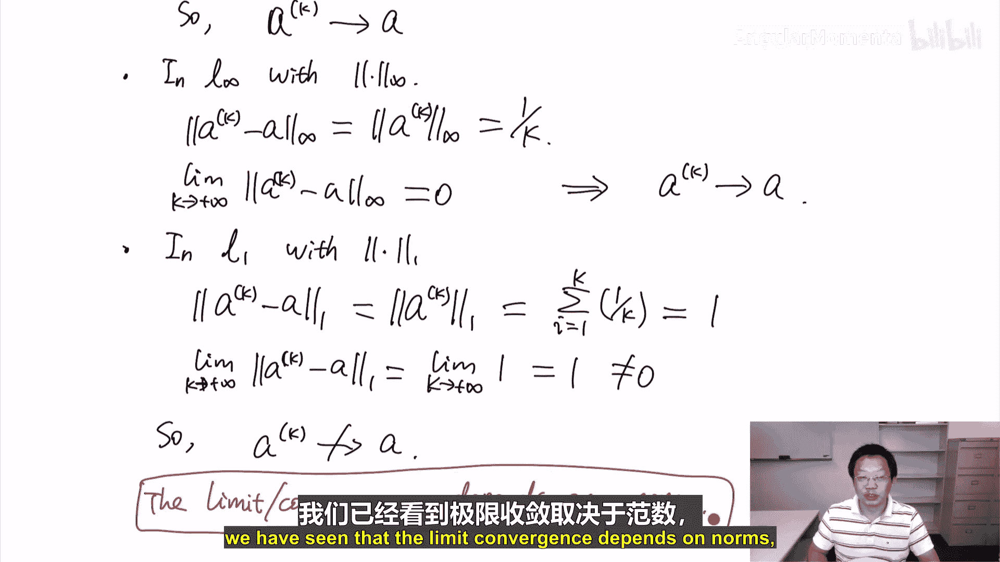

And we use that。You find that the sequence of space。

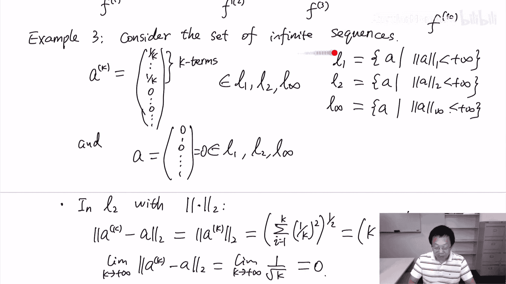

Also， won't we demonstratestr her this sum？And the limit may not be in the same vector space we used again。

 the space of infinite sequences。 Those spaces are not good。

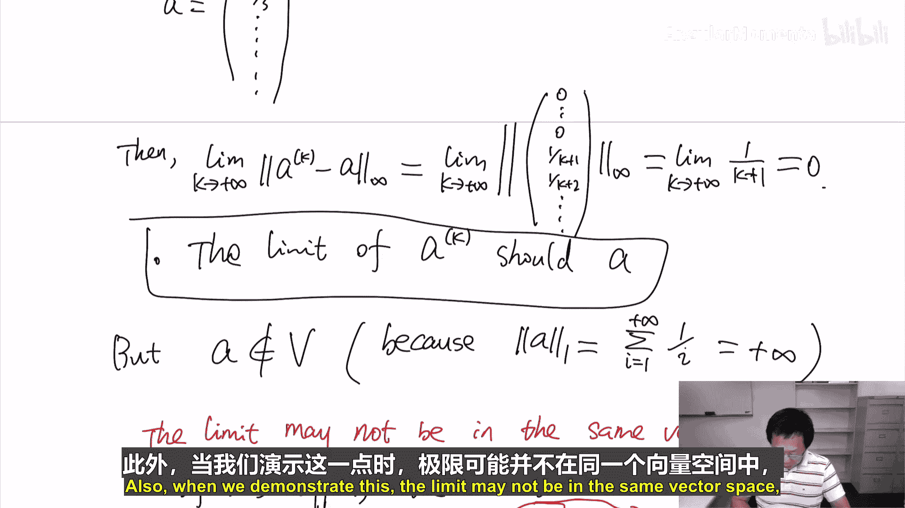

But on the contrary， for some vector spaces。

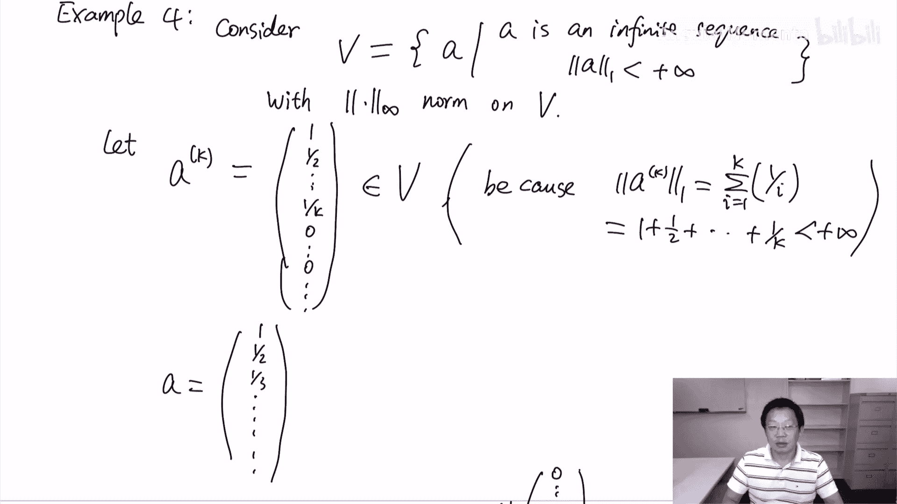

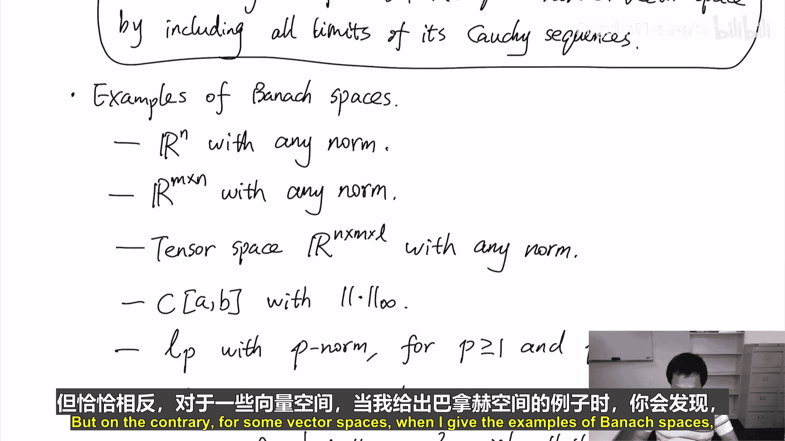

When I give the examples of Baha spaces， you can see that this R N R N by N R N by N by L space。

 with any norm， they are just quite good。 they are always badha spaces， they are always complete。

Why this happened， The main reason is just because these good spaces， they are finitely dimensional。

 Those nasty spaces are infinitely dimensional。

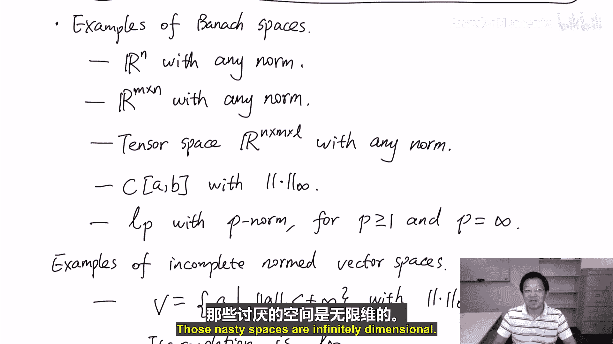

In this section， I just give you some properties of finite dimensional vector spaces。

Another motivation I would like to study finite dimensional vector spaces is。

Is from the practical point of view。In practice。Our computer can only deal with finite numbers。

 with finite digits。Therefore， for any practical iterative algorithm。

 we are always working in the finite dimensional vector space。Then of course。

 there are the convergence and limits in these finite dimensional spaces， they are very。

 very important。We see a finite dimension of vector space， just because。

The vector in that space can be determined by finitely many parameters， like。

RN is an example of finite dimensional vector space because their each vector is just determined by n numbers。

RM by N。The space of matrices is also a finite dimensional vector space because each matrix is determined by M by。

And parameters。And this cancer space are M by M by L。

They are just finite dimensional because each tensor in this space is determined by M， N。

 L parameters。finite dimensional。

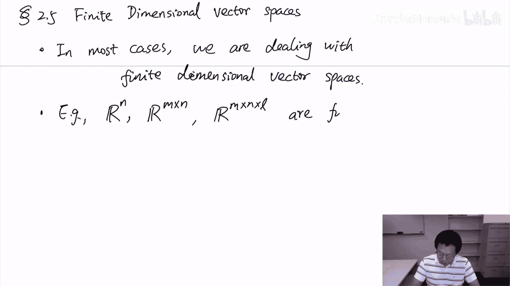

This is C， A B。And these infinite sequences。Space of infinite sequences， L infinity， L2 and Su on。

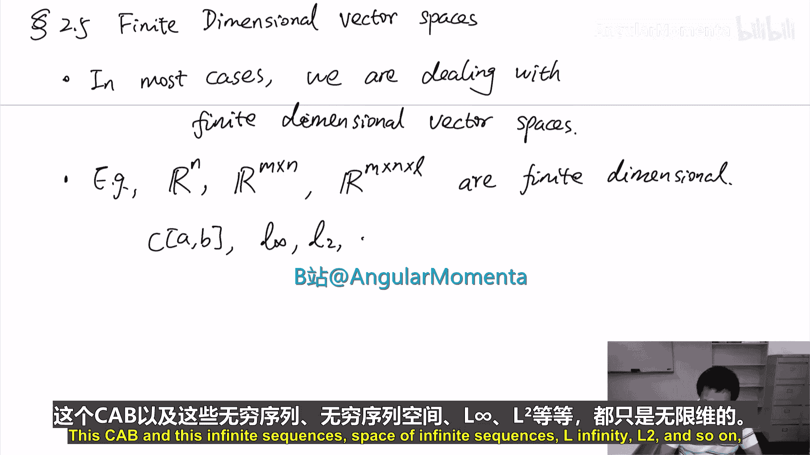

Are just infinite dimensional。

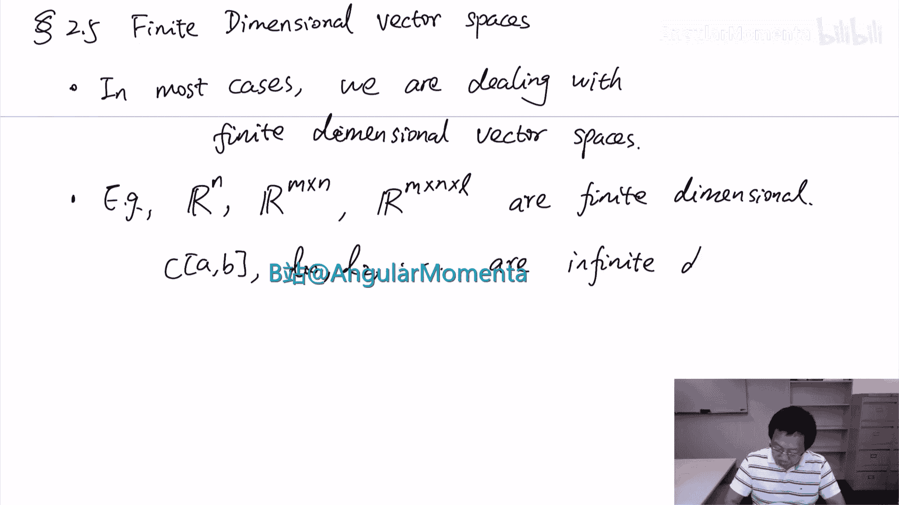

Because， for example， in CAAB， each function is of course determined by infinitely many values。

Because this domain A B contains infinitely many points here。 So for each points。

 I can assign different number。 And for this L to L L infinity。

 definitely they are infinite dimensional because each vector in that space is an infinite sequence。

Though， I have mentioned that in many cases， we will be dealing with finite dimensional vector spaces。

I didn't mean。Infinite dimensional space is useless。 Actually。

 infinite dimensional vector spaces are useful as well。For example， as I have mentioned this。

 we can use this RM by N space to model images， black， white images。But this can be used only for。

Images with a fixed resolution。When the resolution of the images in the database becomes finer and finer。

 this， our space R M by N becomes more and more closer to an infinite dimensional space。

 than in order to study the asymptotic property of the。Our algorithms。When this the M and the N。

Becomes larger and larger。 So we need to use this infinite dimensions。Space to do their analysis。

Anyway， let me present you properties of finite dimensional vector spaces。

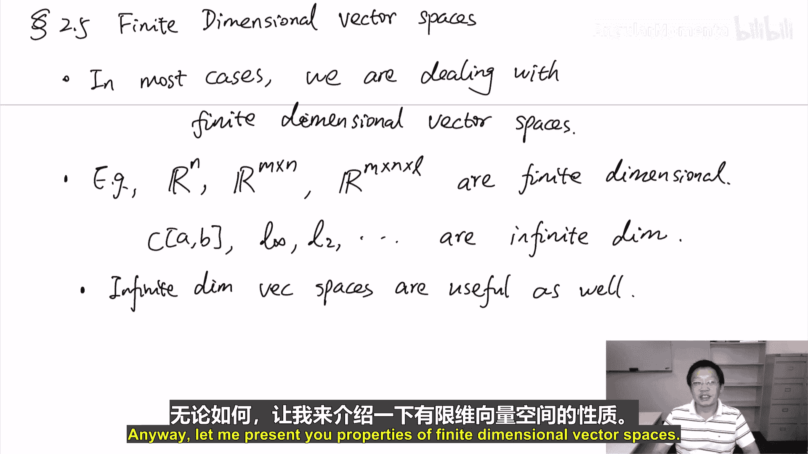

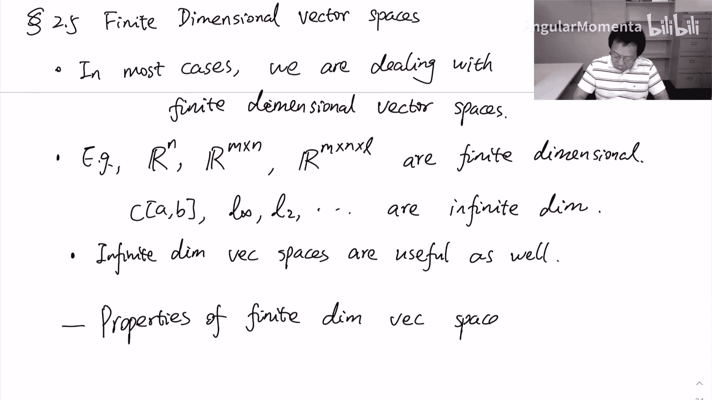

The first property is that。Any finite dimension of vector space。With any norm。Is company。

Which means that any finite dimensional norm vector space is just bananaa space。This is quite good。

 right。 So when we do the iterative algorithms on finite dimensional vector spaces。

 we don't need to worry about their completeness。 The limit will be automatically in that space。

 if we use any norm。We don't need to worry about the norm we used them。

They are not sensitive to the norms。

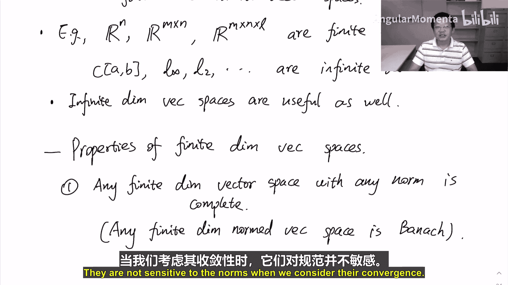

When we consider the convergence。