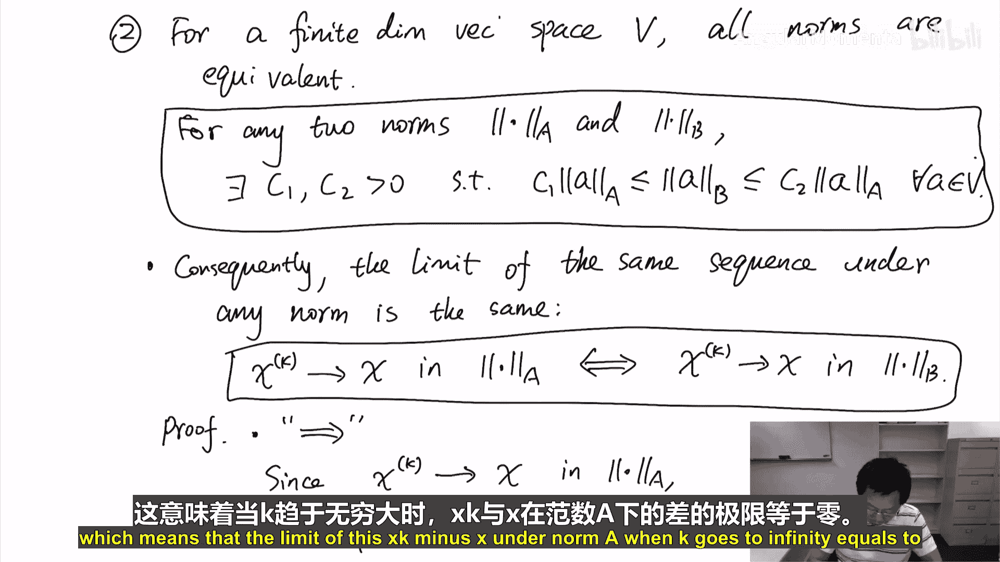
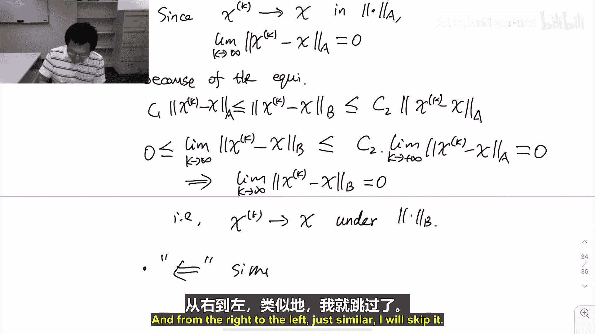
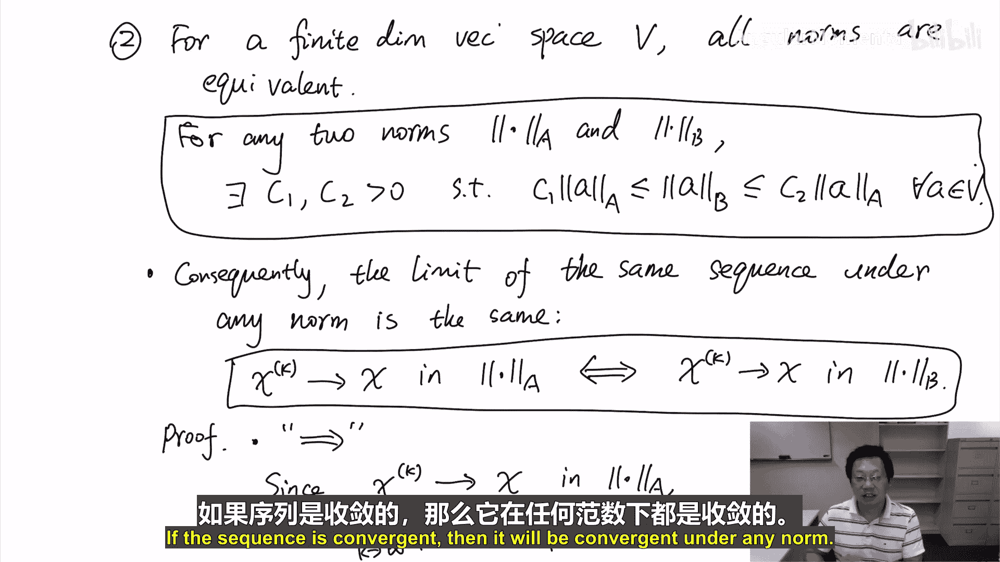
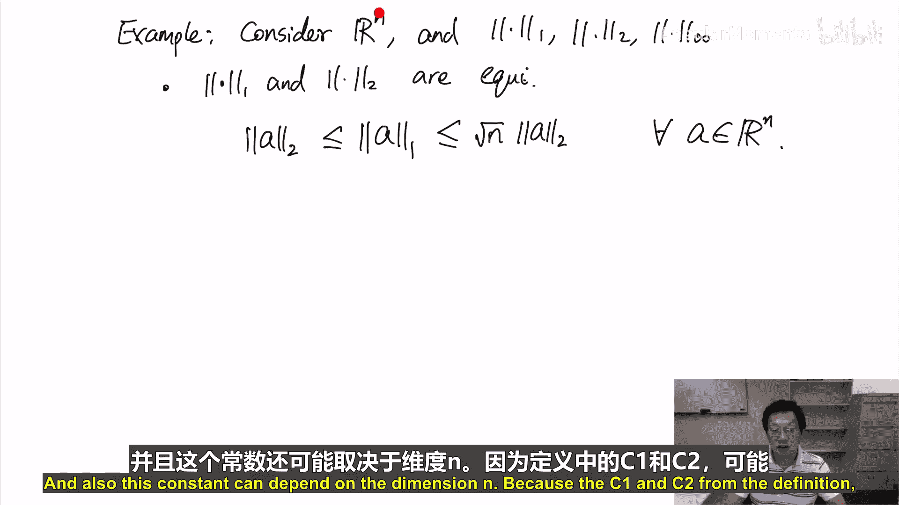
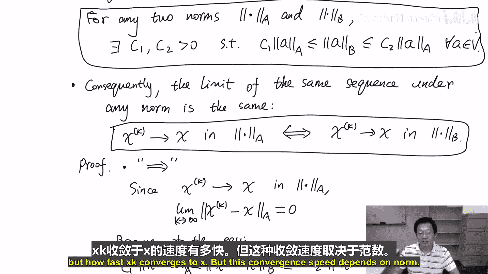
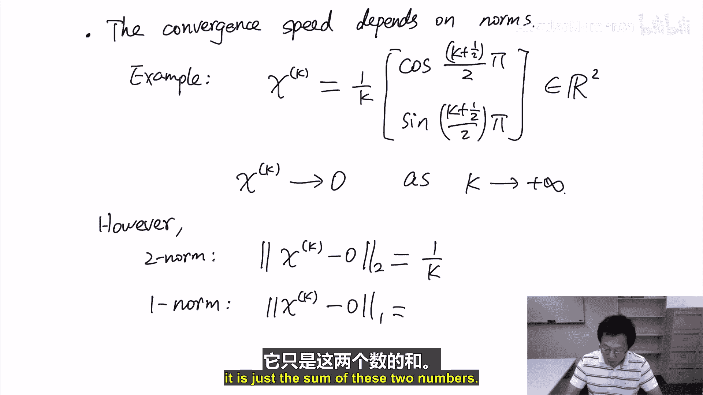
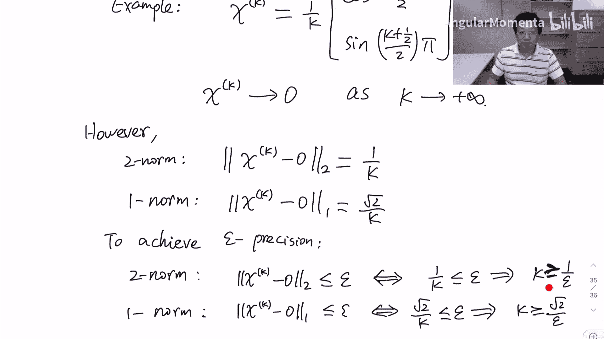
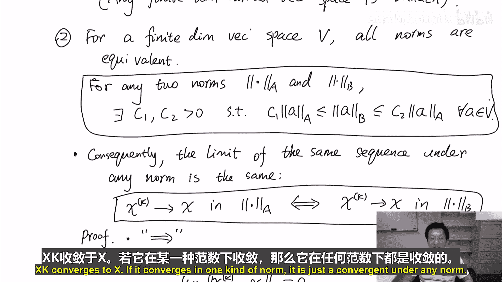
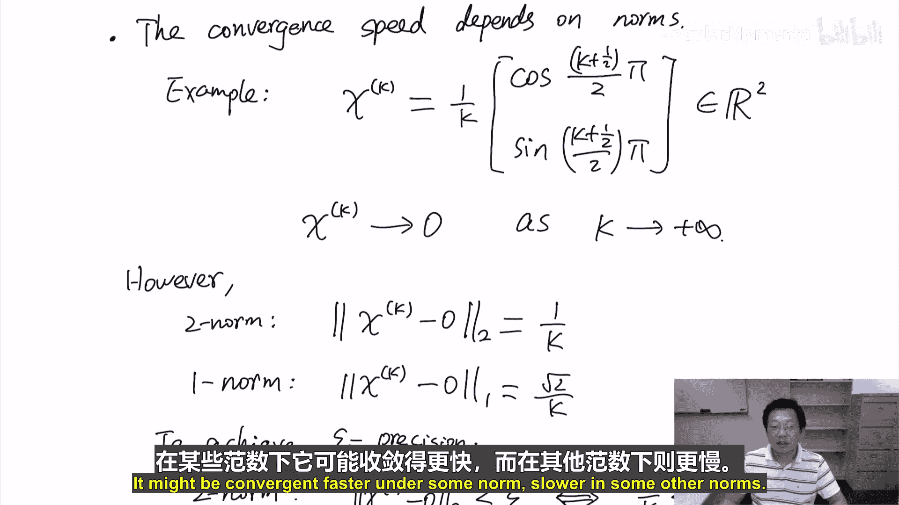

# 【香港科技大学】数据分析的数学方法 ｜ Mathematical Methods for Data Analysis p30 07-06-02-视频 -BV1DEFDzGEZW_p30-

The second property about the finite dimensional vector space is that。

For a finite dimension vector space B， all norms are equivalent。

Which means that for two different kinds of norms， say norm A and norm B on V。

The norm B is always lower and upper bounded by norm A。

This equivalence on norm will give us a direct consequence。

 That is the limit of the same sequence under any norm is the same。In particular。

 you have a sequence X K。That is convergent to x in norm A。Then it is the equivalent to that。

This sequence converges to x in norm B。Let me have a simple proof of this conclusion。

We first consider from the left to the right。Then， since x。K converges to x in normal a。

Which means that's an limit。Of this X K minus x under norm a， when K goes to infinity equals to 0。

Now we need to use the equivalentence because。Of the equivalence。We know that this be norm。Of this。X。

 K minus x。 It is lower bounded by。X K minus x， the a norm times C 1。

And the upper bounded by C2 times Xk。Minus x。A norm。From the equivalence， because for any A， this。

B norm is just lower bounded and upper bounded by the a norm。 So we plug a by X K minus x。

This should be true。Then we take the limit。Of this X K minus x， the B norm when K goes to infinity。

It is just smaller than this C2 times the limit K goes to infinity X K minus x， the a norm。

This limit is 0 because X K converges to x in normal a。On the other hand， because it's a norm。

So the norm is always non negative。 So this limit must be non negative larger than or equals to 0。

Then this simply implies the limit of K approaches infinity。Xk minus x， the B norm is also0。

Just means that。X， K converges to X under。TheB norm。

So we have shown that if the sequence is convergent under norm A， then it convergeence under norm B。

Just because of the normal equivalentvalence here。Convergence in norm A just means that this limit converges to0 so that this limit must be convergent to0 because it is bounded by these two norms。

And from the right to the left。Just a similar。

I will skip it。So here we see that an immediate consequence of the。

Normal equivalence is that the convergence is independent of the choice of the norm。

 So which means that in finite dimension space like the R N， like the matrix space。

 and like the tension space。The convergence is independent of the choice of the norm on under any norm。

 we just get the same convergence behavior for a given sequence， if it is convergent in in the norm。

Then it will be convergent under any norm。That's very nice。Then in practice。

 we only need to worry about the norm choice spin。We just pick an arbitrary norm if the sequence is convergent。

 then it will be convergent under any norm。

Now， let me give you some explicit example of this normal equivalentvalence in finite dimensional vector spaces。

We just conce。And on R N， I， I consider this。1 norm。To norm。And then you're finish up。

The three most commonly use the P norms on it。We know that these three norms are equivalent。

 Let's see the constants in the equivalence。First， we check that。One norm and two norm equivalence。

Indeed， we can see that the one norm will be always larger than the two norm。

We have presented this one night。Introduce that P norm。And on the other hand， this one norm。

 it is also bounded by the square root of n times that2 norm。So that the constant C1 is1 here。

 and C2 is just square root of n。In this equivalence of relation。Now。

 you can see that this C1 and C 2， they are independent of a for any A。

 It is we should use the same constant。 So this constant should be hold for any A in R。And also。

 this constants can depend on the dimension and。

Because the C1 under the C2 from the definition。It can depend on this。

Definition of norm A and norm B in the definition of the norm， one norm and two norm。

 we used the dimension n。This is the one norm and the two norm。

For the two norm and the infinity norm。They are again， equivalent。

Which means that the two norm should be larger than a constant times the infinity norm， actually。

 that constant here is I gain one here。And for the upper bound。

It is just a square root of n times the infinity norm。Again， this C1 is 1。

 and this is C1 C2 is square root of n。Both of them are independent of a。But。

The might depend on the definition of the two norm and the infinity norm here。

 this C2 depends on the N here， because in the definition of two norm and infinity norm， we used an。

For the one norm and the infinity norm， they are also equivalent。In particular。

 one norm is just larger than the infinity norm。The con 1 is a game 1。

The upper bound is just one norm smaller than。N times the infinity norm。Again。

 these two constants are independent of a。But they might depend on the dimension。

Though the norm equivalence tells us that the convergence。Should be the same under any norm。

 The convergence is independent of the choice of the norm。But in practice。

 we may also interested in the convergence speed， not just whether or not X K convergence to X。

 but how fast X K convergence to X。

But this conversion speed depends on norm。For example。

 let's consider a sequence in R 2 defined by X K equals 1 over K。The first component is cosine。

Of half K plus。Off派。The second component is a sign。This is in our tube。For this sequence。

 you can easily check that it just converges to the zero vector。As K goes to infinity。Under any norm。

 because the convergence is just independent of the choice of the norm。But the there。To exist。

 a difference。On the conversion speed。Let's see if we use the true norm。

Then the difference of xk minus0 the2 norm。It is just the two norm of this X K。

 just sum of the squares of this one plus the squares of this one， which is one。So obviously。

 this difference， the two norm of the difference。Is one over K。And for the one norm distance of X， K。

And 0。It is just the sum of these two numbers。

This by trigonmetric identities， you can easily check that it's。Square number 2 over K。

Then in order to achieve a predescribed precision。也不行。Under the two norm。If， we want the。

Everyone is smaller than Ypso。Just means X K。us 0 to2 norm is less than e。 Of course。

 we just want this。1 over K less than eon。 So our K has to be larger than this one over episodeon。

But under the one norm。In order， Xk minus0 is smaller than Ypsson。

 It is equivalent to this square root of k over 2 smaller than all equals to Ypsson。

 which implies that this K has to be larger than this square root of 2 over Eipson。

So you can see that to achieve the same precision。Under two norms and under one norm， we。

The number of iterations needed are different。SoW which means that the convergence speed is different。

In summary。You find that dimension of spaces。Any norms are equivalent， or norms are equivalent。

In a sense that。If we have two different kinds of norms， norm A and norm B， one norm。

 one kind of the norm will be lower bounded and upper bounded by the other kind of norm。

And consequently， the convergence behavior of a sequence。

Is independent of the choice of the norm in finite dimensional norm vector spaces。X K converges to x。

 if it converges in one kind of norm， it is just convergent under any norm。

But the convergence speed。There is a deep difference。It might be convergent faster under some norm。

 slower in some other norms。

