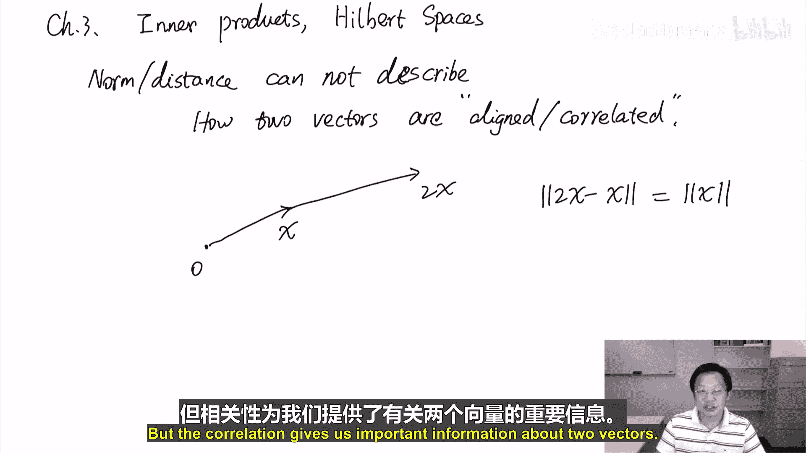
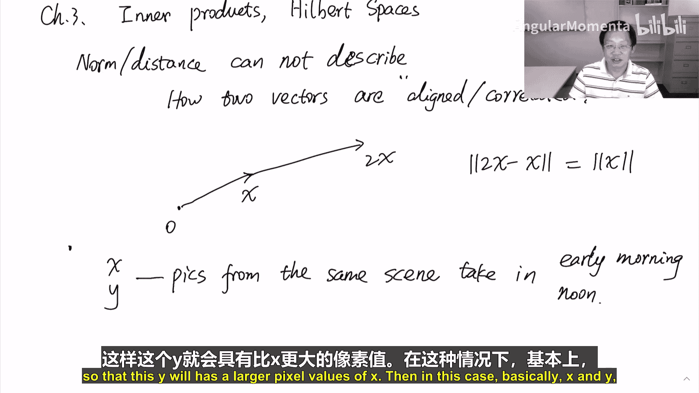
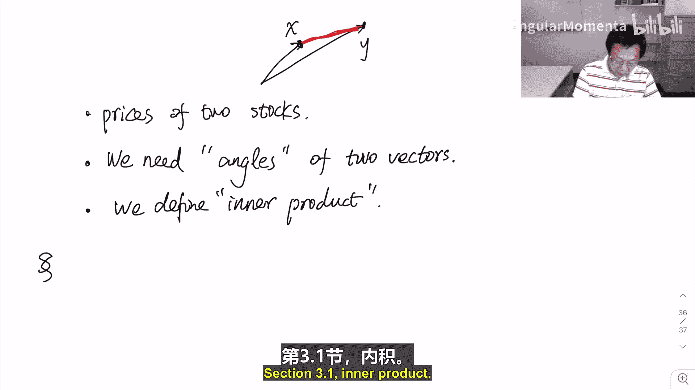
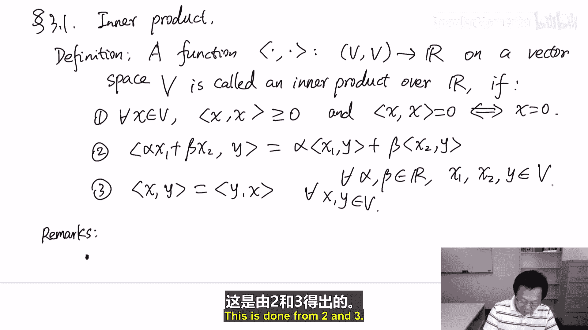
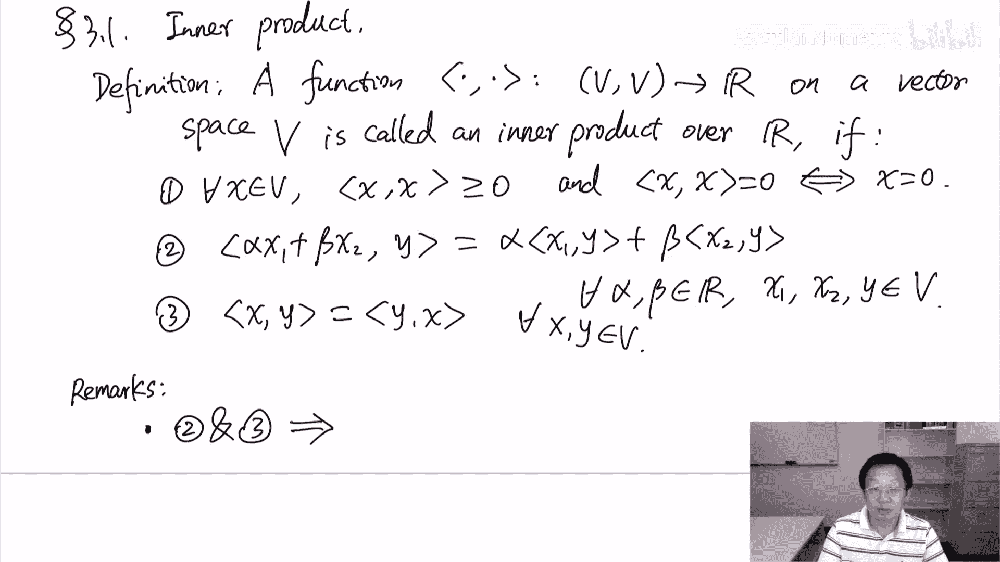
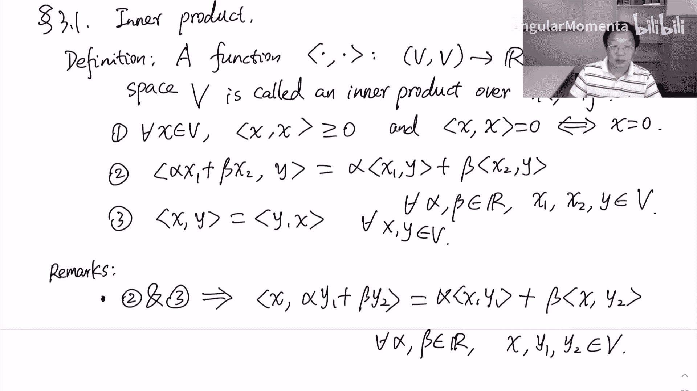
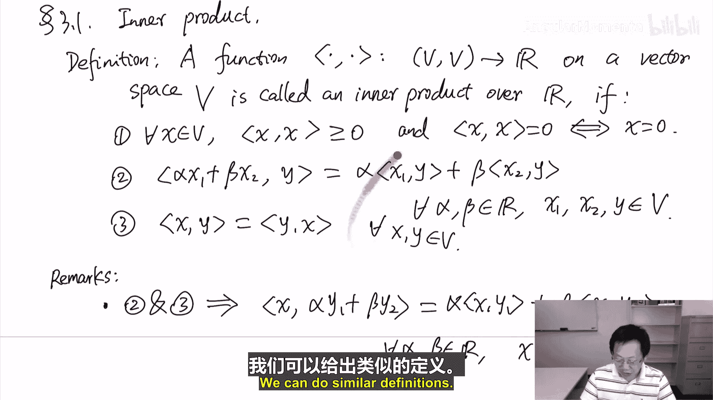
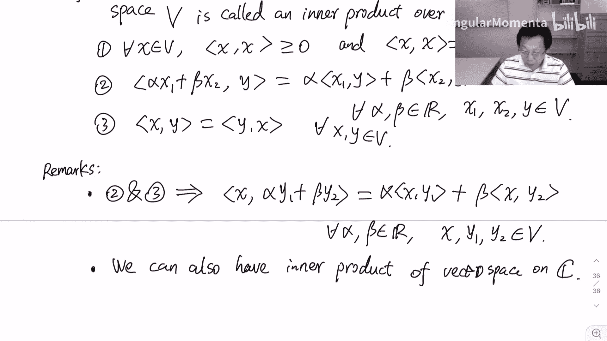

# 【香港科技大学】数据分析的数学方法 ｜ Mathematical Methods for Data Analysis p31 08-01-02-视频 -BV1DEFDzGEZW_p31-

We have defined the norms on vector spaces， and with a norm。

 we can define the distance between two vectors。With the distance。

 we can further define the limit and the convergence of sequences of vectors。But however。

 in many situations， this distance is not enough。The distance cannot describe how two vectors are aligned。

 How two vectors are correlated。In many applicationss， indeed。

 we need the correlation or alignment of two vectors。To see this。

 we just consider an extreme case we have a vector at0， we have a vector x， and it's skin like 2 x。

Now， this distance between 2 x minus x， it is just x。文。The norm of x is large。

 this distance between 2 x and x will be very large。But however， this vector x and 2 x。

 they are exactly in the same direction， they are exactly aligned， they are exactly correlated。

So the norm cannot describe the correlation between two vectors。

 but the correlation gives us important information about two vectors。

More explicitly， we just consider this a scenario。We have two pictures， x and Y。

The posts are pictures from the same scene。But they are taken in different time。For example。

 X is taken in the early morning。And why is taking in the noon。

Because they are for the same thing so that the patternss of these two pictures are very。

 very similar， almost the same。But because they are taken under different conditionss of nighting。

The magnitude of pixels can be very， very different。Better lightinging condition， of course， larger。

Pixel values。So that this y well has a larger pixel values of x。

Then in this case， basically x and y， they are very similar。 they are quite aligned。

They aligned very well。 They are quite correlated， but， of course。

 we cannot use the distance of X and Y to describe the relations of X and Y。

 because the distance of X and y can be very different， but their directions are quite aligned。

This might also happen when we consider the prices of two stocks。

Assume that the change of one stock price just follows the other。 but these two companies。

 these two stocks are in different scale。So that， though。

 the vector of prices of these two stocks are quite correlated， are quite well aligned。

But their distance is just a very big。Then in this case， again。

 the distance is not a good one to describe the correlation between two vectors。

Then we need to introduce a new quantity to describe how vectors are aligned。

 or we need to impose the angles between two vectors。For this purpose。

 we needed to define the inner product first。Section 3。1 inner the product。

The inner product is a function for a pair of vectors。So in the product， actually。

 it is just a functions of a pair of vectors。It maps a vector and another vector to a real number。

This function should satisfy the conditions。The first condition is that the inner product of the same vector should be non negative。

And this inner protector is zero。If， and only if。X is 0。

The second condition is that the in product should be linear with respect to the first variable in particular。

You can see here this is an linear combination of the first variable。

Then we take the inner product with y。 It should be we first take the inner product with y and then do the linear combination。

The last condition is that the two variables in the inner product should be commutable。In particular。

The in product of x Y should be the same as Y X。This is the definition of inner protect。

There are several immediate consequences about this definition。

A first immediate consequence is that this inner protector should be linear with respect to its second input as well。

This is done from2 and three。

From2， we can see that this inner product is linear with respect to the first input。 from3。

 this inner product is just commutable。So that we can commute this to。

 we can get that this inner product should be linear with respect to this second input as well。

A second remark is that in this definition， we just define the inner product over R。

This in the product is from a pair of vectors to R， and this V is a vector space on R。

As I have mentioned before， we can have the vector space over C over complex numbers。So in this case。

 the in product should be from V and V to C to a complex number。We can do similar definitions。

