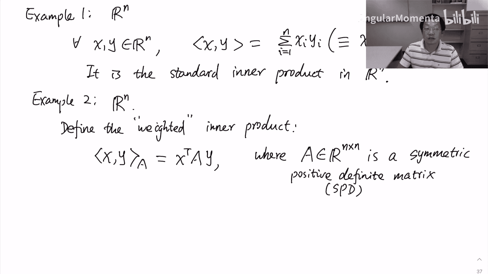
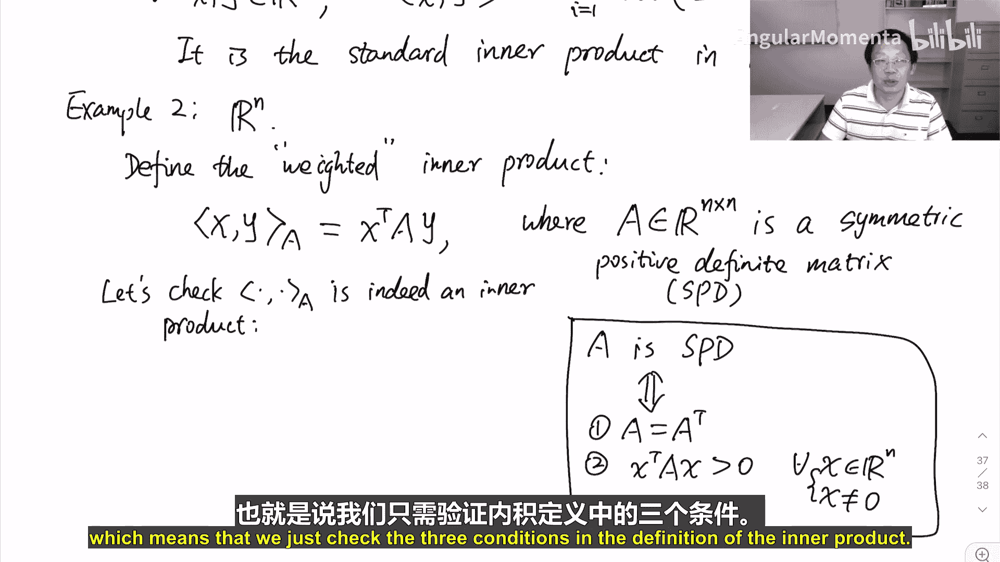
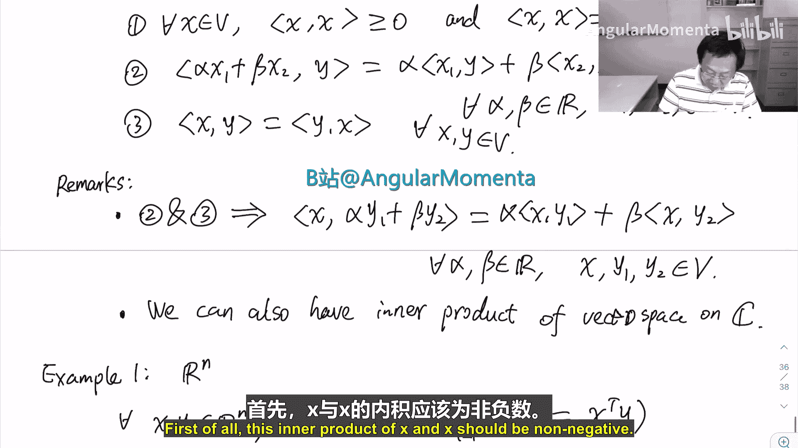
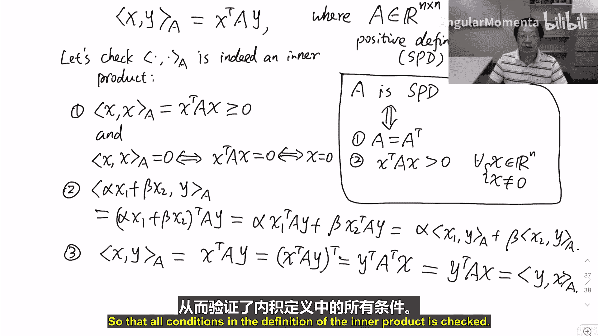
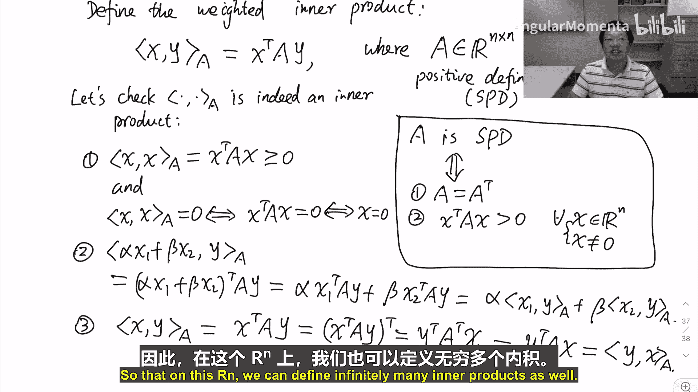
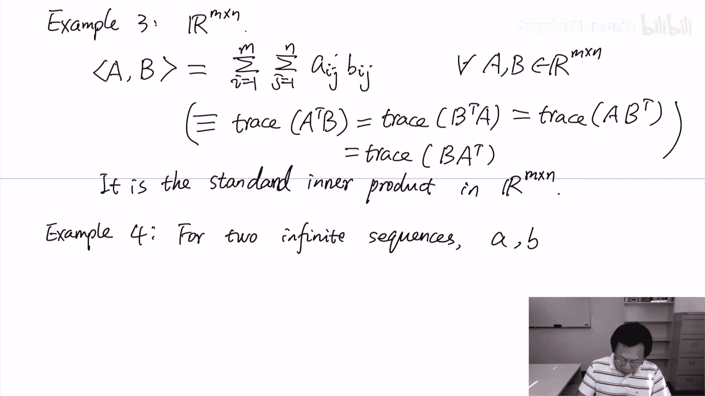
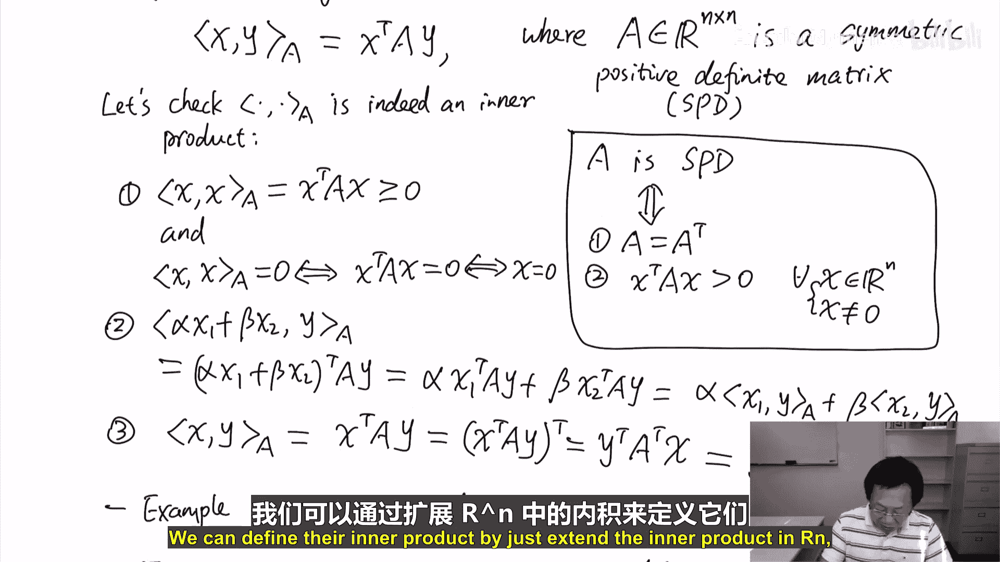
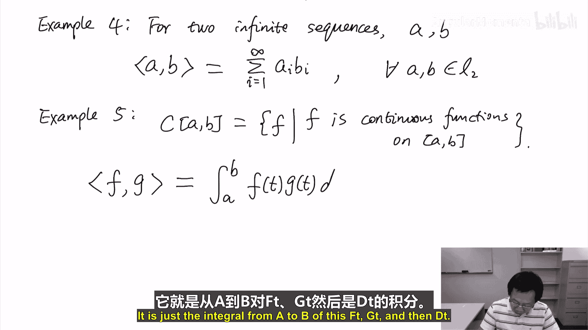

# 【香港科技大学】数据分析的数学方法 ｜ Mathematical Methods for Data Analysis p32 08-02-02-视频 -BV1DEFDzGEZW_p32-

To help you understand the inner product better， let me give you some examples， example one。RN。

In the Ekkuian space， it is well known that the inner product could be defined in for any X and Y in RN。

in the product of X and Y， it is just the summation of I from1 to M of the product of the corresponding entries of X and Y。

 X， I， Y， I。Or equivalently， this is just the x transpose y。

This is just the standard in the product in the Uk Canadianian space R N。exampleamp 2。

Similar to the norm case， we have seen that for the same vector space， we can define different norms。

For the same vector space， we can also define different inner production。

Let's still considered the RN。We define a new in product in this way， the socal weighted。

Inner product。In this way， X， Y。The A weighted in the product to B。X transpose a y。Where。

A is a matrix。A inR。M by an is。And see magic。Positive。Definite。Matrix。Or S D matrix for short。

Recall that when we say a is symmetric， a positive definite just means a is symmetric and positive definite。

In particular， A is SPD。If and only if。Two things。A is symmetric。

 which means that a equals to a transpose and positive definite means that X transpose a X larger than 0 for any x。

In R n。And x is90。This is the definition of SP PD。Then with an S D matrix。

 we just define the weighted in the product to be the x transpose A。 Now。

 let me check this A in the product is indeed an in the product。

Which means that we just check the three conditions in the definition of the inner product。

First of all。This inner product of x and x should be non negative。

This is C。The in the product of this X and x。TheA in the product， it is X transfers A X。

Then by the definition of SPD， x transpose x should be larger than or equals to。0， if x is non0。

 when x is 0 x transpose a x， of course， is0。 Therefore。

 for any X X transpose ax iss just larger than or equals to 0。And。Also。

 if this X x in the product equals to0。Then this just mean that。X transpos Ax equals to 0。

But from the definition of SPD matrix。X transpose x A X is always。Positive， if x is non 0。

 now this x transports equals to 0。 So x has to be 0。

Then the first condition in the definition of in the product is satisfied。 the second condition。

The linearity in the first variable， we just consider alpha x 1 plus beta x 2 and y this in the product。

 It is just the A A in the product。 It is alpha X 1 plus beta X 2 transpose A Y。

Now the transpose operation， you know， it is just linear with respect to the first variable。

 so obviously this is just alpha x1 transpose AY。Plus， beta X 2 transpose A Y， which is， of course。

 of X 1 A in the product。With。Why。And the beta x2 a in the product with y。The third condition。

The commutability of the two inputs in the inner product。X， Y。A in the product。

 it is x transpose A Y by definition， which is x transpose A Y， the transpose。Because here。

This x transports A Y is a number。 The transport of a number， of course， is just itself。

Then we use the rule of matrix transpose。 We first take the transpose of this one。 Y transpose。

 A transpose， x transpose transpose。Y transpose， A transpose X transpose transpose is still x。Now。

 in the last， we need to use the symmetry of this A because A is SPD。So this a transpose is just a。

 then we obtain y transpose A X。This， by definition， is just the y and the x， the A in the product。

So that all conditions in the definition of the inner product is checked。

 so that this weighted inner product is indeed an inner product。

So then by choosing， we know that there are many， many different SPD matrices。

 One SPD matrices just we can define one weighted in the protect so that on this R and。

 we can define infinite many。

In their products， as well。Actually， this example one is just a special case of this example too。

 if we choose a equals to the identity。Then this X。

 Y identity weighted in the product is just x transpose y。

 which is exactly the standard inner the product in the Uk Canadianian space。So this。Example  one。

Is a special case。Where。A equals to the identity。And the second is that for the same vector space。

 we can define infinitely many inner products。Examples 3， we consider R M by N。

That is the space of our matrices。We can define in the product between matrices in this way。

Assume that we have two matrices。Just define this to be the sigma of i from 12。M， sigma J from1 to N。

 A，I， J， B， I J。We define the in the product of two matrices to be the sum of the products of the corresponding entries。

For oil， for any。A and B in R。And by N。This is also the standard inner product in the matrix space。

There are many different formulas for these matrices。

Some popular formulas are just the inner product of A and B。 defined in this way。

 You can prove that it's just the trees。Of a transpose B。You know what is a trace。

 Tra is just the sum of diagonal interest of a square matrix。

This is also the same as the trace of B transpo a。It is also the trace of this AEB transpose。

It is also the trace of。BA transport。There are many different。Formulas for this inner product。

 all these are just the same。This is the standard inner product in the matrix space。Youamp four。

We just consider the infinite sequences for2。You find it。Sequences。Like A and B。

 which means that both A and B contains infinitely many entries。

 We can define their inner product by just extend the inner product in R N。

 the standard inner product in R N。

To the infinite sequences in R， N， just sum of the product of the corresponding entries。

 we do the same。Some of the product of the corresponding entries， AI B。

I is from one to infinity now because A and B are infinite sequences。

This action is only defined for a B in the L2。For some others for the L infinity and L1， like。

 there is no definition。Because。When we write this。

 we need to make sure that this summation makes sense， this summation is convergent。

So this sum is convergent if and only if A B in this L2。If a B in L1， this may not make any sense。

Anyway， so this is the example for2 infinitefin sequences。Also。

 we can define in the product of functions。Just consider in CA A B。Remember。

 C A B is the set of all continuous functions。OnC， AB。For two functions。

 we can just define the in product。Define this FG inner the product to be。TheNow again。

 we just multiply the corresponding entries of S and G together and then do the summation。

But in the continuous setting， the integral will replace the sum。

It is just the integral from A to B of this FT， GT， and then DT。

