# 【香港科技大学】数据分析的数学方法 ｜ Mathematical Methods for Data Analysis p36 08-06-02-视频 -BV1DEFDzGEZW_p36-

There are several interesting inequities， identities associated with the orthogonity in the product and norms。

 The first one is Pitagra's theorem。Thagra's theorem is quite well known in elementary geometry。

 It says that if we have a red triangle， then the square of this side will be the sum of the squares of other two sides。

We can extend this to a general inner product setting。Lets。X。And Y B2 vectors in the。

 in the product space Here， V is。In the protective space。

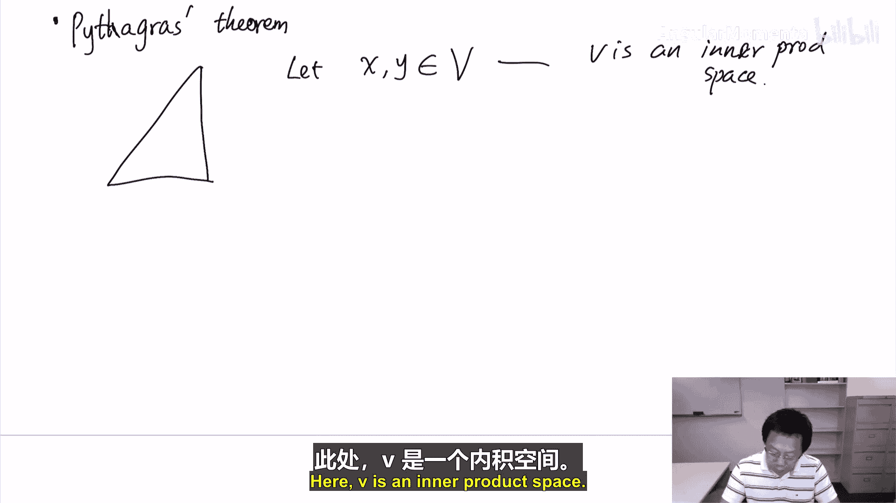

Then。X orthogonal to y， if and only if x plus y norm squared equals x norm squared plus y norm squared。

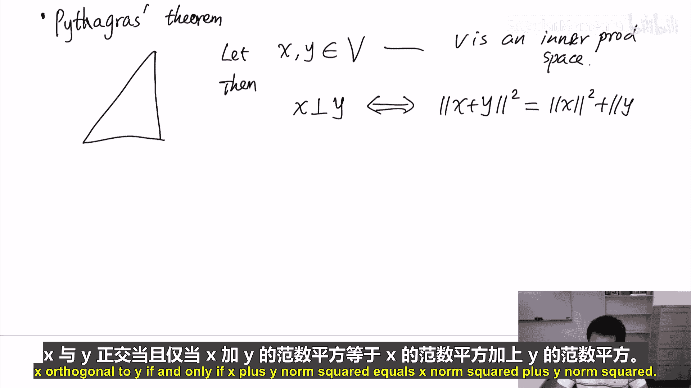

The proof is just straightforward。Just use the definition of inner product。

Because x plus y norm squared， it is x plus y and x plus y。

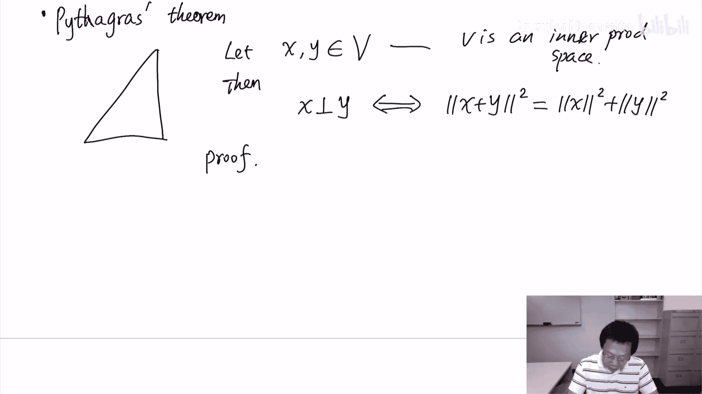

Then by expansion， we know that this is just x norm squared plus2 in the product of x and y plus。

Y norm squared。From this， we can easily deduce that。If。X is orthogonal to Y。

 which means that the inner product is 0。 So， of course this。X plus y。Squared。

 it is just x norm squared plus y norm squared。

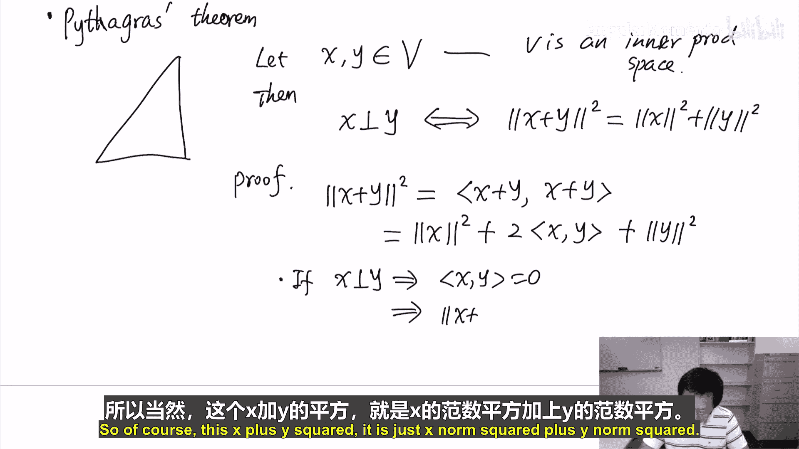

And the reverseers in it， if this x plus y squared equals。Squared the plus y squared。Then easily。

 you can see that。This has to be zero。We finish that proof。Gemetrically。

 it just means that we set up a。Lectctor system in this picture。This is the origin。

 and this is the x。And。This is the Y vector。So that's。The summation of x and y。

 it is just this vector。Then you can see the length。Of this longest side in this right triangle。

It is just x plus1。And these say that it is just。X。And this side is the same length as this one。

 so it is just the norm of y。So you can see by using。

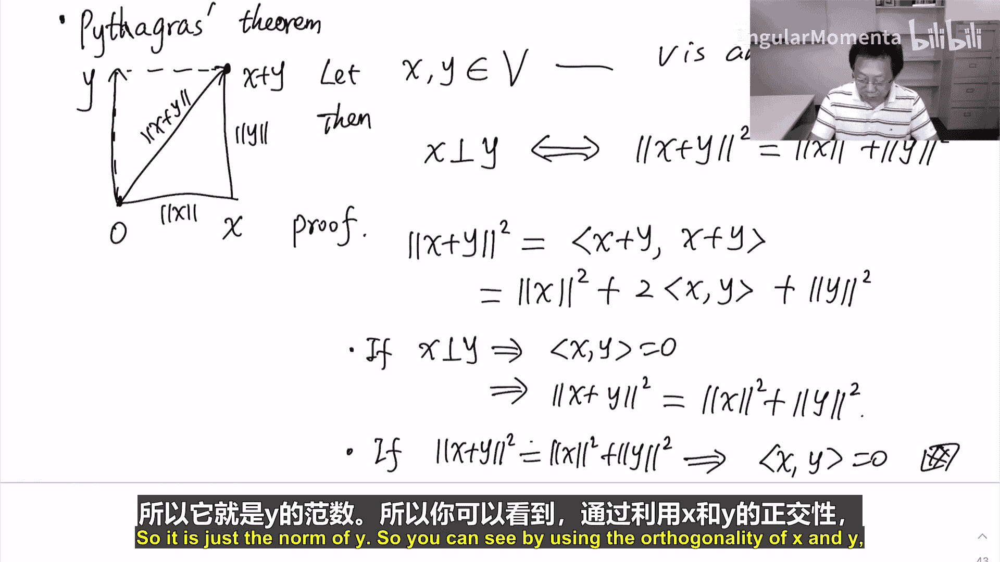

The orthogonity of x and y。

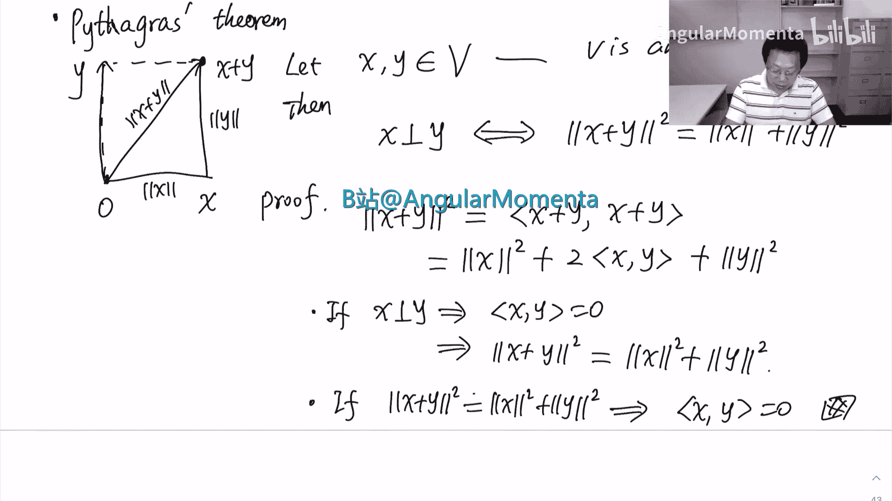

We can show that this norm squared is just this squared plus this squared。

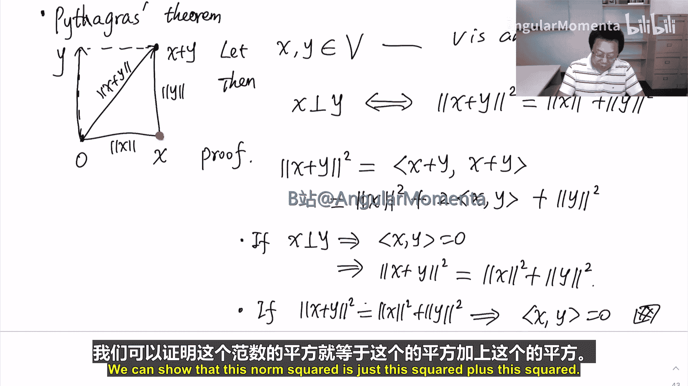

This is the Pythagoras theorem。Another interesting identity is the Para law。In elementary geometry。

 we also have a very interesting identity associated with the paragraph。It's just a。Looks like this。

 we have a parallelogram。Then we know thats。We have that。大个老。Of this parallelogram。

 and then from any mental geometry， we know that the sum of the squares of these four sides。

It's exactly the sum of the squares of these two diagonals。To prove this paragraph law is not simple。

It involves many elementary geometry。But if we set up a proper vector。System to this paragraph。

 then we can prove it very easily by using the concept of in in the product and norms。

Next's do it again， we just let this to be the origin。And we set this vector to be the x vector。

 this vector to be the y vector。So then you can easily see that this， this diagonal， this diagonal。

 it is just。X。Cl5。Beed。And for。This vector， the vector starting from here to here。

 its just y minus x。So then now we can write the lengthes of forest heights under that。

Two diagnoses for this side is x。 for this side is x。 for this side is y。 for this side is y。

For this diagonal is x plus y。For this anti dibin is x minus y。

So then the parallelogram law says that the sum of the squares of these four size is the sum of the squares of these two diagonals。

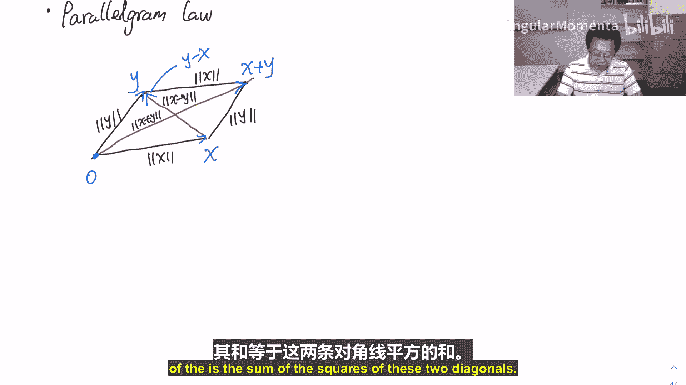

Just to me that。X squared plus y squared。Two times this one equals x plus y squared。

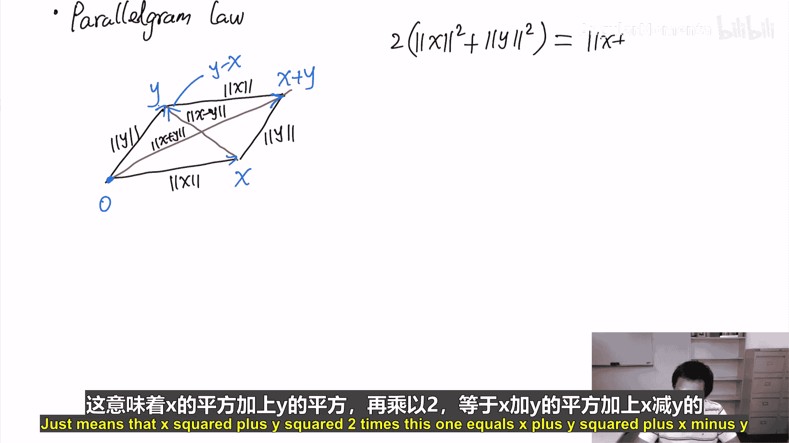

Plus， x minus y squared。This is the Para law。Now， let's prove this very。Quickly。

 by using the property of inner product and norms on an inner product space。

Just by direct calculation。Then this is just x plus Y inner protect X plus y。Plus x minus y。

 x minus y。 And then we do the expansion So for the first inner the product。We know that it is。

X norm squared plus y norm squared plus 2 in the product， X and Y。Similarly， for this second。

In the product here。It is。X normal squaredd minus2 X， Y plus y norm squared。And easily。

 you can see that these two inner product terms cancels。So we just obtained。

Two times x norm squared plus y norm squared。We finish it at that proof。

You can see that the inner product。

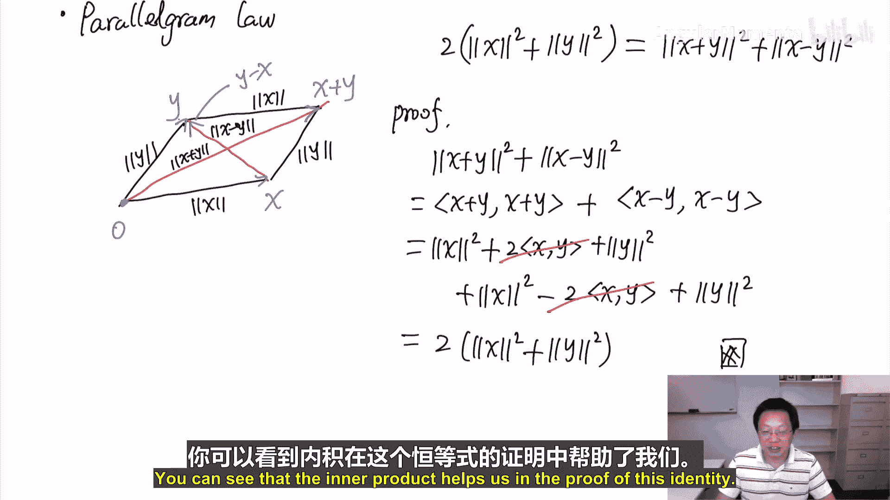

Helps us。In the proof of this identity。And if you just use elementary geometry。

 it's very difficult to prove this paragraph law。But if we use the concept of in product。

 the proof is super easy。And more importantly， this holds true in any inner product space。

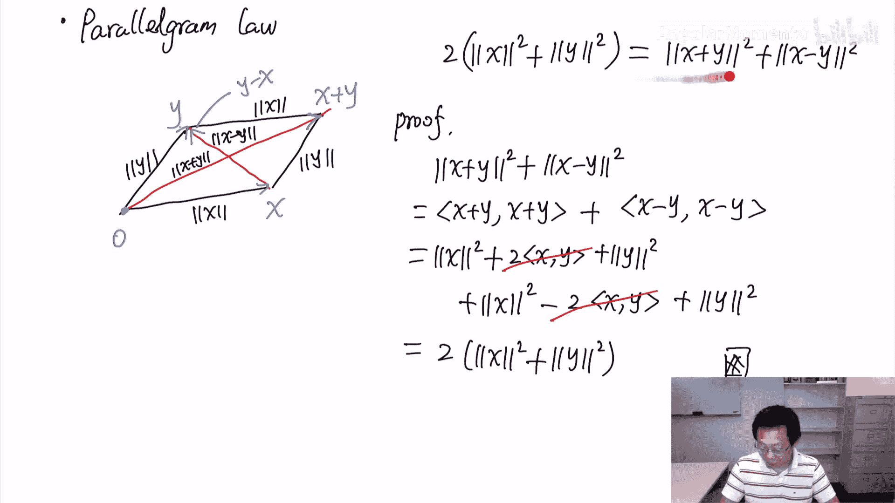