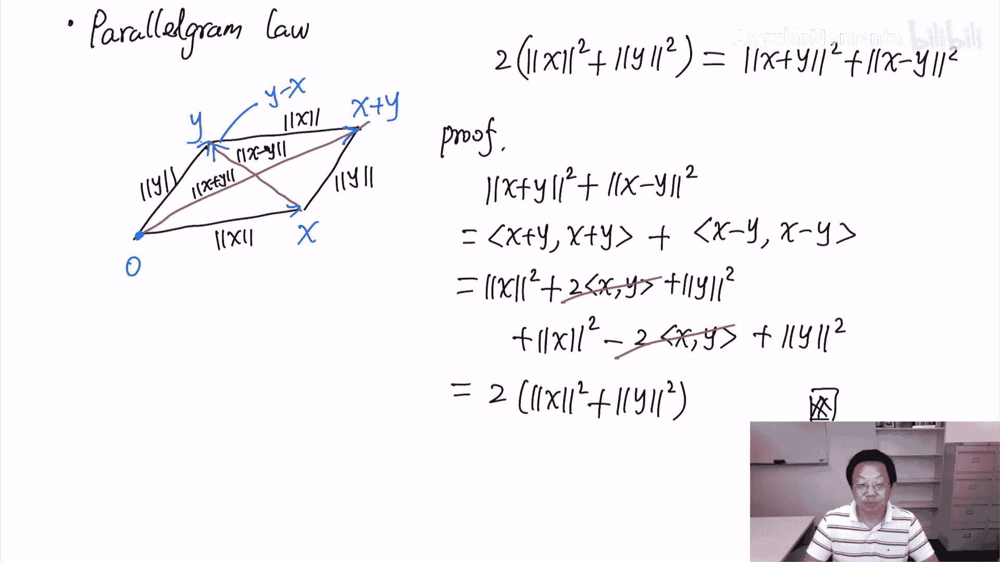
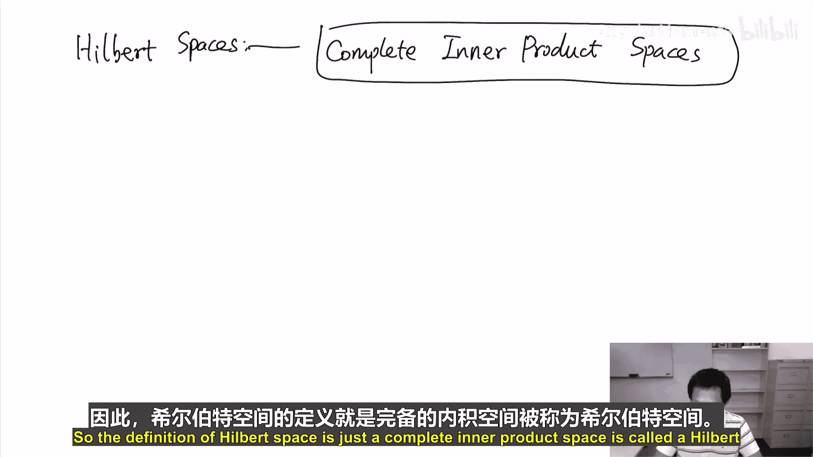
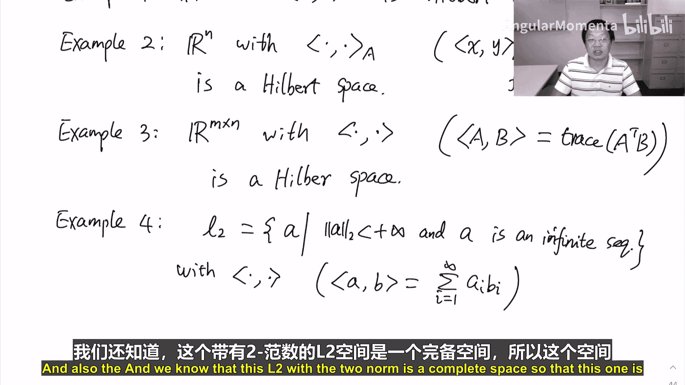
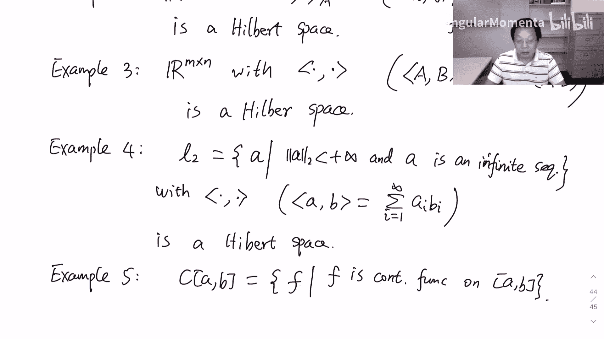
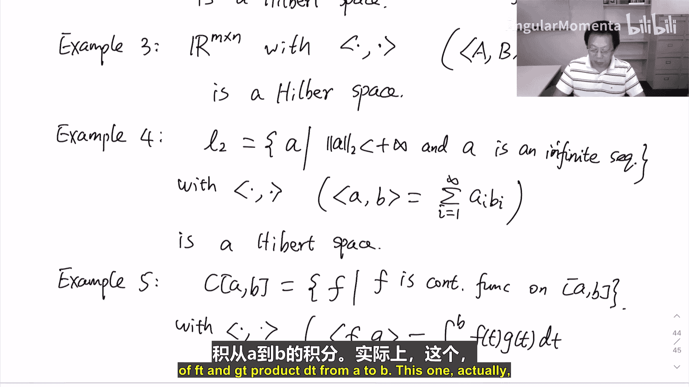
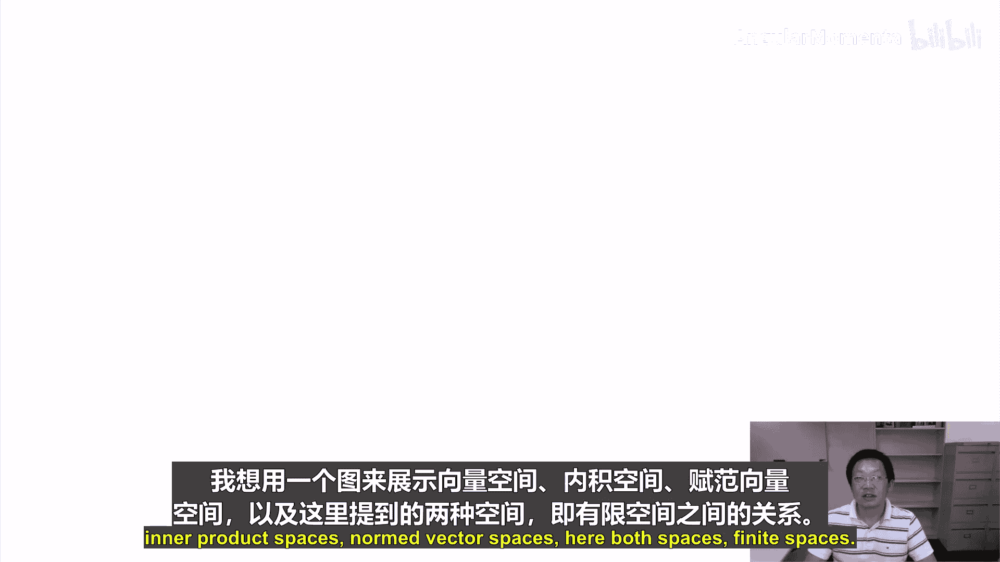
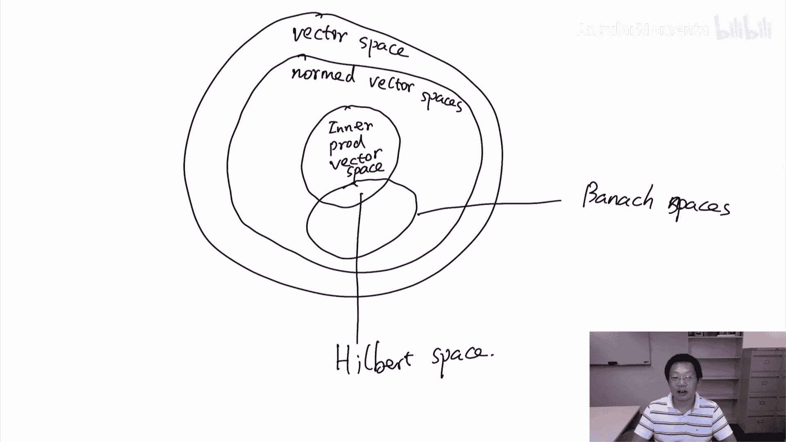

# 【香港科技大学】数据分析的数学方法 ｜ Mathematical Methods for Data Analysis p37 08-07-02-视频 -BV1DEFDzGEZW_p37-

Now we have the in products。 So the in products help set up。A metric or a norm。 And the angles。

So we know that was a norm。The limit and convergence will be very interesting。

 We want to have a complete space under the。Then how about the completeness of this in the protected space。

This is called the here plus Spaces。Heber spaces just means complete。In the product space。

So the definition of Hebrospace is just accompanied in the product space is called a Hebro space。

Of course， here the， theness is in the sense of the norm induced by the inner product。

That norm in the inner protective space。Let me give you some examples on herebo spaces。Again。

 we consider this RN。 Now we need to consider this inner product with this inner product。

Then this is just a hereable space because。This R N is a finite dimensional space。

We have seen that the finite dimensional vector space with any norm is just complete。

 so that with the norm induced from this inner product is， of course complete。

 so that this RN with the inner product is a hubless space。Example 2。This R， N。With other in product。

 with the wt in product。Defined by this X and Y， the a in the product， it is just x transs A Y。

For ASPD。A is symmetric and positive definite。This is the we chip。Inner correct。In RN。

So then with this weighted inner product， we can define a norm。Under this norm， R N is， of course。

Complete because it's a finite dimensional vector space。 So this is a herebo space。Again。

We can also consider this。Matrix space。With the innerner products。

Be the trace in the product just means that this A B。Is the sum of the。

Product of corresponding entries or the trace of this。A transpose B。

 or B transpose a many equivalent forms。Of this trace here。This one， again。

 because it is finite dimensional and the norm induced by this inner product is just a norm on this finite dimensional vector space so that it is just complete so that this RMN with inner product is a hereable space。

Let's see some infinite dimensional vector spaces。Let's just consider the L2， which is that。

Set of all。Infinite sequences。With。The two norm。Less than infinity。안 돼。Is an infinite sequence。

As I have mentioned， we can define and end the products。Bye。This way。By again。

Do the summation of all product of the corresponding entries。AIBI。

By using the cost she was in quantity。Actually， you can check that this is always finite if A and B is in L2。

And also， they induced the norm。 it is just the two norm。

And we know that this L2 with the two norm is a complete space so that this one is just a hereable space。

Example 5。Again， I consider this function space C AB。Which is just that。Continuous functions。

This continuous function space with inner product。By this F and G in the product is the integral of。

FT and G T pro。Back D T from A to B。

This one， actually， because we have known that the induced norm here will be the two norm。

And we know that the CAB is incompette under the tunnel arm。So that this one。

 this inner product space is incomplete。So then this is not a here space。Then this。

 we can complete this incomplete space。 It's competition。Under the two norm， of course， is。

They our twoth space。Which is studied extensively in real analysis。Finally。

 I want to use a figure to demonstrate the relations of vector spaces in the protected spaces。

Normed vector spaces， he spaces， bananaha spaces， all kind of spaces we have discussed so far。

All our discussion is based on the vector space， so vector space is the largest set。

And on the vector space， we can define norms， so。If we define a norm。On vector spaces。

 we just obtained the normed。Vectctor。Spaces。안 돼。We know that in the product。Space is a subset of。

Norm the vector spaces because。For any inner product， we can define。A norm。So any inner product。

Vectture space。It is just。Unormed the vector spaces。Previousversely。

 a normal vector space is not necessarily an inner productive vector space。And。

Another interesting set of these normal vector spaces is the Bnaha space。Bana space just means that。

Companet。Norm the vector spaces。So that this polymer space is only a subset of this norm vector space。

This set here， it is both a banana space and an inner protector space。 This is just the herebo space。

 it means that it's a complete inner protector vector space so that this set is just the herebo space。

So this is a graph to demonstrate the relations of all different types of spaces we have learned。

