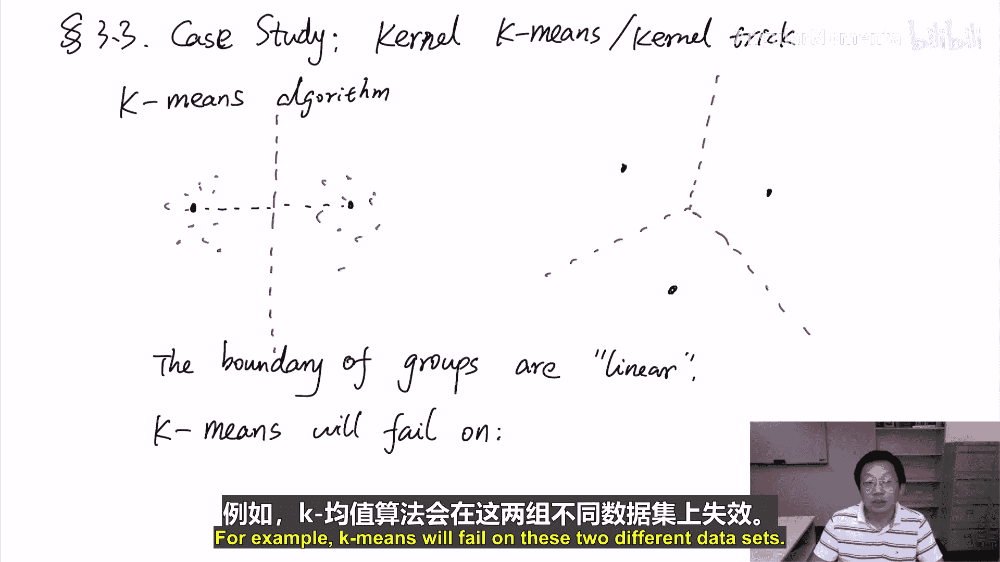
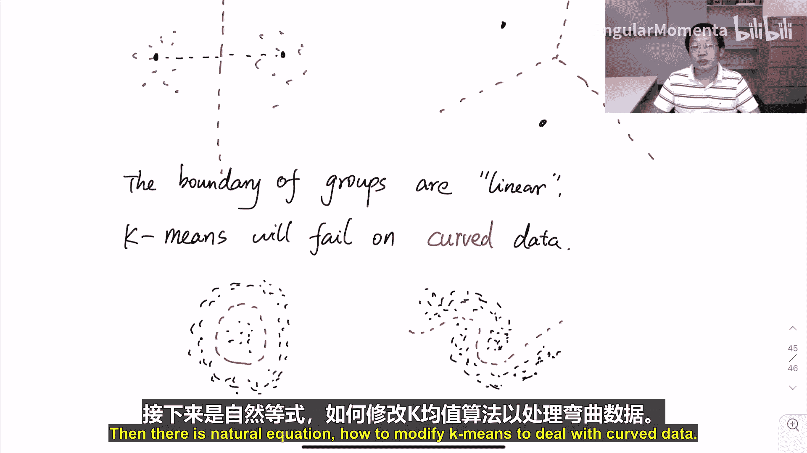
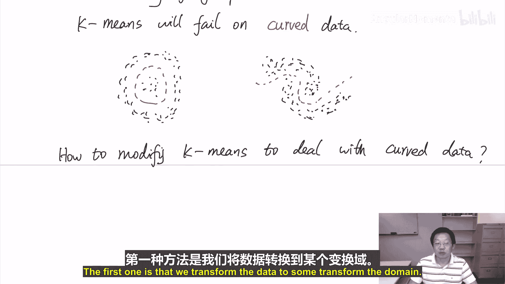
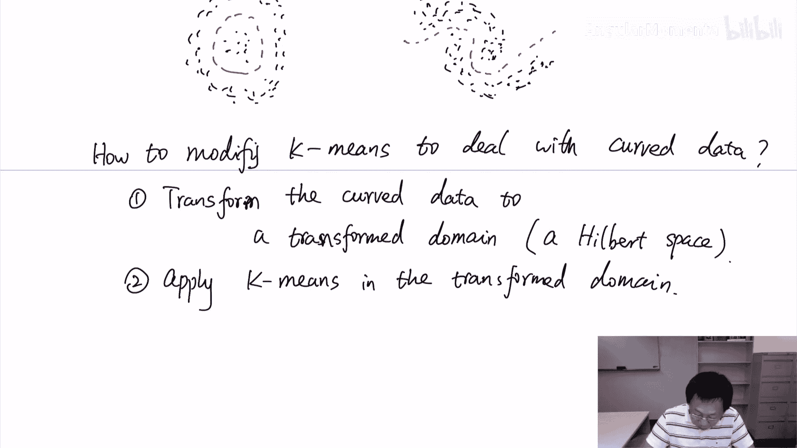
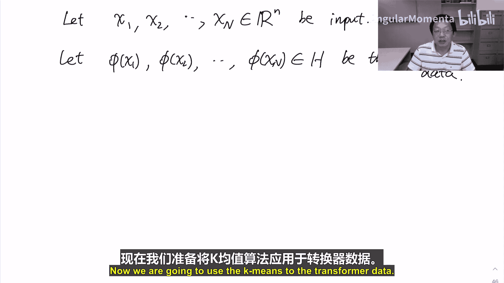
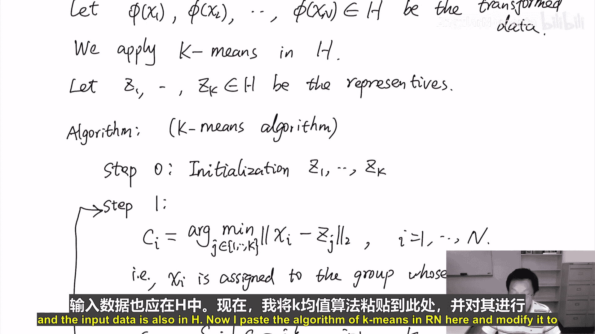
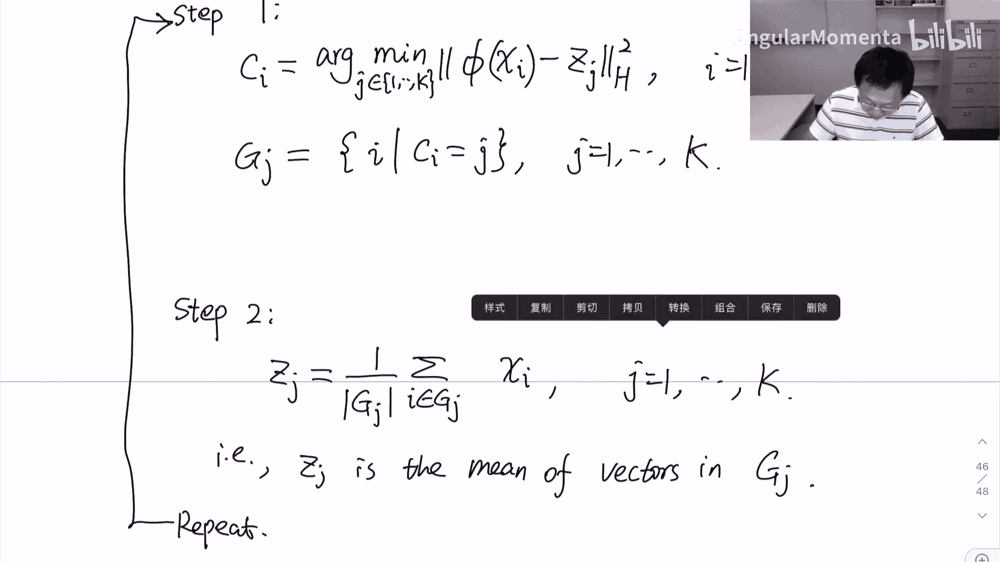
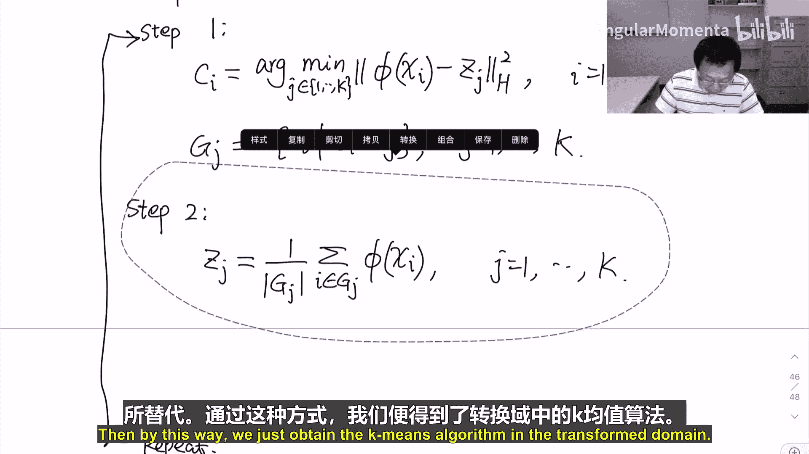
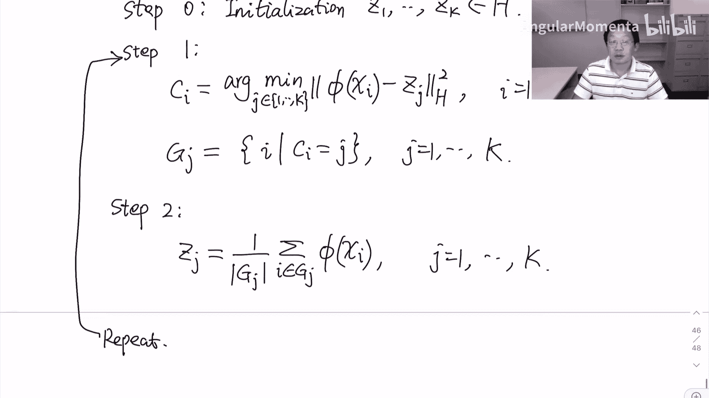

# 【香港科技大学】数据分析的数学方法 ｜ Mathematical Methods for Data Analysis p38 09-01-02-视频 -BV1DEFDzGEZW_p38-

In the following， I would like to present an application of inner product and helpbal spaces。

In particular， I would like to improve the K means algorithm for clustering。

 We will obtain a so called kernel K meanss。And more generally。

 we will get the so called kernel trick。We started with the camenes algorithmism。

Assume that we have only two groups here。And with these two black dots be the representatives。

Of these two groups。 And then the boundary of these two groups actually will be the bisector of this line segment connecting these two representatives。

The best sector of this9 segment。Then you will see that at four points。That is on this region。

 on the left side of this bisector， it will be closer to this left point。

For points that is on the right of this fivese where belongs to this group。

So then this boundary of these two different groups。Will be linear。 It will be a straight line。

In high dimensional space， it will be also so called hyperplane。And if we have three。Representatives。

3 groups。Then the boundary will be exactly the intersection of these bisectors。

So here the bisector of this two， the bisector of this two， the bisector of these two。

Then the region is partitioned into this three for all points in this region。

 it will be closer to this representative than the other two so that the points here are all belongs to this group。

 the points here belongs to this group， the points here belongs to this group。

Then the boundary of different groups are all just linear， are all just planes， hyperplanes。

For this reason， in actually， K means's algorithm is a linear algorithm。

So that it will fail for those data whose boundary is nonlinear， for example。Kvs。We feel。Hong。

These two different data sets。

For these two data sets， training data sets， you can see that。For example， on the left。

 we have two groups。 One is the inner one， the other is this outer ring。

So now the boundary of these two data sets is。A curve。For the data set on the left。

 you can see that we have the two groups， one is inside this red circle。

 the other is outside this red circle。And for this data set， one group is above this red curve。

 and the other group is just below this red curve。Now you can see the boundary of these two groups。

All curves。They are not planes anymore。 They are not linear anymore。 They are just non linear。

So that K meanss will fill on curved data。Then there is natural a question。

 how to modify K means to deal with curved data。

There is a very natural idea that is， we do not work。On this domain directly。

 instead we do a transformation， we transform this kind of data in this R and or in this R2 here to some other higher dimensional space。

 to some hereable space， and then we just apply the keys in the Heable space。So there are two steps。

 The first one is that we transform the data to some transform the domain。

This transformer domain actually will be a hearable space。And then in this hub space。

 we expect that this。Boundary of two groups will be linear。 Then in the second step。

 we just apply K means in the transform the domain。Graphically， it's just like this。

This is the data set。And then we do a transform。I call this transform 5。

This transform P just transform the data from R N。2。Her here above space。

Then we expect this file is able to produce a dataset set looks like。Then in this transformal domain。

 or in this Hibo space， we can apply the standard K meanss because this transformal domain。

 the transformal data is separable by a plane or by a straight line here。So， in particular。

This data point here are X， I。 This is X J。 They are given data in R N。 and this point。

Will be the phi of X I。 This point will be phi of X chain underscore。So from here。

 we can see that the key of success of this idea is that whether or not we can find a phi and H such that this data after transformation is separable linearly。

Nice to see how to find a good file and H。To this end。

 let's just take a closer look of the K means algorithm in this herebo space H。Let。X1。X 2 to X， N。

In R N。Be the input。Lets。This Phi x1。5hi x2。To this Phi X N。In this herebut space。

 be the transform data。Now we are going to use the ks to the transform the data。

Let Z 1 to Z， K be the representatives in the H domainme。

Note that since we are working in the transform domain so that all the representatives should be in H。

 and the input data is also in H。 Now I paste the algorithm of K means in R N here and modify it to the transform the domain。

We needed to first it。Iitialize Z 1 to Z， K。 Now， Z 12 Z K should be in the H。Now。

 step 1 is that with this Z 1 to Z K， we needed to。Assign each data point to its group。

By finding the nearest representative。The representative is in H。 The input data is also in H。

 The input data will not be X I anymore。 It's in the transform domain。 So it's the P X I。

So this is the phi X。And also， because we are working in this age。In this transform domain， the。

 the metric is not the two norm anymore。 The two norm metric is for R。

 And now we are in the transform domain。 The two norm and the， the metric is just the。

Norm induced by the in product。 So I。Would like to use sub H means the。Norm in this H domain me。

 Instead of using the norm H itself， I would like to use the norm squared because。They are the same。

 we still get the same minimizer because the square function is a monotonically increasing function。

And with this C ready， we just formed the new grouping。Then， step 2。With this GJ ready。

 we just formed the new representative by using their means。So again。

 because we should use the data points in the H domain， so this X is replaced by Phi Xi。

Then by this way， we just obtain the K means algorithm in that。

Transform the domain。

