# 【香港科技大学】数据分析的数学方法 ｜ Mathematical Methods for Data Analysis p39 09-02-02-视频 -BV1DEFDzGEZW_p39-

So here you see that we still need an explicit Phi and H。

 Also this Phi and H will able to separate this data linearly。But this is not an easy task。

It's not easy to find a good file and H explicitly。

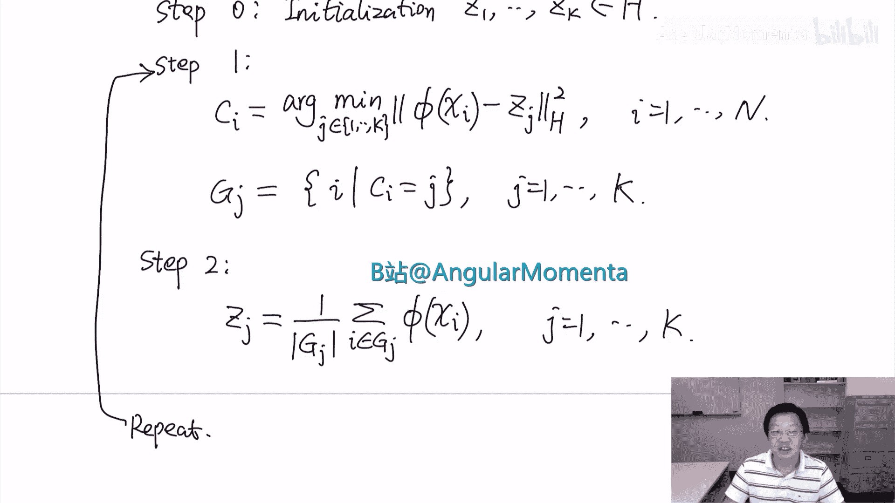

Then people introduced the so called kernelel trick。

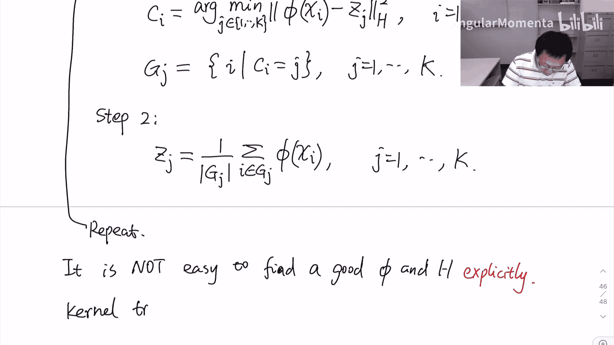

The key point in kernel trick is that we don't define Phi and H explicitly。

 instead we define phi and H implicly。To achieve this goal。

 let's reformulate the K meanss algorithm in age。Let's check the algorithm in this algorithm。

 you can see that we have this Z12 ZK explicitly。Which are vectors in H。

Since we don't like the explicit form of H， Of course， we don't like this explicit form of Z 12 Z K。

Then we try to eliminate Z1 to Zk。

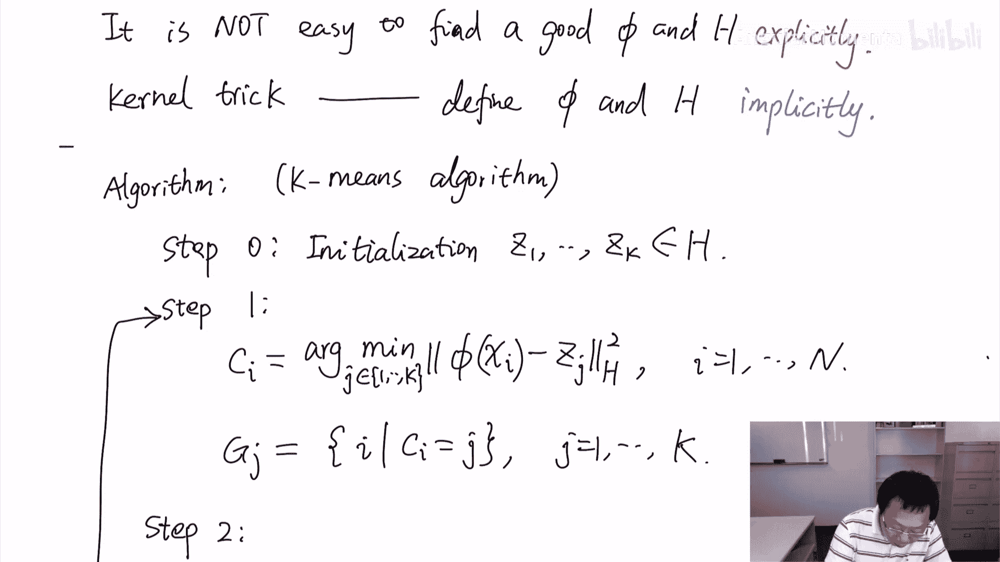

Let's take a closer look at this algorithm。Indeed， these Z 12 Z K are intermediate vectors。

 because the final output of the K means algorithm is only the grouping。

The representative vectors are not important， are not necessary。

And just by checking these two formulas in step one and step2 respectively。

You see that this ZJ actually is a mean of the vector in group J。Just plug this。

Expressing of ZJ into this expression here。And we don't have the step two anymore because it's combined with step one。

Also in this formula， I is fixed， but here in this summ I is a variable。

So I just change this I to another notation。 I use L。

So now you can see this new version contains only one step。 We just repeat this step for many times。

There is a minor issue because now we don't need Z 12 Z K anymore so that we don't need to initialize Z 1 to ZK anymore。

Instead， we initialize this G。So we get a new reformulation of the K is algorithm mean H。

 Now in this reulation， we don't have the representative vector anymore。

 We just have the grouping as the variable。But still in this formulation。

 you can see we have the phi， the phi and the H norm involved。Still。

 we don't like it because we don't want H and by explicit。

A good news is that all these Phi and H are involved only in this norm squared term。

Then in the next step， let's just rearrange this norm square term to see if we can eliminate this phi and H。

For this term， is a norm squared in the hybrid blood space。Then it can be written into an in product。

Then by using the linearity of inner products。We can get an expansion of this term。

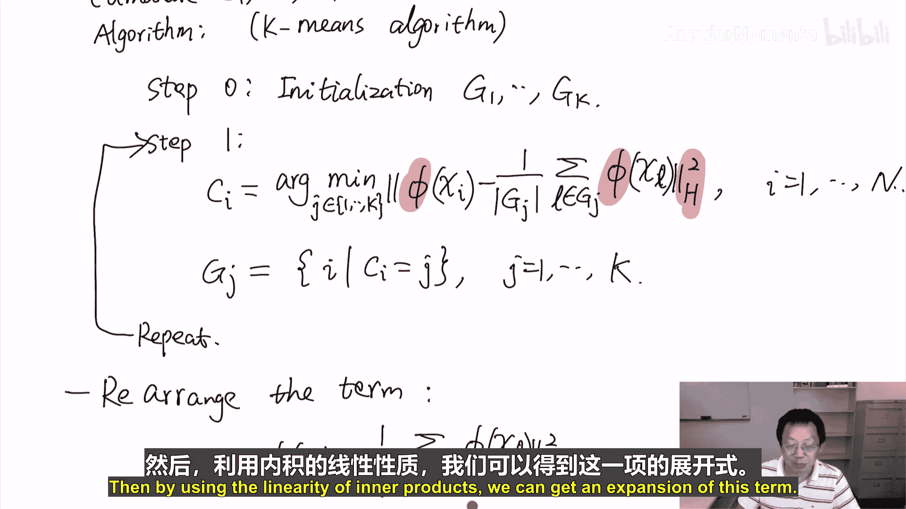

It is。

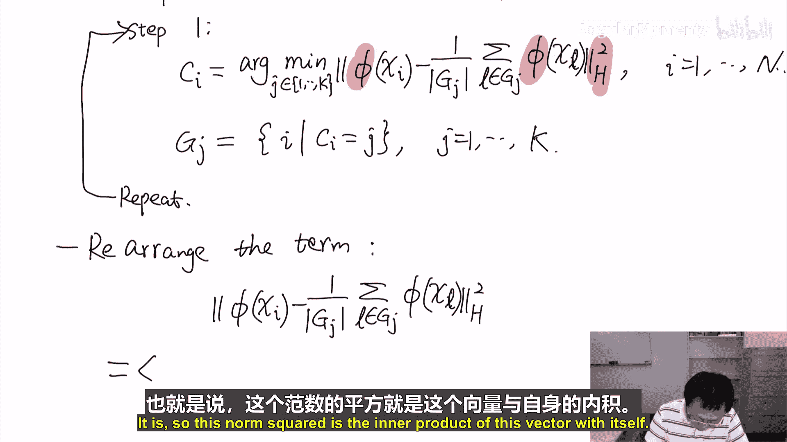

So this norm squared is the inner product of this vector with itself。Now， I do the expansion。

The first term will be the inner product of the first terms in both。And we have the cross term。

 which is two times the inner product。And we have the last term。

Then we can further expand this summation。By using the narrative of inner product function。Now。

 this normal squared function is expanded into an。Linear combination of many inner products look at here。

Now， if we check this expression， you can see that only this term， this term。

 this term involves Phi now。And of course， the inner product in the H space is also involved。

But all these are three terms there are in special forms。

They are in the forms of the inner product of phi x and the Phi1 in that form。

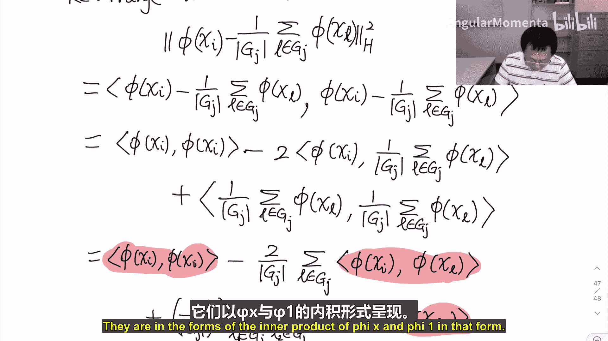

Now， for this form， actually， they are quite good to deal with。 Y。

 because for this one is we view this X and y as variables。 They are just on R N， right。

 And this value of this inner product is a number so that this function。

 This can be viewed as a function from。RN。RN。QR。Because we have two inputs。1 is x， the other is1。

And the output is just the inner product， which is a real number。

 So this is a function that maps two vectors x and y to a number。Now。

 instead of define phi and H explicitly， we just need to define this function。

Once we have this function， then this term。

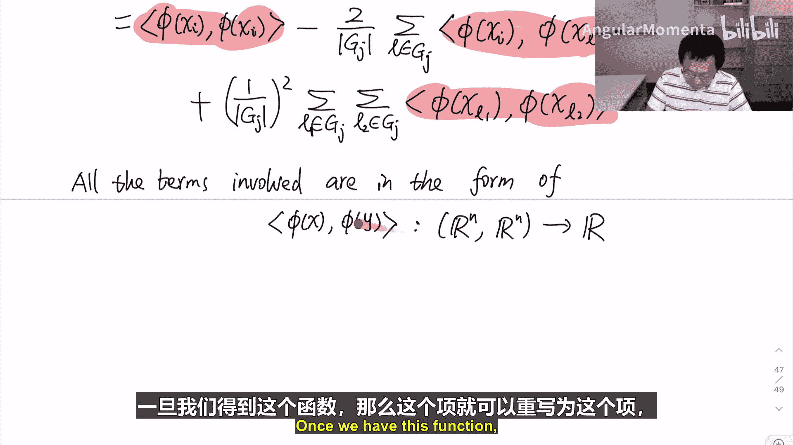

Can be rewritten at this term so we can have a value for it。 Then we can do the minimization here。

 We just take this K possible values of this function or this function。

 And then we just compare them。 So we get this5 X I should be in which group。

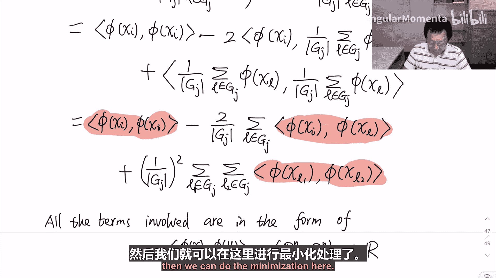

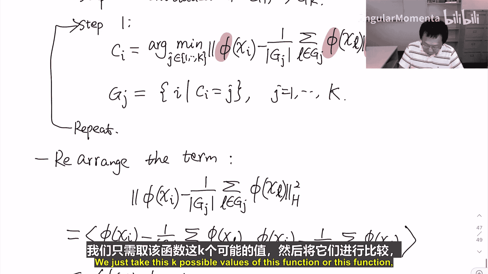

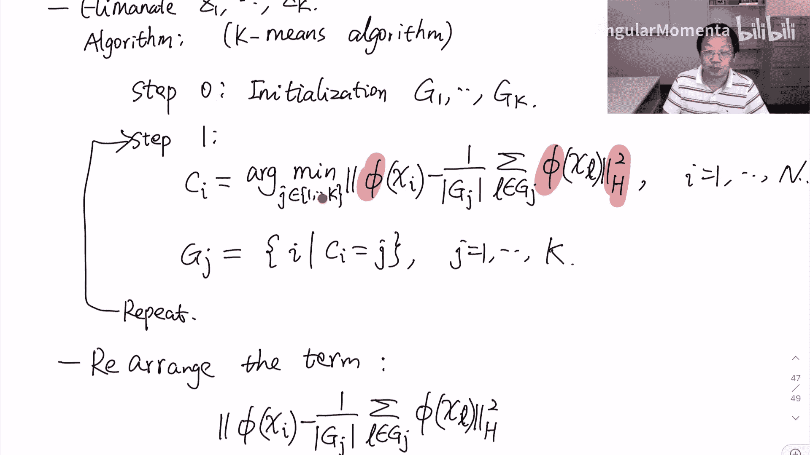

So this is what we are going to do， we just defines this function instead of define phi and h explicitly。

 we define this function。Now we call this function a kernel function denoted by K。

 We just define a function K。This K function is from R N。And R N to R。3し that'。This K of X， Y equals。

5 x。F外。In this way， there is no explicit form of P and H， and the inner product is needed。

Now we just get an algorithm like this。

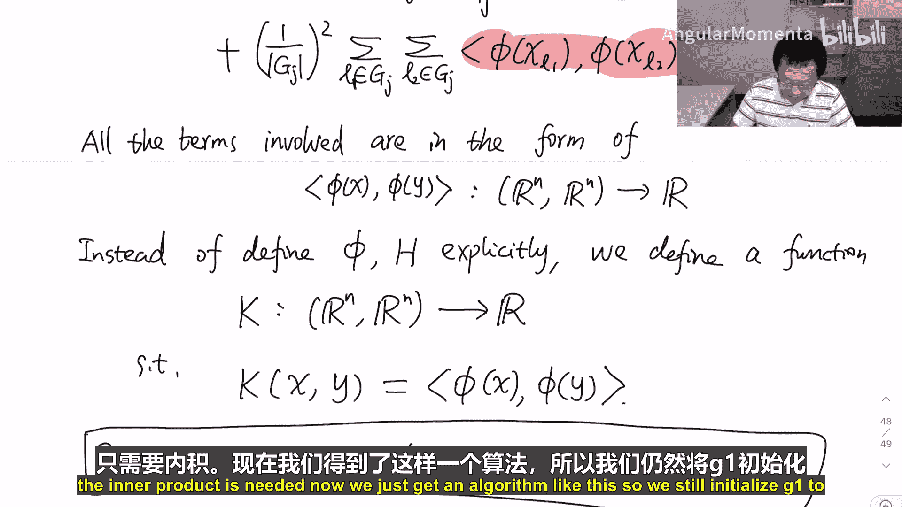

So we still initialize G12 GK， and then at the each step。

 we just obtain CI by using this minimization， but this minimization is replaced by this one。

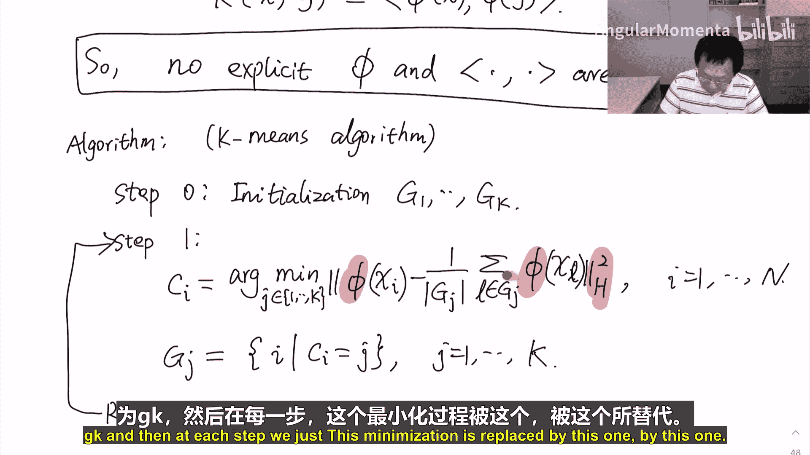

By this one。

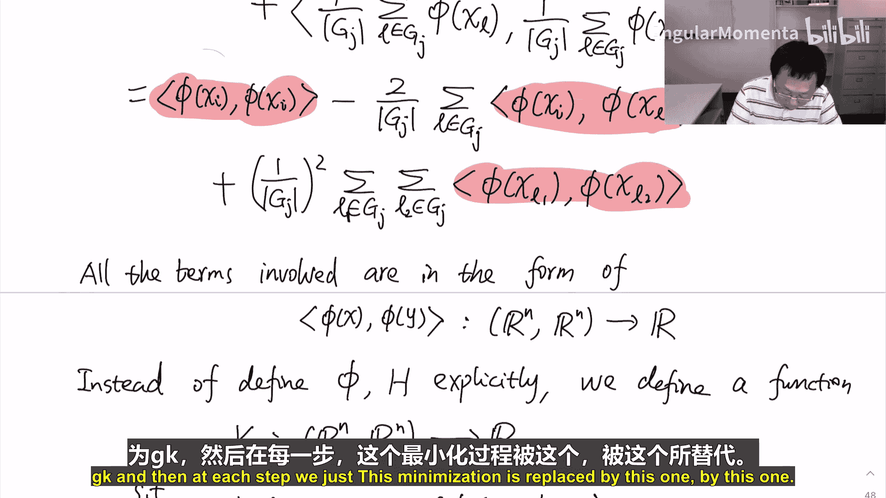

So this term is just replaced by K， X， I， X， I。Now， this term is just replaced by K， X， I， X L。

This term is just replaced by K， X， L 1 X， L 2。Now。

 you can see this is computable because we have defined this key function。

 This key function is very easy to define。 It is just a function from two R vectors to a real number。

 We can later。 I will give you examples。And then， for any。Jy， this is just one number。

So then we can compare the values of from 1 to k so that we take the minimum， we just get a CI。

So this algorithm is called the kernel o came means。This function is called the kernel function。

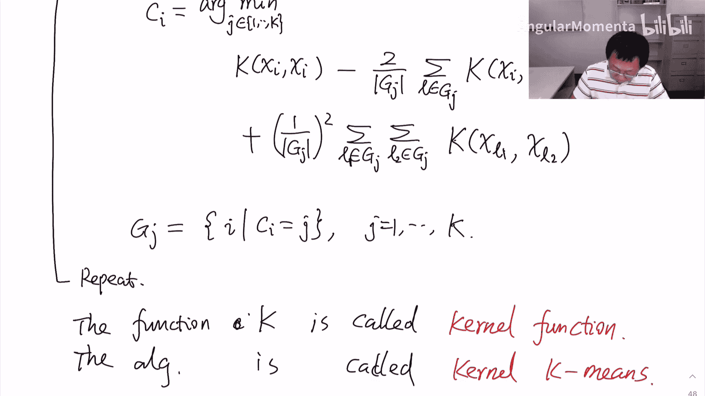