# 【香港科技大学】数据分析的数学方法 ｜ Mathematical Methods for Data Analysis p41 09-04-02-视频 -BV1DEFDzGEZW_p41-

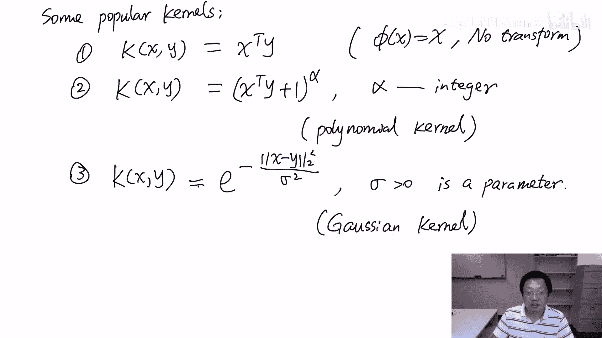

Then finally， I would like to give you a very simple example to demonstrate why kernel method work。

I want to use example in the very beginning of this section。And we choose the Gaussian of the kernel。

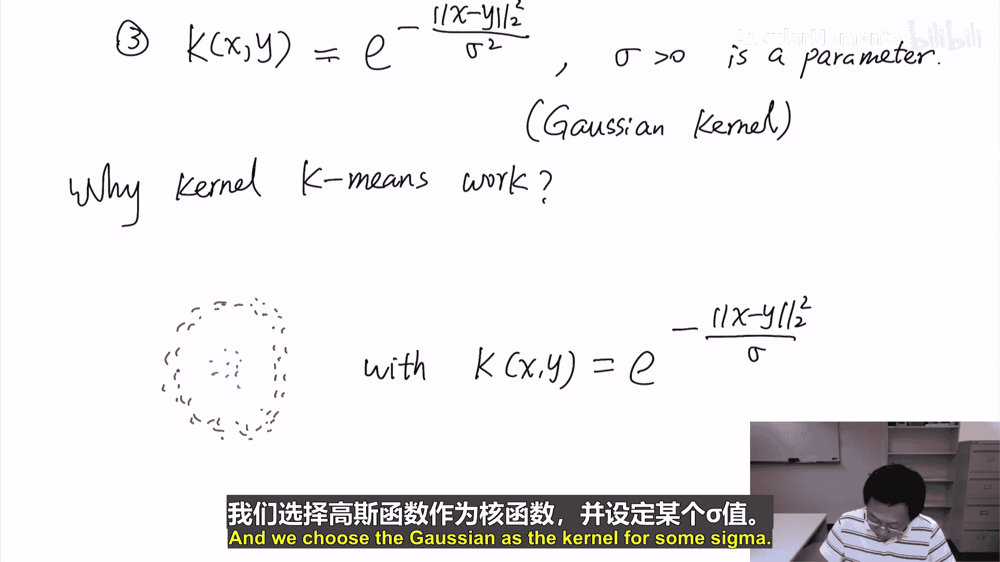

What time sigma。With this kernel， you can see that this K， X I。X， I。

 it is just exponential minus X I minus X I  to norm squared over sigma squared。

 which is exponential to the minus-0。It is one。For any eye。Now， since。

We know that there's a KX I X I。It is the in the product of5 X I。And the P X I。

Which is the norm squared of this5 Xi。This equals one from the here。Then， we see that。5 x1。

To this the 5 x N。They are just units。In H。There are unit vectors in H。

 which means that after the transformation， all the vector will be transformed onto the unit sphere。

And also， let's consider this the K X。I X J。For this one。

You can check that if X I and X J is very small， then this is very。

 very close to 0 so that this is about one。If X， I is very。

 very close to X J in the Uk Canadianian space。And similarly。If this X， I and X J。

 they have a big difference， then this will be very big so that this exponential function decays very fast so that this is just a very。

 very small。Just a very， very close to zero e。X， I。Is far away from X。It's large。

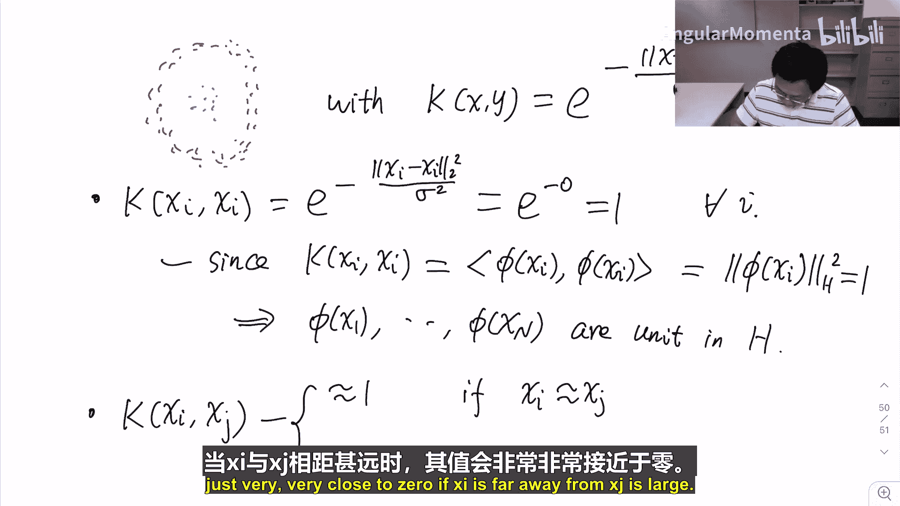

From this， actually， we can further have that the orthogonities between Phi X and Phi J。 From this。

 we can get more information on Phi X I and Phi X J。Actually， since。K X， I， X， J。

It is the inner product of Phi Xi and Phi Xj。If X I is about X J。Then。We know that this K， X， I X。

 J is about one。Then we just compute this5 X。Minus5 x J。The enormous square。

You can see this is just a Phi X。Norm squared than minus-2 phi X。5 x J。Plus。5hi X， J， H Nor squared。

 H Nor squared。

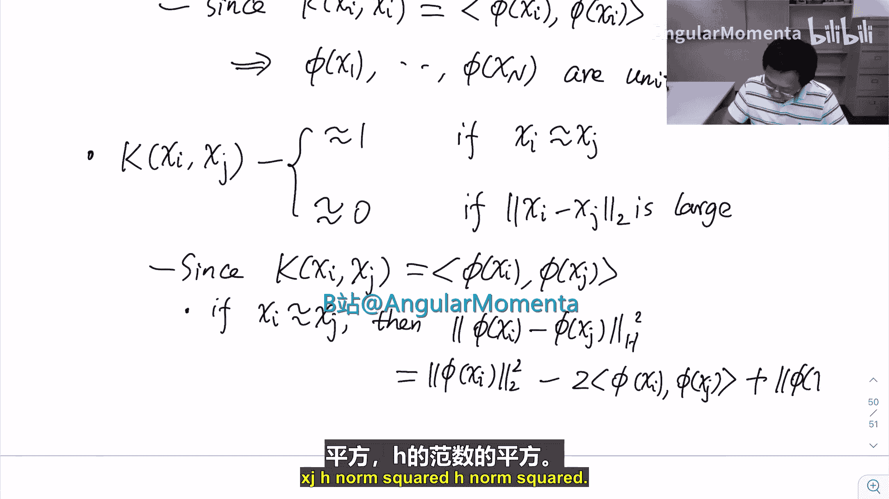

So this is one from here。This is also one from here。 Now， since X I is very close to X J。

 this inner product。Is very close to  one。 So that is 1-2 plus1， which is 0。

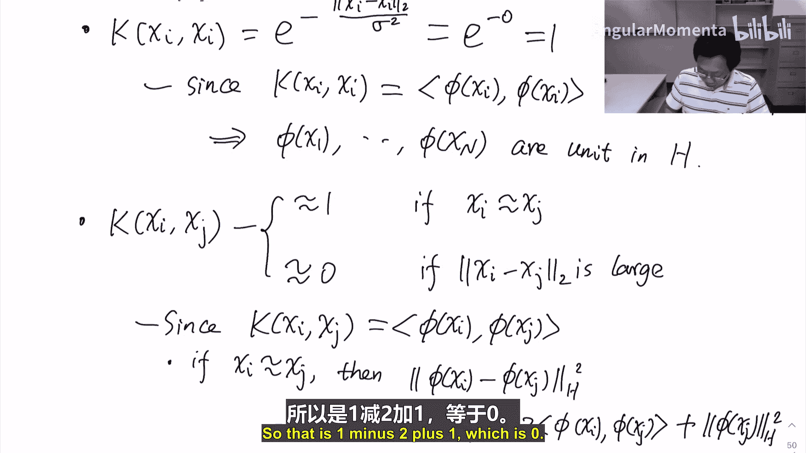

So this just means that phi Xi is very close to phi X J。If X I is close to Xj。

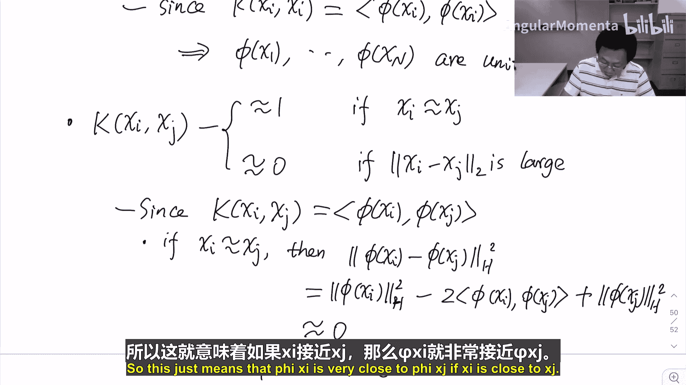

And the similar， if X I。Is very far away from X。

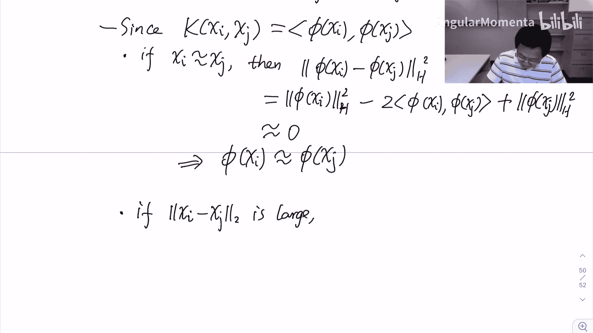

Then。Again， we just have that this。

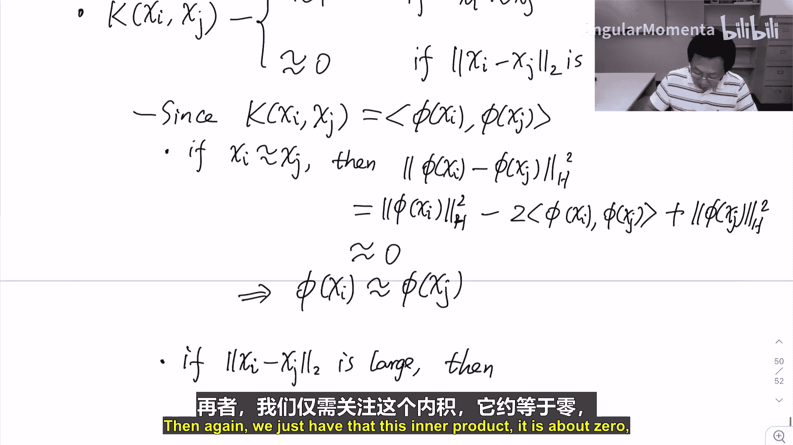

In the product。It is about 0。Which means that this Phi X I is roughly orthogonal to this5 X J。

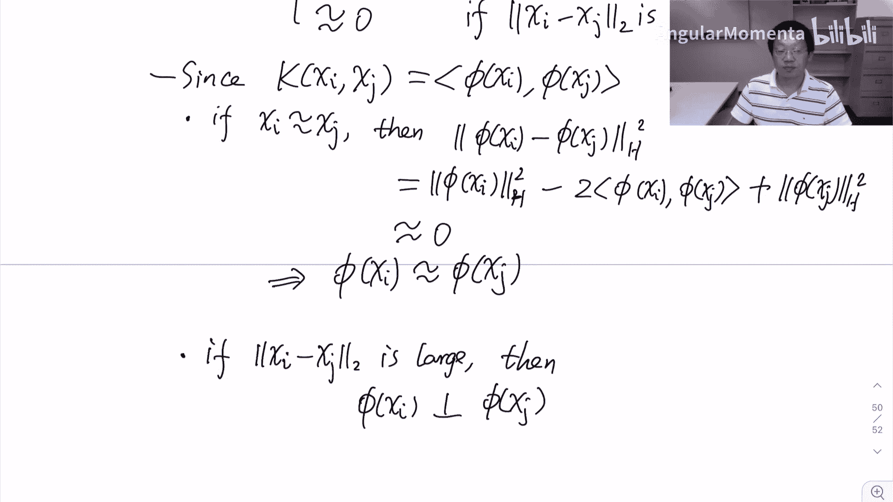

Now， we can see。A picture after the fire transformation in this。

 this is in the R now in this a space。You can see that every vector is mapped onto the unit sphere。

 since these blue vectors are all very far away from these red vectors。 Then you can see that。

This fire X I will be orthogonal to Phi Xj， which means that the blue dots will be orthogonal to those red dots in the transform the domain。

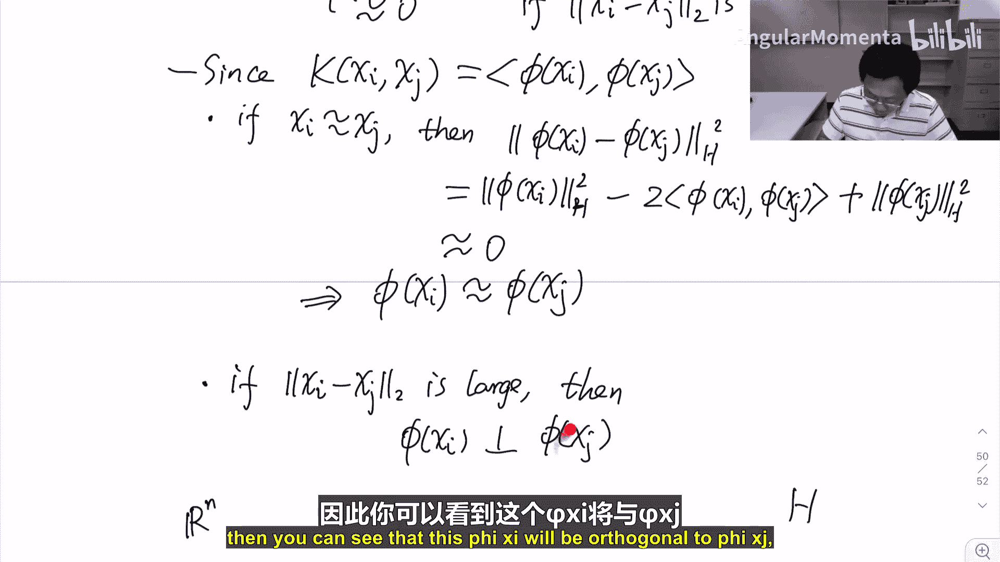

Then for simplicity， I will use a three dimensional space to visualize this age。

 Then the blue dots and the red dots are orthogonal in this age domain。 So， for example。

Then I just app this blue do here。Then the red do will be on this X， Y plane in this edge。

 on this two dimensional plane。So now for this red dot， you can see some are very close。

 Some are very far away。 So for those very close。Vectctorors， they are just。

Very close in the transformed domain。 for those very far away like this point and this point。

 they are just very orthogonal。So then phi x x is red may looks like this。So then in this space。

 of course， we can use a plane to separate them very easily just。This one。Right。

 you can see that we can use this green plane to separate the blue dots and the red dots。

So that we can use the K means algorithm in the A domain to partition them into two groups successfully。

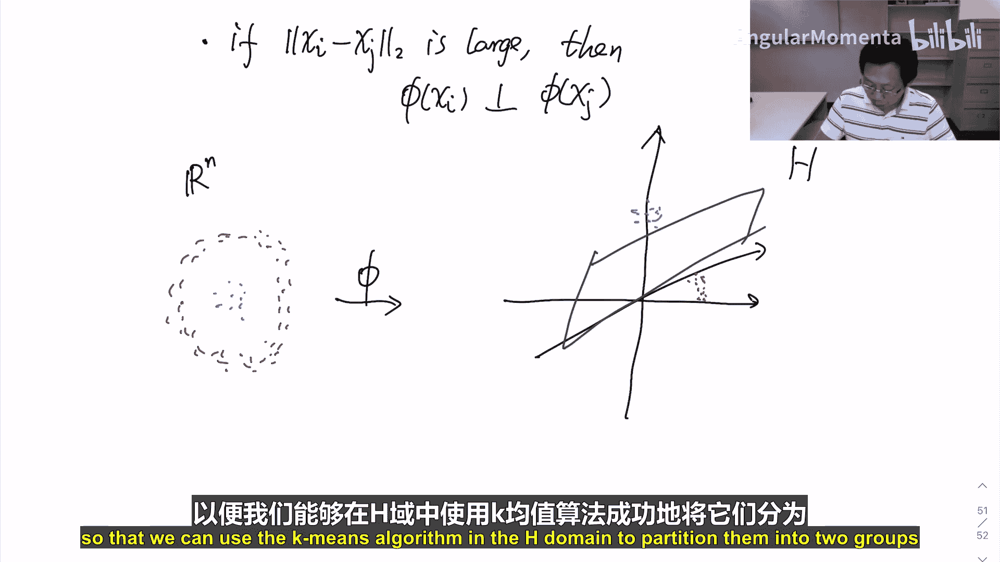