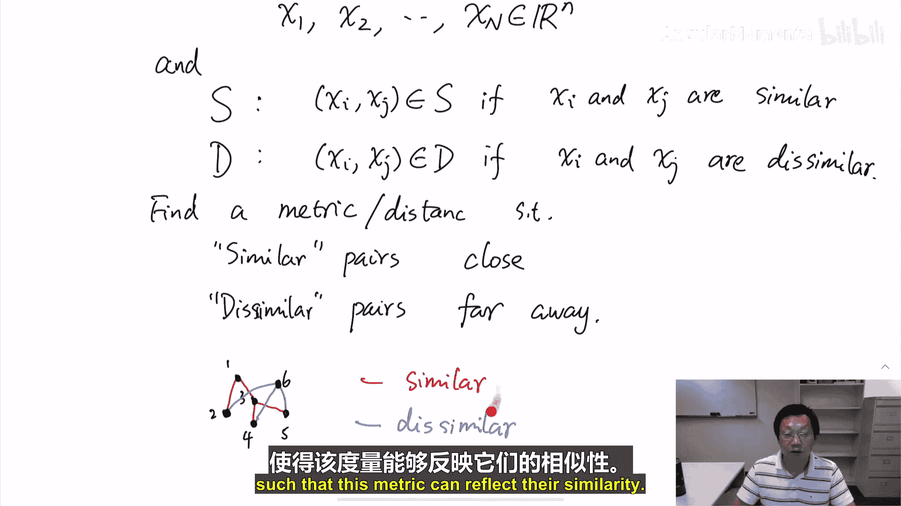
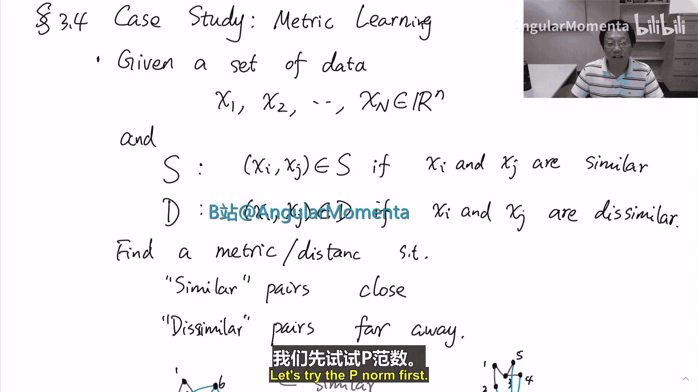
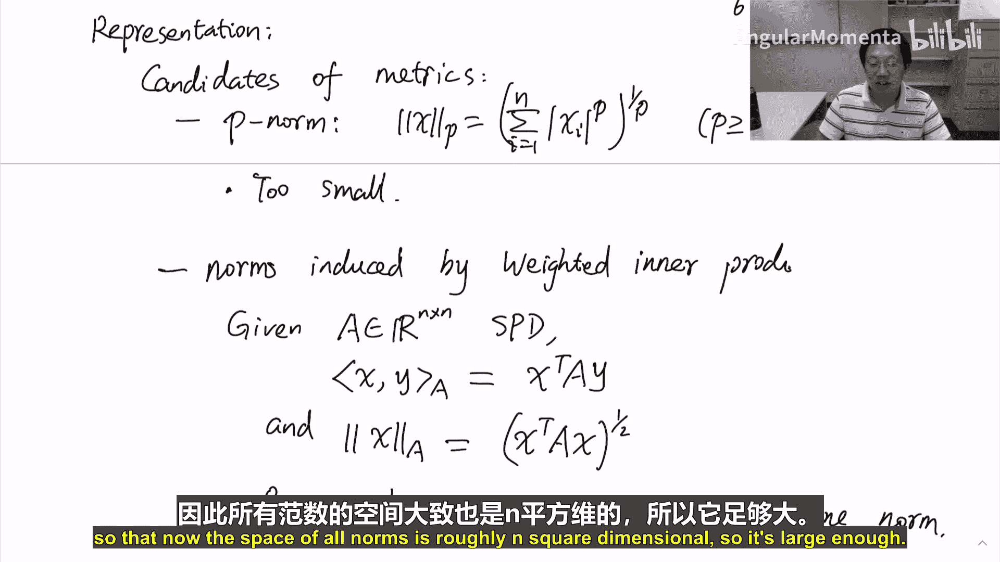
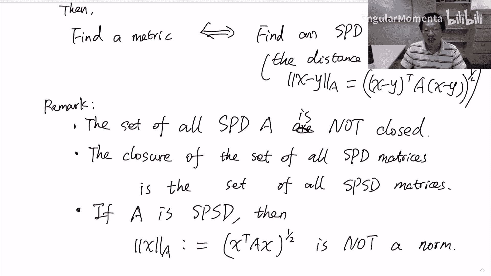
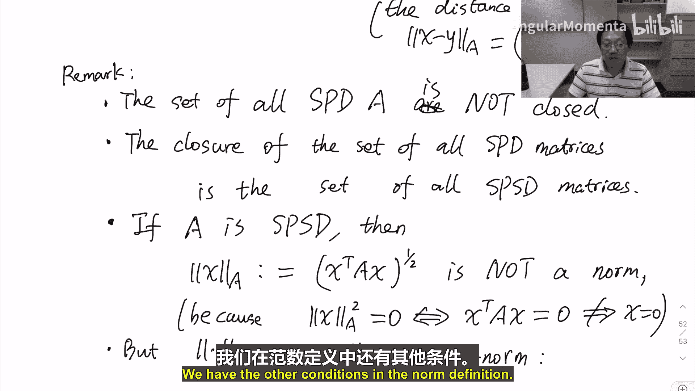
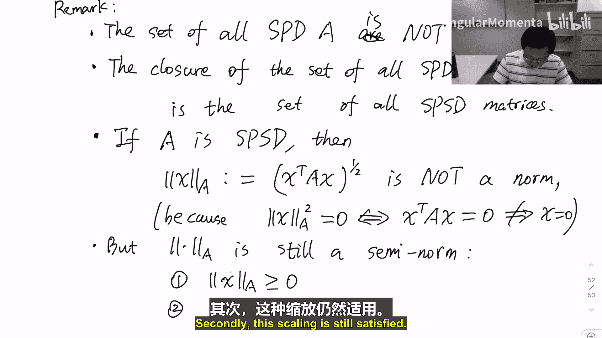
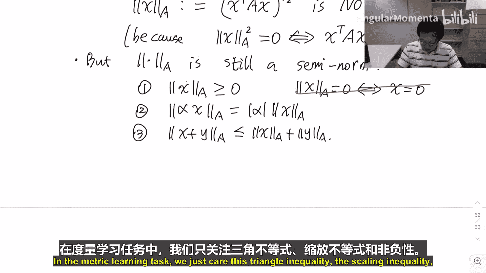
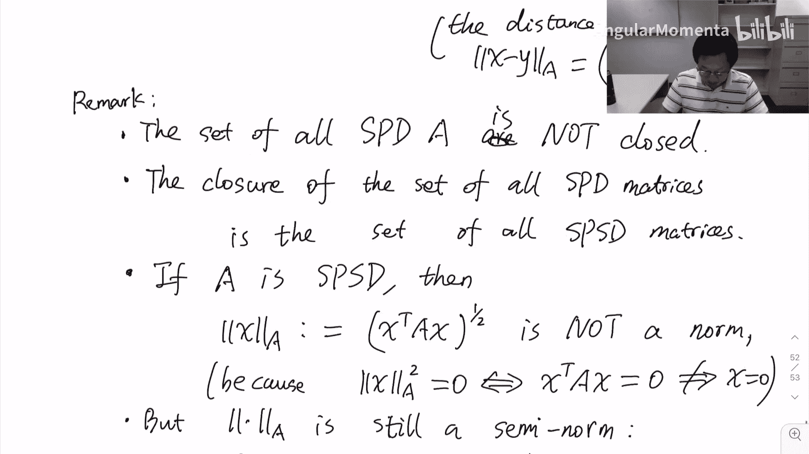
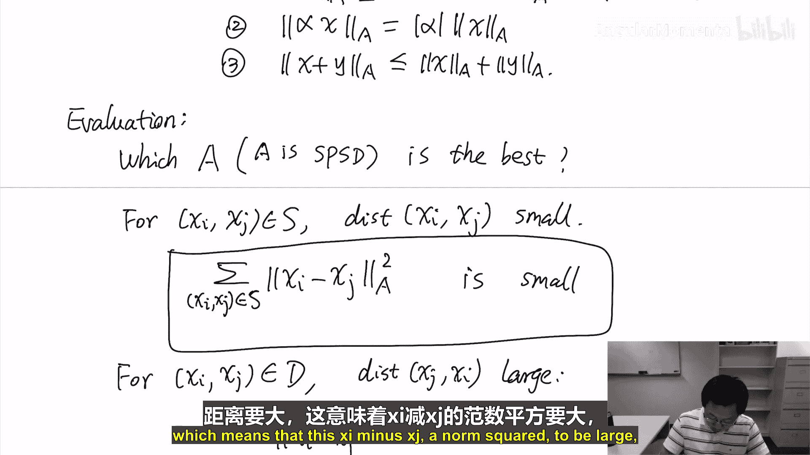
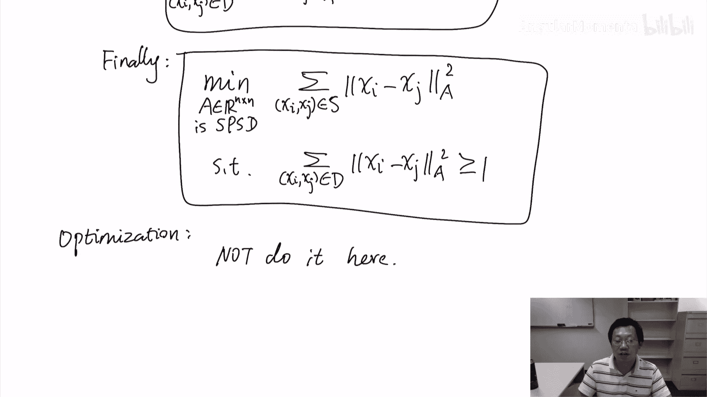

# 【香港科技大学】数据分析的数学方法 ｜ Mathematical Methods for Data Analysis p42 09-05-02-视频 -BV1DEFDzGEZW_p42-

Let me present another application of inner product， and its induced metric。On magic learning。

The machine learning task is as follows， given a set of data points。Say x1， x2。

All these data points are in R N。And also， we have some label on this data。And。

This label is two sets。 One set is called the S is the similar set。 The other is the dissimilar set。

 They both are sets。Or they both are pairwise relations。 just means that X， I and X。

 J in S just means that X， I and X， J， they are very similar。If X I and X J disappear。In第一。

Means that X， I and X， J are dissimilar。So we have a collection of similar and dissimilar pairs。

Then based on this， I wanted to find a distance and a metric that。Similar pairs are close and。

These similar pairs are far away。For example， if we are given such a data set。In this example。

 we have a six points。Here， this red the adjustment is similar。And the blue is dissimilar。

Definitely these points plotted in this subspace is not good because those very dissimilar points like six and five。

Geometrically， they are just very close。Then I want to reorganize these points。

To put them into a new metric space， such that this metric can reflectlect their similarity。

We expect。A result like this。So this demonstrate you a result of the metric learning then you can see this six is just dissimilar to many points so that this six in the new metric system is far away from others while those similar ones。

 these red ones， they are just very close in this new metric system。In order to solve this problem。

 we still follow the representation plus evaluation plus optimizationization framework。

Let's start from the representation。In this task， now what we are going to learn is a metric。

How could we represent a metric so far we have learned。In RN， the P norm， the weighteded norm。

 So we have only two choices of the norms。One is the P norm， the other is the weighted norm。

Let's try the p norm first。

For the p norm， we know that it is defined through this sigma I from one to n。

X I to the peace power and then take the peace route。With P larger than or equals to one。

But in this family of norms， there is only one parameter that is the P。

 which means that the resulting optimization containss only one variable。

 we just take the best P to fit our metric learning task。Definitely in this。

Class of norms is too small because it's only one dimension。

There is only one parameter to tunemb in this family of Nor。Then we call a larger class of。Norms。

 the norms induced by the weighted in the product。In particular， we have a SPD matrix。

Sesymmetric and quality were definite。Then we define the in product by。

The A in the protector equals x transpose A。And then， the induced norm will be the。X transpose A X。

 and then take the square root。The inner product of x and x， and then take the inner product。

Now let's consider this family of norms。This family of norms is big enough。

Because each SPD matrix can define a weighted norm。

Since the space of all matrices is n by and is n square dimensional。 so that now the space。

Of all norms is roughly n square dimensional。 So it's large enough。

Then with this representation。Find a metric。Is equivalent to find an A。In order to find a matrix。

 find a norm， we just need to find a matrix a。With this matrix， a the distance between。X on the y。

Is just the a norm of x and y， which is x minus y transpose a x minus y。

 and then take the square roots。This is about the representation。Before we go to evaluation。

 let's give a remark here。That is。Now we are going to identify a metric in with an SPD matrix。

So which means that our hypothesis space now will be the SPD matrix space。

As I have mentioned that we want that space is complete。

But this one is not a space in such just a set。 Then in this case， we just want set to be closed。

Because if it is not closed， then the limit of a sequence inside this set might converge to a point that is not in this set。

Unfortunately， the set of all SPD matrices are just not closed。

Which means that this hypothesis space of all SPD matrices are not good。We have to complete it。

Different from the combination of a vector space， Nor vector space。

 The combination of a set is relatively easier。 We just need to find out this closure。

The closure of this is set。The closure of the set of all SD matrices。

Its just that set of all SPPSD matrices。To understand this。

 just think about the SPG matrices as positive number。

Then we know that the set of all positive numbers is not closed。

Because a sequence of positive numbers might converges to0。0 is not a positive number。

Then the closure of the set of all positive number is just the set of all non negative numbers。

Correspondingly， just the symmetric positive semi definite matrices。Now。

 if we use the SPS SD matrices to replace the SPD matrix here， we should have the new metric。Here。

 where a is just S，PSD。If a is S， P， SD。Then。Now we have a trouble because X a defined by this x transpose A X the half。

Is not a norm。

The reason is just。This。Ex。A norm squared。Is 0。Just implies x transpose A X。Equals to0。From this。

 we cannot reduce to this。X equals to 0， because this A is only S P SD。

 It might be singular when it is singular， I just choose this x to be a non0 vector in the kernel space of a。

 So then A X equals to 0。 so that the x transpose a X equals to 0。 but this x is non 0。

Then a condition in the definition of a norm is not satisfied。But。This。Is。Though it is not a norm。

 it is still a semi norm。In the sense that。Most of the property in the definition of the norm is satfactoring except。

This one。We have the other conditions in the norm definition。 is still satisfied， like。

，X a norm， it is just larger than or equals to 0。 It is still non negative。 Secondly。

 this scaling is still satisfied。

And we also have the triangle equality。In this seminar， we just don't have that X。A norm equals0。

 if and only if x is the zero vector。This is not satisfied。But this condition does not matter in our。

Magic and learning Tusk。In the magic learning husk。We just care this triangle inequ quantity。

 the scaling inequ quantity， and the lung negativity。

This is not so important。Because it might happen， it is allowed that if two points are very。

 very similar。Then we just set their distance to0。 these two vectors can be different vectors。

This is allowed。We only care this similar dissimilar property。

 We just want this similar pairs is close， but how close they can be zero close。

Then with this， now， what we are going to do is that we just find an SPPSD matrix a such that the distance is defined in this way。

Now， let's go to the evaluation。In the evaluation， we want to define which a。Of course。

 this A is SPSD。I that best。Then let's see for those of similar pairs。

If X I and X J is in a similar set。Then their distance is small。

Which means that we want this X minus Xj， this a norm squared， this is small。For all X I and Xj in S。

 then as we have done before， we just do the sum of the squares of the a norms。This is the one group。

For another goal， if this X， I and X J。Is dissimilar。Of course， we want their distance to be large。

Which means that this X I minus X J A norm squared to be large。

And we want their summation of squares to be large。So we have these two goals。Then finally。

 we just do this optimization。We just minimize。Of course， we minimize A in R M by N is SPS，D。

Our unknown will be the。All SPSD mates， we want to minimize the distance between similar pairs。

And at the same time， we want also to maximize this one。Or we want this。 Not small。

I change this target to not small。Then we can make this to be a constraint。

Just we constrain that this distance。The sum of squares of these similar pair distances。

Larger than a prede number， for example， larger than one。Of course。

 this one can be replaced by any fixed number， right。

 because we just just want this distance is not small。How not small you specify here。

 I just say larger than one is not small。I， I can also 101000。 Any number is Ok here。

So then we get this optimization。Then we just find an a matrix such that this is minimized and the same time this distance should be larger than a fixed number。

Then for the optimization。I will not do it here。Because this optimization is very， very complicated。

 It's a quadratic constraint， quadratic optimization。 It can be very， very difficult to solve。

