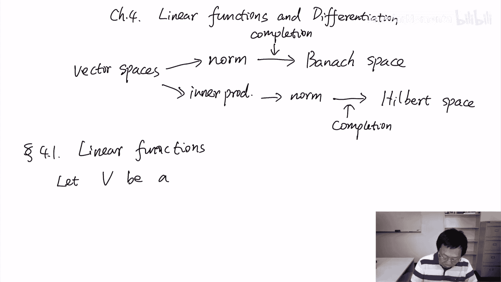
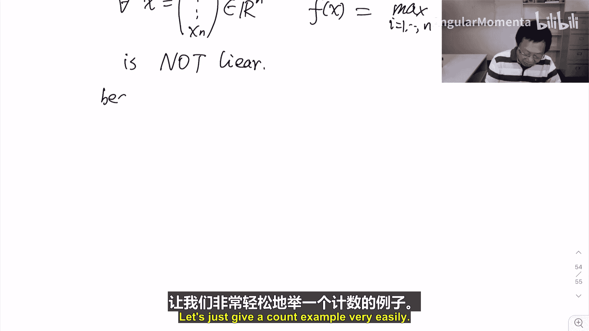
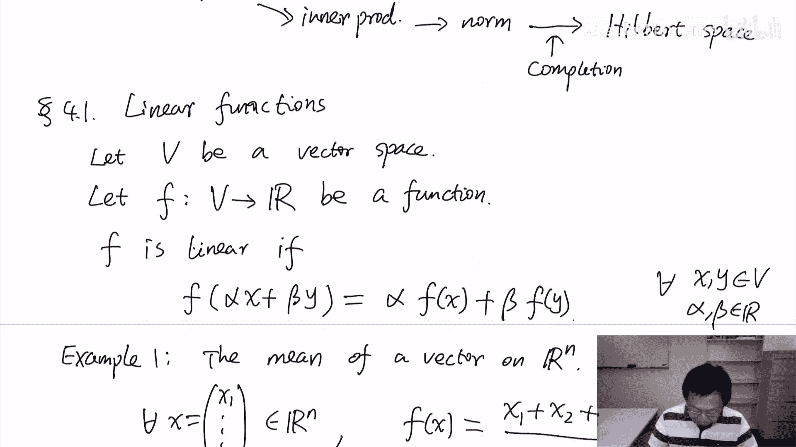
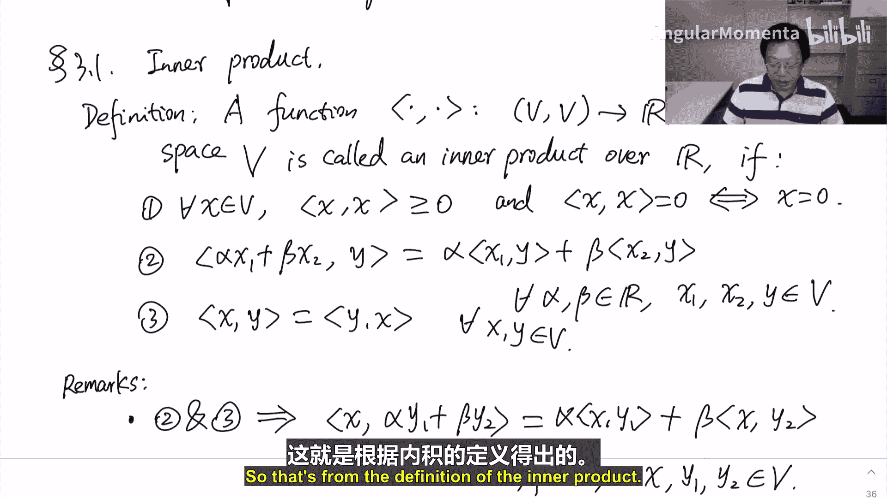
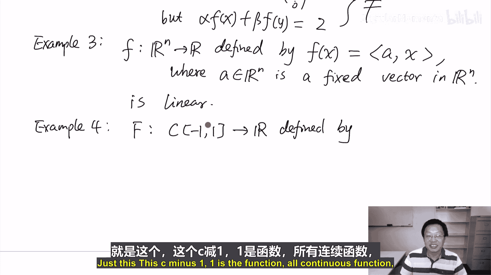
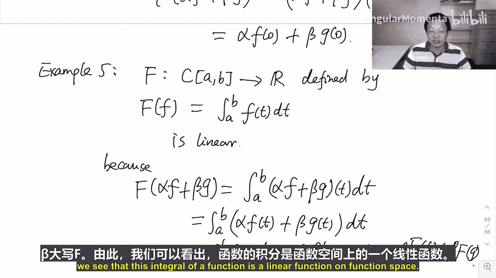
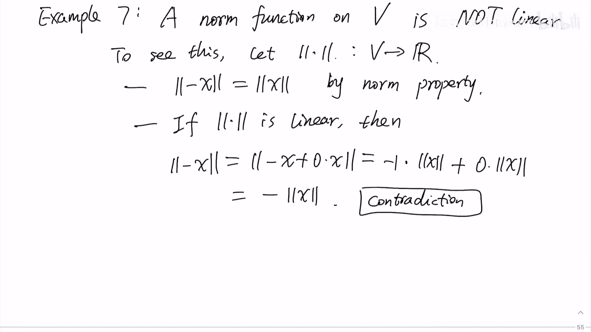

# 【香港科技大学】数据分析的数学方法 ｜ Mathematical Methods for Data Analysis p43 10-01-02-视频 -BV1DEFDzGEZW_p43-

Now we have defined the vector spaces and some structure on the vector spaces。On vector spaces。

 we may define a metric or a norm。And then we get a normal vector space and this normal vector space。

 if it is complete， then we get an Aha space。Which means that compute norm vector spaces。

If the space is not accompanied under that norm， then we do accomplish。

We still can get a banner space， a complete norm vector space。We can go another way， we don't。

Give a norm on the vector space directly。 Instead， we define an inner product。For an inner product。

 it is naturally。 it is automatically a norm on this space。

Just the norm induced by the inner productor。Again， once we have a norm。

 we get if the inner protected space is compute under that induced norm。

 then we get a hereboard space。Again， if that space is not complete， it's incomplete。Then。

 we just completed。We do the competition。Then we still be able to obtain a Hepo space。

These are the structure that we have discussed before。 Now this is the domain of our function。

Then in the following， we will study functions on the vector spaces， in particular。

 functions on hereable spaces and on banner spaces。

We will mainly focus on herebo space because we have in the protector in the protector can give us the norm and the angles so that's。

We have a better structure than the binary space。The heboard space has a better structure than the bottom space。

So that we can develop more tools for functions on hereboard spaces。

To start with we will start with linear functions， and then for nonlinear functions。

 we will use linear functions to approximate it。This is known as the differentiation。

So let us start with linear functions， chapter 4。1。Linear functions。

A linear function is defined in this way。Let v be a vector space。

We have a function F。From V to R。Then this function is an in。If this is satisfied， if this。

We first do linear combination。X and y are two vectors in this V space。

Alpha and beta are two real numbers。So then we know that because our B is a vector space。

 which means that it is a linear space so that their linear combination。Is still on that space。

 still in V。 So F of alpha x plus y is well defined。

Then this should equal alpha法 times F of x plus beta times F of y。In other words。

 this just means that if I first do the linear combination and then do the function。

 apply the function， it's the same as I first apply the function to x and y respect and then do the linear combination of this function values。

So linearity just means that this linear combination and the mapping F， they they are commutable。

 I can first apply the linear combination and then apply F or I can。First。

 apply this F and then apply the linear combination， we should get the same result。

The linear combination and the function is commutable。

 Then this function is called a linear function。In your function， actually it's。

It is the simplest function on vector spaces。 Let's just first see some examples。Example one。

 we consider the mean of a vector。On R N。It defined in this way for any X in R N。

If I write the x in the componentwise form。Then we just define the mean the F of x equals the mean value of the entries。

Not the main vector， but the main value of the entries of x。which means that it is x1 plus x 2。Plus。

 x and divided the by。This function is a linear function。

This is quite obvious because when we do alpha x plus beta y。

 every term here just becomes alpha X I plus beta Yi。So then， of course， this is a linear function。

Because。Is F alpha X plus beta Y。 It is just alpha X， I plus beta Y I。 This is the I entry。

 and then some from I。1，2， n。Divided by， And this is definitely alpha sigma I from1 to N X I over n plus beta sigma Y。

 I， I from1 to N。Over and， which is just alpha F X plus beta。FY。This is a very first example。

The mean of a vector is。A linear function。InExample 2。We consider the max of vectors， the max。Entry。

Of a vector。In RN。Like。For any X， still， I have an entries。In R。

This F of x equals max of I from one to n。Xi。This function。Indeed。

 this function is not a linear function。Why， let's just give a account example very easily。

We can find a count example。Just net x equals 1，0，0，0， and y equals 0，1，0，0，0。Then alpha法 equals1。

 be塔 equals 1。Then you can see F，R 5 X plus beta y。It is just the F of this。1，1，0，0，0，0。Because。

X plus y is just 1，1，0，0，0。 So this is one， but。阿尔法 FX plus beta FY。It is。One times1 FX equal1。

FY equals one。 so that is one times 1 plus1 times 1， which is 2。These two are not equal。

Then this max entry of a vector in R， it is not a linear function。So these are two obvious example。

Example 3。Let's just consider this function from R N to R。Dfined by。Defined by inner product。

Just this Fx equals the inner product of a and x where。A is a fixed。Is a fixed vector。Y儿。

This function is linear。That is from the definition of the inner production。

One condition in the definition of the inner product。The second condition。

The second and the third condition ensure that this。

In the product is linear with respect to the second variable if the first variable is fixed。

It is also。Ninear with respect to the first variable， usually the second is fixed。

So that's from the definition of that。Inner product。

So of course， now FX is simply linear just by the definition of inner product。Example 4。

All the previous examples are on。Functions in R N。 Now， let's consider functions of functions。

Let's just define a capital F。Because our F little F will be reserved for a function。

This capital F is from C -1 to1 to R。Defined。By this way。Just to these sun。This C-1。

1 is the function。 all continuous function defined on this -1 to 1。

 so that this capital F maps continuous function to a real number。

Then we define this capital of F。To be。F at 0。So that this Captain F maps F a function to a number。

 F at0 is just a number。Then this function is definitely its linear。Because。

You just think about this alpha F plus beta G。The capital F applies to alpha f plus beta G。

 It is just。An alpha F plus beta g this function at 0。

This is obtained by our definition because alpha f plus beta G， this is a new function。

 This new function is just defined by for any T。 alpha f plus beta G at T is beta F T plus beta G T。

 Now T equals to0。 So we just get alpha F0 plus beta G 0。

So the linearity is proved for this function of function。 So this is a function。

 this capital F is a function of function。Sometimes we just call this character effort a functional。

We have many other examples of linear functional。You goes jumpm five。Like again。

 I consider a capital F， which maps a function， a continuous function on A B to a real number defined by。

Just this F of。Little F， it is the integral from A to B， F of TD T。This function is again linear。

Because。It is just because of that。Property of the integral for integral。

 we know that it is linear with respect to the function。

Which means that this F alphapa F plus beta G。一。Es integral from a to B，阿法 F plus beta G。TDT。

We know that this alpha F plus beta G F T is defined by alpha F T。plus贝taG7。电铁。

Then just by the linearity of the integral， this is just integral from a to B。

FTDT阿法 plus beta integral ABCTDT， which is阿法 capital FF。Plus是贝塔。Cital FG。So from this。

 we see that this integral of a function is a linear function on function space。

Example 6。Now， let's consider a general case。 Just consider we have a inner product space。

Which means that B is a linear space with a inner product。Let this be the inner product on this V。

And then， we define Fx。We define F by this way by F of x equals a。In the product with X for any。

X on B。And。For a fixed。Vectctor。A on B。So then this F of x is defined by the inner product of a and X。

 where a is a fixed。Vectctor and x is the variable。So again。

 as I have seen that this inner product is linear with respect to one of its variable。

When the other is fixed。So this， just from the definition of the inner product。

 we know that this Fx must be linear。This holds true for any in space。

As long as we have an inner product， then we can construct a linear function。

We can construct many linear functions actually， right。

 because one a corresponding to one linear function。

So we have many different as so we can construct many， many different linear functions。

All the previous examples are just good examples of linear functional， except example2。In example 7。

 I want to give you one more。Count example of linear functions。In the very beginning。

 we have constructed norm norm adjusted functions on vector spaces。Lets consider a norm function。

On the linear space。On we。Actually， this one is not linear。A norm function is not an linear function。

 why。To see this。Just in that。This be the norm function from V to R。Then we know that this。

By the norm property， we know that this minus x should be。X。

 the norm of minus x should be x a sc minus-1 does not change its length。But。

But this is from the norm。Property。Anor must satisfy this relation。But。If。This is linear。Then。

We should have， we just consider again， we consider minus x the norm， this should be。

Minus x plus 0 times x。So you can view this minus as a linear combination of x and x with coefficient minus1 and0 respectively。

Then this by definition。It is minus-1 times X。Plus，0 times x。

This is from the linearity because we have assumed that this norm function is linear。

 so since it is linear， then I can first apply the norm and then apply minus1 to this norm plus0 to this norm。

This should be。Because zero times any number is just zero， so it's just minus。The normal effects。

So this is a contradiction with the property norm。So this is a contradiction。So by this way。

 we have proved that the norm function， any norm function， is just not linear。Because otherwise。

 if it is linear， then minus x， the norm of minus x should be minus of the norm， this is impossible。

Because a norm is always non negative。And it is 0， if and only if。X is zero， but for a non zero x。

 this definitely cannot happen。

