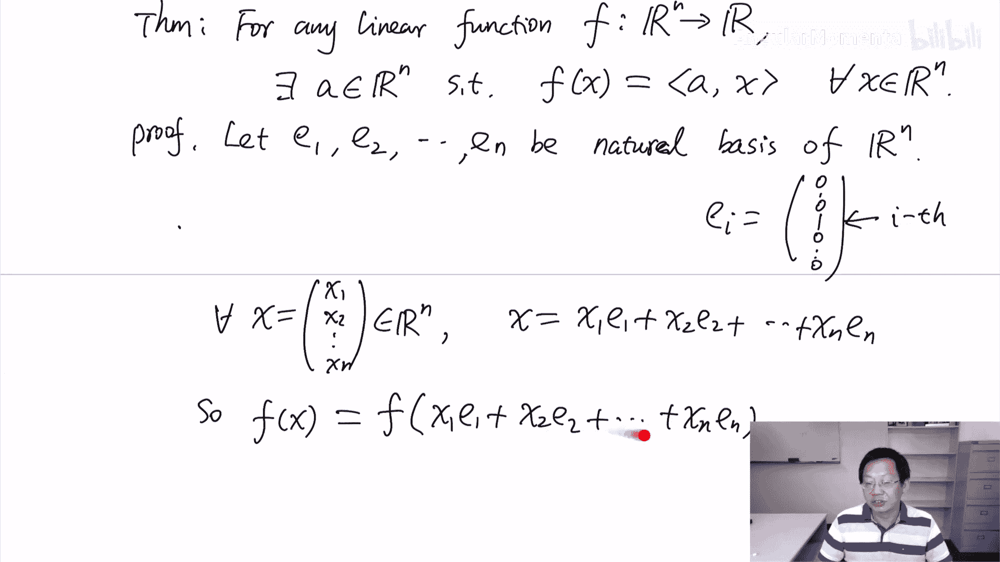
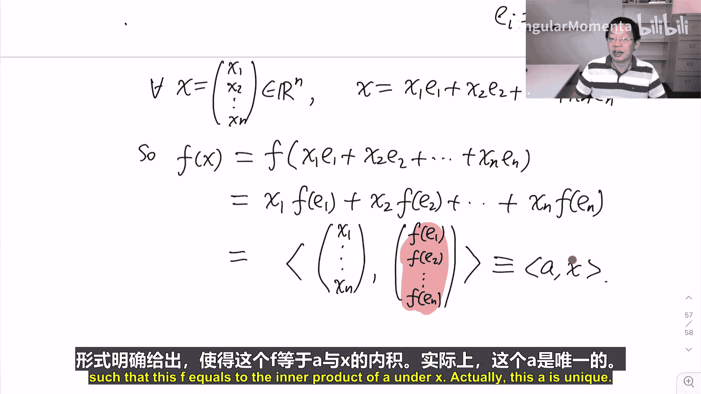
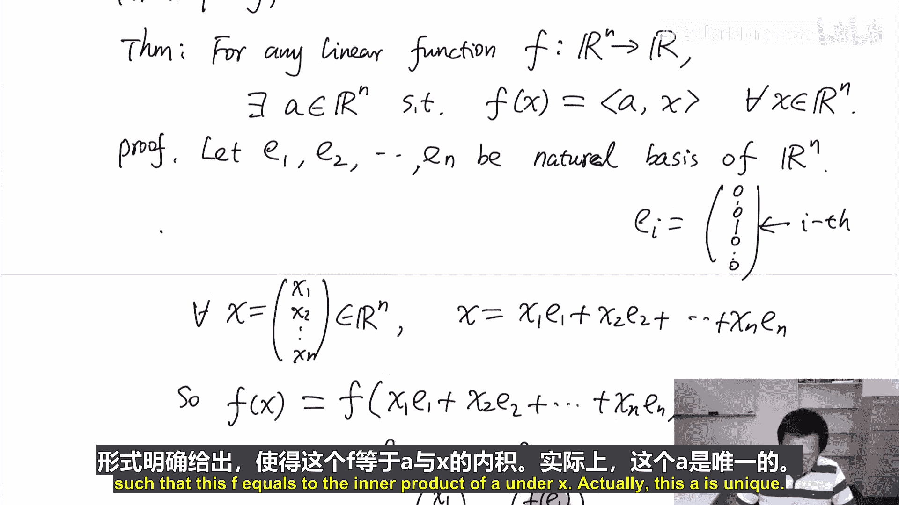
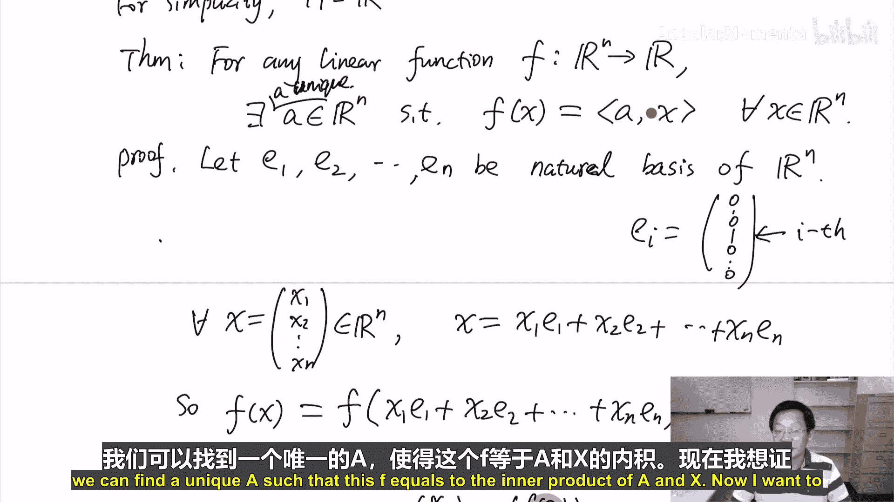
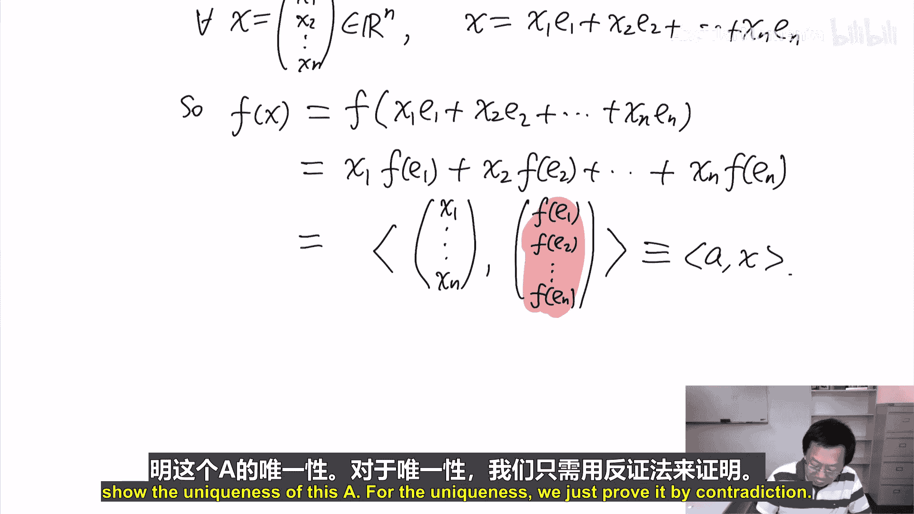
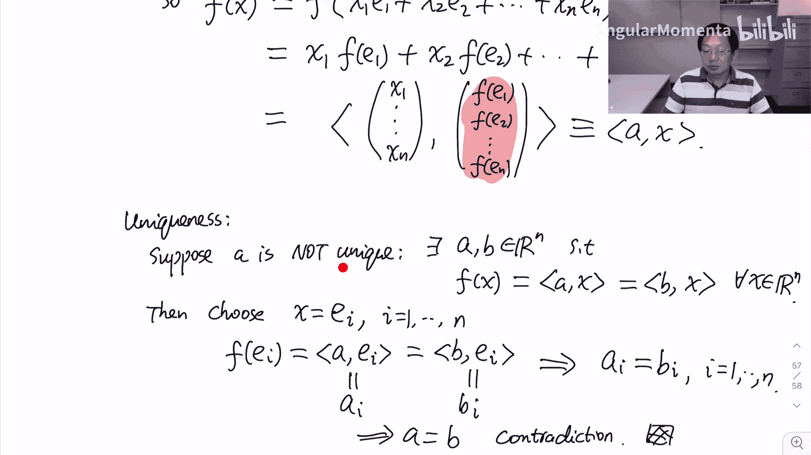
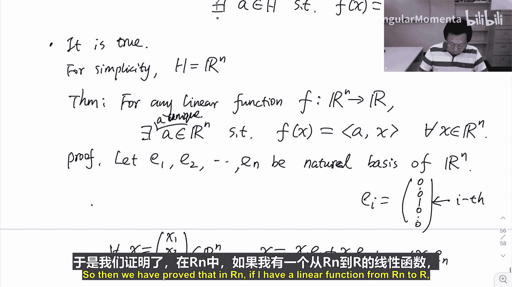
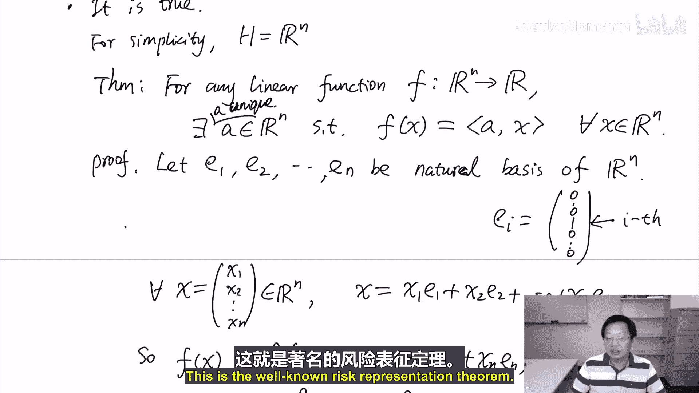
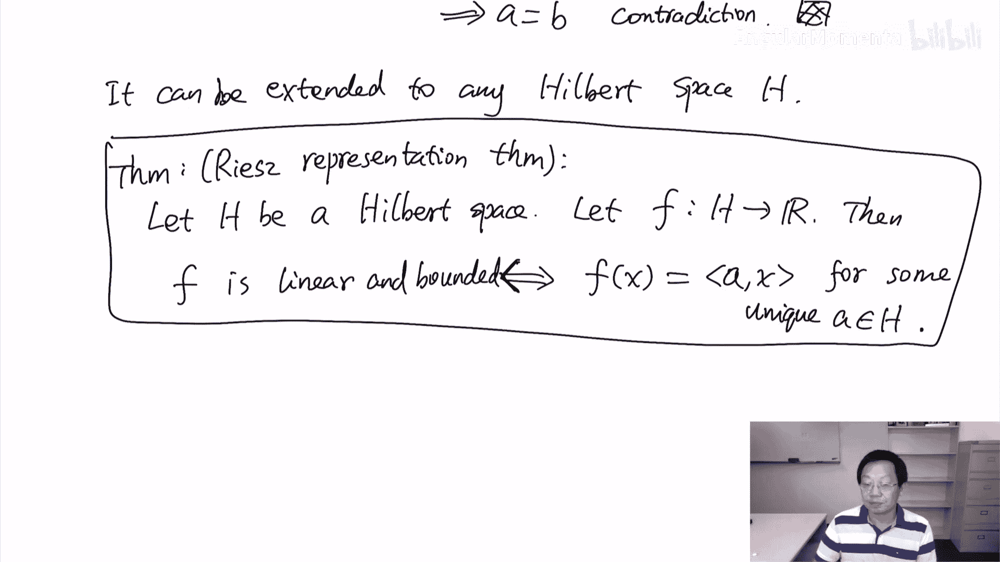

# 【香港科技大学】数据分析的数学方法 ｜ Mathematical Methods for Data Analysis p45 10-03-02-视频 -BV1DEFDzGEZW_p45-

Now， let's see there。Leiner functions。here about the spaces。

We restrict the vector space to be a hearable space。So let's H be a hereer space。安で。

For the He space is an in product space。 for the inland product space。

Let's go back to our example6 here， you can see that for any inner protector space。

 we can define a linear function through the inner product with the first input fixed。

As I have mentioned， by this way， I can define infinitely many linear functions because one a corresponding to one linear function on this bit。

In the productive space。So。This example six tells us。Impice that for any A on H。

We can find a linear function。This F x equals a X。Is a linear function。I h。

Now I want to consider the reverse。off。This one。Which means that if I have a linear function。

 can we find an A such that this linear function in this form。So from example6。

 we can see that from a vector。On the Hebra space， we can construct a linear function。Now。

 if we have a linear function， can we construct a vector on H。So the reverse。For a linear function。

F from。HQR。Can we find。A vector A on H， such that。F X equals a inner product X for any x on H。

We want to answer this question。If the answer is yes。

 then we can find a one2 one correspondence between。

Vectctorors on the hub space and the linear functions on the vector space。Actually， this is true。

To see this， I I just for simplicity here， I just consider this。H equals to R N case。

I wanted to summarize the results into a theorem。Whi it says that for any linear function。F from R。

 N to R。We can always find a vector A in R N。Such that。

This f of x equals the inner product of a and x for any x on R N。Let me first approve it。In R， N。

 we know that that there is a natural basis in R N， E1， E， I， E 1， E 22 E， N。Bi。Natural basis。

Of this， all right。That is EI。It is just the vector with only one， one。Only the I element。

Of this E eye vector is one， all the rest elements are just0。This is the EI。

The EI forms and basis of this iron。Then， for any X。Which is x 1， x2 to X， N。In R N。We can expand it。

Under these spaces， so x equals x 1， E，1 plus x 2， E 2 plus。X a。Yian。

The coefficient before this EI is just the Xi。So。Now this F X， because it's linear。This F X。

 it is just the F。X 1， E1 plus x 2， E2 plus。Plus X N E n。Because x。Is expanded under this basis。

It's a linear combination of this Eis。

Then I just apply the property of the linear function。This is just x 1， F， E1 plus X 2， F， E2。Plus。

Plus， X， N， F， E， N。Then you can see this is just the inner products。Of the vector， X 1，2， X， N。

And a vector。F， E1。F， E to to this。Yan。Then， I just call this。To be a。Then， this is just。A X。So。

 for any。Linear function F， I can find a vector A， which is explicitly given in this form。

 such that this Fx equals to the inner product of a and X。

Actually， this a is unique。

This A is unique。We can find a unique a such that this F X equals to the inner product of a and X。

Now I want to show the uniqueness of this a。

For the uniqueness。We just approve it by contradiction。Suppose。A is not unique。

Which means that I can have two vectors， A and B， such that。This Fx equals ax。

It is also B of x for any x in H in R N。We have two in the product representation of the same linear function。

Then。I just choose different。X。I choose X equals E I。 I consider the value of F E I。 Then F E I。

 you see it is just A in the product of E I。 It is just B in the product of E I。

Then for a inner product E， I this， if I take the inner product of a vector in R N with the E I。

 then I just get the I coordinate of this vector。 So it is AI。This similar is just BI。 So from here。

 we should see that AI equals BI， the I component of A equals the I component of B。

And I choose I from one to n。So that AI equals to B for I from one to n。

So this just means that all components of this a vector is the same as the components of B vector。

 So we just have that this。A vector must be B vector。So this is a contradiction。

Because we have assumed this A and B are different。 A is not unique。 So this A and B。

 there are different vector。But from the linearity we and from this representation。

 we have derived this A and B should be the same vector。 So this is a contradiction。

 So then this a must be unique。

So then we have approved that。

In R N， if I have a linear function from R N to R。Then we can find a unique vector A on R N。

 such that F X equals the inner product of a and X。this is。For I， actually。

 this theorem can be extended to。Any here but space。

This is the well known risk representation theorem。

Race。Representation。Theorem。It says that in the letter a should be a here space。Let F be。From。

H to R be a function。Then。We have that F is linear。Impice。F。X equals。A X 4。Some。Unique。A in H。

But you should be careful when we extend this result to any hub space。

 we should have a stronger condition than this linear。It， it is linear and boier。So， we need that。

To add abundanceness of this function as well。Otherwise， for an unbounded inner function， this F。

Cannot be represented in this form。And the reverse is obviously true because if Fx in this form。

 then F must be linear and the bondedness is just assumed by the co was inequality because it's an inner product。

So this is always smaller than the norm of a times the norm of x， so it is just the bun。

So this is just an equivalence。So this is the risk representation theorem。

It says that if H is a hub space， if we have a function from H to R。

 then this function is linear and bounded。 if and only if this function is written into the inner product form for some unique a。

