# 【香港科技大学】数据分析的数学方法 ｜ Mathematical Methods for Data Analysis p46 10-04-02-视频 -BV1DEFDzGEZW_p46-

This risk representation theorem is a fundamental theorem in functional analysis。It is just identify。

A linear and bounded function with an vector in this age。

So we set up a one to one correspondence between all linear and bounded functions and all vectors on this H。

 for a vector on H， I can find a linear function， linear and bounded function for a linear and bounded function。

 I can find an a。 So these are just one to one correspondent。Let's see some examples。Of this theorem。

Example  one。Just consider the mean function。We know。The mean。Of a vector。好。RN。Is linear。

So the mean of x， So F of x， it is just x1 plus x2 plus plus x n over n。

So then we must kind write this into an in theproductive form。

This is the same as the inner product of this 1，1，1。Give divided the button and this X。

Which means the weight before X is10。Example 2。Just the letter H B here space。你 sir。Yes， not。Ninnyer。

Right，The norm function， I mean， the norm induced by this inner product is not linear。

 Any norm is just non nonlinear。

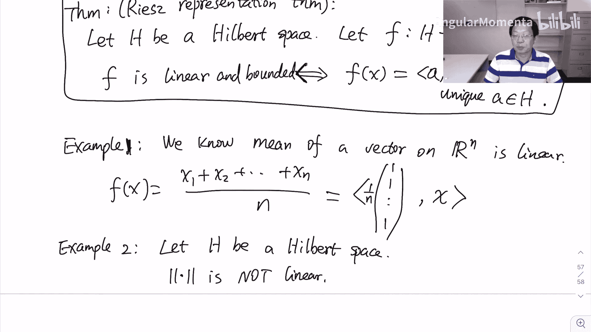

So since this norm function is long nonlinear。 so， I cannot find an A on H such that a norm。Es a X。

For any ex on H。We cannot do this。The norm is not an inner product in this form。

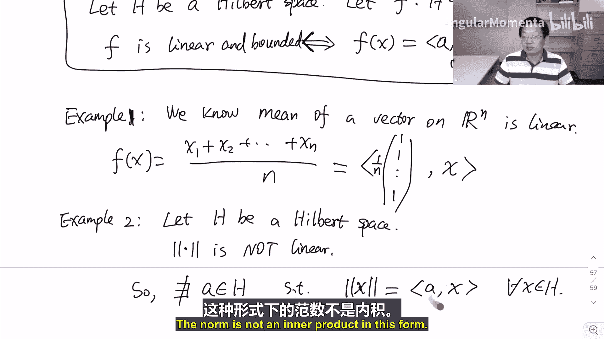

E example three。We consider the space of matrices， of square matrices are M by n。

With inner the product。Just the standard inner product， defined by a B。Equals summation of。AI JBB。

I J。I and J I is from one to N J is also from one to n， because here， all the matrices are square。

On this inner product space。Define a function。It a trace function。

It is just be the sigma of I from one to an AI I， the sum of the diagnosis of the matrix。

For any A in R。by N。This trace function arises very frequently in machine learning。

 in many matrix related problems。This trace function， it is just an in。

Then we know that this R N by N， this space is finite dimensional with any inner product。

 We have an induced norm with any norm。 This finite dimensional space is just complete。

 So this R N N with this inner product is a here space。So then by the risk representation theorem。

We must can have write this trace of a into an in product form。We have。The trace of a。Actually。

 it is just the inner productor of A and the identity matrix。

We can write the trace into the inner product of a and the identity matrix。 So here。

You can see that we have find。An element in this R N by。

 and such that the trees is just the inner product of that element under it。Now。

 this animate is the eye。

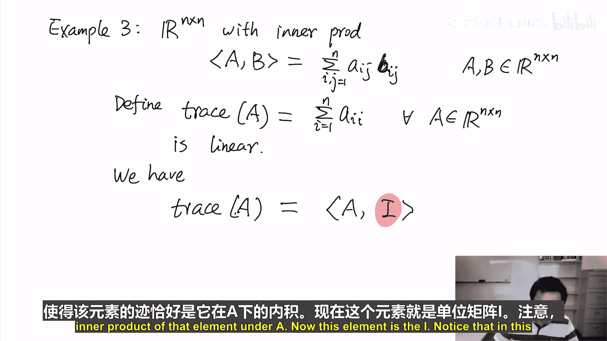

Notice that in risk representation theorem， we have this bondness。

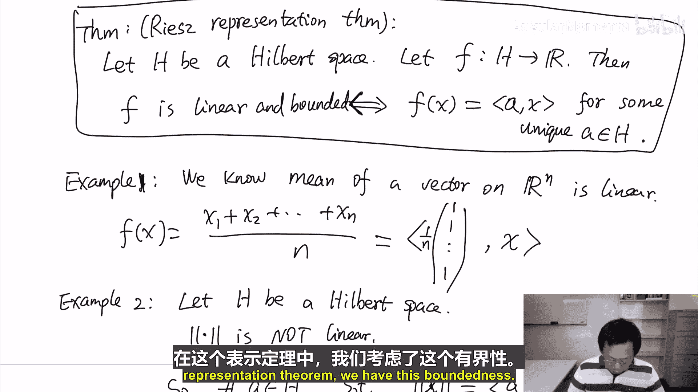

In this example 1 and example 3， we don't worry about the boundness because all these spaces are finite dimensional。

 R N is finite dimensional。 R N by N is finite dimensional。

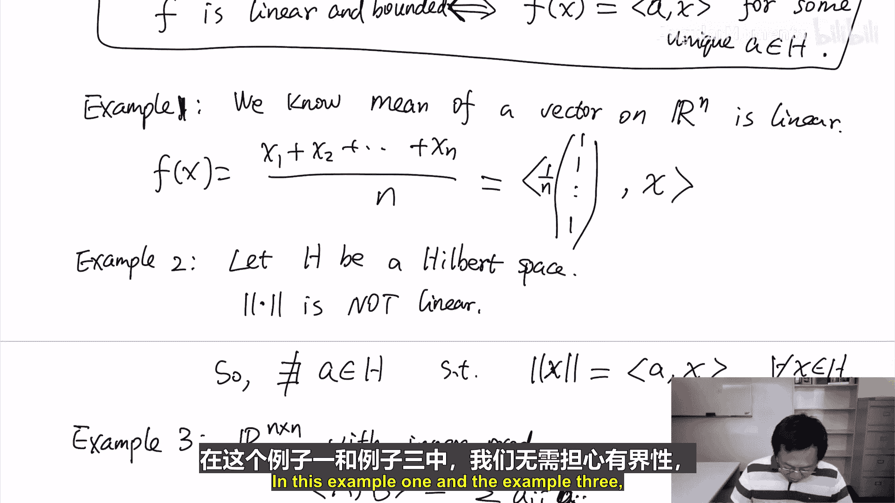

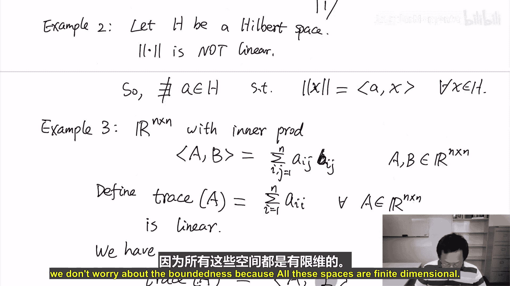

So for finite dimensional vector spaces， for finite dimensional hebro spaces， indeed。

 linear implies boundness。

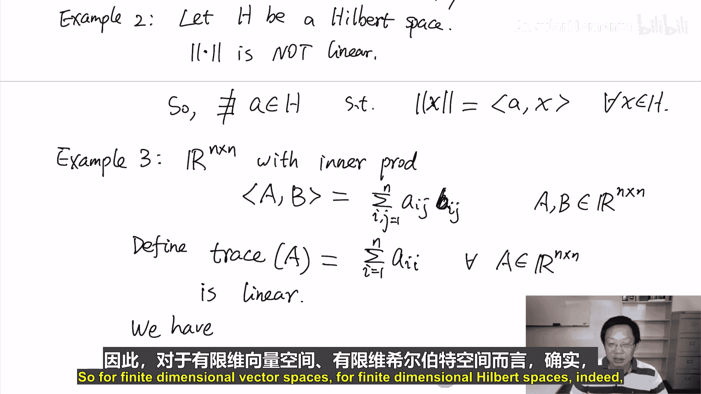

I have this remark。In finite。Dimmenional。Here bought spaces。你是玲玲。Is equivalent to linear and bounded。

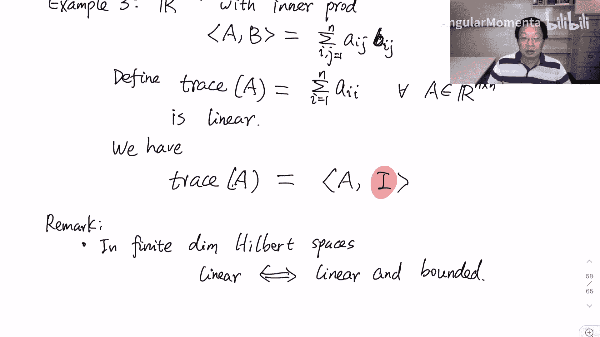

But。This is not true for infinite dimensional spaces。In even finite notes。Dimmenional。Here。

 bud is space。There exists， some inia。But。Un banged。ファンクシンス。Let me give you examples， example  for。

We just consider the。L2 minus1，1。This space， as I have said。

 it's the combination of C of the function space。Of this is c minus121。The continuous function set。

Under the inner product。In the product。This。F and G in the product is the integral from -1 to1 F T。

GT集T and。In the worm。It's just the two norm equals。F， F。The half。

Or it is just the integral-1 to 1 F T squared D T。And then take the square root。

This capital L2-11 is the combination of this incompte space C-11。Actually。

 on this space we can find。An unbounded， linear， but unbounded function。This is just the one。

In our previous example， when we。In this example， in the example4 here。

 we have seen that if we take the value of functioning at0 on this C minus-11 is a continuous function。

 is a linear function。 It's linear。Function， actually， it is also bounded。

 But when we do the combination， then some very discontinuous function come in。

Which makes this F 0 might be infinity。 Actually， it does not make any sense if we just take the value of a function。

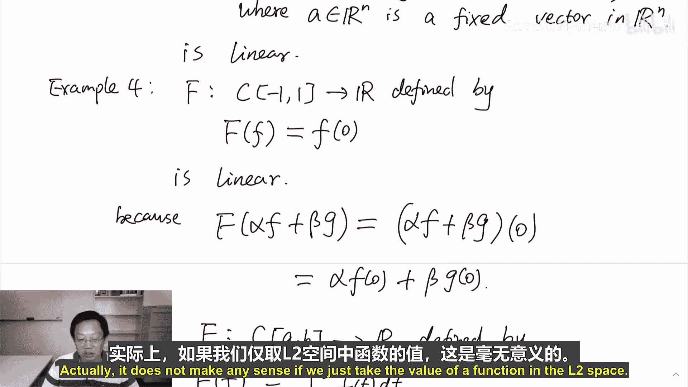

In the L2 space。Then。We just consider this function。Consider this said。C比到 F。

F equals F0 defined by this way。It is a steel linear， right？But this one is unbounded。This F， F。Is。

Unboundunded。Because。We can find some F on this L 2-1，1， such that this F of F is infinitefinity。

There are many， many such functions。 I just choose。This function F。F T equals。1， T is not。

And just that T equals infinity T equals 0。Of course， under T is in between -1 to one。This function。

 its2 norm， is responded so that it's in the minus1 to1， but f0 equals2 infinity。

So then for this function， there is no inner product representation。

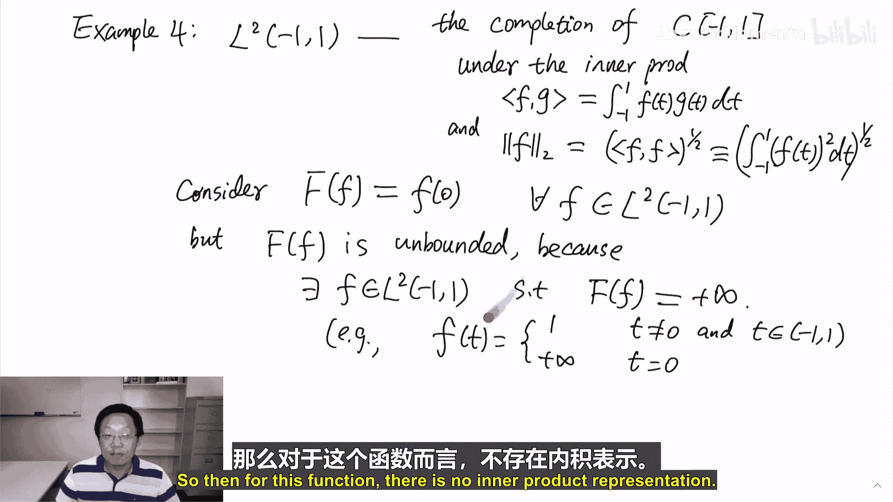

Because it's linear， but unbounded。You can sample 5。Dear， I consider this L2-121。

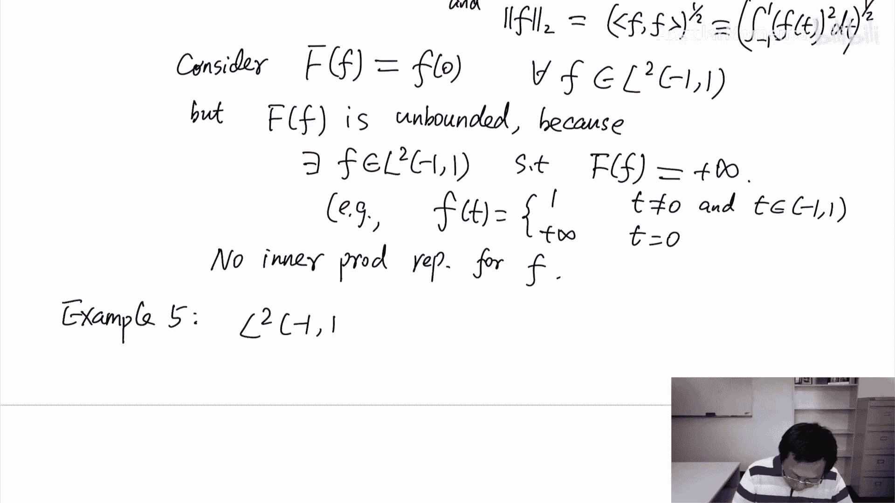

And the we consider see。This is a G that maps this one to a number。In this way。

 such that this G of F equals the integral from -1 to 1。The FTDT。First of all， this G FG is linear。

That's quite obvious because this integral is linear in this function F。 we have shown it before。

 right。

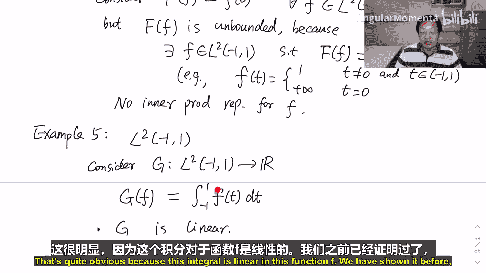

And secondly， J is bounded。Because。We just for any F in this L to minus-1 to1。

We just consider this a G of F。It is the integral of minus1 FT DT。

It can be viewed as the integral of -1 to1， F T times 1 D T。Then it means that this。

Is the inner product of the F function and the constant function 1。

So it is just see that this is F and one。 the inner product of F and one。Then， this is。

Applied by them。Ca was inequ quantity。 This is just smaller than the F2 norm times this one function the two norm。

This constant w function here this one。以 course。The integral of minus1 to1，1 square the Dt。

 and then take the square root。So it is just a square root of two。

So that this is smaller than2 times F2， smaller than infinity because。

This F is in L2 so that the two norm of this f is bounded。

So that this G F is just a boundary for any given F， it is G F is just smaller than infinity。

 so that this G is bound then by risk representation theorem。

It implies that we must confine a function。

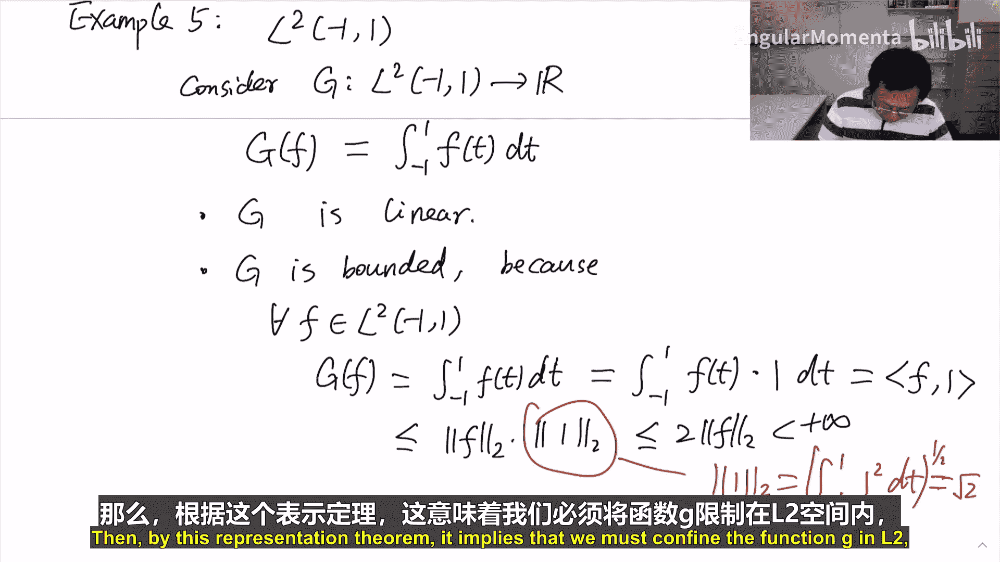

G in L2。Such that this G of F equals F in the product with G。Indeed， we have find the G here。 right。

 You can see G is just the constant function。Now the function whose value is one。Indeed。

It G is the constant function。For all T in this-1 to1。It is just this function。

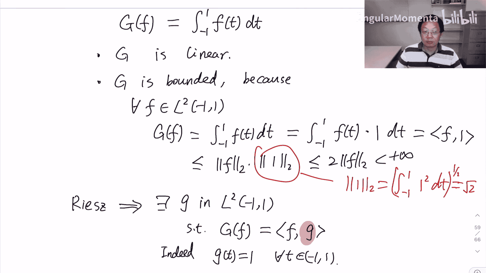