# 【香港科技大学】数据分析的数学方法 ｜ Mathematical Methods for Data Analysis p48 10-06-02-视频 -BV1DEFDzGEZW_p48-

Now we discuss the projection onto hyperlinks。Because this hyperplan is very simple。

 It is just defined by one linear equation。 It is used very frequently in machine learning。

In many machine learning tasks， we need to find the projection onto the hyperplane。For this。

 we just consider。A hyper play。In this Hy plus space H。Deefine in this way。X in H。AX equals B。

So for simplicityity， I dropped the subscripts here。We have a hyperplan。

And assume that we have a  point of1。The whole space is H， just given。W on H。

And we wanted to find the closest point on this as to y。So this point， the closest points on S to y。

 it is just called the projection of y on to S。There。Reectctor on S。That is closest to why。Is called。

The projection of wire onto to us。It is denoted by this P， S。PSY。

P means the projection S means the target。And y means it is the projection of y onto S。

Using optimization terminology， this P， S Y， it is the minimizer or A。Of this y minus x。

 the distance between x and Y X is on the S。Here the norm we use is the induced the norm on the he space。

Now， let's find a close the form of this。PS to Y's。Find。An exclusiveive form。Of P， Y。

Because in many applications， we needed formulas for PSY。

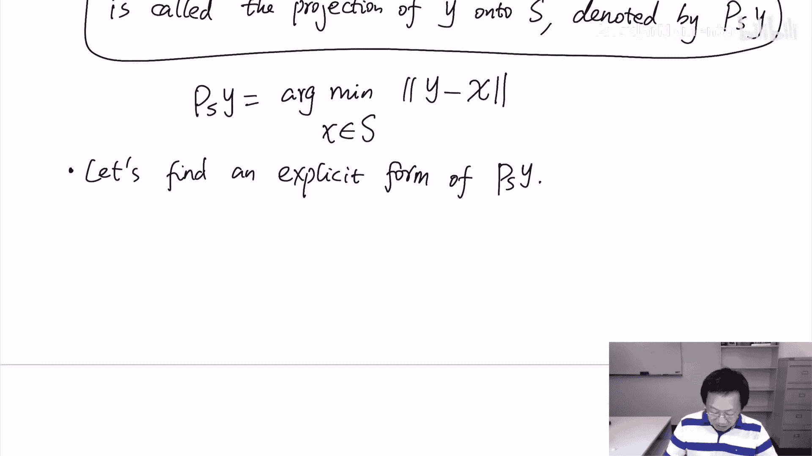

In the formula of this P S Y， we can only use。The S。

Which means that A and B because S is defined through A and B。And also， why， of course。

We want to express this P SY in terms of Y， A and B。

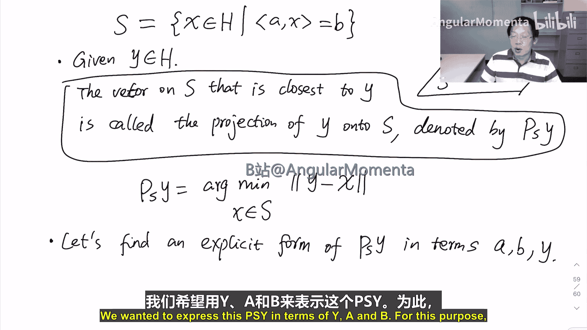

For this purpose， let me first present you a theorem。It says that Z is a solution。

 if we have a solution。To this minimization problem。Here。If and only if this Z on S and。

This the minus y。X minus Z， the inner protect equals 0 for any x on S。

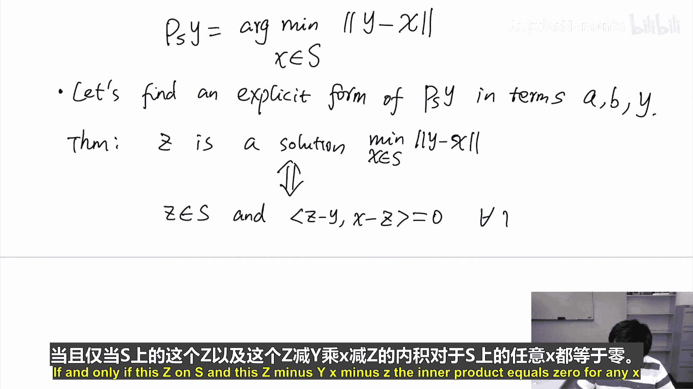

Geometrically。We have the Z here。Z is just the P Y。Then， y minus Z。

Is orthogonal to z minus x for any x on this S。So which means that this y minus z。

 this vector should be orthogon to this x minus z vector。

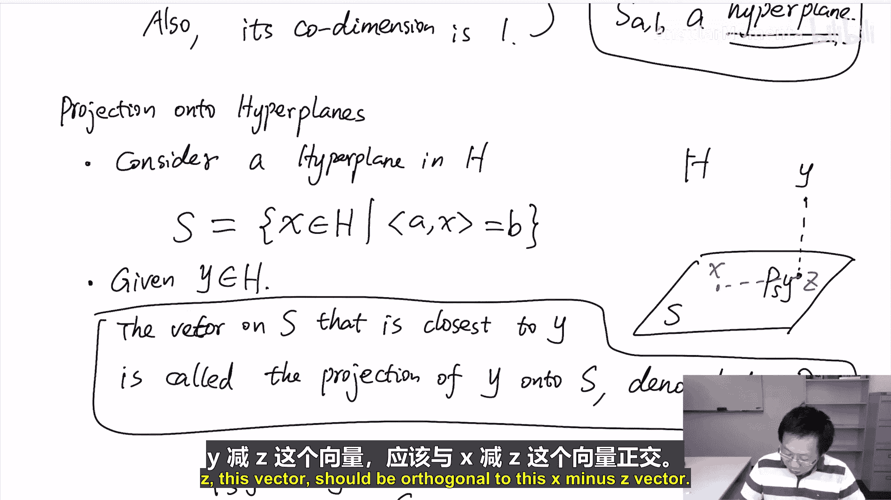

Also， since this。For any X on S。This x minus Z is just belongs to S minus z。And。This Z is on S。

This tool just implies that this x minus z is on this as a0。Right。

 because Z is just a fixed vector on this S A B。Then from the previous calculation。

 we see that the SAB is any fixed vector on this SAB plus SA0。So here we choose x 0 equals to z。

 So then you can see x minus z must be in S0 so that this is the same as z on S and z minus y。

Is ortho to this S0。So this condition is just the equivalent to this condition。

This is a remark about this theorem， Gemetrically， in this theorem。

 just see that if this is a solution of this minimization。

We must have that this z minus y is orthoal to S0。S A 0 is a subspace。

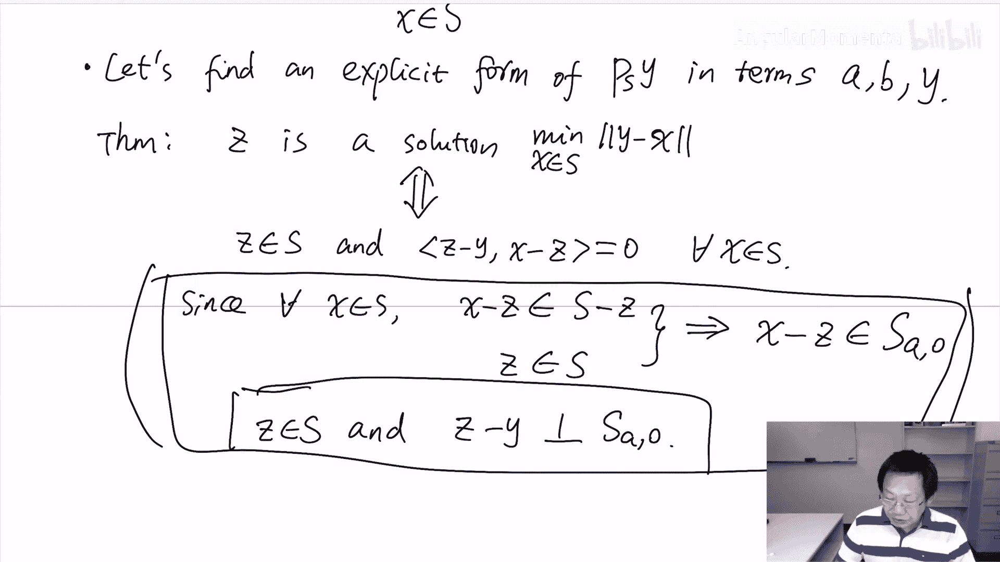

That's just the prove of these of theorem。We started from。Top to bottom。That is， this is a solution。

 We want to show that this is true。Assume he is a solution。Then obviously， they should be on us。

Because the constraint is on S， we minimize this y minus x norm on S。

 so definitely this should be on S。Now we wanted to show this ofberity。

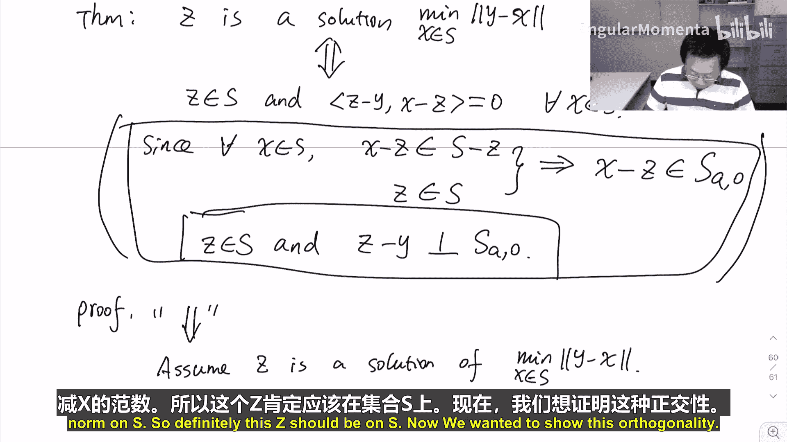

For this purpose， we consider for any X on S。This is S， this is Y。And this is Z。

So now for any x on it， we just consider this red line that connected the z and x vector。Then。

Any points on this red line must be in the form of Z plus T X minus Z。

It's like we start from these Z is the origin。Any point here， it is just z plus T X minus Z。

So you can see when t equals 1， it is just x。 when t equals 0， then we just obtain z。

 When t is in between 0 and1， this point just in between x and Z。 If t is smaller than0。

 we have somewhere here。 T larger than than one， we have somewhere here。

 So that any point on this red line can be written in this form where T is just a number。

So for any T on R。We just consider a vector on this red line。For vectors on this red line。

 we we first show that the whole red line will be on this S。For this purpose。

 I just need to consider in the product of this a。With the point。

 So this is just by the linear is A Z。Plus， T of A X， minus A Z。So Lucy is just Tim。

B plus T B minus B， which is。Then from here， we just see that this。The plus T X minus the。

 this is on S。Actually， this is quite obvious because this is a plane。

 So a straight line must be on this plane。 If two points of a line is on this high on this set。

 then the whole line must be on this set because this set is a flat set。

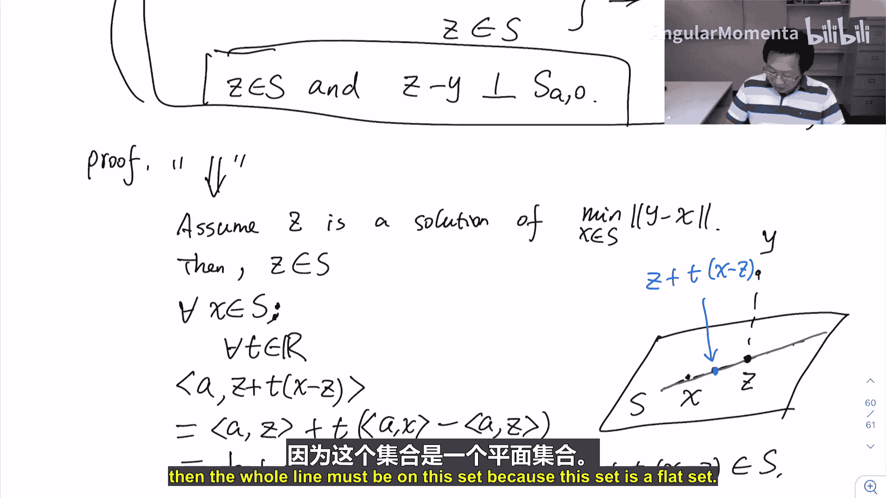

Next， we are going to use the opportunity of Z， see。Z is a minimizer。Of this problem。

Then this distance to Y。This one is the smallest on asset。

So that this is just smaller than or equals to this Z plus T X minus Z minus y。

 This is smaller because both Z and this point are on S， Z and this point， Z both are on S。So。

 and but Z is the closest point on S to Y。 So this is smaller。 Of course。

 the square is just smaller than the square。And then we do some rearrangement。

 This is just the minus y。Plus。T X minus Z。

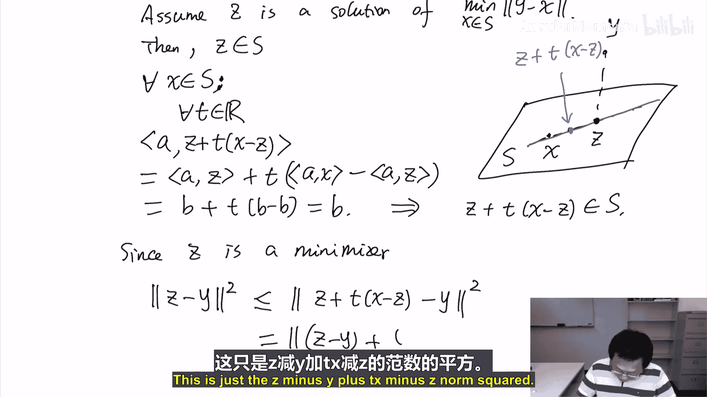

Normal square that。This。We just used the。Expansion of。

Norm squared because norm squared is an inner product。

So we should have this z minus y norm squared plus。To T。

Of the inner product of Z minus y and x minus z。Plus， t squared X minus Z。Normal squared then。

We just expand this norm square into the。Norm squared of the first term plus the norm squared of the second term plus two times the inner product of these two terms。

Then。We have a cancellation， this cancels this。So we just obtained that this2 T。The minus Y。

 X minus Z。 This is just。Larger than all equals to。Minus t squared。X minus z norm square rootta。

I just move this to the left， so this will be larger than or equals to minus of this term。

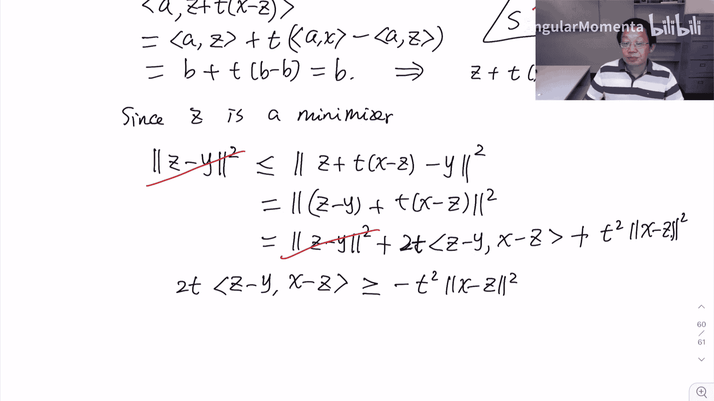

No， I would like to。Use the sign of T。If t is larger than0 then this blue point is on this side of。

 if t is smaller than0 then this blue point will be on this side of z。So if T is larger than zero。

Then。We just go back to this inequality。 I would like to divide both sides by 2 T。

Which one will be larger？Because t is larger than 0。2 T is just larger than 0。

 So then dividing both sides by a positive number， then will not change the direction of the equality。

 So it is still this direction。And will let。T approaches zero， but of course。

 we keep T to be positive。Then， this inequality。This equality always holds to because he is positive。

But the absolute value of T goes to 0。So， then this。Z minus y。X minus Z。

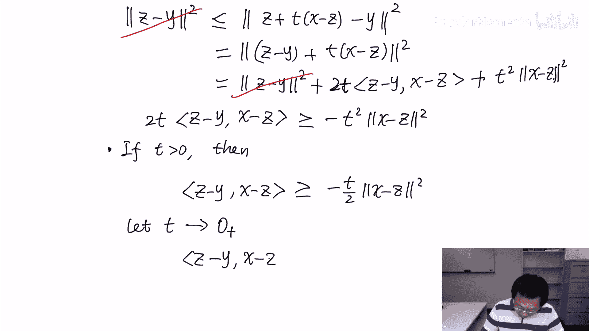

Will be larger than all equals。 This limit of this T approaches0 plus。

It's minus t over 2 x minus z norm squared。 So this is definitely 0。

So this inner product is larger than 0。ET is negative。Then again。

 we divide both sides of this E in quantity by 2 T。But now because 2T is negative。So that this。

Direction of this inequality should change to the opposite direction。Then again。

 I set this T approaches 0， but keeps T to be negative。Then this inner product。

Should be smaller than all equals to the limit when t goes to 0 minus。

Minus t over 2 x minus Z norm squared。Again， this limit is 0。

So we just obtain that this inner the product should be non negative on the one hand。

 should be also non positive on the other hand。So then this inner product must be zero。

So we have proven it that。If。🤢，Z is a solution of this minimization。 Then Z on S。

 and this inner product is 0 for any X on S。Let's do the rivers from the bottom to the top。啊小。

Z on S and this inner product。It is0 for any x on best。We want to show that this Z is a minimizer。

Then。For any X on S。We just use the。X minus y and norm squaredd that。Which is just。X minus Z。Plus。

This z minus y squared。Then。Because this and this， they are orthogonal， their inner a productor is0。

 then by using the pythagoras theorem。We just obtained this。

Is x minus Z the norm squared plus Z minus Y， the norm squared。Since this term is non negative。

 of course， their summ is larger than this term。This is true for any X on S。Z is also on S。

So that this z is the closest point on S to y。Because for any ex on S。

We just have that its distance to Y is larger than the distance from Z to y。 So， of course。

 Z is the closest point on S to y。We finish that proof。

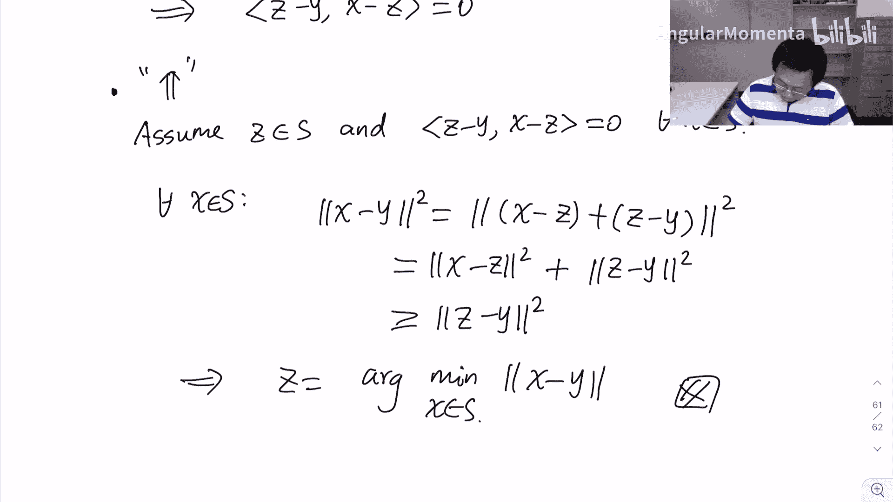