# 【香港科技大学】数据分析的数学方法 ｜ Mathematical Methods for Data Analysis p49 10-07-02-视频 -BV1DEFDzGEZW_p49-

Now， we continue to find the formula for the projection of。

Vector in H onto this hyperplane defined in this way。

We have given a and sufficient condition for the projection。

It says that z is the projection if and only if y minus z is orthogonal to x minus z for all x on S。

Or equivalently， z is the projection if and only if y minus the is ortho to the subspace as a0 where this B is replaced by 0。

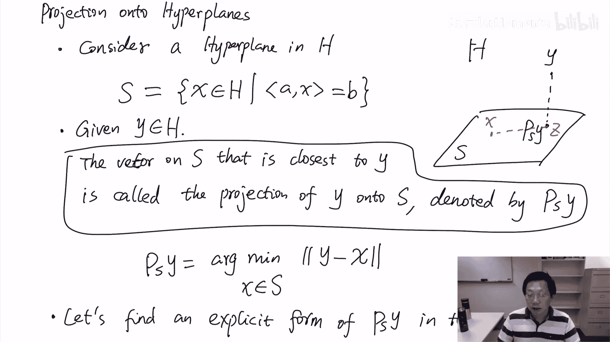

But in this necessary and sufficient condition， actually。

The existence and uniqueness of the solution of this one is even unknown。

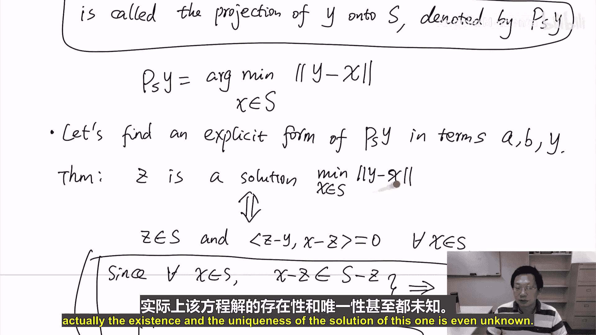

Now， I present a theorem。The solution of。That miniization。Exists。And they is unique。

Which is given by。We have an explicit formula for this unique solution。 It is y minus。A Y minus B。

Divided by a enormous squared。And times a。Let me prove this theorem。For simplicity。

 I just denote this vector by z。The equals。Then。I just want to check that this is the defining in this way。

 satisfies the necessary condition here， sat this condition。

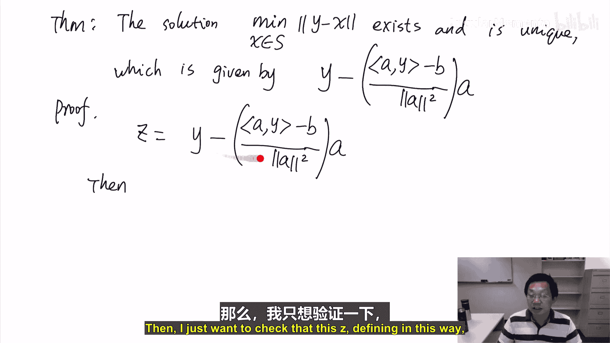

Then we just have that this must be a solution of this。

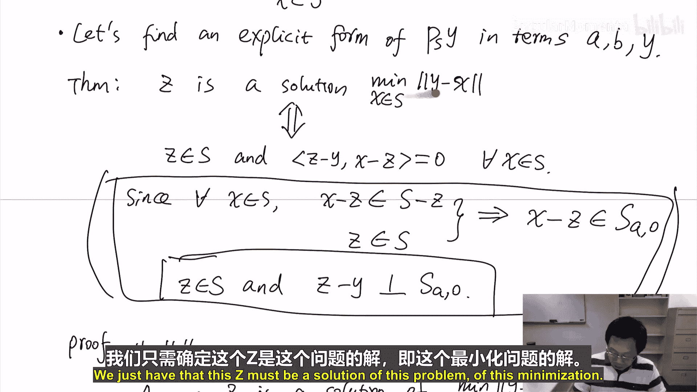

Problem of this minimization。For this purpose， I need to check Z on S。This is easy because this A Z。

 I just checked the inner product of A and Z equals a Y。Minus a。This。

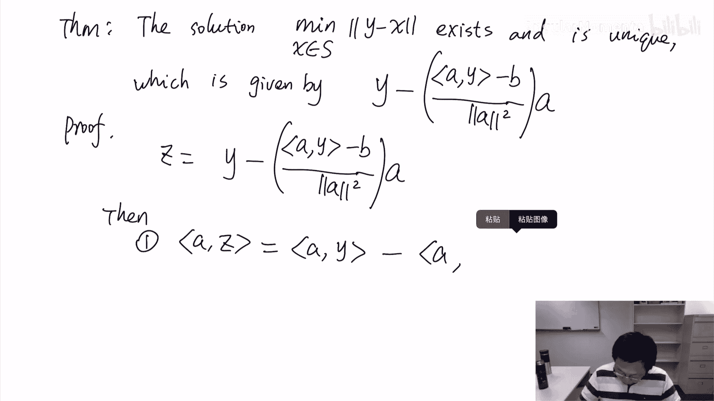

Which is。This A A inner the product is just a norm squared。 So then we just have this cancels， this。

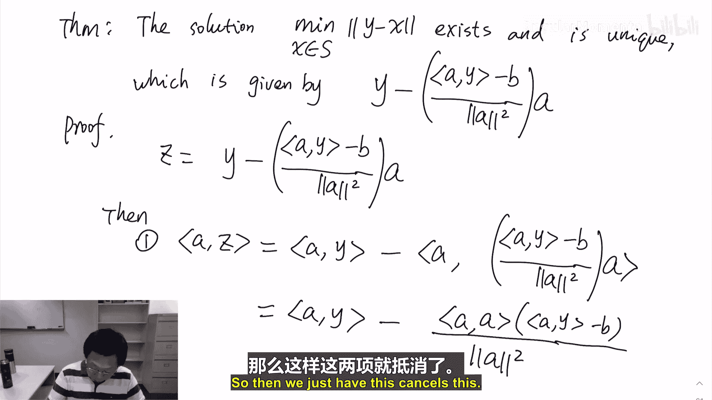

So， it is just。AY， minusness。Ay。Class。Which is。Then from here， we just see that this the。Is the inS。

Z constructed in this way is in S。

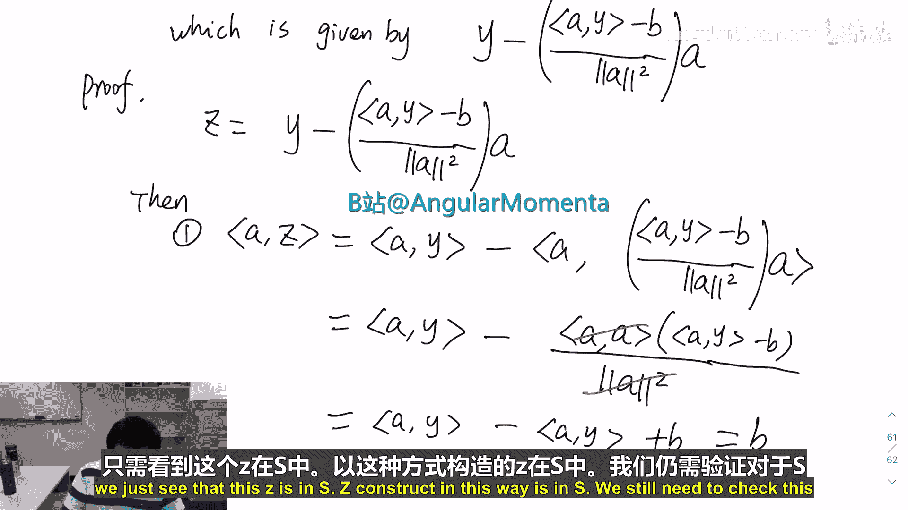

We still need to check this inner productor equals zero for any x in S。Secondly， for any x in S。

 we check the minus Y X minus the， this inner product。

 We just plug in the expression of the directly。It is。So for this z minus y。It is just obviously。

 z minus y is that。Minus A Y minus B over a normal squared。8。And this in the product with x minus z。

So by direct calculation， this is just minus。A Y minus B over a norm squared。A X。マイナスジ。

This can be submitted as。A X minus A Z。But for this A X， because X is on。

So that the inner product of A and X is B。At the same time。

 Z is also on S so that the inner products。Of a and Z is also B。So that this is just a zero。

 so that this is just a zero。So we have checked that ortho between z minus1 and x minus z。

Then let's go back to our previous theorem through the construction formula。

 our Z sat these two conditions， so our Z is a solution of this minimization。

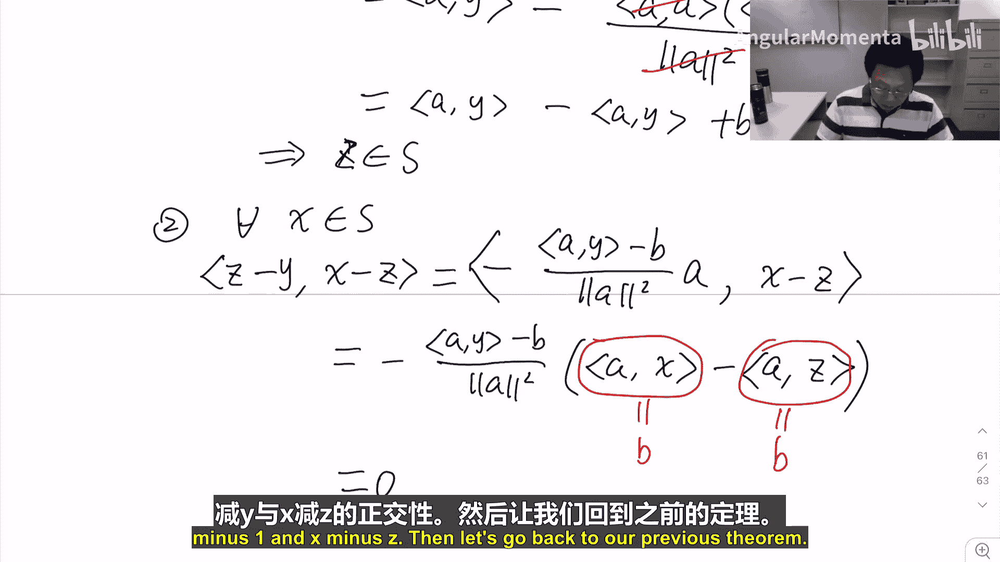

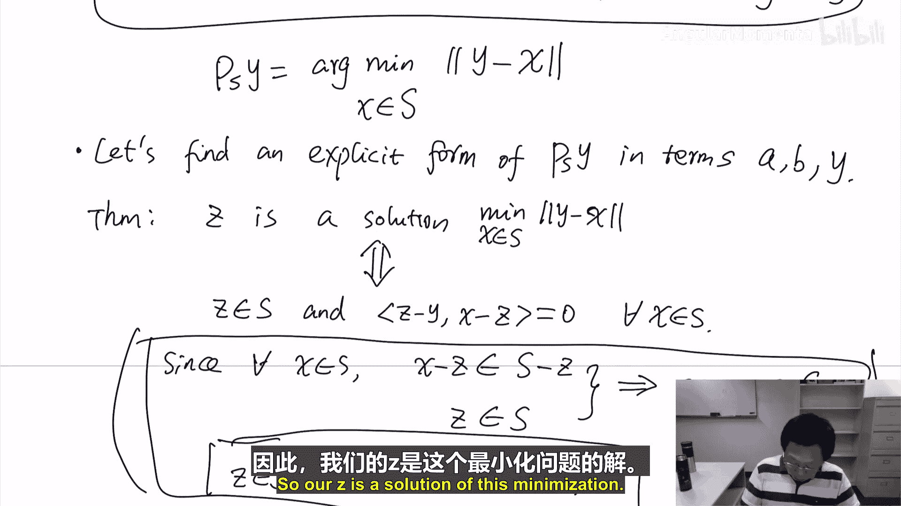

Then。The solution of this minimization exists at the least， this is a solution。Now。

 we need to prove the uniqueness。 We may have some other these such that it is the minimizer of this problem。

It remains。To check。The uniqueness。We just use contradiction。 Suppose we have two solutions。

It has to。ss。Z 1 on the Z 2。Then， first of all。This z1 under the2， they both。In S。Secondly。

Since Z1 is a solution。

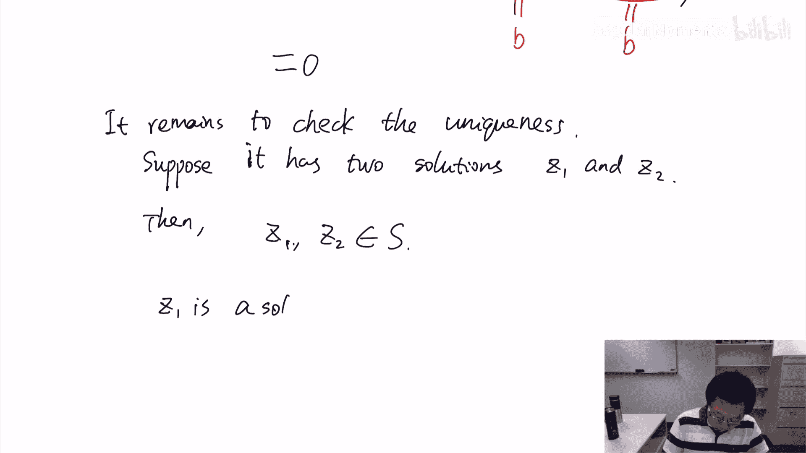

Then， this implies that。

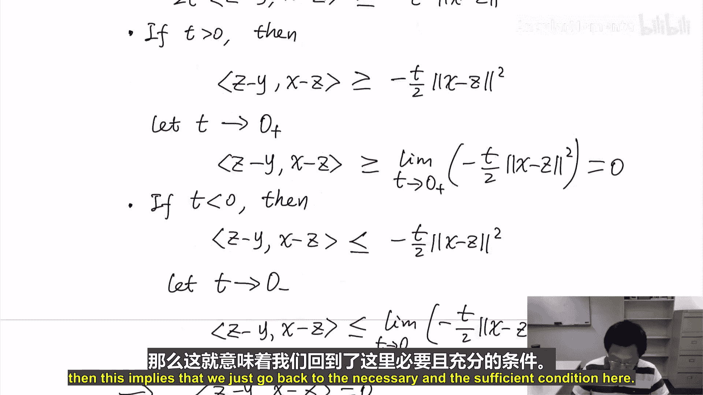

We just go back to the necessary and sufficient condition here。

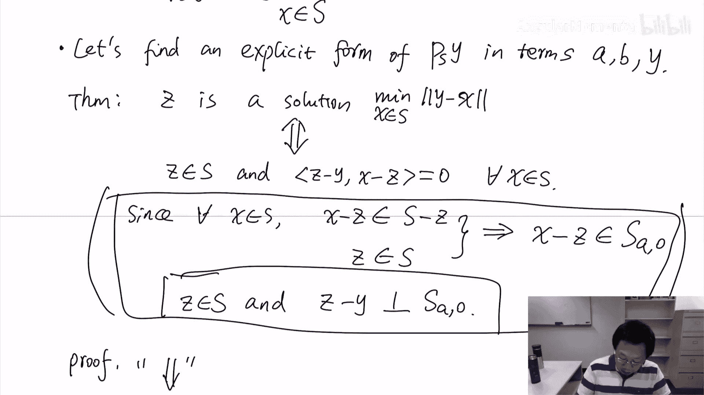

Any solution we must have this so that this z1 minus y in the product with x minus z1 equals0 for any x on S。

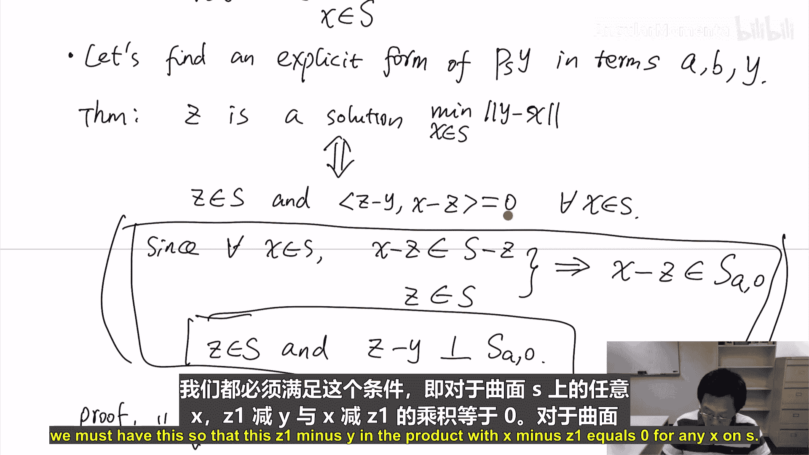

For any X on S。Then we just pick this x to be the2 because。Z2 is just on S。I choose。

This acts too busy， too。So I get an identity here。

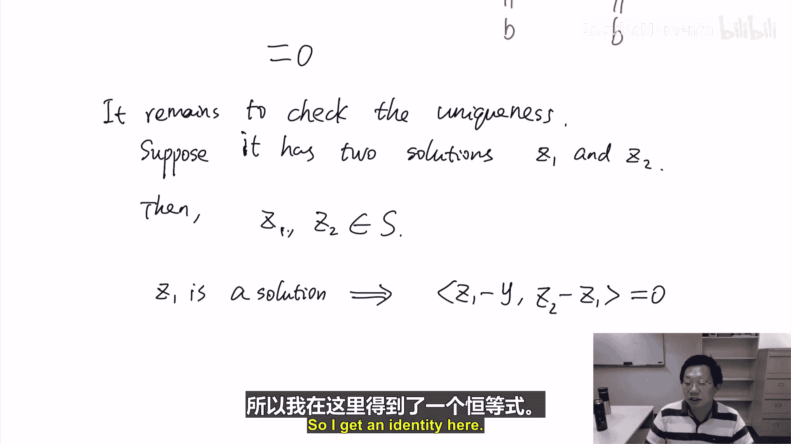

Similarly， Z2 is a solution。This implies， again， this is z2 minus y。X minus is E2。

Equs0 for any x on S。Again， I just choose our eggs to be。Z want。Because the one is on S。

 So this identity is still hold。Then I get these two identities。Now， for the second identity。

 I can turn it to this y minus Z2。Z 2， minus Z 1。E equals 0。I just add this a minus sign。

 add this a minus sign， I get this identity。And then I added this identity with this identity。Add in。

The two ids。We adjust have that。Because for this and this。

 they have a common factor Z2 minus z1 by the linearity。

 so it is equivalent to we add the first factor here， so it's just a z1 minus z2。And Z2 minus Z1。

For the right hand side， it is just 0。Then， this implies。What is this， this is just a minus。

Of z2 minus01， the norm squared equals 0。Which implies that Z2。Minus zero1， the norm should be 0。

So we just have that's Z2。E equals two。Then it's a contradiction because we have assumed that we have two solutions。

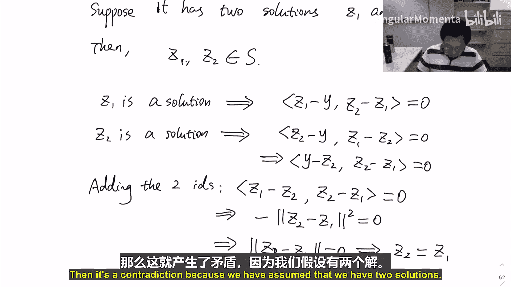

There is a contradiction。

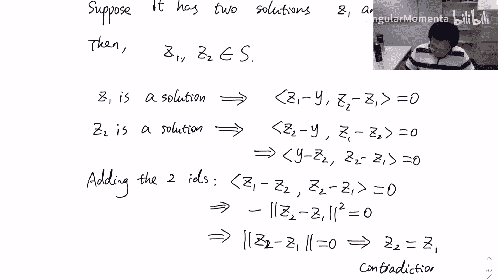

So then we finished the uniqueness proof。This Z1 and Z2， if they are two solutions。

 they must be the same。So that there is only one solution of this minimization。

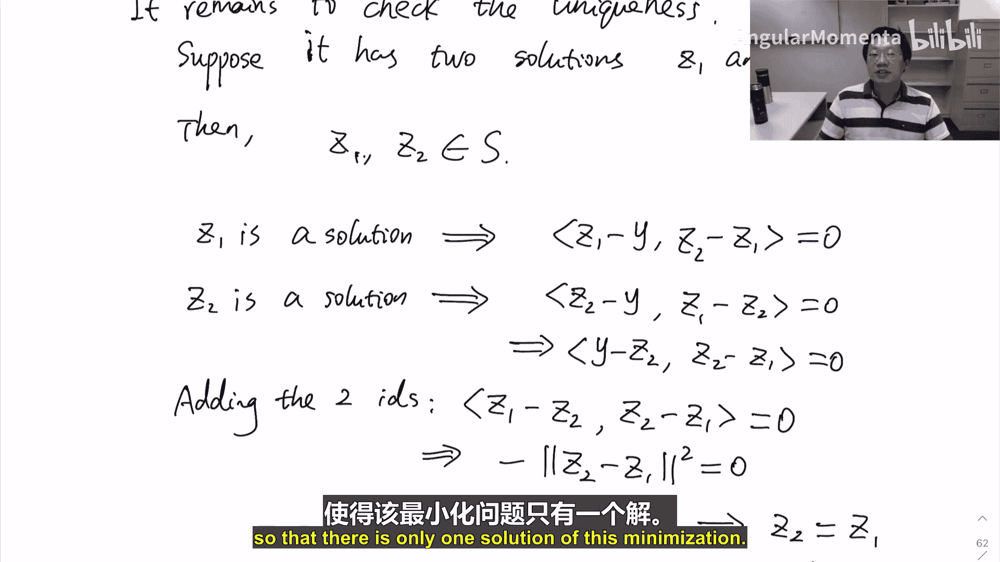

And we have checked that this is one minimization so that this is the minimization。

So we finished the proof of this theorem。We have also found the explicit formula for the projection it is just a given in this way。

So， in summary。Let it be a hubbalspace。And SB。Hyperplan。Defined by A X equals to B。Where， of course。

 this A in H。And B is a real number。Let Y be in H。 Y can be on S can be not in S in general。

 It's just not on S。Then the projection。Of this， Y onto to。S is。Just to。PS， Y， by definition。

 is the argument。Of all x on S of this Y minus x。This one is given by。C SY。

 we have an explicit formula。

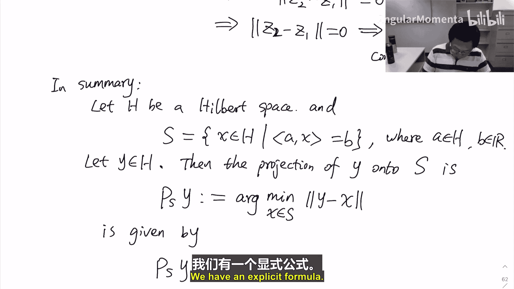

Just the one we obtained in the last theorem， Y minus this one。

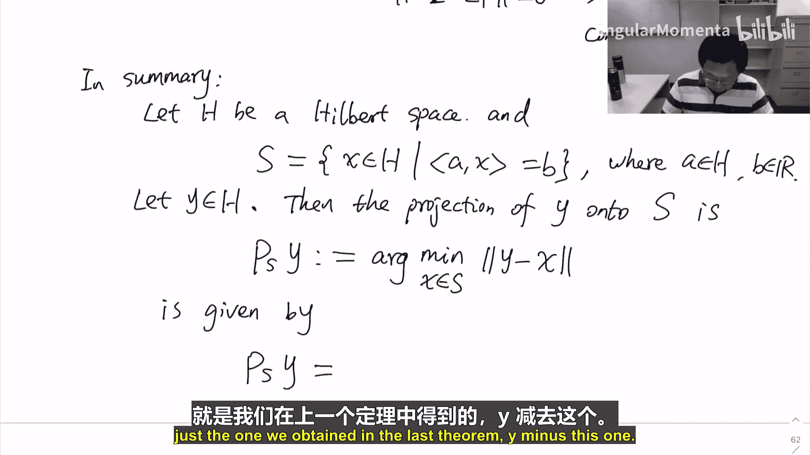

Y minus。A Y minus B over。A norm squared a。This is the projection onto them。

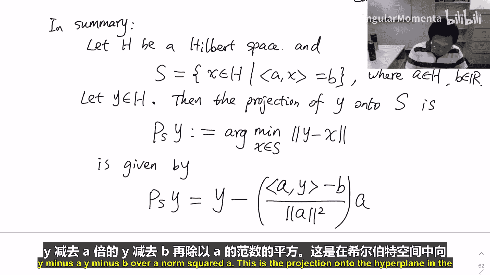

Hyperplan in a hereboard space。We have encloed the form。Of this projection in this closed form。

 we use the only the A and the B and the Y。A and B is used to define this hyperplane。

 Y is the vector to be projected。And also， this projection is unique。We cannot find two points。

 They both are closest to y。No。We can only this。Closest point to Y is unique。

These are all about linear functions。 So linear functions have very nice properties。Like。Innuity。

 like。Hmogeneity， like the additivity。Also， for linear functions。

 linear and bounded functions on hip spaces， we have the risk representation theorem。

 they must be in in the product form。And for the hyperplane， we have an explicit projection formula。

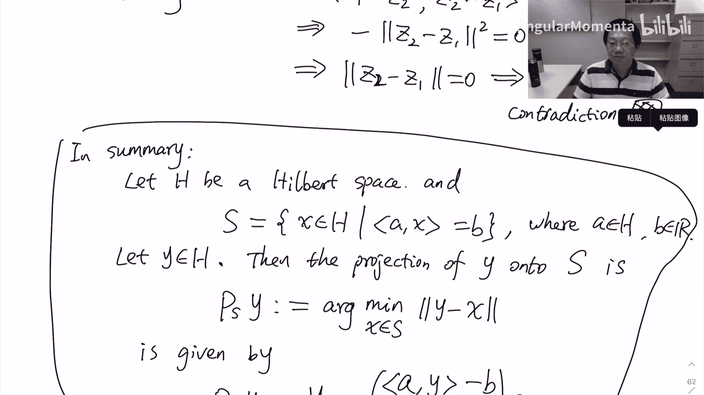