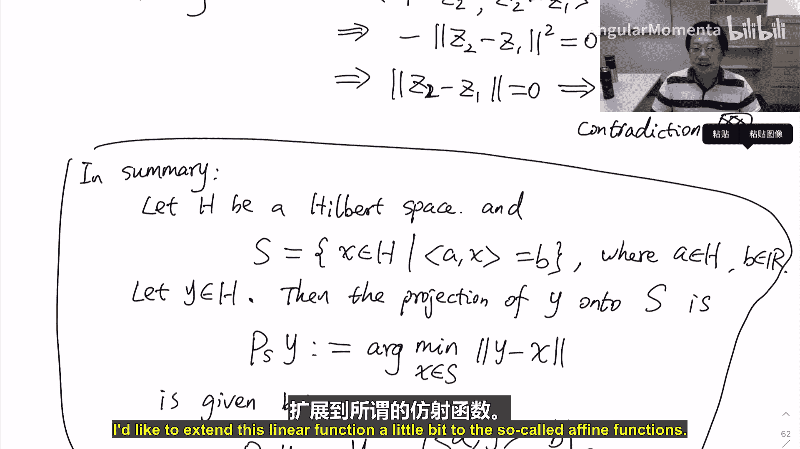
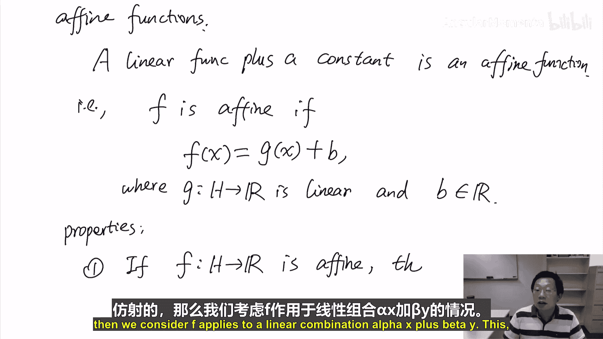
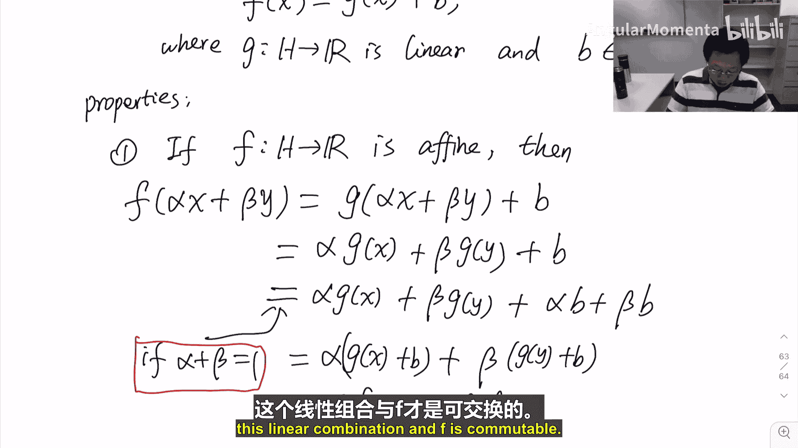
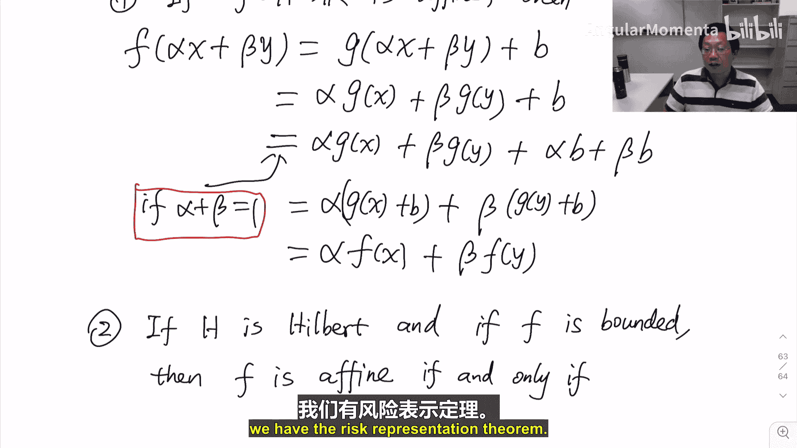
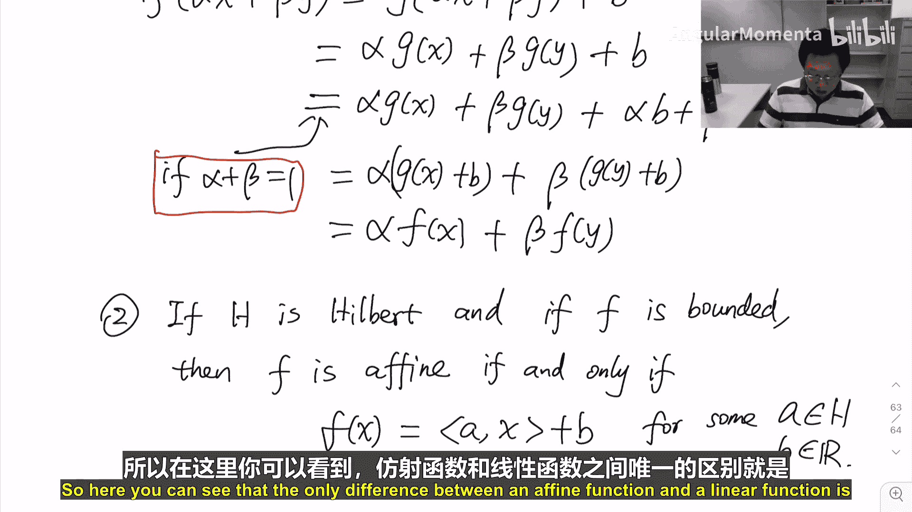
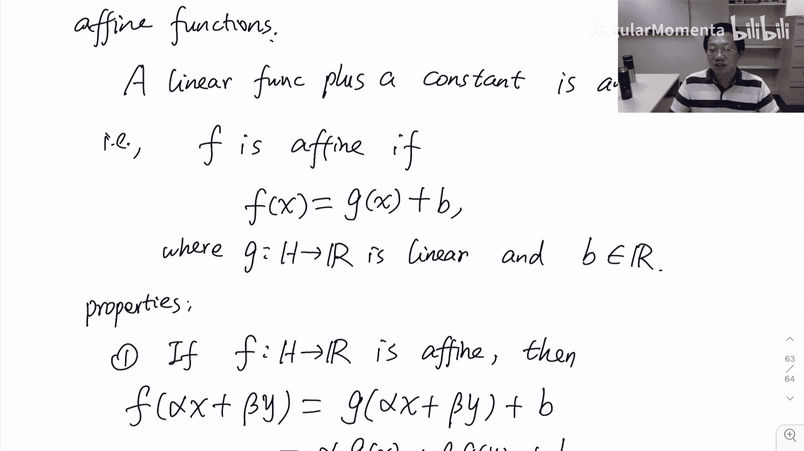

# 【香港科技大学】数据分析的数学方法 ｜ Mathematical Methods for Data Analysis p50 10-08-02-视频 -BV1DEFDzGEZW_p50-

Now， in the following， I'd like to extend this linear function a little bit to the so called a functions。

An linear function plus a constant is just called an function。That is。F is a phi。If。

This F of x equals G X plus a constant B。Where。This G is an linear function。And。

B is just a real number。The behavior of a fine function is very， very similar to a linear function。

Let's just see some properties of our fine functions。The first one is that if this F。From H to R。

Is a fine。Thenen。

We consider F applies to an inner combination。Of阿法 x plus beta y。This， because F is a fine。

 so it must be a linear function。Plus， a B。Now， this。

Is alpha g of x plus beta G of y because G is linear and then plus。

Then if this alpha plus beta equals 1。We can split this B into。阿法 B plus beta B。

So that we have that this alpha Gx plus B。Plus贝ta G，Y plus B。Then we just have a F X。Plus， beta。F of。

To let this linear combination and this fine function commutable。

We have a const for this coefficients here。 This alpha plus G should be one。

 otherwise they are not commutable。This is a little bit different from linear function。

 for linear functions just for any weight。For any coefficient alpha and the be this。

Linear combination and F is always commutable。But for a fine functions。

 only if this alpha plus beta equals1， this alpha， this linear combination and F is commutable。

The second property。If H is a here birthspace。And if F is boed。Then。F is a fine。

F is't a fine function。If and only if。Because for a hereable space。

 for a bounded and linear function， we have the risk representation field。

Then this F X must be in the form of this AA X。Plus b43。A in H andB in R。

So we have a inner product representation for the linear parts， for this constant part。

It is a steer here。So the this F X can be written as the inner product plus a constant。

So here you can see that the only difference between a fine function and an linear function is this constant here。

In linear functions， it is this constant is just 0。 In our functions。

 this constant can be a real number。Actually， this。Constant term。

 it is quite important sometime in the machine learning models。

Sometimes we just call this biased term。And conventionally。

 because the difference between a fine function and linear function is indeed very subtle。

Then conventionally， we just do not。Differentiate。Linear functions and are fine functions。Usually。

 we just call a fine functions， linear functions。

