# 【香港科技大学】数据分析的数学方法 ｜ Mathematical Methods for Data Analysis p54 11-04-02-视频 -BV1DEFDzGEZW_p54-

We have learned linear regression models， but linear regression has some limitation。

With people sometimes just use linear model to do the prediction。For example。

 if the price of our stock goes up in the past a few days， then we will just think that the trend。

Of the stock price is up。 So then we will predict that in the next a few days。

 the stock price will keep going up。Here， we just use an in model to do the prediction。But however。

 we will never think that the stock price keep going forever。Because we know what that's。Impossible。

This is just one limitation of the linear model。Then in order to improve that linear model。

 we use the kernel method to。Get some nonlinear model。 This is section 4。2。2 on。Colonel。Rich。

Regression。We will use the kernel method to improve the range regression。To improve。The人年 model。

We use。Clonnal method。The idea here is the same as the one from Cams to Colonel Kimms。

We just transform the data into a hereB space， and then we apply the India method in the transform the domain。

 So in the first step， we just do the transform。We apply a transformation file that maps the input data in RN to a hereboard space。

So here this file here， sometimes we just refer it to。Feature mapping。

Because we think that vectors in H is a feature of the vectors in R。In particular。

 our given data is an X。 then it will be mapped by this5 X I in this H。

Then the second step is that we just apply linear regression。Yes applied。In H。

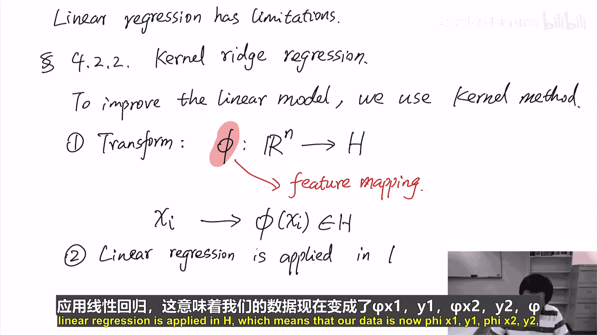

Which means that our data is now5hi x1。Wwa。5hi x 2。Why2。5hi x， N。Y and。

And then we just find a function we find。And a fine function。I call this function F。

 which is from H to R。

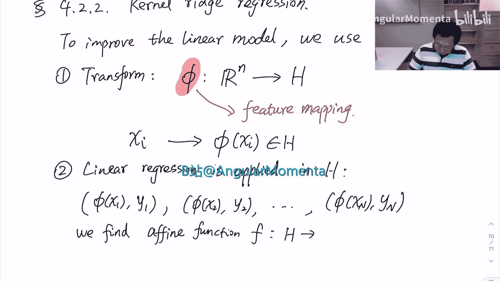

Such that this F applies to Phi Xi。Mis about a white eye for all I。Now， the question is， again。

 the same as in the developing of the kernel Kmin algorithm。

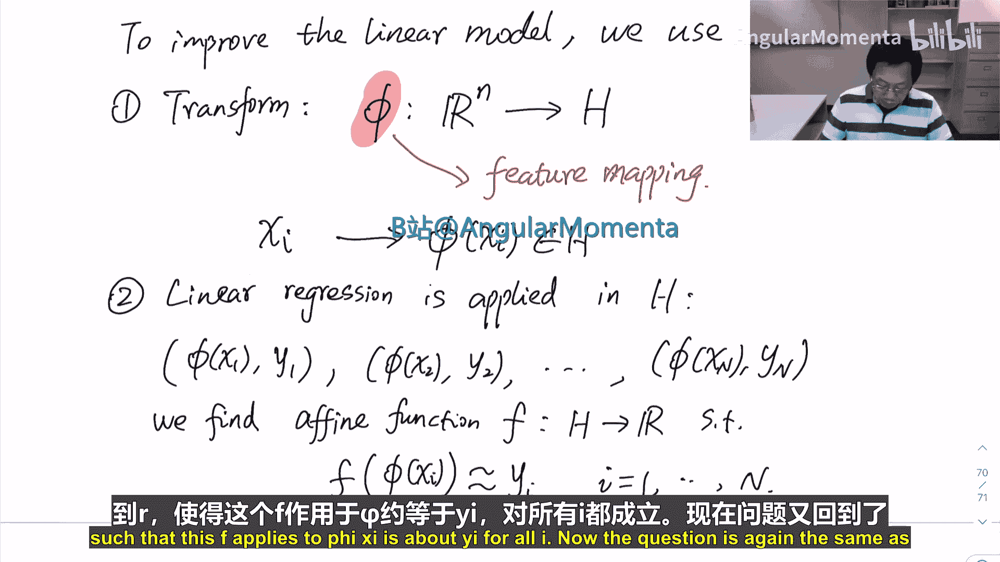

How to find。This。H。And5。 And here， even more difficult， we needed to find a function from H to R and。

This F function。

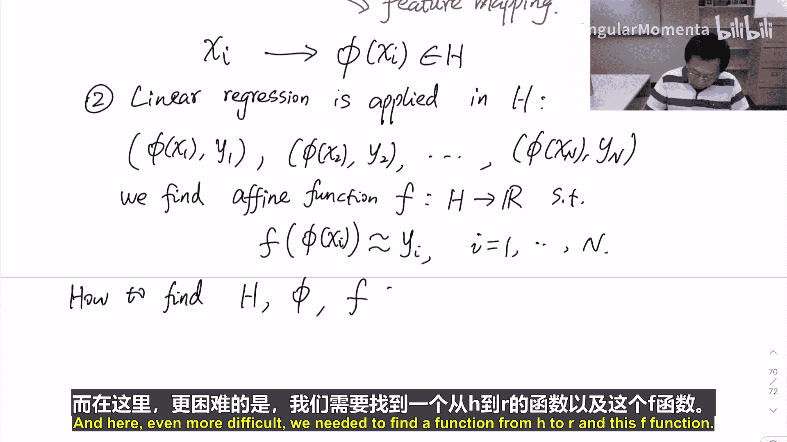

To begin with。Here， we know that。We find a fine function on this herepot space edge。

The first remark is that we can reduce this fine function class。

To linear function class to make the problem a little bit easier。This is seek。

Why this linear function is enough。Which means that we don't need to bother。There are fine functions。

The raising is just the big cost。If we have an a fine function。If an a fine function indeed。

 is needed， just let that function be F。Let's this F。From H to R。Be a fine。And bonded。Of course。

 we want a boundary function because we don't want to map。A vector to utility。

Then this function is a fine in the transform the domain。So this F phi of x must be G of phi of x。

Plus， B， where this G is just a linear function on this file。

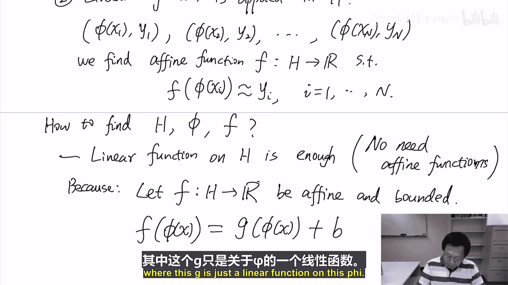

Now， because this h is a huber space and this G function is linear and bounded。

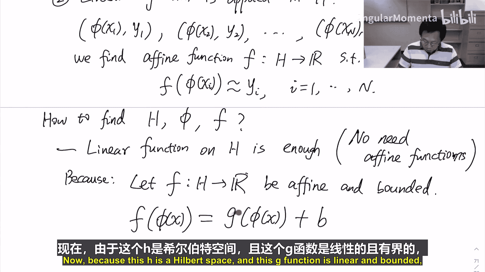

Then we have the risk representation theorem。We know that。This。

Must be an inner product of5 x and some a。Plus， B， where this A is on H， and B is in R。No。

I just define a new filehi and a new H， we define。A new。Feature mapping。

 I call it by tutor and a new Hu space。 I call it each tutor。this。H is just this。The old one。

 together with a real number。So it is just this H tutor is just one dimension more than this H。

 We just add this cableable space and extra coordinates a real number。And then。

I also define this phi to the x。This X is just。The original phi of x plus are number one。

I just add a number to this Phi x vector。So then definitely this is in H2的。Then。

You can see this F of5 x。It is。This5hi x。A plus。One times B。

Then this is exactly the inner product of this5hi x。1 under this A B。

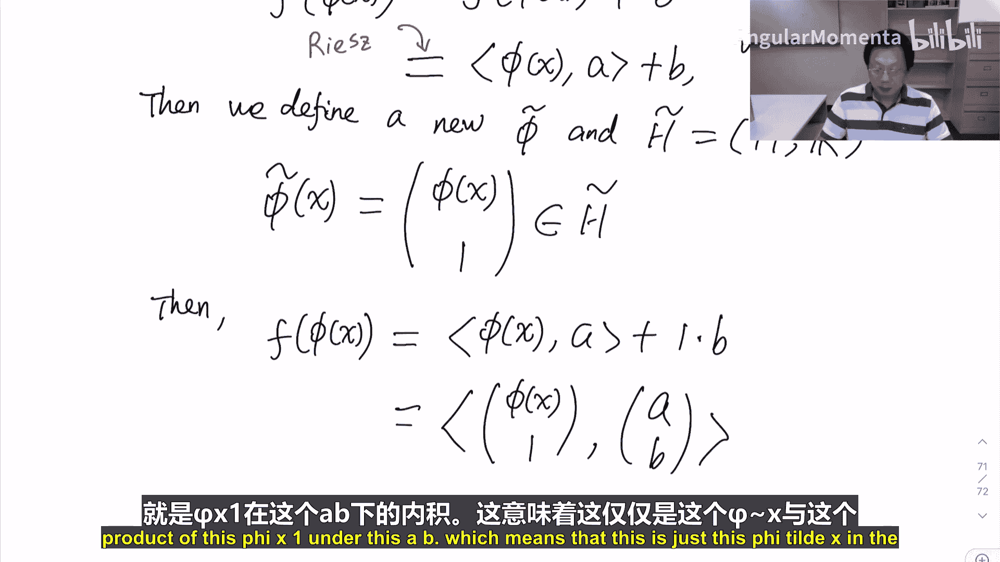

Which means that this is just this phi to the x。In the product with this a tutor。

 where this a tutor is just A B， which is on this H tutor。

 because it's only a vector in H and a number， H and a number。So from here。

 you can see that this F5 x now， it is a linear function on this H2。

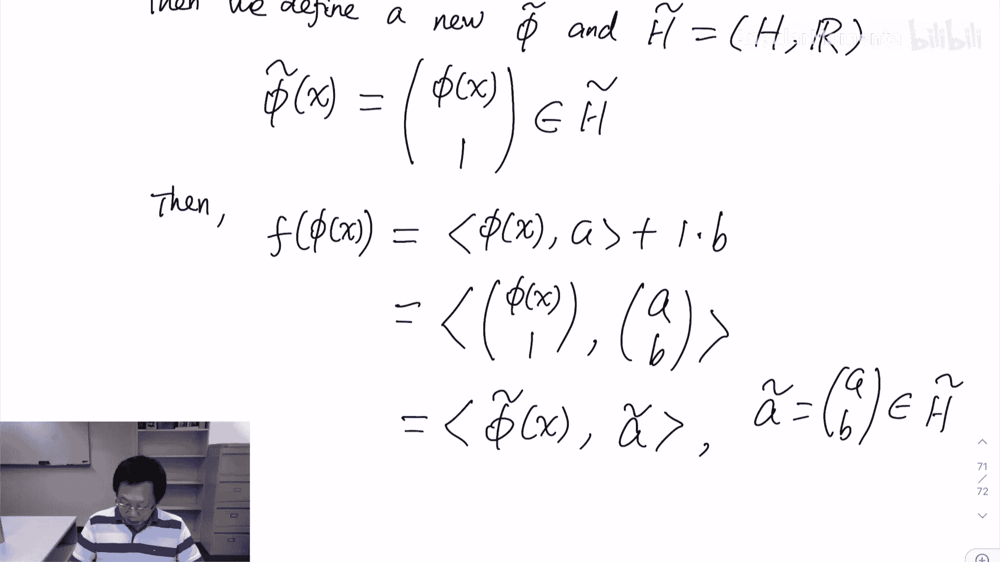

It's a linear function on this filehi。X。

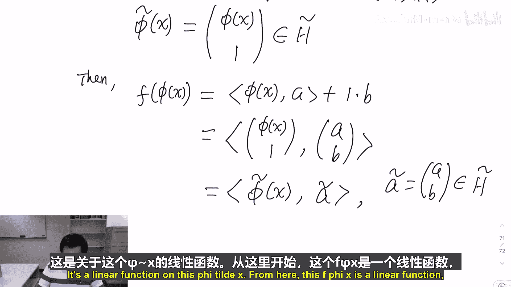

From here this。fi。Is a linear function。Linear and bounded。Because it's in the inner product。

It must be boed， Fxi。On this H Q。If this a fine function F is needed， we just redefine。

A featureature mapping under the corresponding H。And then this fine function on H。

 it is just a linear function on this H tde。 So then we just instead of working on this H。

 we just work on this H tde。With a linear function。So that's why。Nar function on H is enough。If。

Ler function on H is not enough。 Then we just change this H。

 We just change this phi tu by adding one extra coordin to this file。

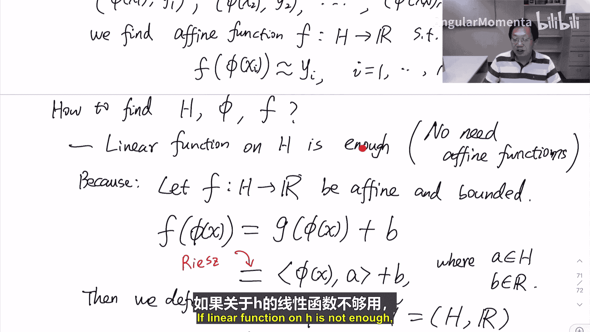

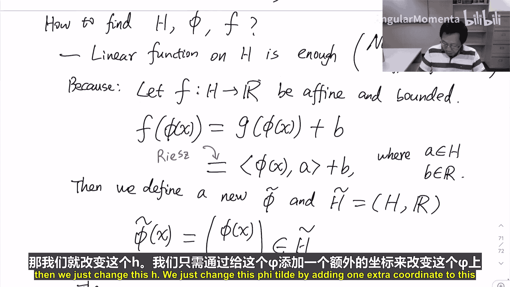

By adding one extra。Accordingord to this age。To get this H tutor and fire tutor。

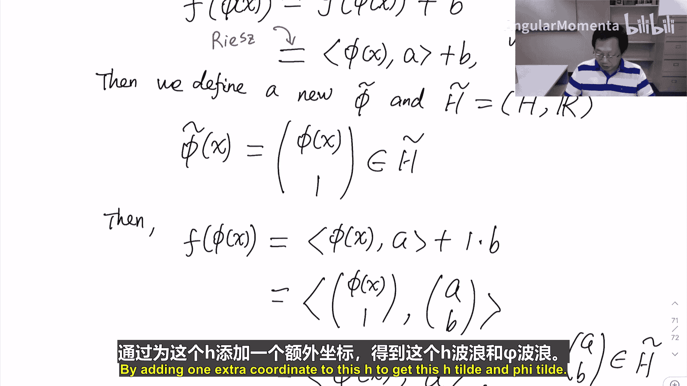

Then this F function on this new space， it is indeed。A linear function。

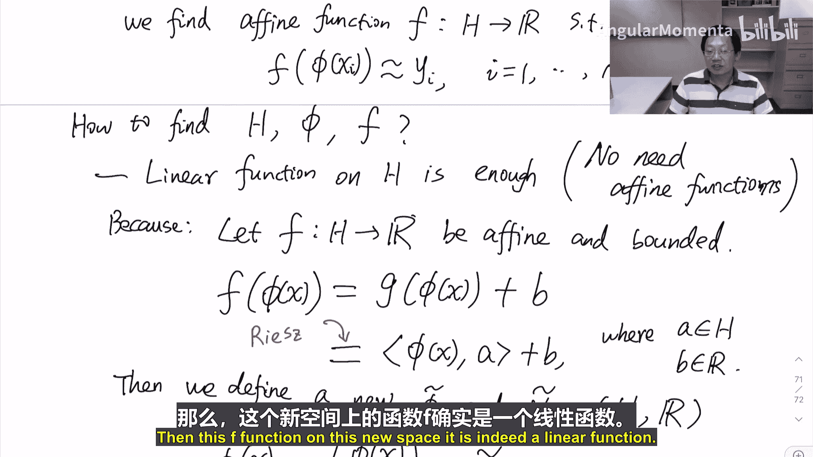