# 【香港科技大学】数据分析的数学方法 ｜ Mathematical Methods for Data Analysis p55 11-05-02-视频 -BV1DEFDzGEZW_p55-

Now we just need to find a linear function。Then。A linear and bounded function on。On H is enough。

So then by the rich representation theorem， we know that a linear and bounded F Xing。On H。

It is just the equivalent tool that。FZ must be in the form of Az。For some。A on this edge。Then。

 instead of finding this。Linear function on this H。 We only need to find a vector A on this H。

 such that this F Z is always A Z。So， then。The Indian regression。点H。Becomes。

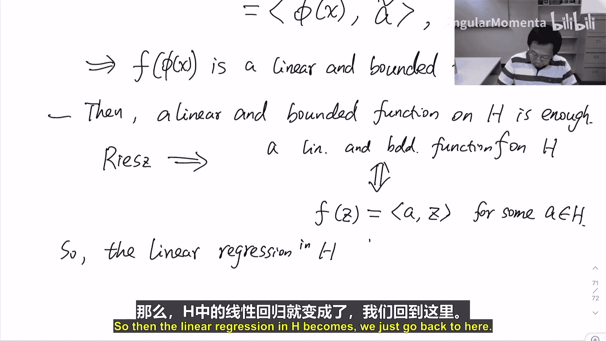

We just go back into it here。You can see now we find a linear function F such that F5hi X I is about Y I。

 Now， this F is an in product form。So we just find an A on each side such that A in the product with Phi is about Yi。

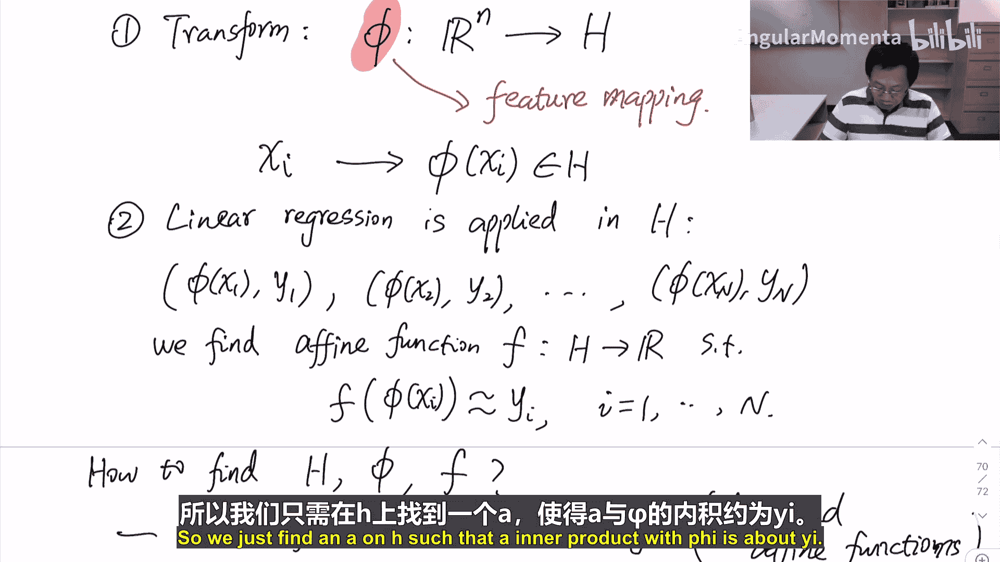

Find。A on H such that is A Phi X， I。It's about to wait eye。I from one，2。This is the。

Problem in the transformed domain H。And still here we needed to define this phi explicitly and this in the product explicitly。

Now， similar to the list square idea。Because we want these N equations。Then。

We just minimize the error of this n equations。 We use the sum of square arrow。So。会琐。

The least the squares arrow of these N equations。The difference of the left hand side and the right hand side。

 and then squared。And then sigma I from one to end。This is the total error。

And then we minimize the total error。

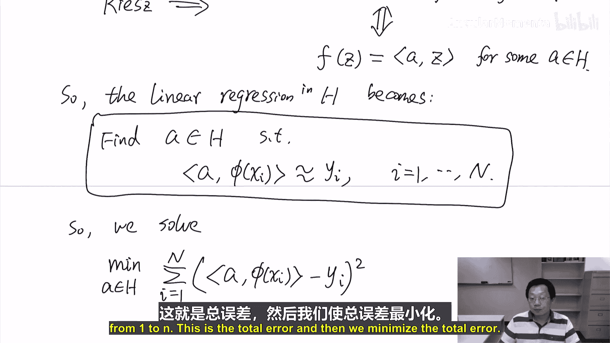

We need to solve this minimization。But。This minimization might not be solvable， because。

Our age is infinitely dimensional。In most of the cases。Usually， the feature domain。

 this H space is just infinitely dimensional。 It is just some functional space like when we use a Gaussing kernel。

 actually this。H is just the silicon called reproducing here， but the kernel space。

So that is infinite dimensional， which means that for a vector on this age。

 we need infinitely many parameters to describe it。But here， the known equation。

 the number of the known equation is only n。It's like we have infinitely many unknowns。

 but we have only finitely many equations。We have。红咪。And。得タ。

So we want to use infinite finitely many data to solve an infinite many unknown。Problem。

 that is impossible。Therefore， this domain H is too large。We need to use a subset of this H。

We need to use regularization。Again， similar to the linear model case， in the linear model case。

 if we choose the set of all a functions is too large， then we just choose a subset of it。Here。

 if we use the who H as the candidate space for this A， it is too large。

 there is no way to have a unique solution。Then what we do is that we just choose a small subset of this H。

To search our A。This is the regularization。

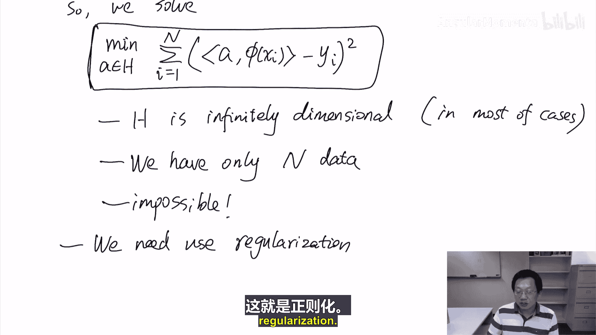

Then just similar to the rigid regression， we use the norm squared as the regularization。

This is called the current rigid regression。We just minimize A on H。Sigma I from one to n。A5 X， I。

Minus Y I squared。 The data fittinging term is the same。But here we have a regularization。

In region regressioning， we use the two norm square。

Because the true norm is the norm induced by the inner product on R N。Now we are in the H。

 so then we should use the norm induced by the inner product on H。

So I will use this H to denote such the norm。So they should be the norm squared then。

This is the kernel Rige regression。

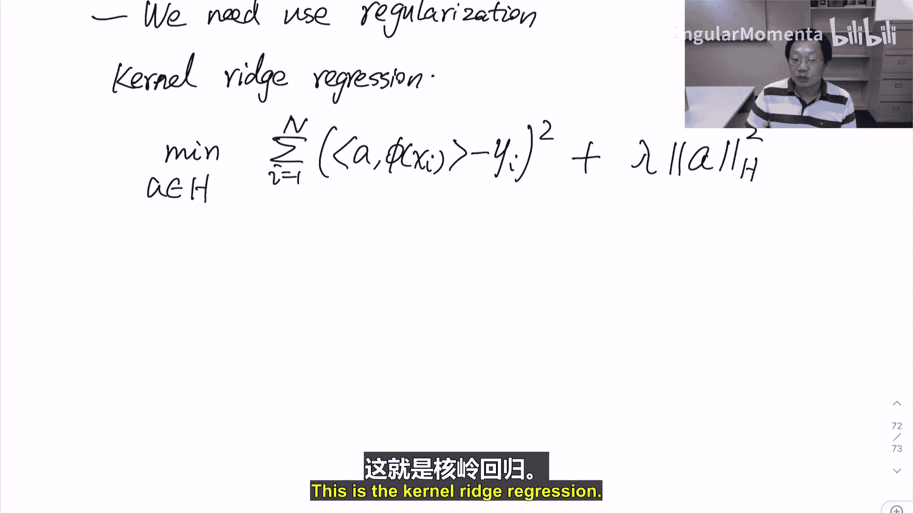

This is the data fittinging term。This one is a regularization。

And this problem is known as the current regression。Or the KR for short kernel regression。

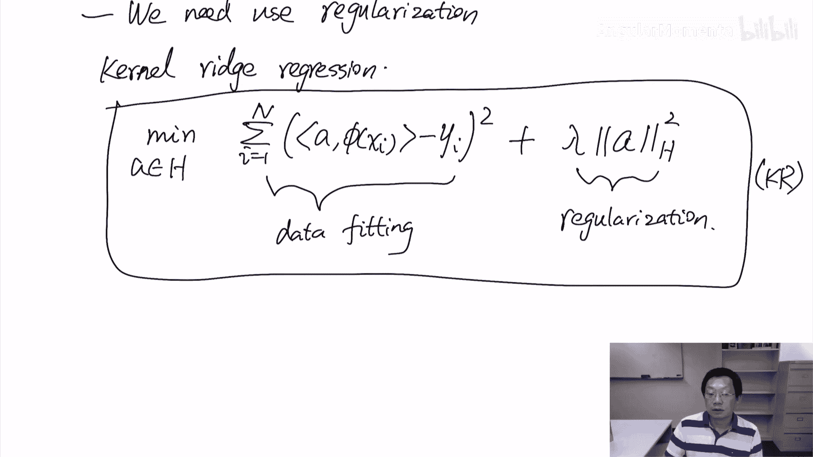

This optimization problem involved in the current regression is still impractical， because。

First of all。You can see that here our A is still in H。 H is infinitely dimensional。

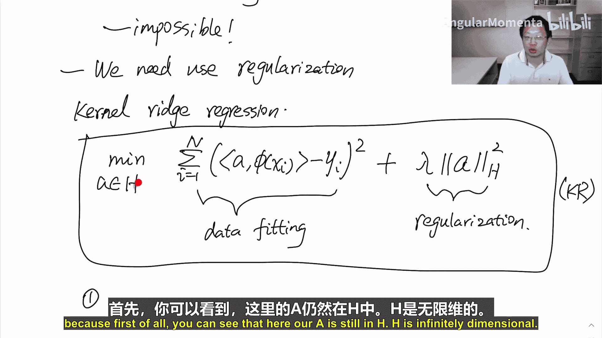

So that in this optimization， we still need to solve an infinite dimensional problem。

Which means that if we want to parameterize this A， we need infinitely many parameters。

 This is a problem of infinitely many unknowns， but we have only still finitely many known data。是迪。

You find that。Dmenal。Problem。Secondly， in this optimization， we still need the explicit form of H。

We still need the inner product in H。 We still need the explicit form of the norms on H。这是D二尼的。

Explicit。I theify H。Based on these two reasons， this coronal rid regression is still an impractical optimization problem。

We cannot develop a numerical algorithm for solving this problem on the computer。

Here comes a good news， we have the so called the Representer Theorem。

This represent theorem will solve these two issues for the kernel ridge regression so that this kernel ridge regression will become practical and we can find a numerical algorithm to solve it on the computer。

The Re theorem states that the solution。Of this current re regression optimization must be in the form of。

A equals sigma of I from1 to capital N C， I5hi X I。Where C I are just a numbers。婴儿。

So here I rewrite this C I together to form a vector in our capital N。This is the Reer theorem。

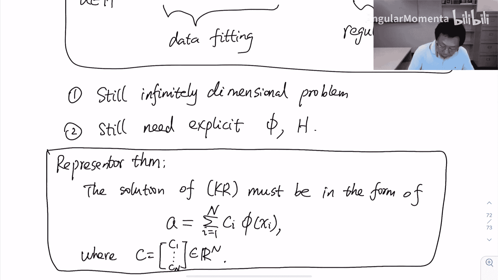

Now you can see this represent theorem tells us that the solution of the optimization in kernel regression must be a linear combination of Phi X I X I are the input data。

 so we， we know it。So these5hi X， I， I from 1 to capital n are just capital n fixed vectors in this H space。

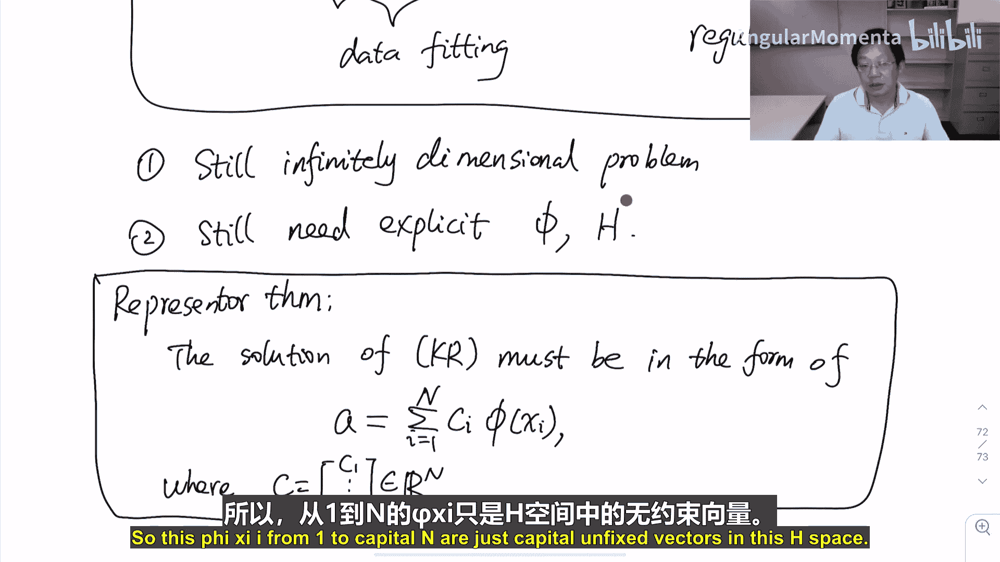

Therefore， in order to find out the solution of this kernel regression。

 we only need to find this N coefficient C here over the vector C here。

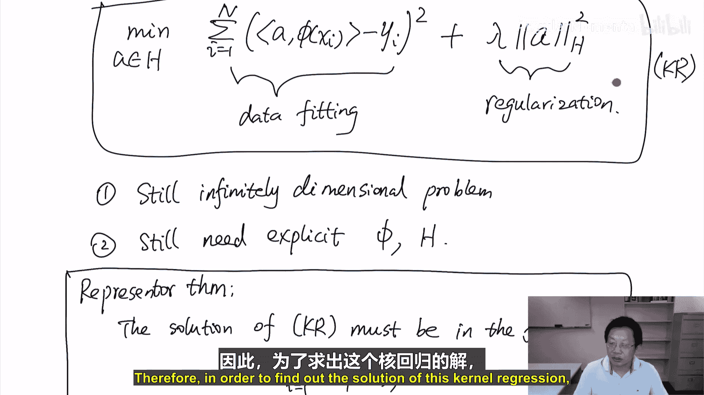

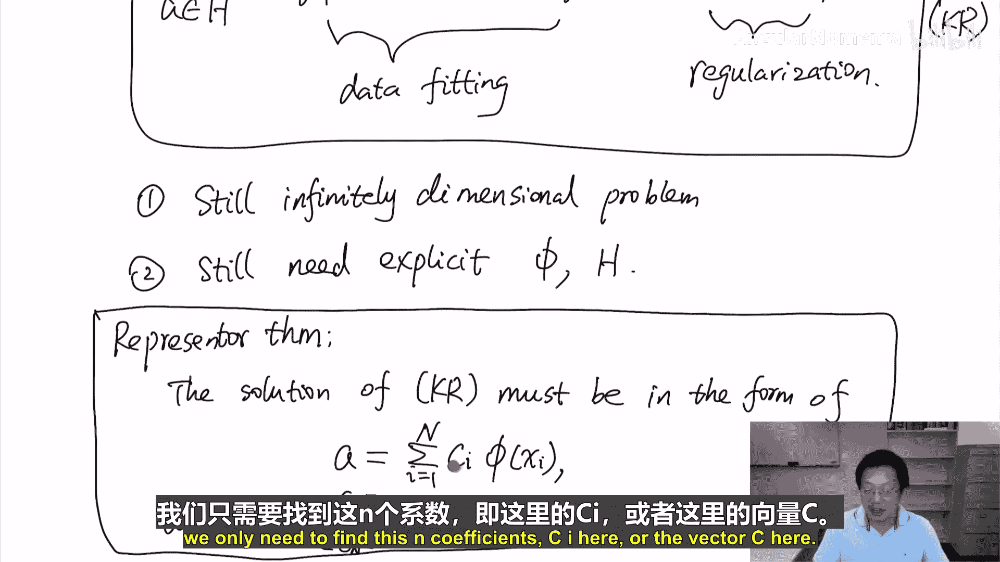

So by this way， this current origin regression is converted to a finitely dimensional optimization problem we only need to compute this C vector here。

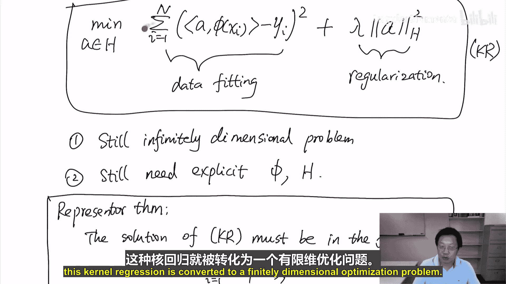

So then the first issue is solved。We converted an infinitely dimensional problem to a finitely dimensional problem。

Also， because this A is a linear combination of Phi X I。

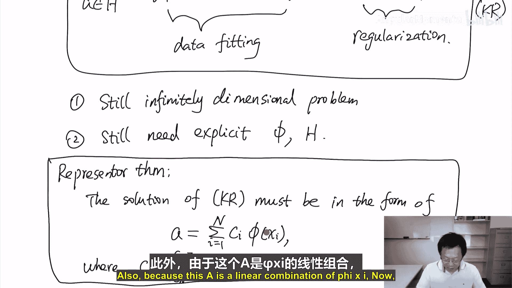

Now， if a is a linear combination of this Phi X， I。

 then this inner product will be always the inner product of P X， I，5hi X， J。

This is also in the form of inner product of file X， I，5 X。So that we can use the kernel trick。

 we don't define this Phi and H explicitly。 Instead we just define a kernel function that is the inner product of Phi X I and Phi X J。

By this way the second issue is solved， we don't need the explicit Phi and H。

 we can define Phi and H implicitly by using a kernel function。

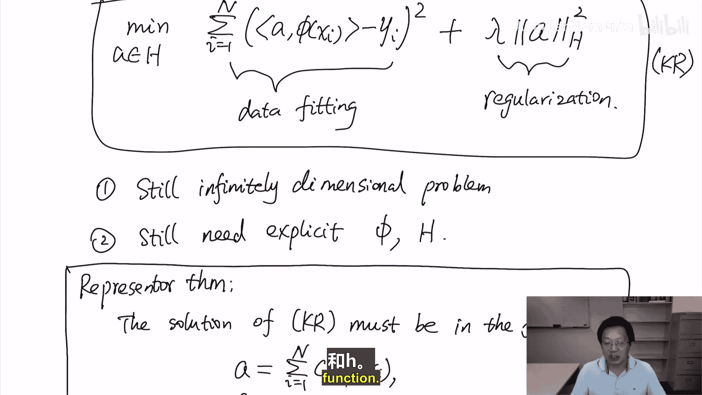

So that this represent theorem is really fundamental in solving this kernel re regression。

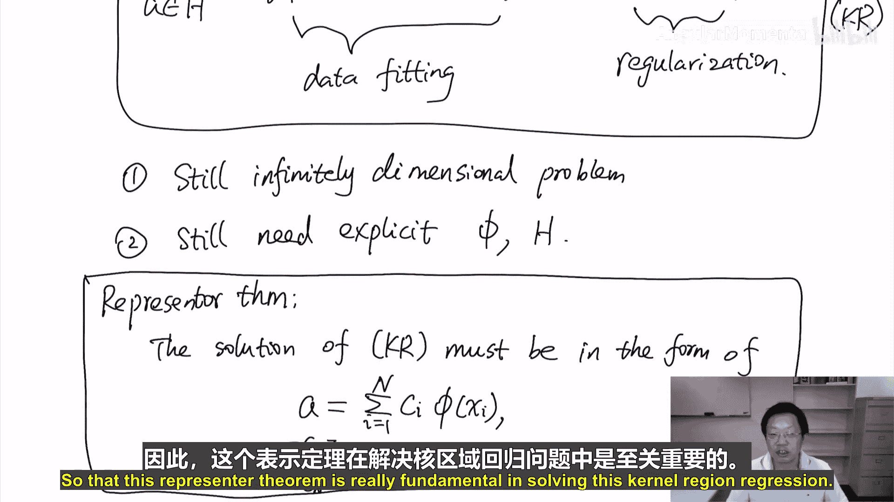