# 【香港科技大学】数据分析的数学方法 ｜ Mathematical Methods for Data Analysis p56 11-06-02-视频 -BV1DEFDzGEZW_p56-

This prove the Re theorem。To do this。We start with a decomposition of A in H for any A on H。

We can do a decompositionization。 I want to reex this a。We claim。Thats。A can be decomposed。As。

A equals AS plus sigma I from one to n。C I phi。

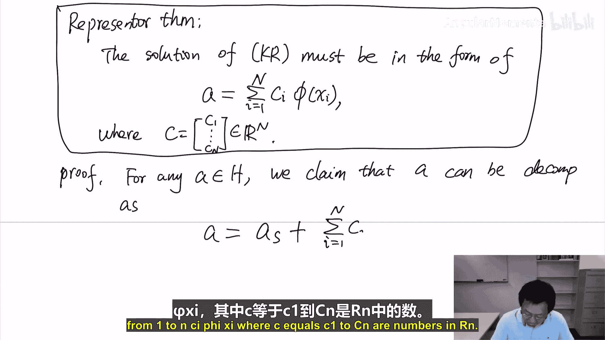

Excellent。Where。C equals， C 1。To C N R numbers in R N。And。This AS is just orthonal to all5 X。

I equals 1，2， n。Since these Phi X I they are fixed vectors because X I are the input so that Phi X I are fixed vectors。

For any A， we just use the same5 X I， set。So that we have reexpressed this A in terms of A S and C I。

So this is a representationation of this A vector in H for any A in H， we do this decomposition。

Let's first prove this claim why this is true。

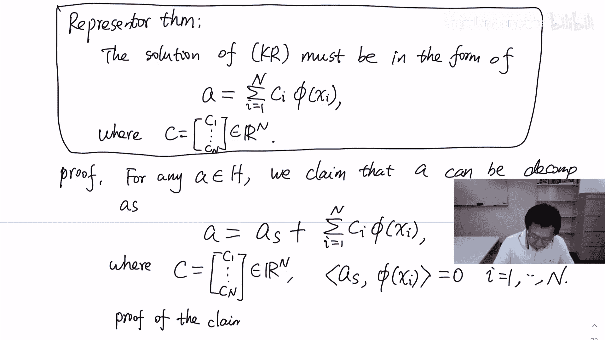

We prove only the case where n equals to one。For n equals to 2 and other numbers。

 it can be done similarly。when this n equals to one， we have only one vector input vector x1。

So we just define this to S。To be。Because we want to decompose this a into A S plus C1，5 x 1。

 This A S will be orthogonal to this5 x 1。 So then I just consider the set of all vectors such that they are orthogonal to。

5hi x1。Then V on H。 And V is orthogonal to Phi x 1。

 which means that the inner product of V and Phi x 1 equals 0。Now， this said is。A hyperplan。

 as we have discussed in the last section。And this is also a subspace because this right hand side equals zero。

This， iss a hyperplan。And it is also a stop space。Graphically。

 let S be this straight line in this two dimensional space， and we have an A A is given here。Now。

 what we are going to do is that we just project this。A onto this S to obtain PA。

So we have a equals P S A plus the residual A minus P SA。Now， due to the construction of this PSA。

We know that this PA must be orthogonal to5hi x1。 Then I will set this。

PS A as our A S energy decomposition， because it is just orthogonnal to this Phi X1。

 And this A minus P A， I will show that it is a multiple of Phi X 1， then。We get the decomposition。

For this PSA。Because he have projection。We know for projections。

 we have a nice property that is this a minus PSA is orthogonal to this subspace。

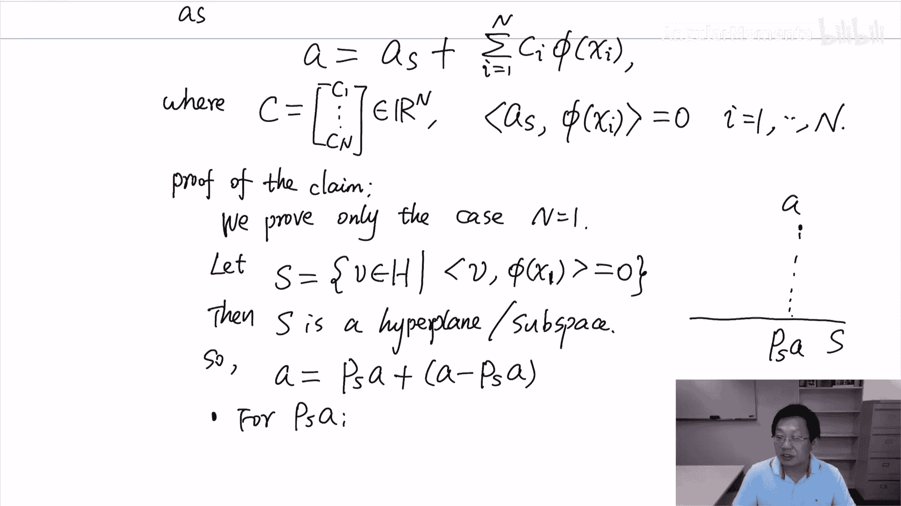

All the hyperplanes aretract by a fixed vector on the hyperplane。Since PSA is the projection。

From the projection theorem we discussed in the last section， a minus CSA。

Is orthogonal to P A minus V。For any on this S。This is a necessary condition for PSA。

Been a projector onto。The S。So we just the shoes。They equal0。Because。0，5， x 1。E equals 0。Implies。

0 is on S。Then we just obtain a minus P A。And the PS SA equals 0。Which means that now this PSA here。

It is just ortho or to this one， so which means that these two are。Secondly。For this A minus PA。

We just used the explicit formula of this。PSA。嗯。Explicit。Formula。Of PA。

We have this in the last section。Then this a minus P S A。 It is just。5hi x1。A minus0。

Divided by phi x1。The norm squared then。Times5hi x。Then I just set this constant。To be C1。

So that's this is just。Do know to the。C1 times5hi x。This is a number， just denote this number P C1。

Then a minus P SA equals C1，5 x1。

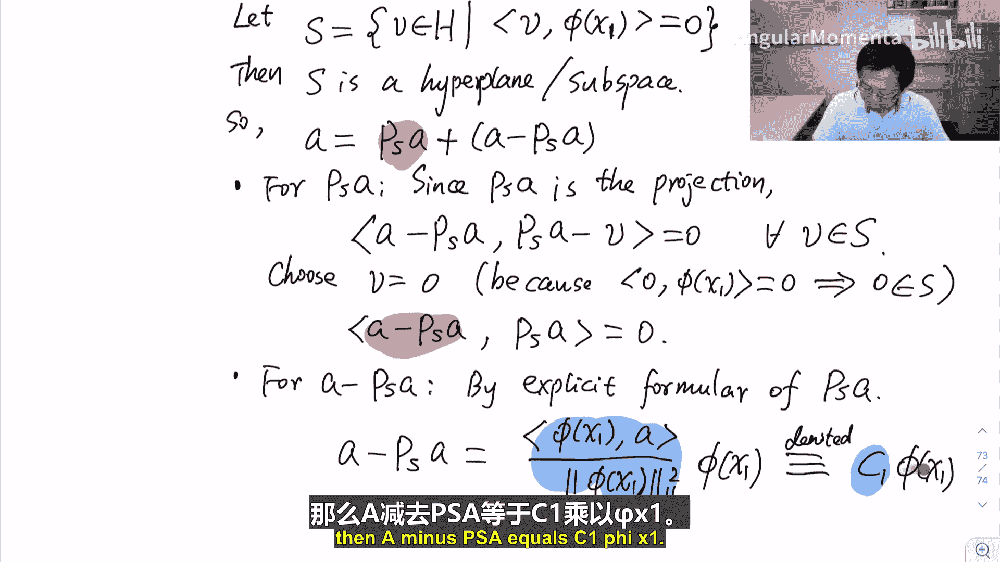

So we obtain。Is a equals。Now， I set。This PSA equals A S。Just denote P S A equals to A S。

 I get A S plus。This is AS S now， this a minus PSA is now C15 x1。C 1， phi x1。Where。From。

Here we know that this C1，5 x1 is ortho 2 AS。

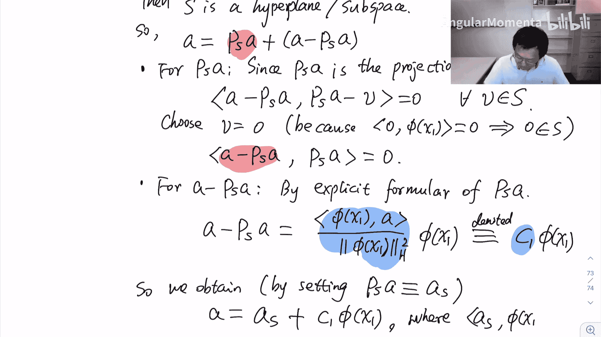

So I finish the proof of this claim。

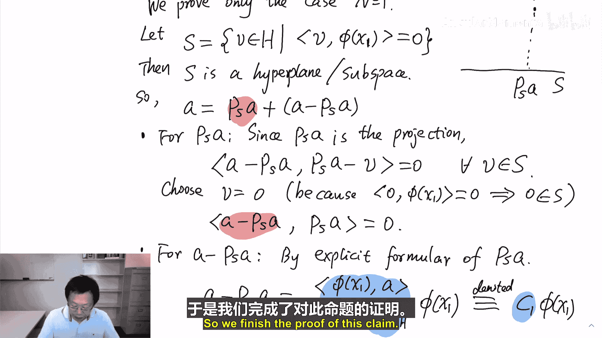

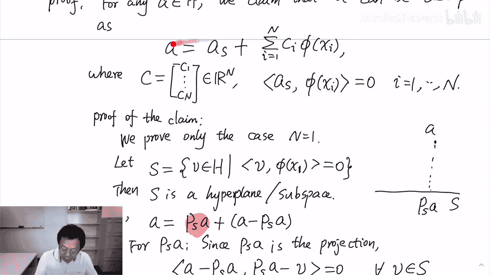

When n equals one， when n equals to one， we can decompose this a into A S plus C 15hi x 1。

 where this A S is just ortho to5hi x 1。

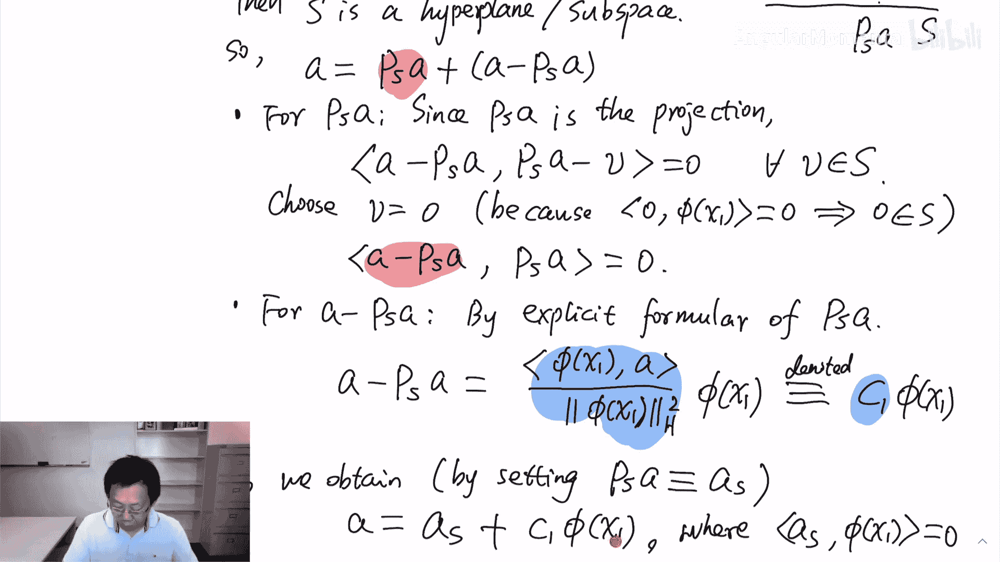

In our proof， we just used the projection。 we project a onto this S。

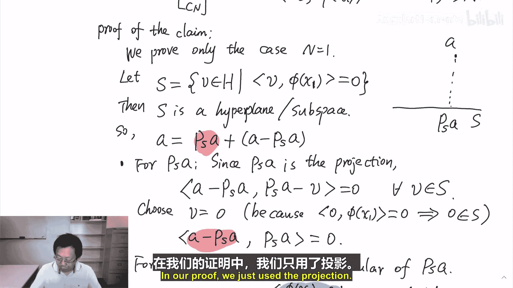

And对。If we set a coordinate system， this S is a subspace and we have something that is orthogonal to it。

 then given a we just project this A onto this S to get the ASS。This is also the AS and for the rest。

It is just this。C，1，5， x 1。

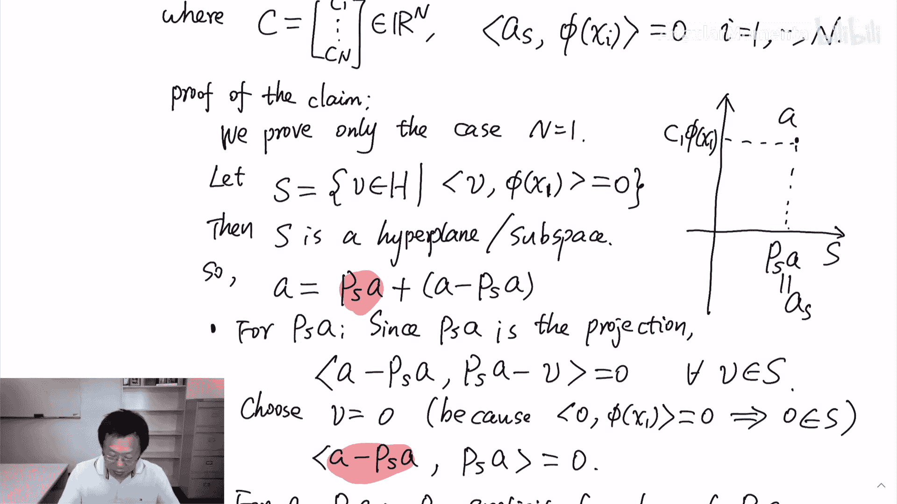

Then。For n equals to 2。Eals to any other number， actually， we can do it similarly。

 which is just define an S to be an intersection of many subspaces defined by the in the product with Phi X I equals0。

 right We have n hyperplane。 the intersection of the n hyperplanes。

 Then we just similarly construct the projection onto the intersection of n subspaces。

Then we can get this decomposition。

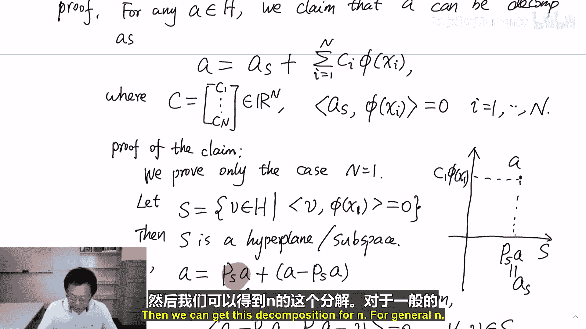

For an。Forgen。Use projection。Angqiu。The intersection of。V on age， of course。Is V and Phi X I。Equs 0。

For I equals 1，2，2， n。And for this， indeed， you can find an explicit formula for them。

I will not do it here。We just proved that this claim is correct。For any A。

 we can decompose it into A S plus a linear combination of fine X I。

Where ASS is just orthogonal to all5hi Xi。In this aspect。

 we have parameterized this A by A S and number C ice。

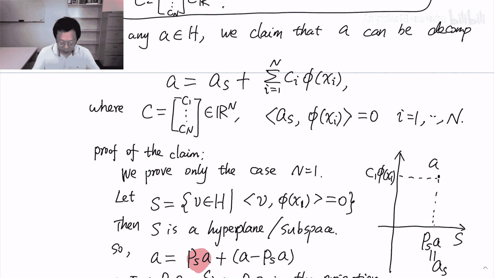

To illustrate this decomposition。

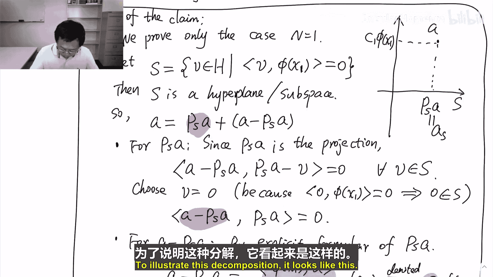

It looks like this。We have an A。And we have this intersection of many。I from one to n。This V on H。

This the F X I。Eals0。So we have the projection， this is called AS， the rest。

It it must be a sigma of I from1 to N， C， I5 X I。This is what this claim tells us。

We can decompose this a authority to ASS and this part。

And this A S is just on the intersection of the。

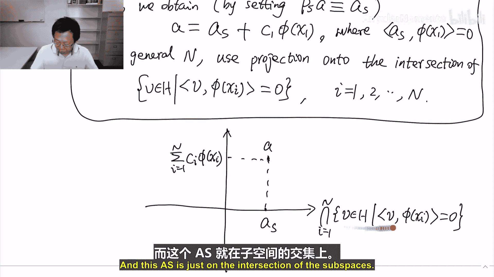

Subspaces。