# 【香港科技大学】数据分析的数学方法 ｜ Mathematical Methods for Data Analysis p57 11-07-02-视频 -BV1DEFDzGEZW_p57-

Now with this new expression of A。We can reex the objective function in this kernel regression。

Re express。The objective。Fangxi。In current regulation。

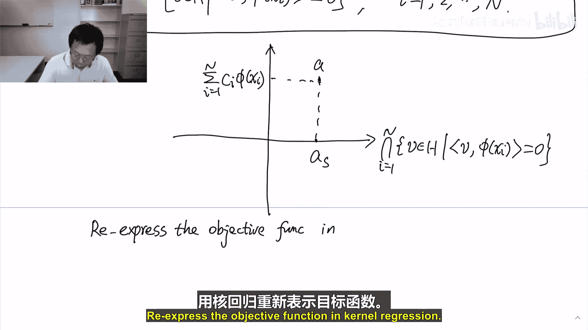

Recall that in the kernel regression， this function is。

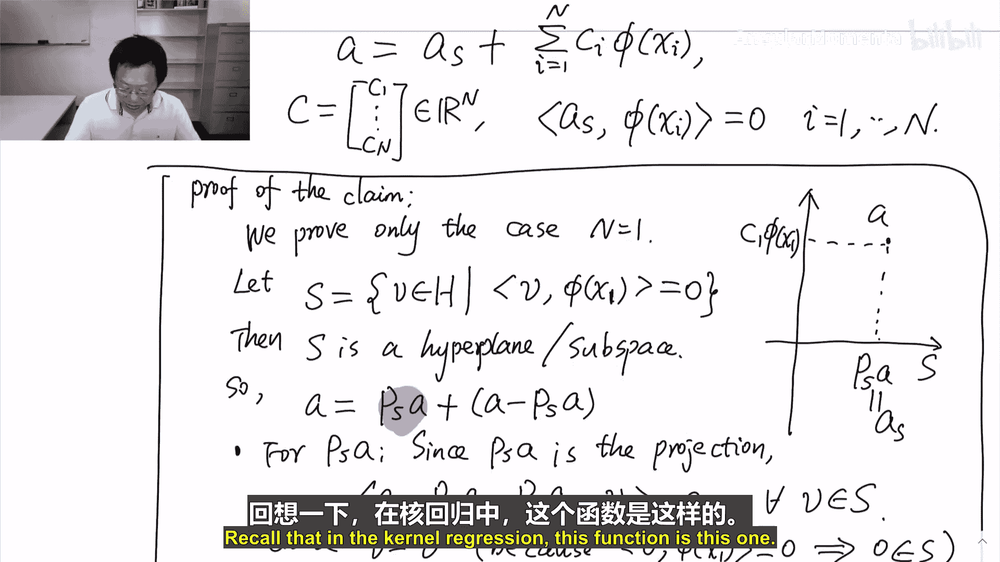

This one， it has a sigma。

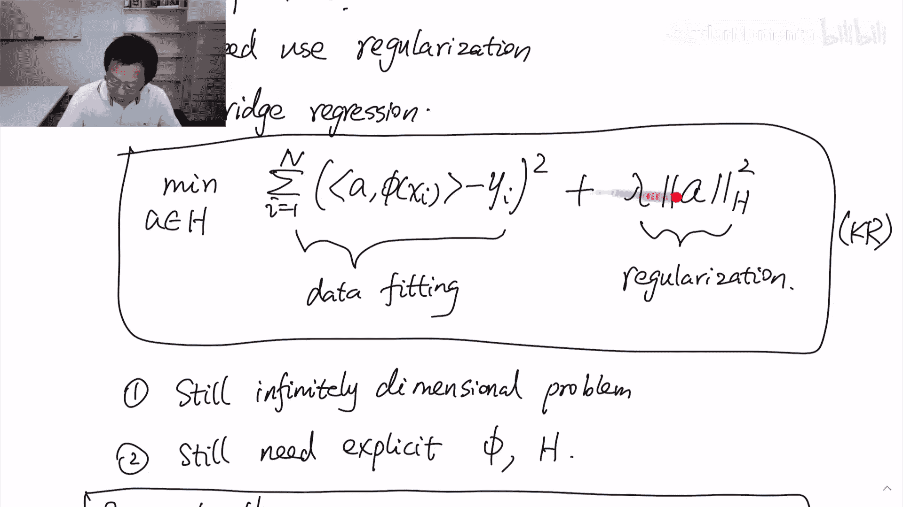

I from one to n。Of this。A phi X， I。Minus Y I squared， this is the data fitting term。

This is the linear function in the feature space H。And this is the corresponding outputs。

 We just want the output of this linear function matches the output in the training data。

And then we have also a regularization， which is a the H norm squared。

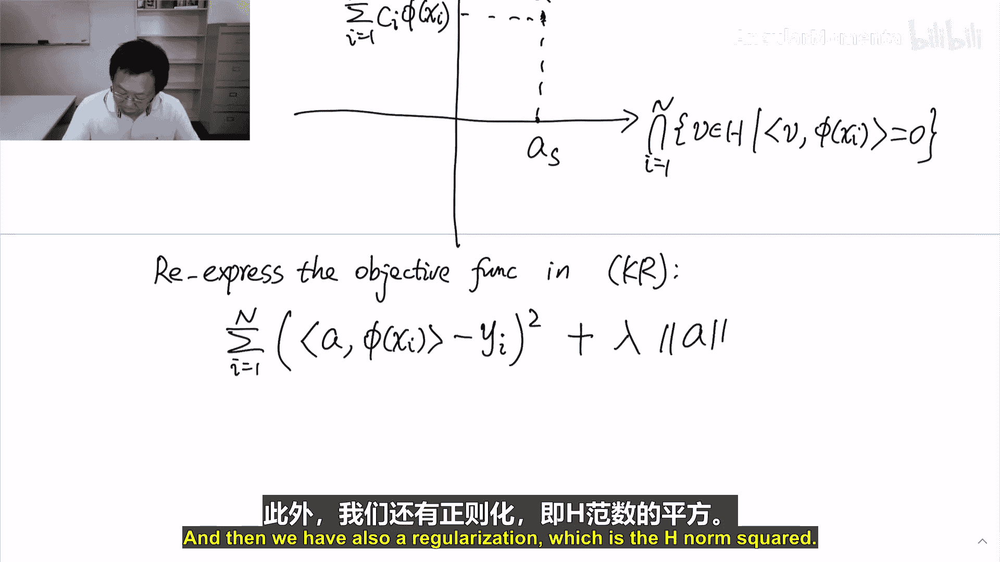

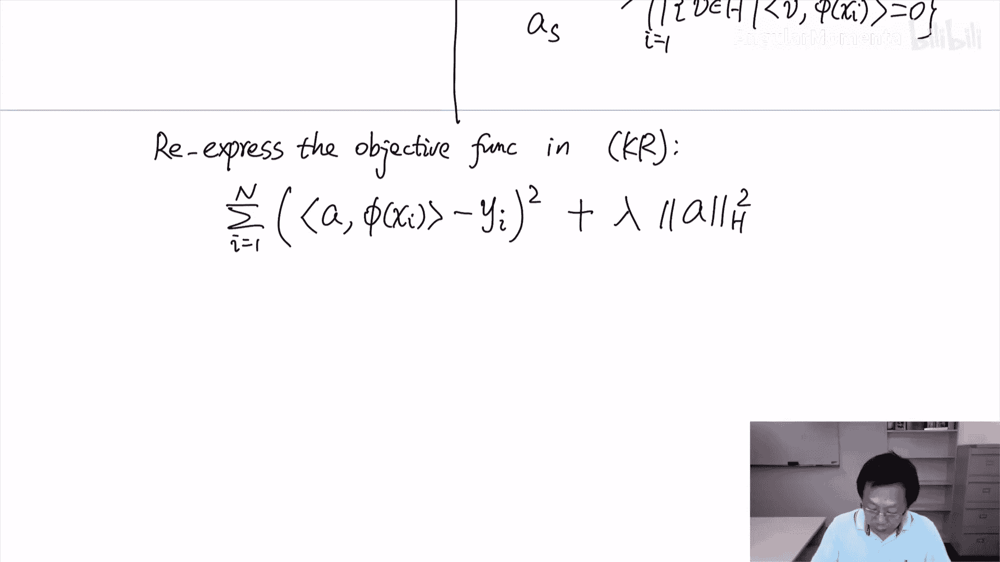

Next， I would like to replace this a by its decomposition。

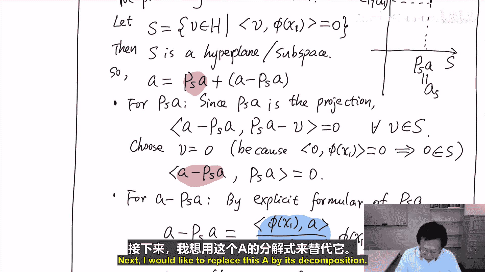

We obtain。Sigma I from1 to n。Of A S plus sigma。 now。

 because this I index is used in the outer summation In this inner summation。

 I will change the index in the summation to J。C j5 x j。

This is exactly the decomposition we obtained just now。So a equals to this decomposition。5hi X， I。

minus Y I squared the class。For the regularization term。I again， replace this a by its decomposition。

Then because we know that in this decomposition， AAS is orthogonal to this Phi xj。

So that when we take the inner product of this and this ASS and this5hi Xi。

 it just disappear because it's0。We obtain。Sigma J from1 to N， C G。5 x， J。5 X， I。inus Y I squared。

 this A S term just disappear in this sum。Because ASS in the product with Phi X I equals zero for any eye。

For the regularization term。Now， again， due to the authority of A S and Phi X J。

This is orthogonal to this。So then we can apply the Pythagoras theorem。This A S H norm squared pluss。

Sigma J from one to N， C， J 5hi X， J。H norm squared。Now， I would like to。Expand this。

A enormous squared。Because this is just the inner product of this vector with itself。

Then by using the property of inner products， we can write this into a summ of inner products。

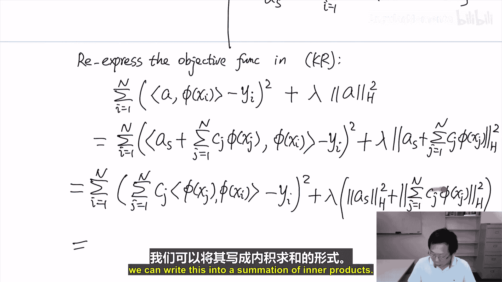

The first term is still the same。For the last term。I do the expansion。It becomes a double sum。

Some of J 1 from1 to N， some of J 2 from1 to N。 I pick one term from this summation and make their inner product。

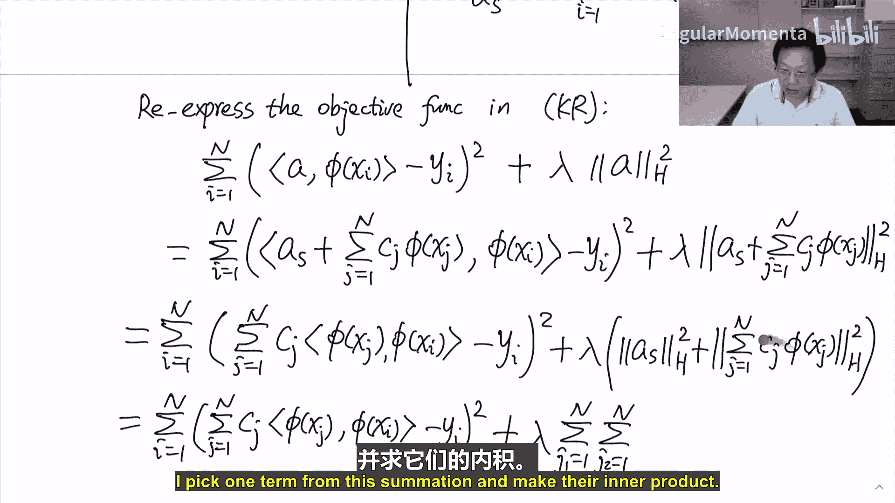

So it is C， J 1， C J 2。Phi X J 1。5 X， J 2。

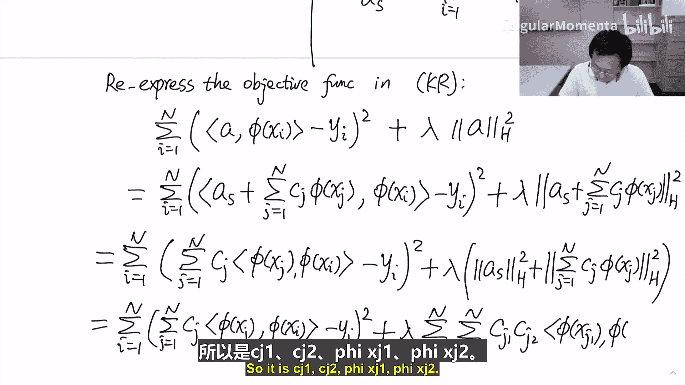

For the second term。We keep P。In order to further simplify this expression， we introduce a matrix K。

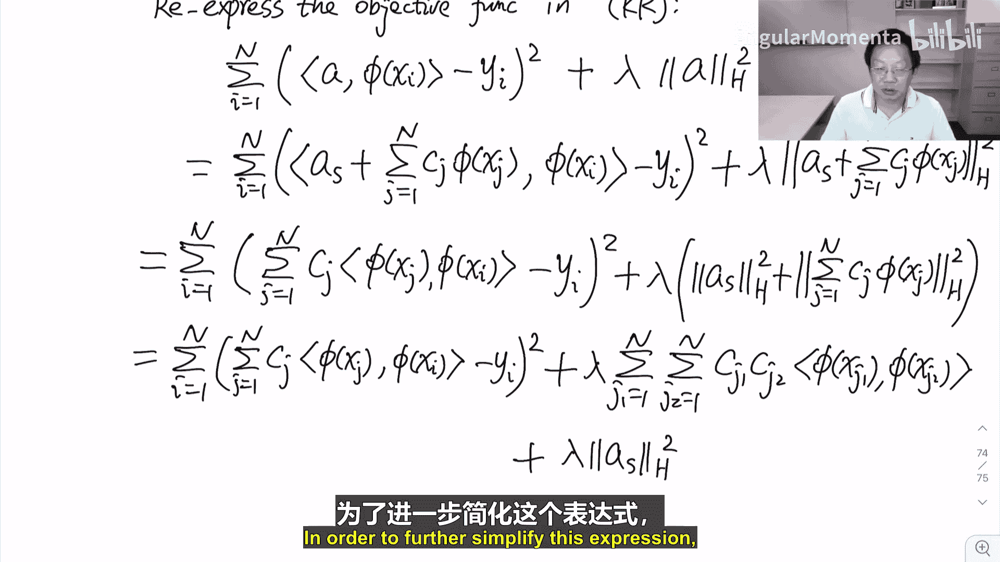

You know。Can be a matrix。Whose I J entry is just Phi X I。5 xj。So this I and J are both from one to n。

And this K is a matrix in。M by N。Then with this new matrix introduced here。

 we can simplify this summation here and the summation here for the first summation。It is just the J。

 I entry times C， G， and then some。So if you are very familiar with matrix vector product。

 this is exactly the eighth entry of this K transpose times C。And this is the eighth entry of Y。

And this is the summation of the squares of entries of the difference vector。

So it is just the two norms squared。Plus lambda， this one， if we define the K matrix here。

 is just a weighted。Smation of C J1， C J 2。 So it's a quadratic form on this C vector is a C transpose K C。

And for the last term， still this ABS。H norm squared。

Now we have reexpressed the objective function in the kernel Ri regression in this form。

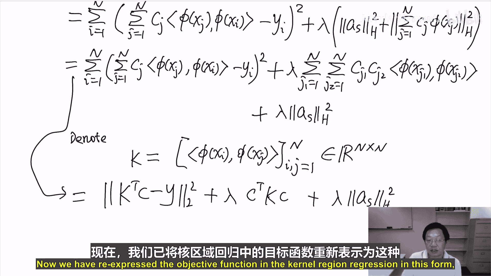

Which means that the current rigid regression。It is now equivalent to the minimization on this K transpose C minus y the2 norm squared plus lambda C transpose K C plus lambda。

A S the H norm squared。Hear that。Variables， the unknown in this expression is C vector and this A S vector in H。

C is just a vector in R N。A S is in H。But this A S is not arbitrary。

 It's the one in the orthogonal decomposition of a。 So there is a constraint on this A S。

 This A S is just。Auththgonal to this fine X。So this is an equivalent reformulation of this kernel region regression。

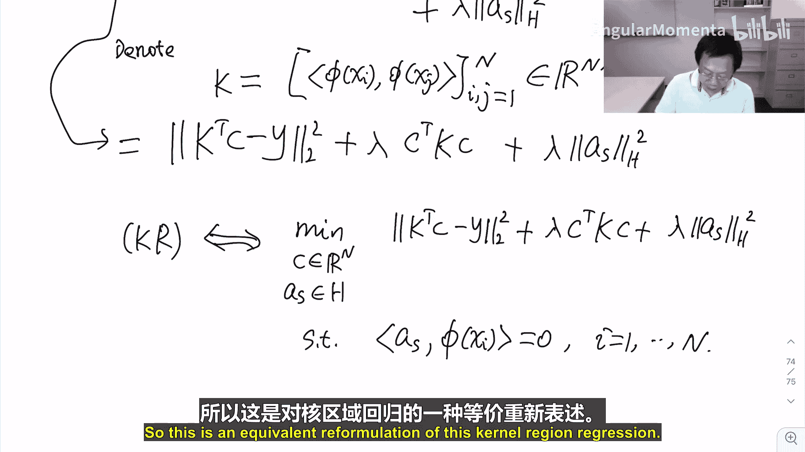

But。This optimization is very difficult to solve because it involves two variables， C and ASS。

And there is a constraint on this A S。 This A S has to be orthogonal to this fine X。

 It is a very difficult optimization to solve。I will call this problem， P1。We want to solve this P1。

Prob。To this end， I temporarily dropped the constraint here。 I consider another optimization。

Wedraw the constraint。In this problem 1， then I just get the minimization of this C in R N。A S in H。

K transpose C minus y， the two norm squared plus lambda C transpose K， C。

Plusus lambda A S the H norm squared。I call this problem， P2。

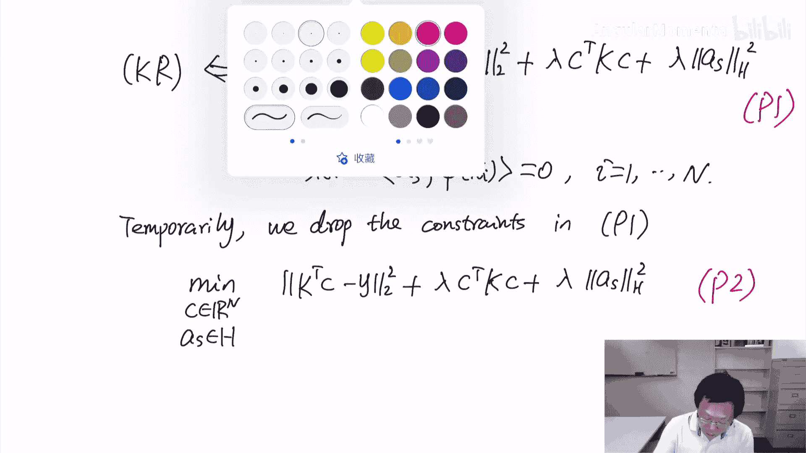

The P2 problem is relatively easier to solve because we don't have the con。

Let's have a closer look at this optimization。We notice that。

C involved only in the first two terms and A S involved only in the last term。And also。

 because this K is。In this form。From the kernel sectioning。

 we know that this K matrix must be symmetric， a positive semi definite so that both these two terms are just non negative。

 This is non negative。So then both terms are non negative。 the first term involves only C。

 the second term involves only ASS。Then this P2 problem， actually， it is the so called separable。

 which means that this P2 problem is equivalent to two independent minimizations。

 The first one is just the minimization on C。Of only the first two terms。

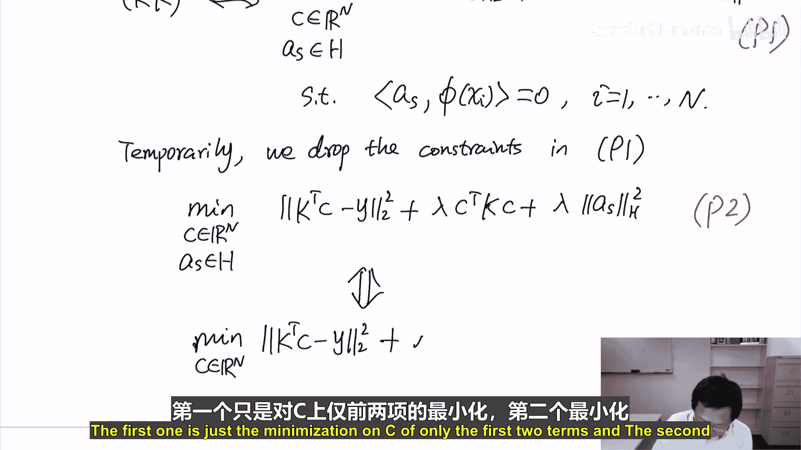

And。The second minimization is only on the ASS。Of this lambda A S。H is squared。

For these two optimizations。This is very easy。 We know that the minimum possible value is just0 when AS equals 0。

And this is a discrete optimization。 We know how to solve it。

 It is just similar to the eastern squares problem。So then this is just equivalent to。

This minimization of this C in R N。this K transfers c minus y to non squared。那么da C transportse K。

Under this。A S。I will use AS star。Deote the minimizer AS star equals to 0 and C star equals to the argument of this one。

This is how to solve this P2。 This P2 is just easy to solve。 C star is obtained in this way。

 and A S is just 0。Now， I want to claim。That this sister， A S star is also。A solution。Of P one。

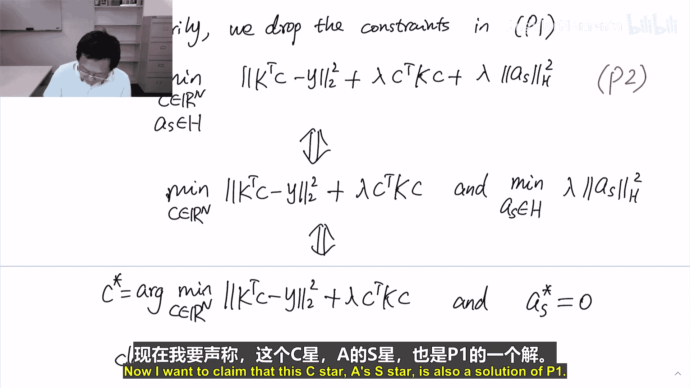

To prove of the kim。Let me just denote the objective function。In this P 2。Bi。

Capital F of this C and A S。And then we see that the only difference between P1 and P2 is that we have this extra constraint in P1。

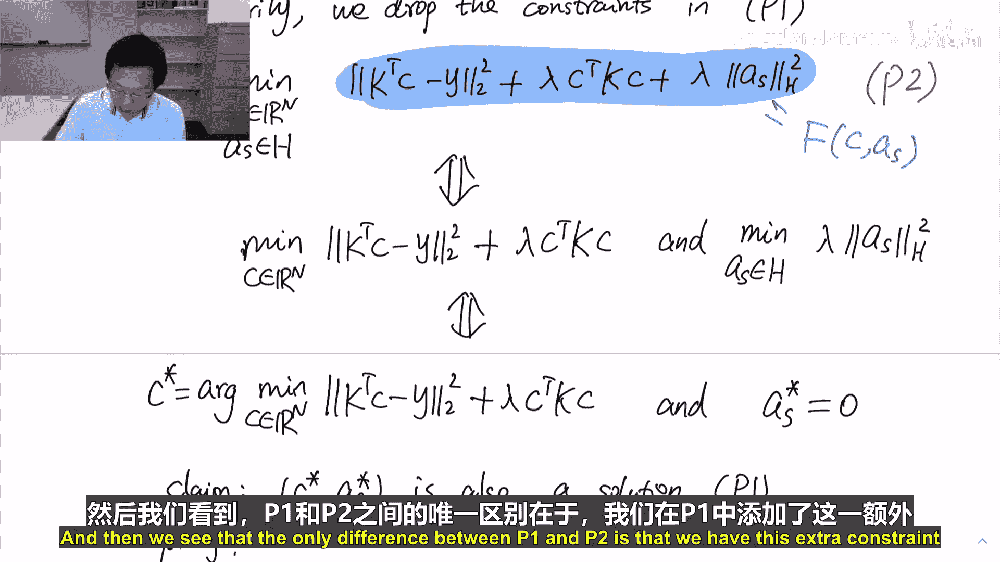

Under the objective function here is FAS。The two functions in blue are the same。

The booths are capital， FA S。Then since we have an extra constraint in this P1 and P2 is unconstrained。

 they are in the same objective function。

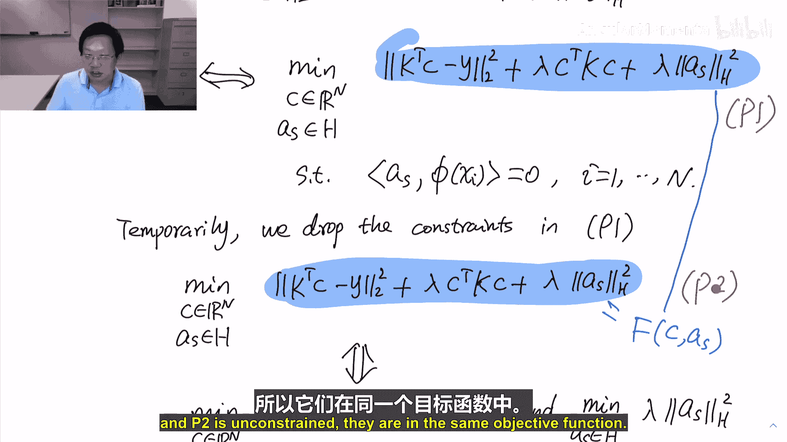

So then with a constraint， definitely I will get a bigger optimal value so that the optimal value in this P1 is bigger than P2。

Because P1 contains an extra。Constraint。On the other hand。We。

 if we look at this A S and C star carefully， we can see that this A S star and P X I。

This inner productor， because ASS star is0 so that this inner productor is just zero for any eye。

Which means that this C star and A S star， these two vectors satisfies。

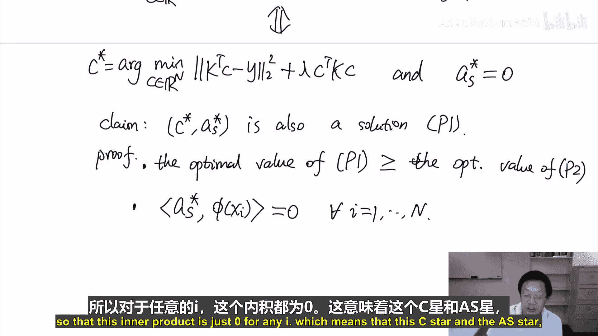

The constraints。

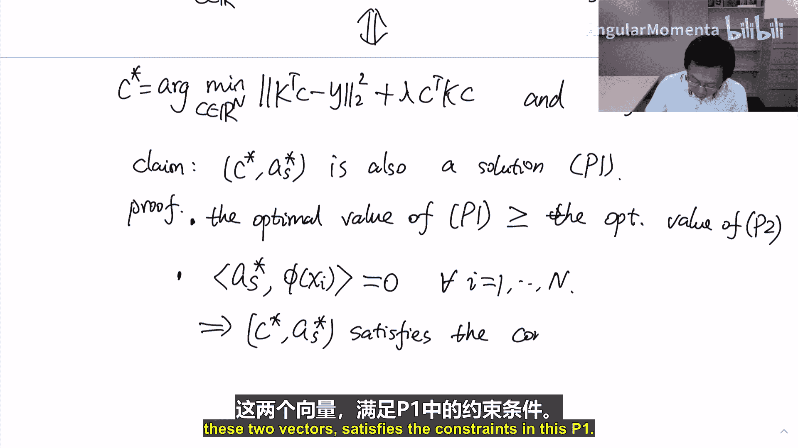

因 this是屁惯。

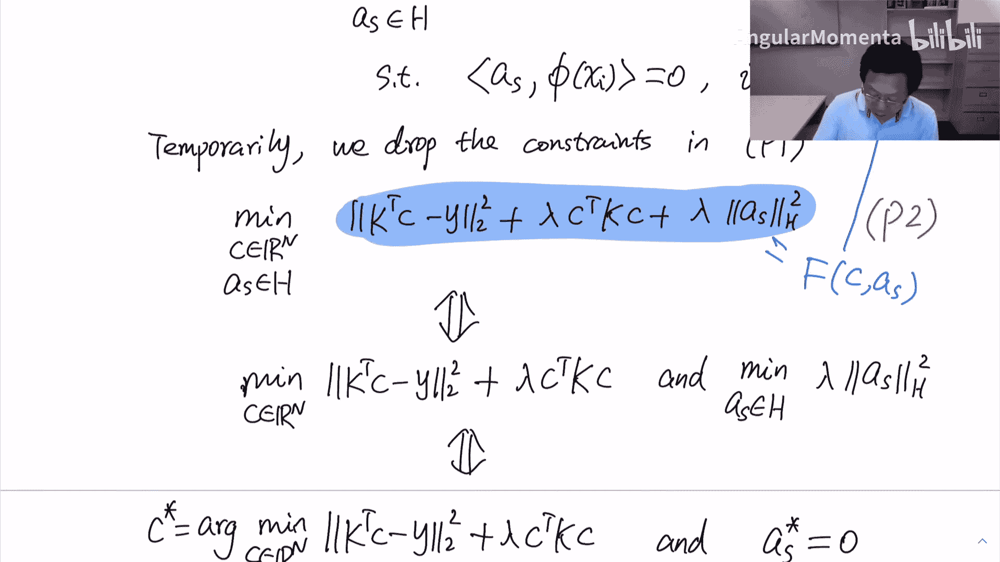

The constraint in P1 is just AS and Phi X I equals 0。

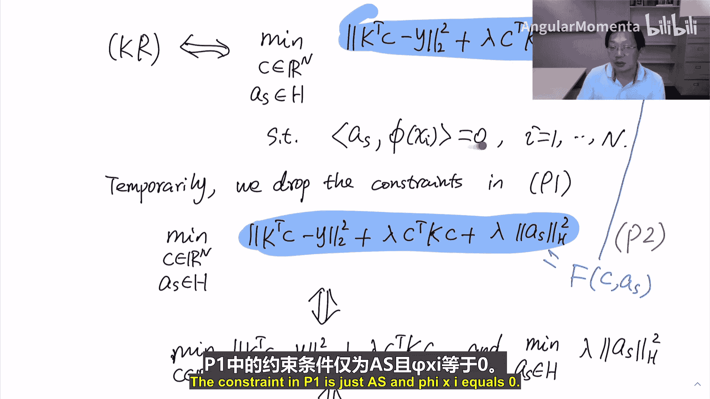

Therefore， the Op value。Of this P1。Because he's minimal。

It's the minimal in all vectors satisfies the constraint。

 So this one is just smaller than all equals to F of this C star。

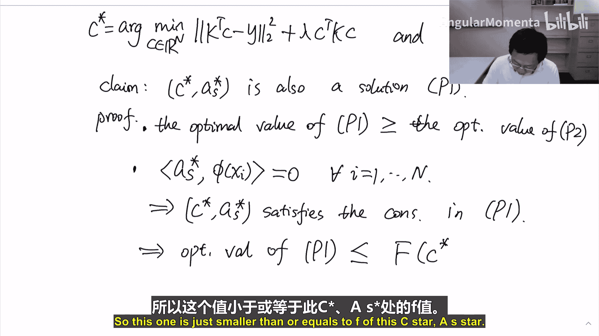

A star。But this F C star A S star is the optimal value of this。P2。

Because C star A star is the solution of。P52。So therefore， based on this and this。

 we have seen the optimal value of P1 and the optimal value of P2 are the same。

So that they have the same solution。And the both of them are F。Of A S star， C star。

So from here we just see that this AS star， C star solves。P1还是么。So we finish the proof of this claim。

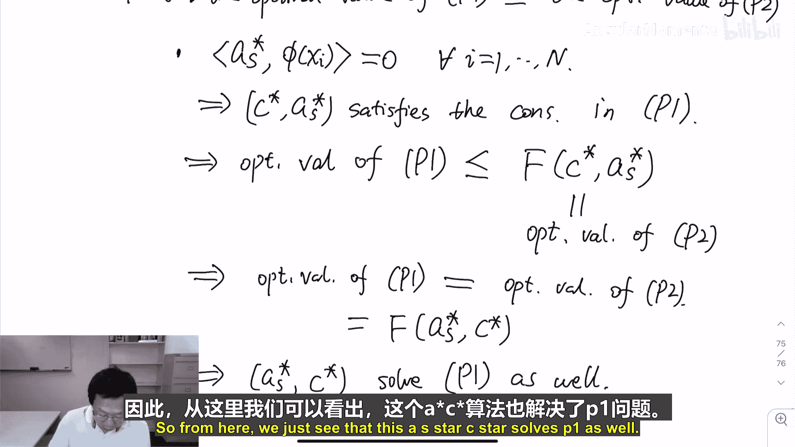

Now with this claim， we have found a solution of this P1。

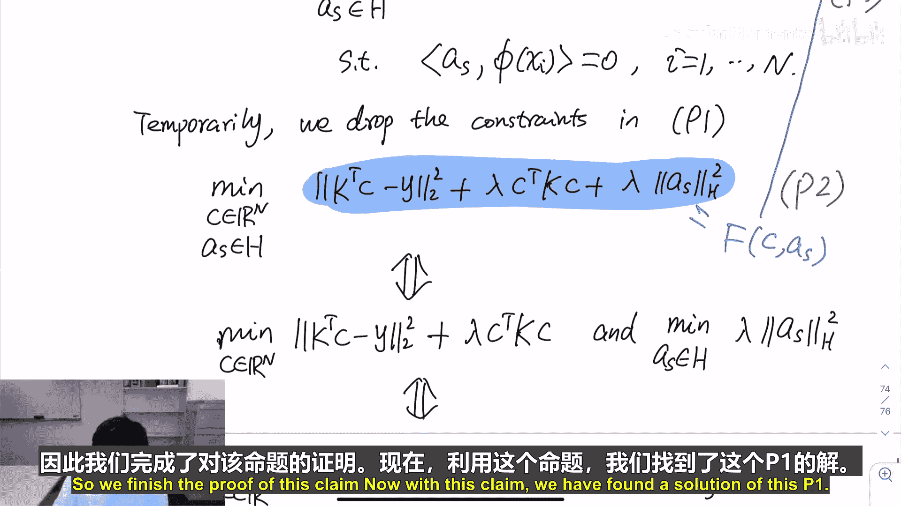

That is， we found a solution of this KR。

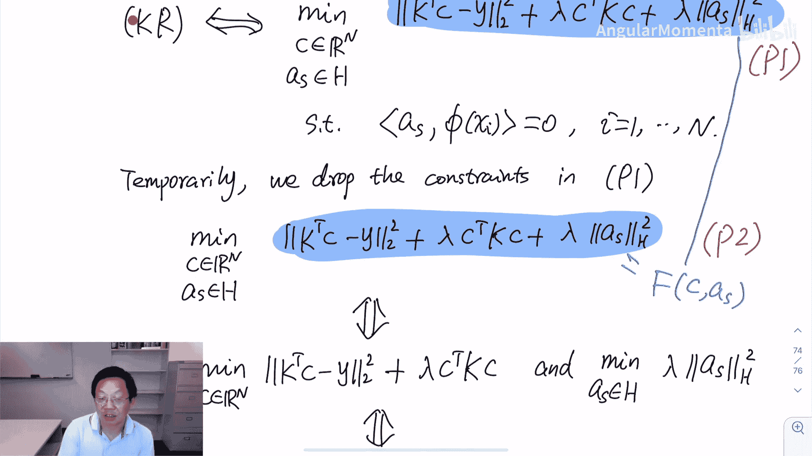

快到，你。A solution of this current origin regression。えす？Gn by。

This a equals a S star plus sigma I from one to N C， I star。5hi X， I。

But now this A S star is just 0 plus sigma I from1 to N C， I star 5 X， I。RightWhere。This C star。

 It is just the solution of this minimization。

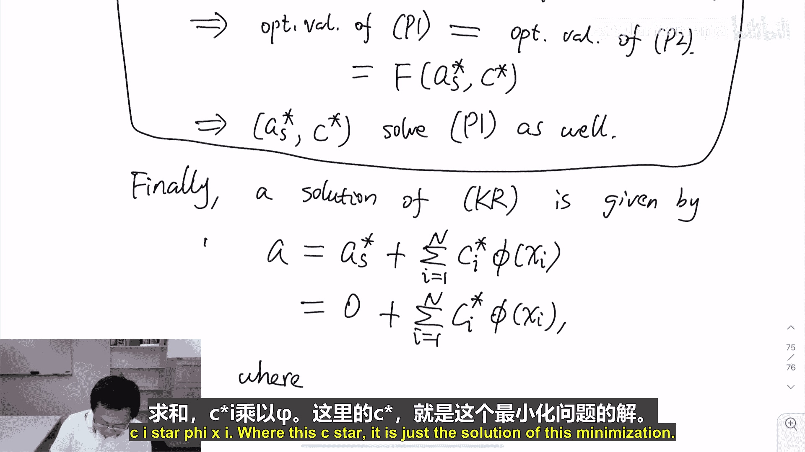

So we have approved that。A solution of the kernel re regression must be in the form of Sigma i from 12 and C5 X I。

 where C is just the solution of this minimization。I finish it that proof。

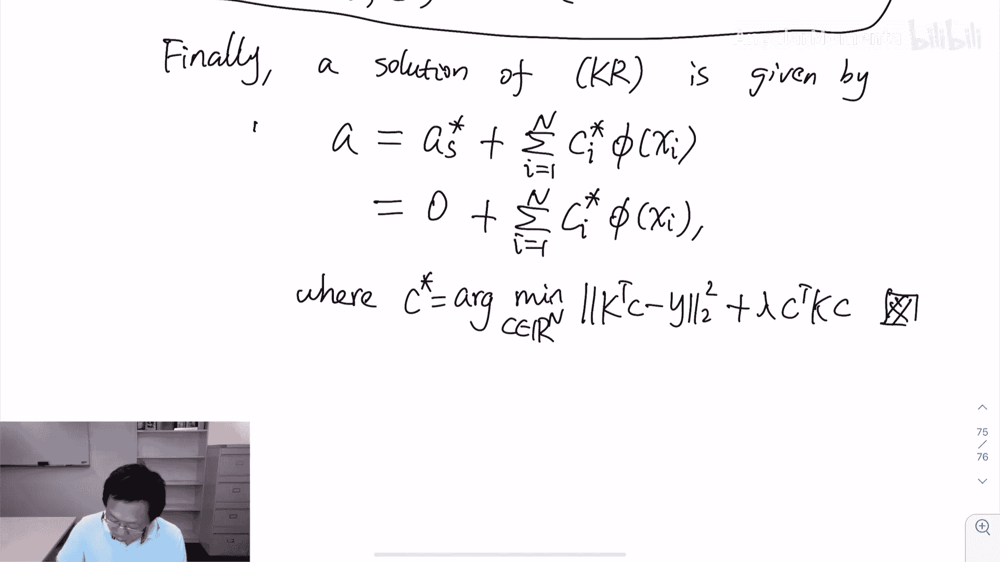