# 【香港科技大学】数据分析的数学方法 ｜ Mathematical Methods for Data Analysis p58 11-08-02-视频 -BV1DEFDzGEZW_p58-

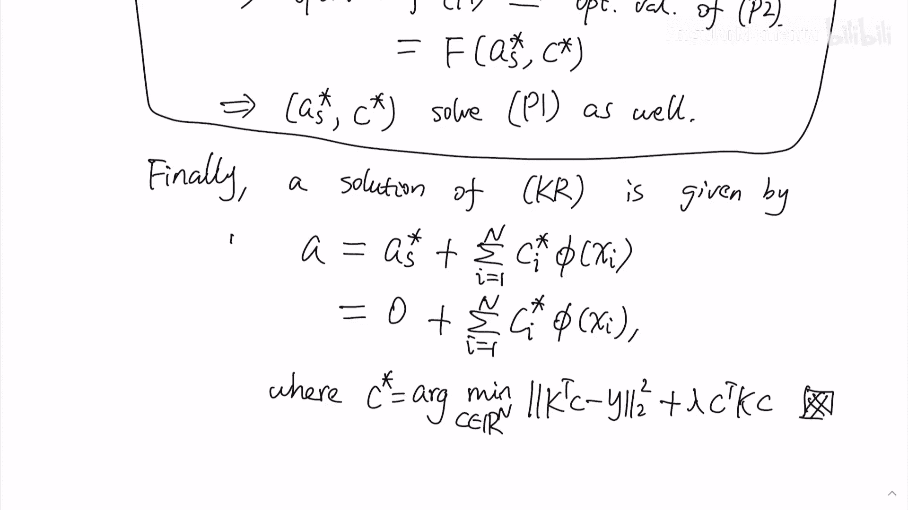

From the proof of the representative theorem， we see that in order to get a solution of this kernel rigid regression。

 we first solve this optimization problem in RN and obtain this C star with this C star。

 we construct the solution of kernel rigid regression by this way。

So a key step in this procedure is to obtain this C star is to solve this minimization problem in this R。

And in the definition of this。Optimization problem in R N， we use the only K。

Which means that the feature mapping and that hub space involved here is only the construction of this matrix key。

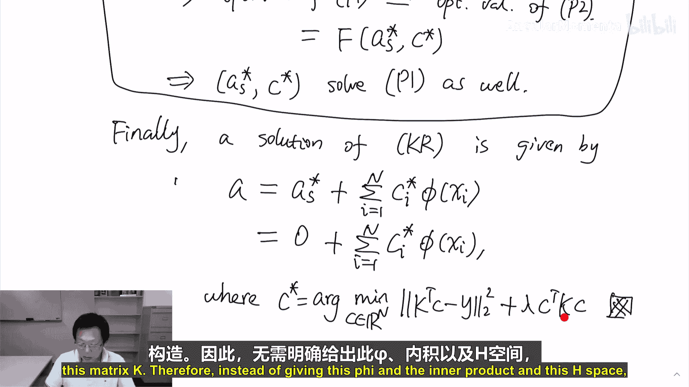

Therefore， instead of given this P and the inner product and this H space， explicitly。

 we only need to define this inner product of Phi X I Phi X J for any X I X J。

 This is exactly the kernel function。

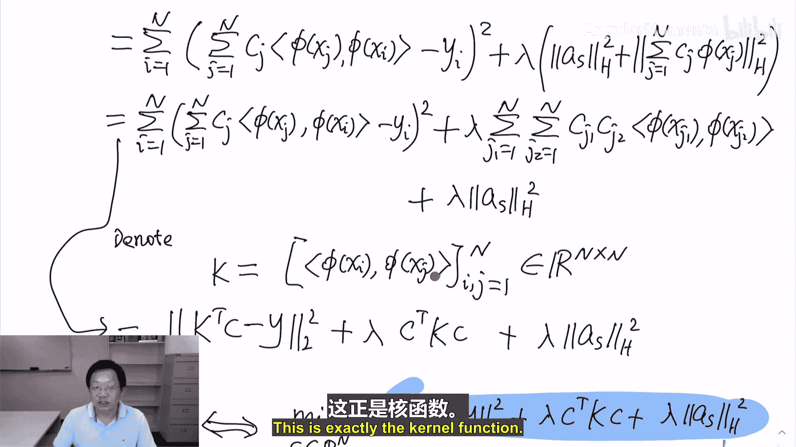

Therefore。We can apply the kernel trick。So as a buy product。Of the proof of the Re theorem。We can。

Apply the kernelel trick。

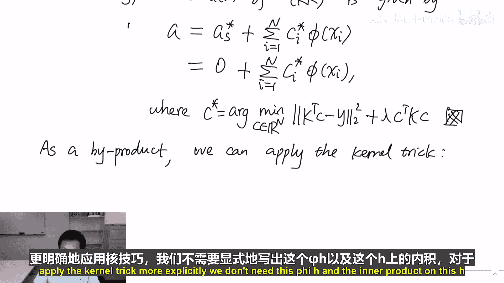

More explicitly， we don't need。This5 H and the inner product are this H exclusively。We only need。

This phi X I。5 x check。For any X， I and X， D J in R。Therefore。

 we have to define this as kernel function。We define this。B K X， I， X J。

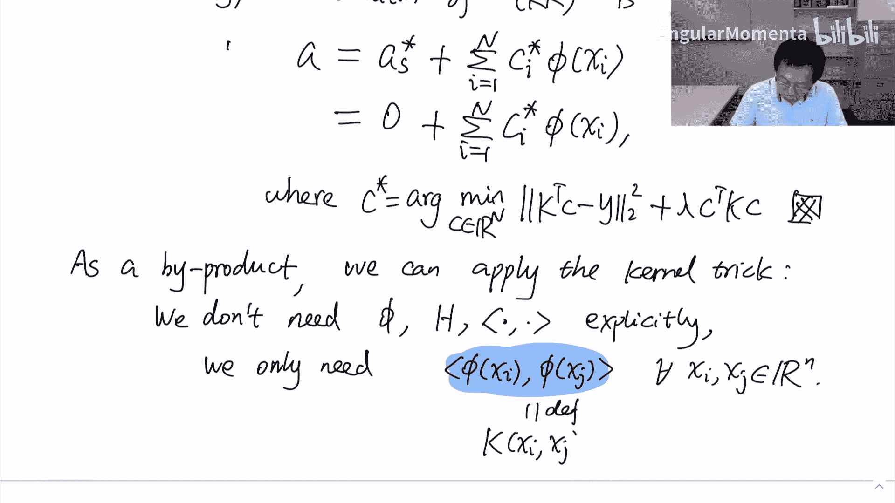

Now， the steps in kernelnal rigid regression becomes a first step。We choose a kernel function。Kxy。

Of course， this kernel function is chosen， such that this K， X。

 Y is exactly in the product of Phi x and Phi Y。According to the Mercer theorem。

 we just choose a symmetric a positive semi definite kernel is enough to be a good kernel。

And as I have also mentioned， that， some popular。Choices。

Of this kernel function are this Gausian kernel。That's the exponential of x minus y。

Square the over sigma， squared all the。Pnomial kernel that is x transpos y plus one to the power alphapha。

Where alpha is some integer。Once we have chosen a kernel function， then we just。For a kernel matrix。

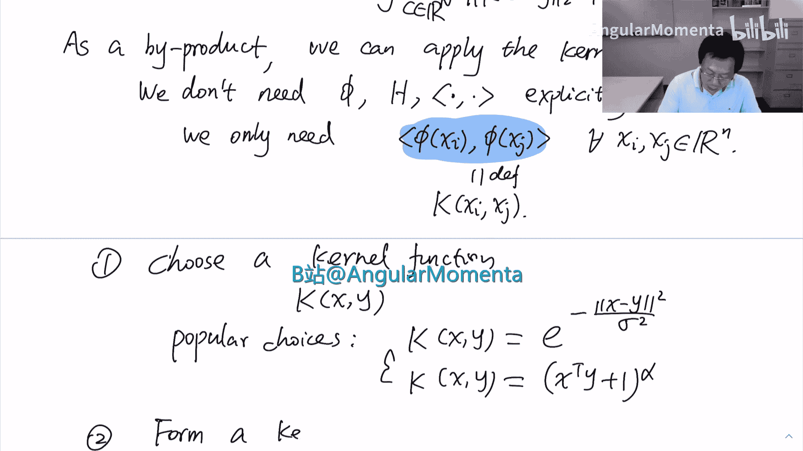

Its kernel matrix。 It is just1。

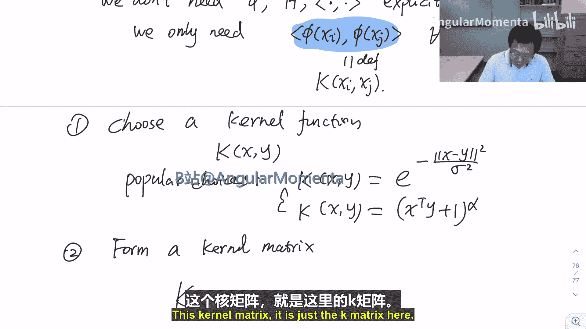

The K matrix here。

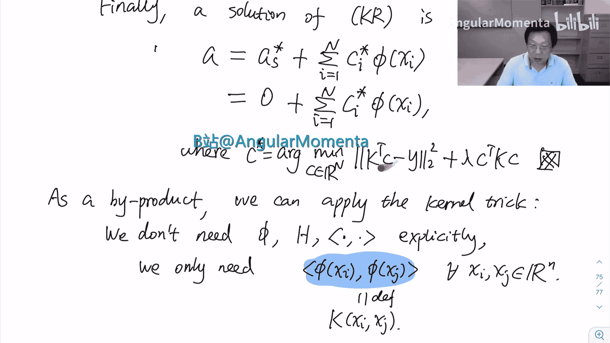

Or it is just a define the in。In this way。 So now this inner product is replaced by K。X， I， X。

 J by the current function。

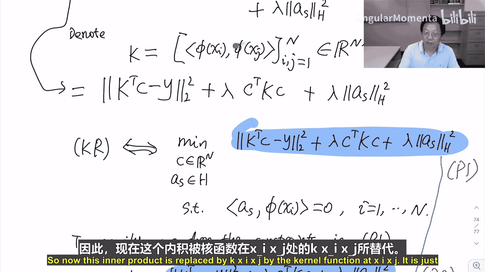

At X， I， X J。

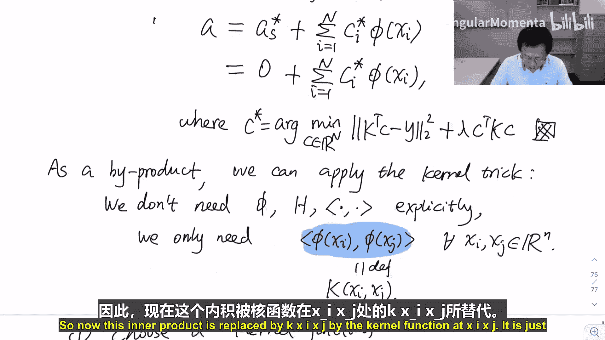

It is just the K of X， I， X， J。I and J are both from one to n。

 This is a matrix in capital N by capital N。

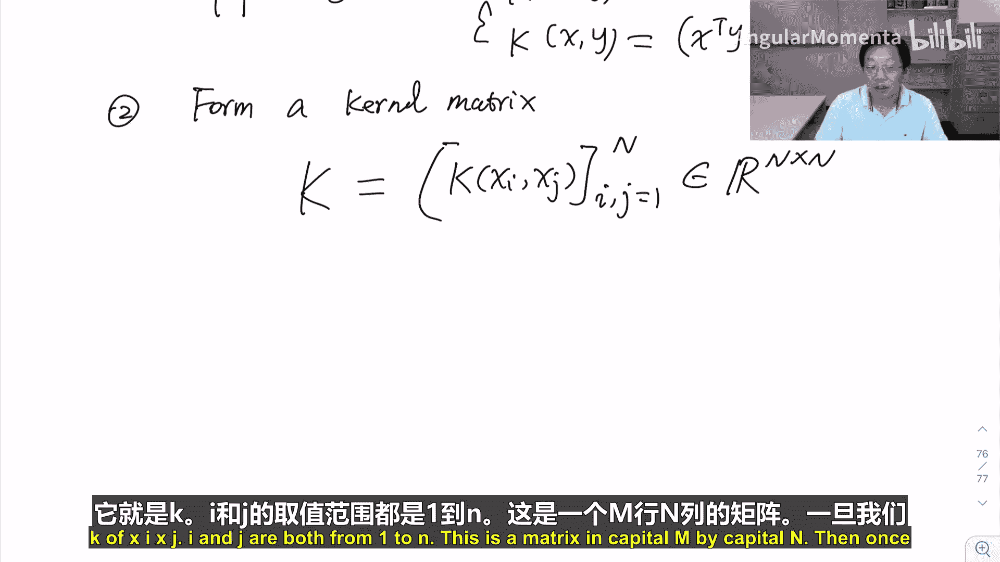

Then once we have formed such a kernel matrix， then we just solve this minimization to obtain our C star。

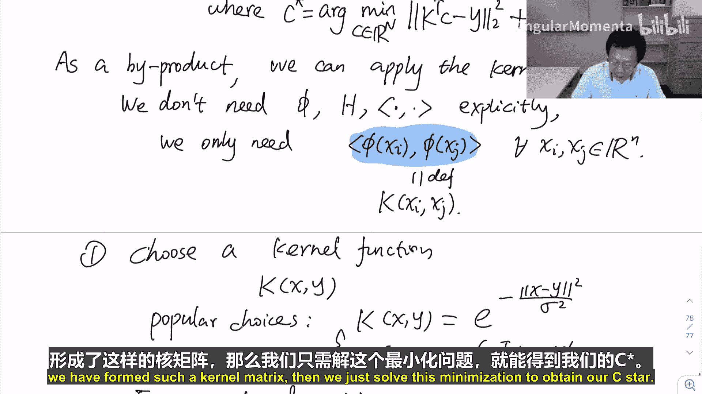

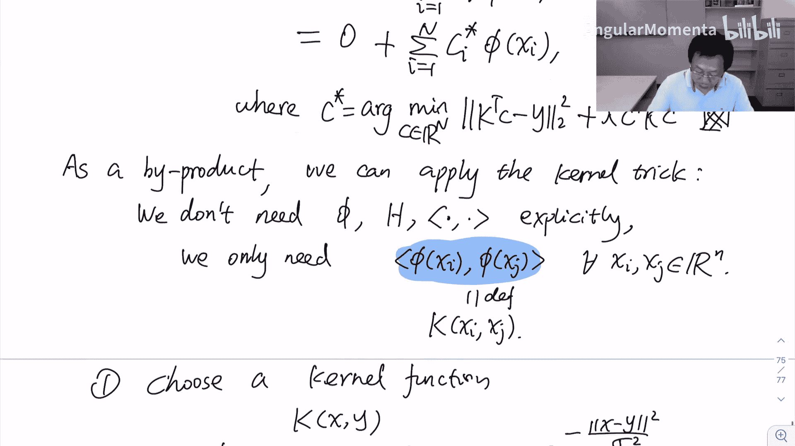

So。Is a C star from。The star is the。Minimizer of this K transpose C minus y and2 norm squared plus lambda C transpose K C。

But this C star vector is used only in the definition of a。

The solution of the kernel re regression problem。With this solution of the kernel Ri regression。

 we have the regression function。The regression function is just this a vector in the product of this5 x for any given x。

Giv a new vector in R。Given a new input， we want to predict the output corresponding to this input。

 we just use this one。 We just first transform this X into the feature domain and make the inner product with the A vector A is the solution in the kernel Ra evaluation。

 which is given by C star5 X I summation。Then this is just sigma I from1 to N C， I star。5 X， I。

With5 x。So by the property of inner product， we can do the expansion。C， I star。5hi X， I。5 x。Again。

 you can see it involves the。Feature， transform fire and the inner product in the Hebal space。

But this one is given explicitly by our kernel function。This is just a sigma I from1 to N C I star。

Clonnal function of X， I。Therefore， we just use this， given any x in R N， we just use this as that。

Output， the predicted output。This one is the predictor output。All the regression function。

 it is just given in this form。 Again， you can see that in this function。

 it does not involve Phi H and the inner product on H。It involves only this kernel function。

 and the C C is obtained in this way。

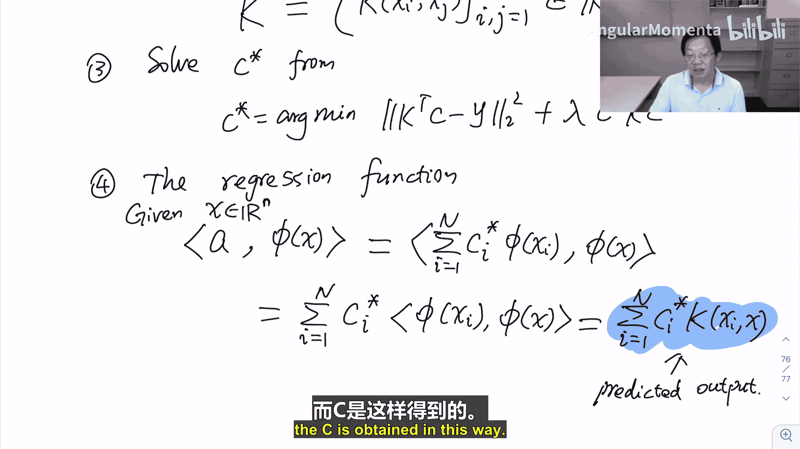

So this is the full procedure of that。Colonnal Ri regression。

 It is totally computable on the computer， because the only。Optimization。

 the only computation is the。Optimization here。

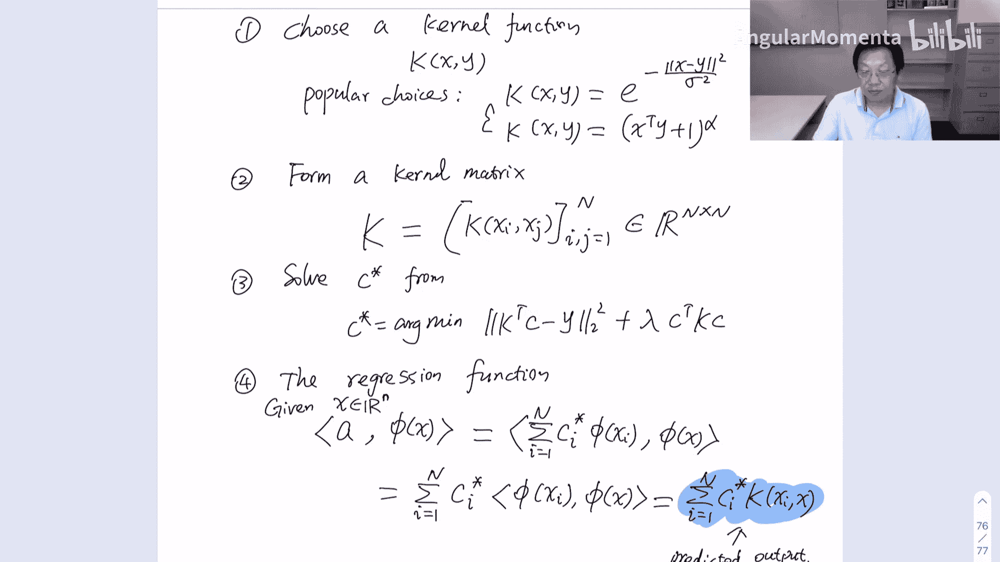

Finally， I wanted to give you a simple illustration of this kernel rigid regression。

Just to consider in this。Are two。We are given a bunch of data in R 2。X under Y。

Maybe this set of data looks like this。If we use a linear regression。

 definitely is not good because this data is curved。Then if we apply the current rigid regression。

 we get a function， this function。Ma looks like。It just fits a curve to the given data。

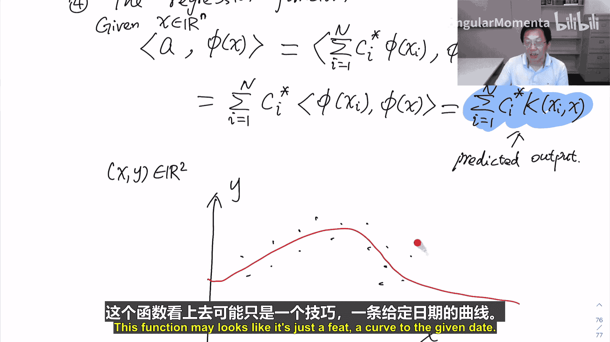