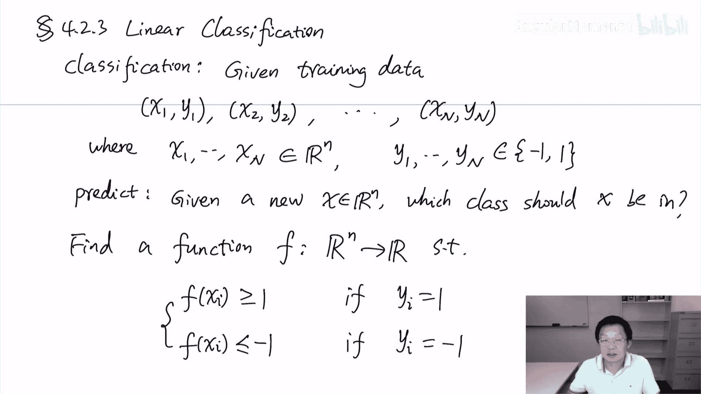
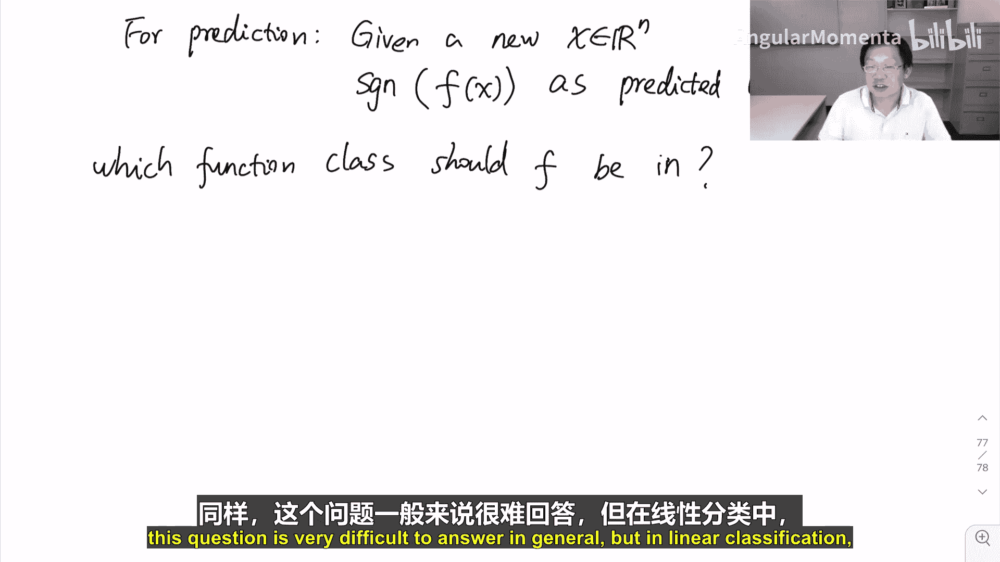
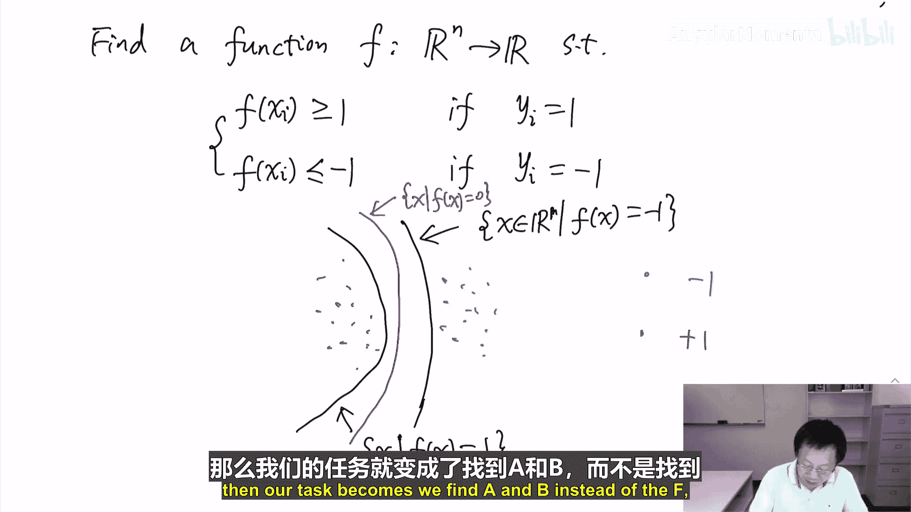
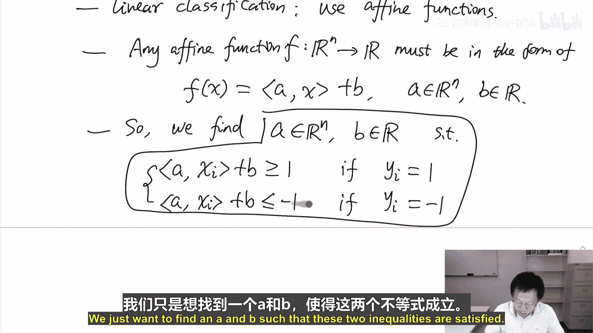
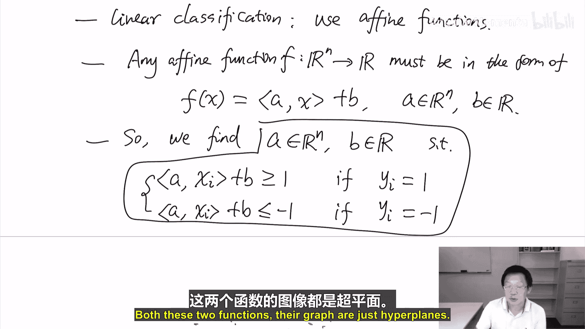
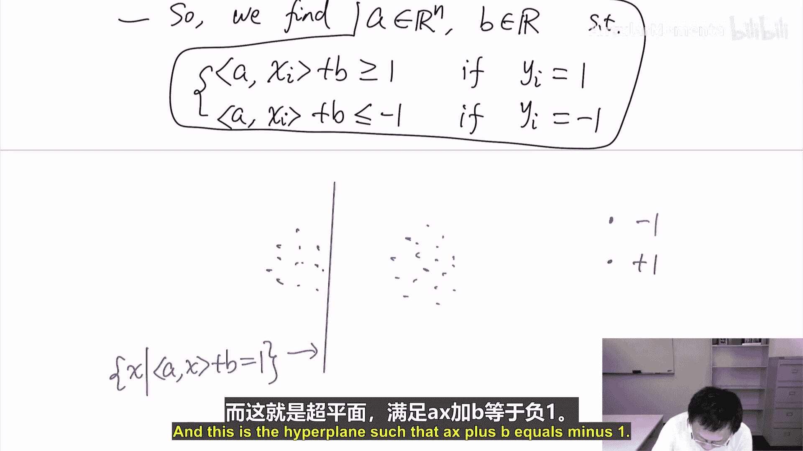
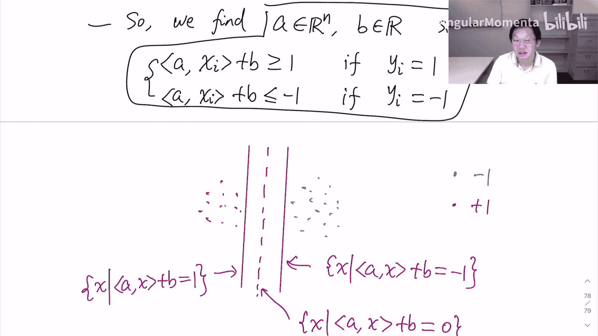
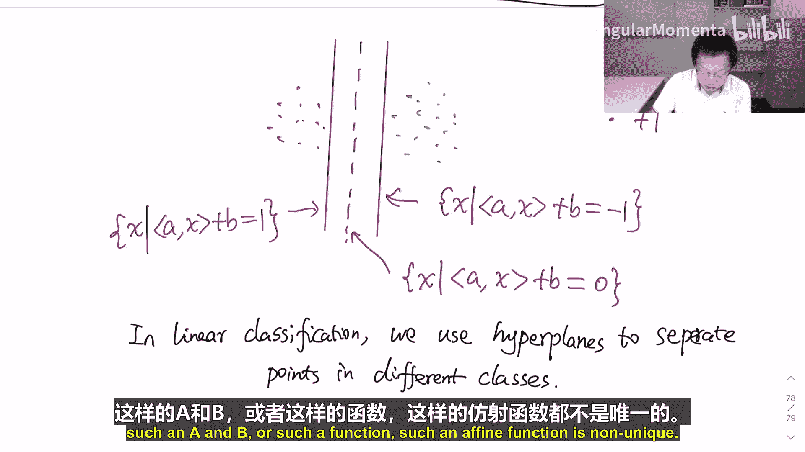
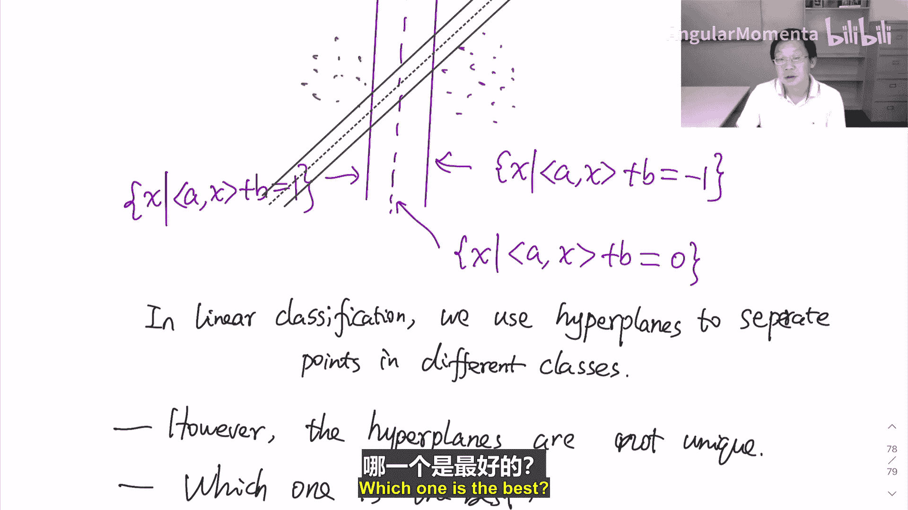
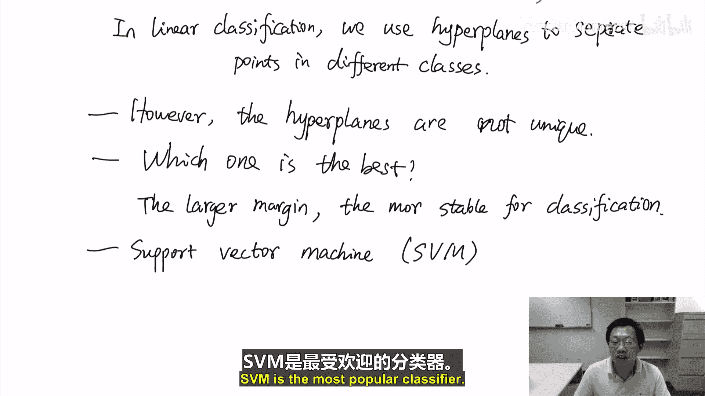

# 【香港科技大学】数据分析的数学方法 ｜ Mathematical Methods for Data Analysis p59 12-01-02-视频 -BV1DEFDzGEZW_p59-

Now we go to the linear classification。Where we want to solve the classification problem。

The classificationification is quite similar to regression。

It is also a supervised learning task given a set of training data。Again， in the input output pairs。

X I。Why I。Here。This x1 to X N。They are just in our little。For simplicity。

This is the same as the one in the regression， but for this y is， y1，2， YN。They are still1 number。

 but they are just binary numbers。Either minus1 or one。Which means that we have two classes。

 class minus1， or class one。Then again， our task here is given a new input。

 We want to predict which class is this new input in。Again for this classification。

 it is a relation of input and output。 We still need to find a function to reflect the input X I and its corresponding label Yi。

We find a function。F， this function is from R N to R。Instead of from R N to binary value。

 we find the function F from RN to R， such that。This F， X， I will be larger than all equals to one。

 if this Y， I is one。And the F X I is smaller than or equals to -1。 If this Y I equals 2-1。

This is the function we are going to find。

Graphally， we just given many data points。Like this class。Plus， one。

 And we have also another set of data in。Classs， -1。So this is minus-1。Ratom is plus one。

Then what we do is that we find one function I offer。

So this curve is just an all x such that the function value is minus1。

This curve is just all X such that F X equals 1。Therefore。Oh， blue points。Points。

Belongs to class  -1 has a function value F x smaller than or equals 1。And for the class1 points。

 Fx is just larger than or equals2。For prediction。Because our output， our label should be binary。

 but our F maps R N to R。 Then we need a conversions。 We want to convert a real number to。

The binary one。What we do that given a new。X。InRN。We don't apply this F X directly。 This is。

Different。To the。Regressing case。 we just use the sign of this Fx。As the predicted label。

If this F X is positive， then it's in class 1， if F X is。Negative then is in class minus-1。

Or equivalently， we have this。F x equals 0。So that if the new point is on the left side of this purple line。

 then it just belongs to class plus 1。 If this new point X is on the right side of this。Purple line。

 Then it just belongs to class -1。Of course， here， similar to the regression case。

 we need to determine which function class should FBE。Again。

 this question is very difficult to answer in general。But in linear classification。

 we just use our fine functions。

Again， we know that any a fine function。F from R N to R is in the form of。F X equals a X plus B。

 where a is just a vector in R N， and B is a number in R。Therefore。

If we choose the F to be a fine function here。Then our task becomes， we find。

A and B instead of the F， because any fine function can be parameter by A and B。

We just find。A。In R， N and B in R。Such that。This。F， X I larger than one。If Y， I equals one。

So this A X I plus B。Larger than all equals to one， if Y I equals to one。And this A X I。Plus。

 B smaller than or equals-1。If this y is equal minus1。This is what we are going to solve。

 we just want to find an A and B such that these two inequalities are satisfied。

Let me use a picture to demonstrate you this。 assume we have class  one points。

And we have another class minus1。So this blue is minus-1。Red is plus one。

Since here our Fx is a fine function。Now， this。F X equals plus1 and F X equals -1 becomes A X。

 I plus B equals1， and A X， I plus B equals minus-1。Both these two functions。

 their graph are just hyperplanes。

So this is the hyperplane。That to this。Oh， X， such that。AX plus B equals1。And对。

This is the hyperplan。Such that A X plus B equals -1。And we have this equals0。This is just。X。

A X plus B equals 0。If we have a new point coming， if the point is on the left side of this dashedton line。

 then it just belongs to class minus1 if this point is on the right side of this dashed line and then it will be class minus1。

So then in other words， in linear classification， we use hyperplans to classify the points。

In linear classification。We use hyperplanes。Qiu。Separate。Points。In different classes。

However， from this picture， you can easily see that such a hyperplane is non unique， Such an A and B。

 or such a function。 Such a fine function is non unique。 I can find another function。

For example， I can use this green hyperplanes to separate this class1 and class minus1。

For all red points， they are just on this side of the green plane and for all blue points。

 they are just on the other side of this green plane。Actually。

 we have infinitely many hyperplans to separate the blue and red dots。Then naturally。

 there is one question。 since we have too many， of course， we want to pick the best one。

 Which one is the best。However。The hyper place。Are not unique。维 you one。Yes。Best。

Let's first compare this to hyperplane classifiers。 assumeum that we have a new data coming in。

 This new data is exactly here。Then both the green Hyplane and this purple hyperplane has。Correct。

Classification。The both classify this big red dot to class class1。

 because this red dot is on the red side of this purple dashed line。

 it is also on the red side of this green dashed line。But real data always contains noise。

Which means that the clean data is here， but the noise data will not be here。

 It will be perturbed by the noise。Then， if this。Red is perturbent to the other side of this classifier。

Then we will have a misclassification。For this purple classifier。

 the noise should be at least this large。At least this red dot should be perturbed to the other side。

 Then this red dot is misclassified。The width of this hyperplane and this dashed hyperplane will be the smallest noise for a misclassification of this purple classifier。

This nurch， the noise should be at least a this nuch。But for this green classifier。

If this red dot is misclassified， then it should be at least perturbed on this side of this dashed green hyperplane。

So that this noise has to be this large。So of course。

 larger gap means the classifier is more stable to that noise。

So we like a larger gap between this and this， or we want a larger gap between this and this because this is just two times of this。

This distance， the distance between two hyperplanes in the same classifier。

 the hyperplane plus1 and the hyperplane -1。This distance is just called the margin。

So the margin for these super purple。Classifier is this white。

The margin for this green classifier is this nu。We like a larger margin。Because larger margin。

 as I just argued， means that it is more difficult to be misclassified。The larger margin。

The more difficult for misclassification。And the more stable for classification。

This strategy is exactly used in support vector machine。Or S V M for short。

SVM is the most popular classifier。

