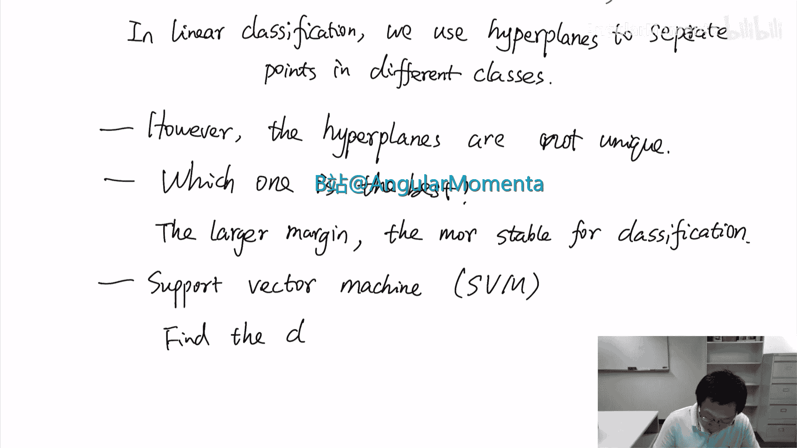
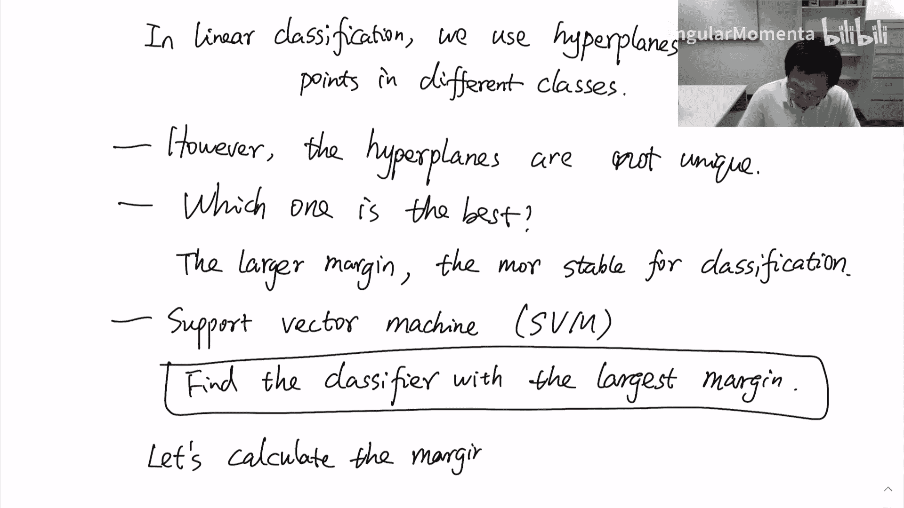
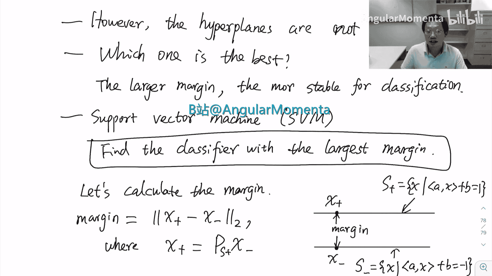
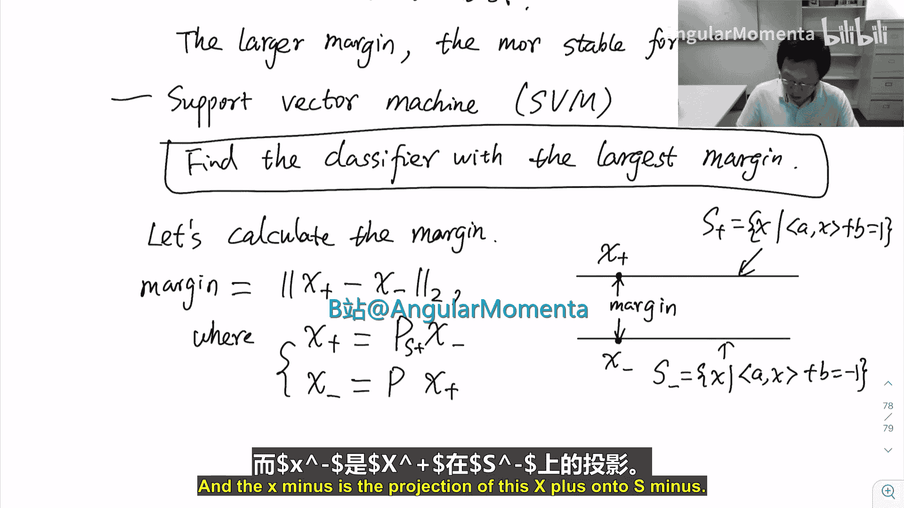
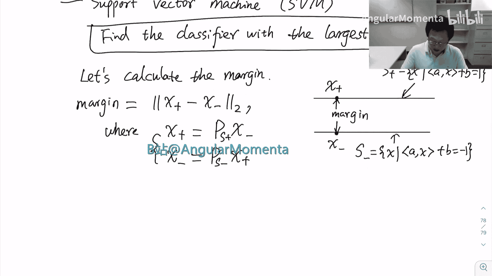
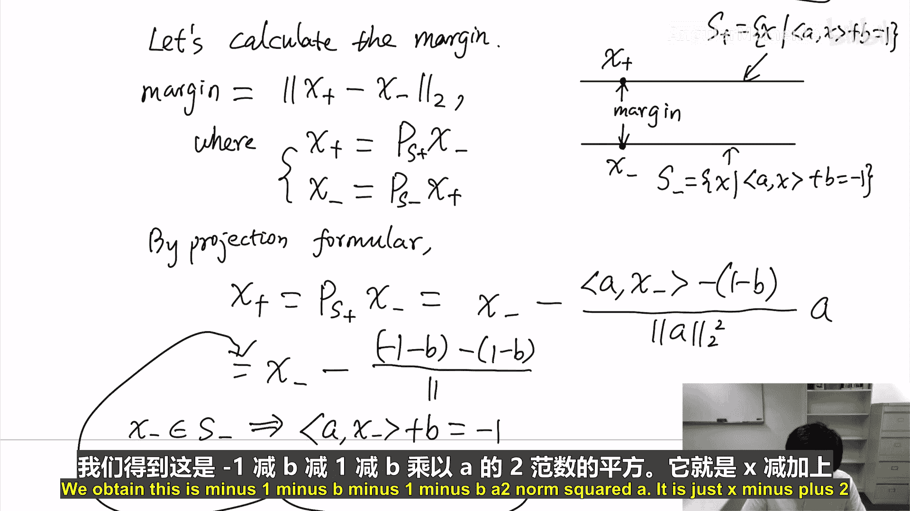
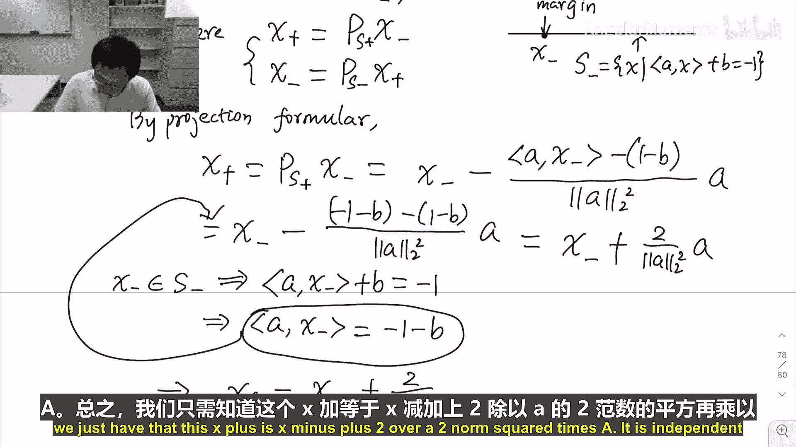
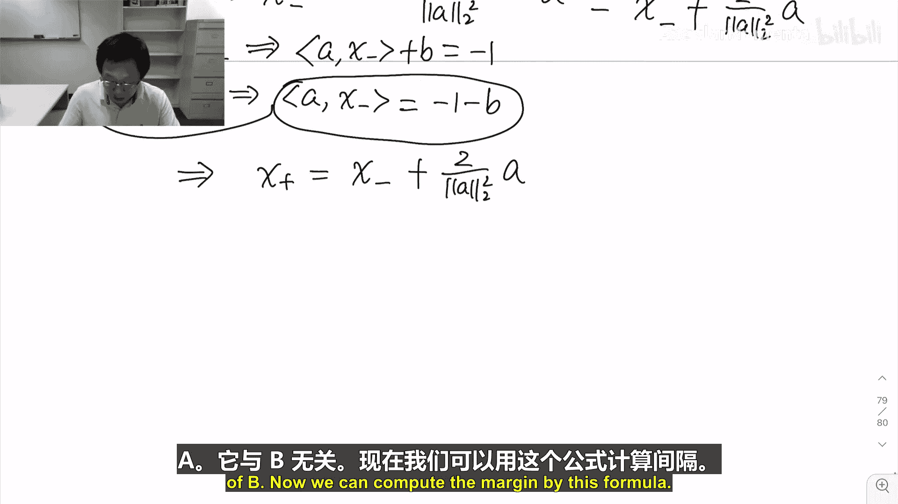
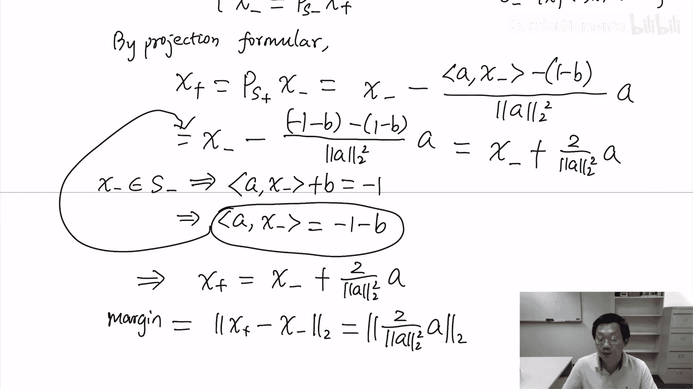
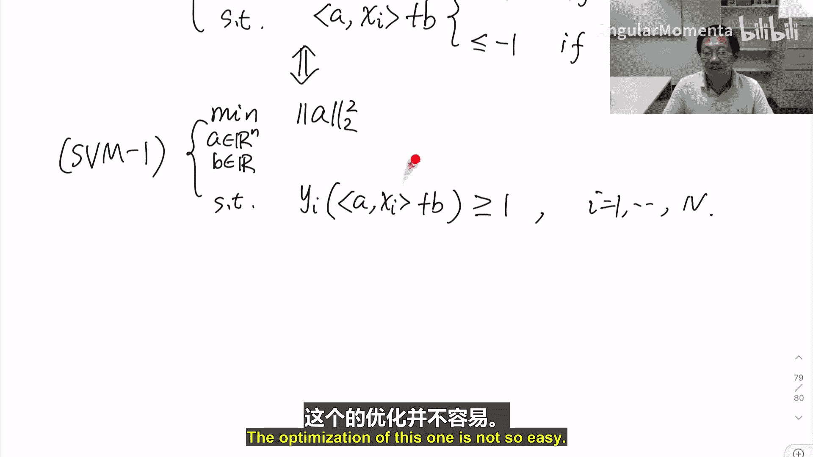

# 【香港科技大学】数据分析的数学方法 ｜ Mathematical Methods for Data Analysis p60 12-02-02-视频 -BV1DEFDzGEZW_p60-

SVM is the most popular classifier。It just defined the linear classifier with the largest margin。

Which means that we pick the most stable classifier。In order to turn this into an optimization。

 we need first have a quantitative description。On this margin。

 we need to calculate how large a margin is for this A X plus B classifier。

Here I just draw the two separation hyperplants。The top one is the one。X。A X plus B equal one。

The bottom one is the x。So I should that to AX。Plus1 equals -1。These are two。Separation hyperplans。

 So for those training data， class plus one just here。 class -1 is just here。

And I just call this plane to be S plus。I call this to be S minus。

Margin is just the distance between these two hyperplanes。This distance is called the margin。

Then to calculate the distance of these two parallel hyperplans。

 we just need to consider a point here where I call it x plus。And this point， I call it x minus。Then。

This x minus will be the projection of this x plus onto S minus。

This x plus minus x minus to be orthogonal to this hyperplane， So which means that this x plus。

It projected onto this S minus should be x minus。At the same time。

 x plus should be the projection of this x minus onto S plus。With this observation。

 we are ready to compute the margin。The margin， it is just the x plus minus x minus the two norm。

Where。This x plus is just the projection。Of this x minus onto the S plus。

And the x minus。Is the projection of this x plus。Onto S minus。

We have discussed the projection formula by using the projection formula。We see that。 X plus。SPS。

Plus。X minus。Then it is just x minus minus。A X。Minus。Minus。S plus is a X equals1 minus B。

A inner product with x equals1 minus B。 So this should be minus-1 minus B。

And then divide by the a2 norm squared times。8。This is from the projection formula of this P plus x minus just given by this。

 we have derived it in the last last section。Then this is just x minus。Minus。

Let's see what this A X minus the inner product is。Because。X minus is on。S minus。

So that we just have。A X minus plus B equals -1。Then we just obtain the inner product， A X minus。

Equals minus-1， minus B。We plague this。Into this。We obtain。This is minus1 minus B。Minus。1 minus B。

A two norm square that maybe。

It is just X。Minus plus2 over a two norm squared the a。In summary。

 we just have that this x plus is x minus plus to over a2 norm squared times a。

It is independent of B。

Now， we can compute the margin。By this formula。So， the margin。Is。X plus minus x minus the two norm。

 It is just2 over a two norm squared。The A， the2 norm。

By the scanning property， it is just two over a2 norm squared times the norm of a。2， normal Fe。

Then this is just a two over that。To Nor Rafe。So the margin is just given by。

Two over the two normalfe。Then we have computed the margin。

 So the margin here just depends on the A only。 So because for this purple classifier。

 we have an A for this green classifier， we have another A。

 So different a means that a different margin。2 over the2 normal of a will all be the margin here。

Then we want to maximize the margins， we maximize two over the two normal a。We saw。Maximize。

We want to find A in R N and B in R。This two over。two normal费。

Subject to because AX plus B is an linear classifier， they should satisfy this relation。

It is larger than all equals to1。 if Y I equals1 smaller than all equals to minus1 if Y I equals minus-1。

For all I。So we get this constrained optimizationization problem。This is not the standard form。

Usually we just rewr this into a minimization。So this is the same as the minimization。A on RN。

Beyond昂。Because maximize this2 over the2 norm of a is equivalent to minimize the denominator here because the numerator is a constant。

Minimize the tool normal。Usually we write a two norm squared because with or without squared。

 the minimization is the same because the square function。

Its moretonly increasing if the input is positive。And the constraint is also rewritten into。

One single line by combining these two cases。These two cases is equivalent to this Y I times A X I。

Plus， B。Larger than all equals to1 iPhone 1，2 M。Because this is the function F this is the Yi。

 so for the classification， we want the Yi times this FXI， they have the same sign。

This equality just combined these two cases。 Then this formula， we just call it the S VM1。

It is the very first version of the support vector machine or SPM。

The optimizationization of this one is not so easy， I will not do it here。

