# 【香港科技大学】数据分析的数学方法 ｜ Mathematical Methods for Data Analysis p61 12-03-02视频 -BV1DEFDzGEZW_p61-

It is the very first version of the support vector machine or SPM。

The optimizationization of this one is not so easy， I will not do it here。

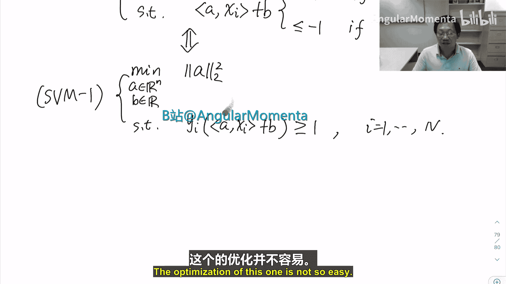

Though we maximize the margin just because we want this。Classifier is robust to noise。

Is stable to noise。But this staple to noise is only for the prediction stage we go back here。

We have this data come in。 if this data contains some noise， then。

This margin is just how severe should this noise be to make a misclassification。

So it is for the prediction stage。How about that？Training stage。 If in the training stage。

 we have some noise。Then。We may not be able to use this hyperplans to separate these two。

Because of the noise。-1 class and the plus1 class will be interlaced。S， V M1。Is not。Robust。To noise。

In training。可呀。Here is just a simple example。I have this kind of data。 This is class class1。

I have the blue data class minus one。But this is only for clean training data。In practice。

 we have some noise。 So then we may have some。Blue point。 That is perturbably。To here。

Some redors are also。Perturrbbed by noise to hear。So that's。This class plus one and the class minus1。

They are interlaed。So then we can find an linear classifier。2。Classify them exactly。

 no matter which hyperplane you choose， you can always have both。Blue and red do on both sides。

So in this case， any hyperplan。Can not。Separate。The two。Classes。Andally， just means that。

We don't have any A and B such that this constraint is satisfied。

In optimization terminology just means that the feasible set of this constraint optimization is empty。

 There is no solution to this minimization problem。No solution。To the minimization problem， S VM1。

Then。We needed to reformulate this S3M1。The idea is that we first reformulate this SVM1 into an unconstrained optimization。

In optimizationization。What we usually do is that we definey indicator function of the。

Constrain asscent。We define a function。I call this function H。This H maps R to R。Union infinity。

It's a generalized function。 It's。Rch can contain the infinity number。

 It can map a finite one to an even finite one。This H T is。Just defined。

 it is0 if t is larger than or equals to 0。Yve。T is smaller than 0 than it is just plus infinity。

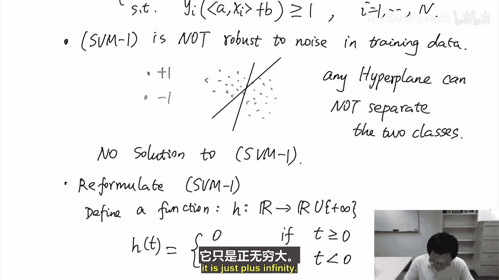

So this age is just。Indicator function for the set of all non negative numbers for non negative numbers is just 0。

For negative numbers， it's just infinity。So this is our T。This is just the H。

So then you can see that this H is 0。 If T is non negative， H is infinity， if this T is negative。

Then with this notation。Then， S VM1。Is equivalent to。Let's just go back to this constraint。You know。

 in this constraint， we want to Yi times this A X I plus B minus1 is larger than all equals to0。

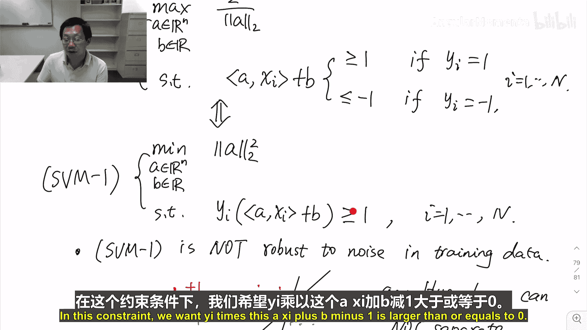

Then in this H function， T larger than or equals to0。 H T is 0。

 T is smaller than0 than this H T is just plus infinity。

This means that we don't want our T to be negative。We just allow our tea to be。Non negative。

 So here this Y I times A X， I plus B minus1 is non negative， is restricted to be non negative。

Then we just use this H applies to this。Y， I times a X， I。Plus B。-1， we apply H to this。

Which means that we restrict this one to be non negative。

 it is negative then this H is just plus infinity。And then we sum this up over all I。

And we sum this by this a2 norm squared。With do the minimization。Here。

 this lambda is just a positive number。Why this SVM1 is the same as this one。

 if some Yi times this one minus1 is negative。Then one term in this sumation will be infinitive。

And also， each term in this summ is just non negative。 This is also non negative。

 Since one term in this summation is infinity， So that all the term together is just plus infinity。

Of course， it cannot be the minimizer。So this function value is finite if and only if all these things are non negative。

Which means that all these constraint are satisfied。When it is finite， this term is just zero。

So it is equivalent to minimize this AE2 norm squared。Such that this is non negative。

So we just get an equivalent formulation of this S VM1。This formulation is very interesting。Actually。

This can be viewed as a data fittinging term。This can be viewed as a regularization term。

In the N regression。But different to the linear regression case， rigid regression in particular。

 in rigid regression， we we use a two norm squared as the regularization。 So here is the same。

 We just use the two norm squared as regularization。

But the data fitting term here is different from the linear regression case。

 In linear regression case， we just set the difference between this。The predicted。

I want to put to Anna there。Obsservve the output， then make the square by sum of the squares。

 but here， because we are doing classification， we use that a different fitting。Now。

 with this observation， with this reform， we can get a better formulation of S AVM such that it will be robust to noise in the training data。

 The idea is that we replace this data fitting term because this data fitting term is equivalent to our classification hyperplan should that。

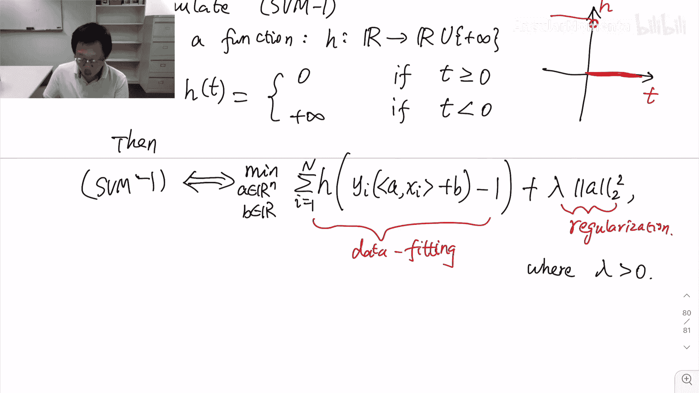

Classify those training data perfectly。But this can feel if noise is presented in the training data。

So this is too restrictive。Which means that this is too restrictive。Why it is so restrictive。

 It is just because in this age， if the constraint is not satisfied， we set it to。

Infinity is too aggressive。It's too hard。Then we just soften this。Infinity， we use a soft。

Version of this age。When this constraint is satisfied， of course， we said it's zero。

Because we don't need to penize it， it satisfies our expectation。We just want this one non negative。

 so it is non negative。 It's good enough。But when it is negative。

 instead of imposing this H to be infinity， we just。

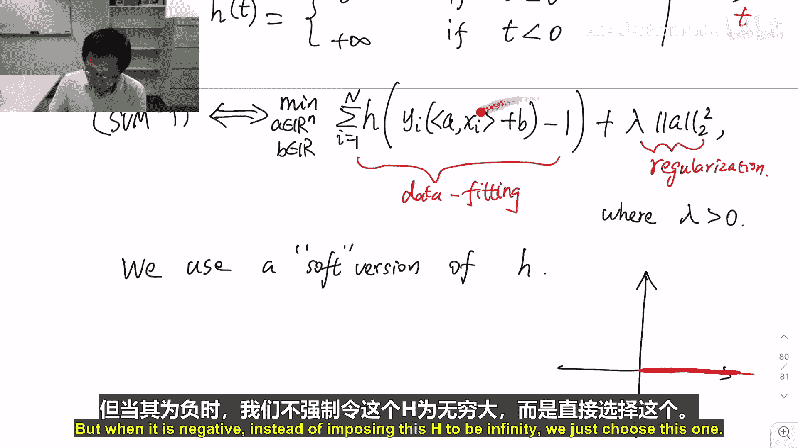

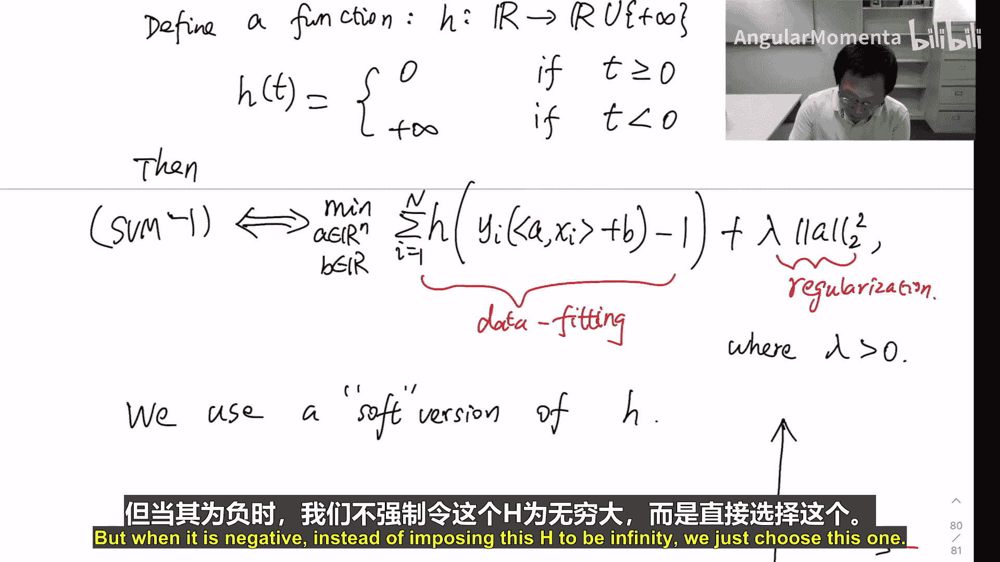

就是 this one。So if it is very， very negative。Then， of course， it is close to plus infinity。

 If it is just a little bit negative。Then we don't let it to be plus infinitefin。

 but a penalty to the error of the misclassification。

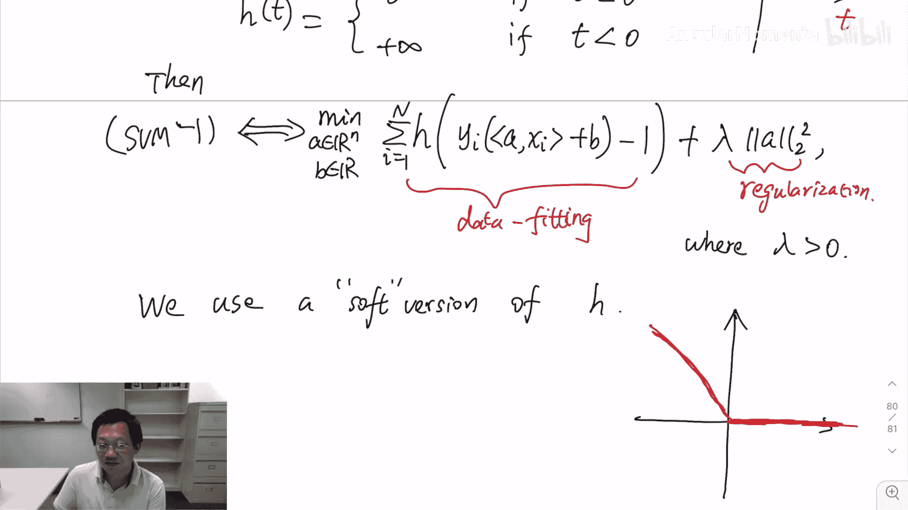

Then， this H T is just。Y。T is larger than or equals to 0。 It is just 0。 If t is smaller than 0。

 we just set it to the absolute value of T。

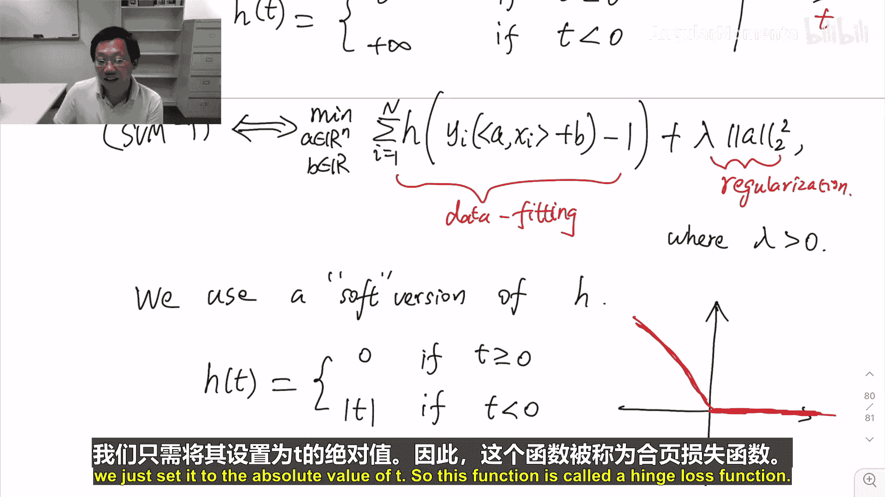

So this function is called a Heulos function。Because the graph looks like a hinge。

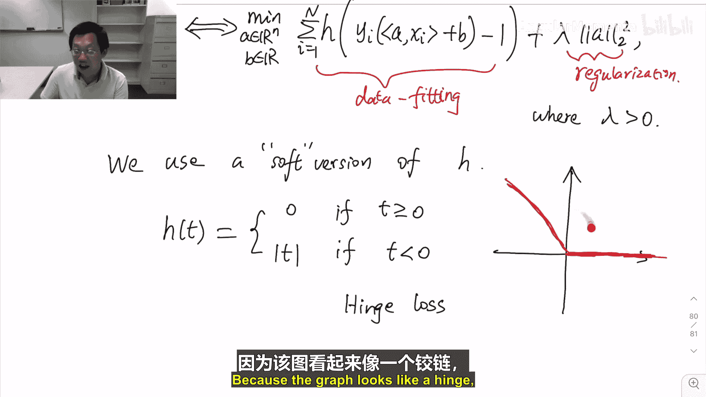

Then， we obtain。This minimization of this。A inRNB inR。

This is still the same sigma of I from one to n。H applies to Y， I times。A X， I plus B。-1。Plus。

 Nada a2 Nor squared。So this is called the SVM 2。Is a soft version of this SVM。

Sometimes we just call this one a softer margin asVM。

The difference between this soft margin S VM and the original SVM is just we changed H in the original SVM。

 We used this H。

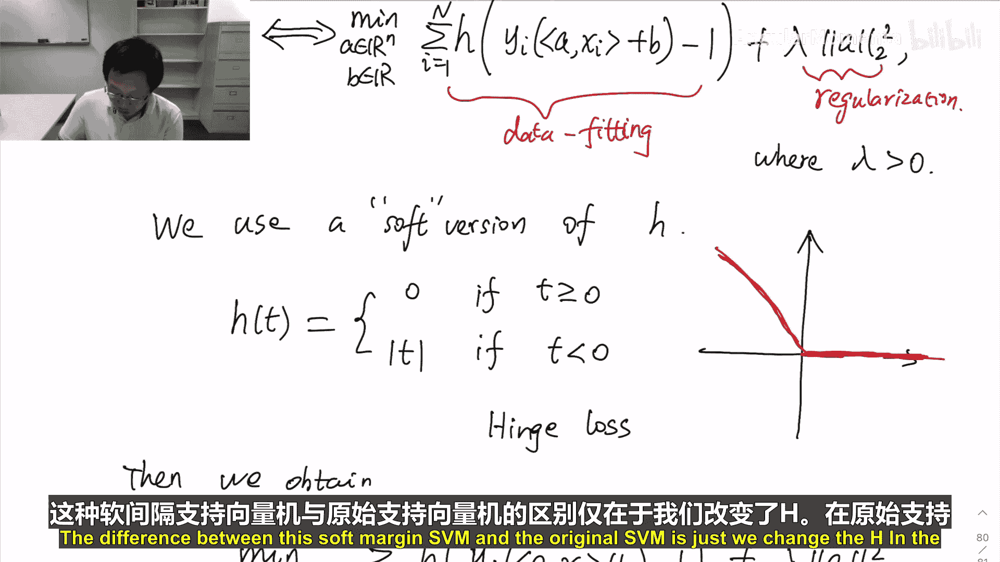

If the constraint is not satisfied， we just set it to plus infin so that this is strictly not allowed。

But in this software the margin SVM， we used。This penulos function。

So that if this one is not so negative。It is still acceptable， but， of course， we don't prefer it。

 But if this one is very， very negative。Then through the minimization of this function。

 you can see that we keep this one to be small， to be close to positive。

Then by minimizing this objective function here， this Y I times A X I plus B-1 will be close to this non negative。

If it is very， very negative， then this H。Will be very large so that we don't make this A at the B。

So then we just find an A and B， such that for many of these Y I。

 this is non negative for some of this I， it is negative， but not too negative。

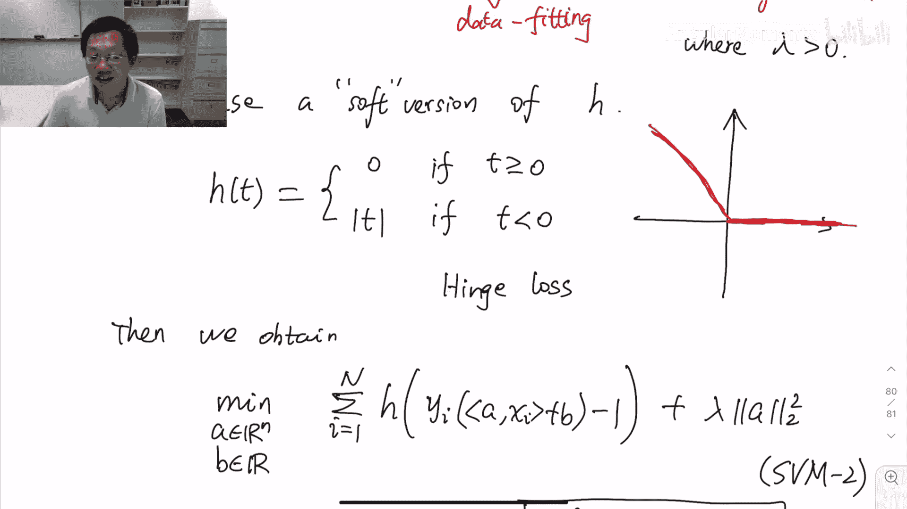