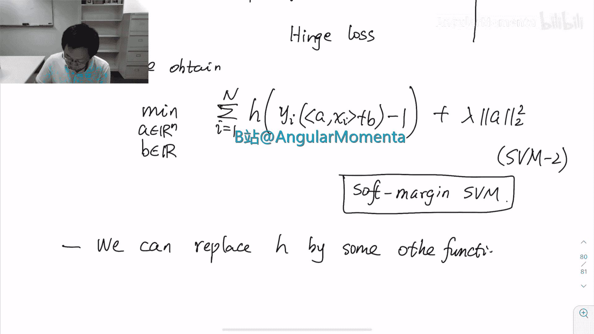
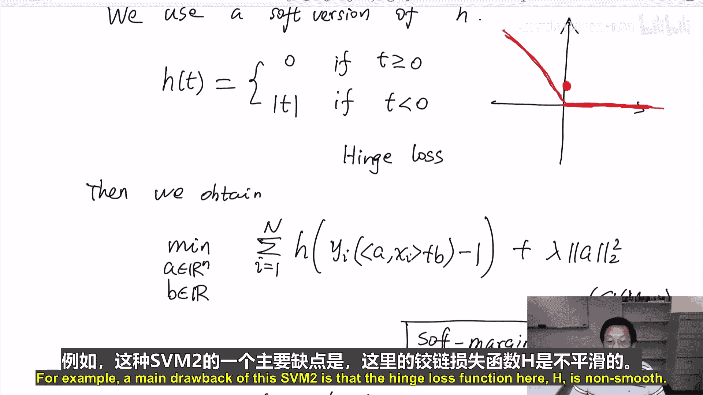
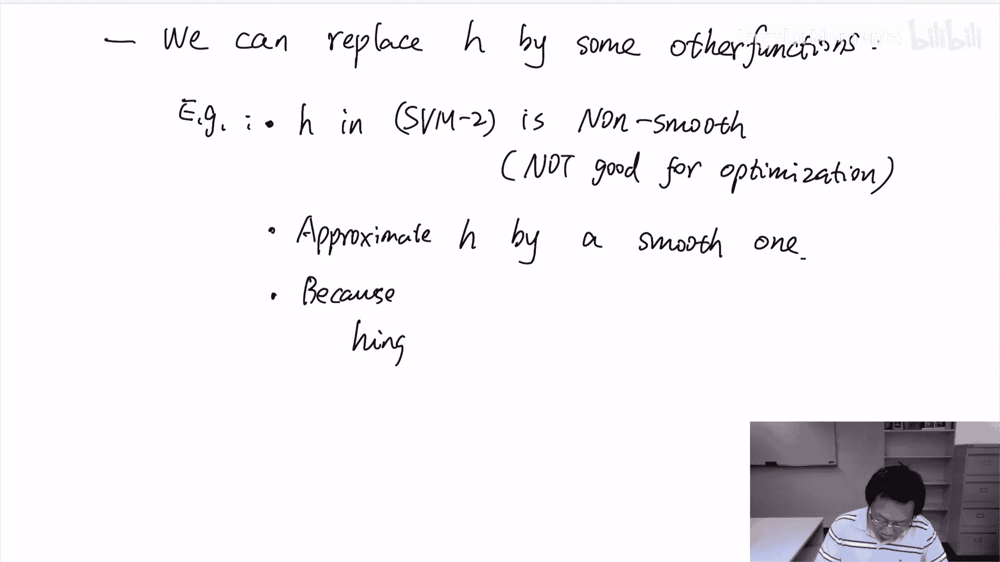
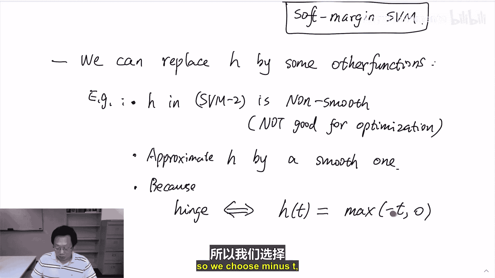
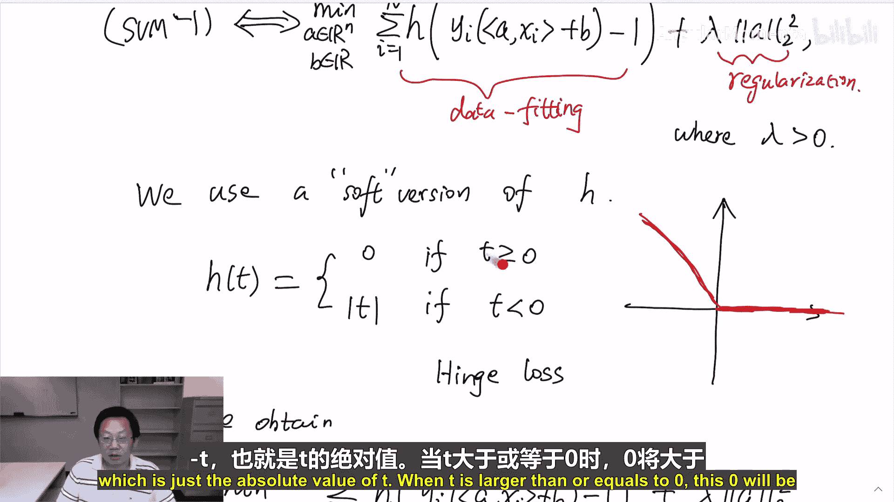
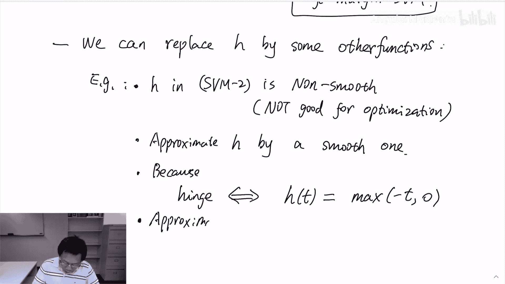
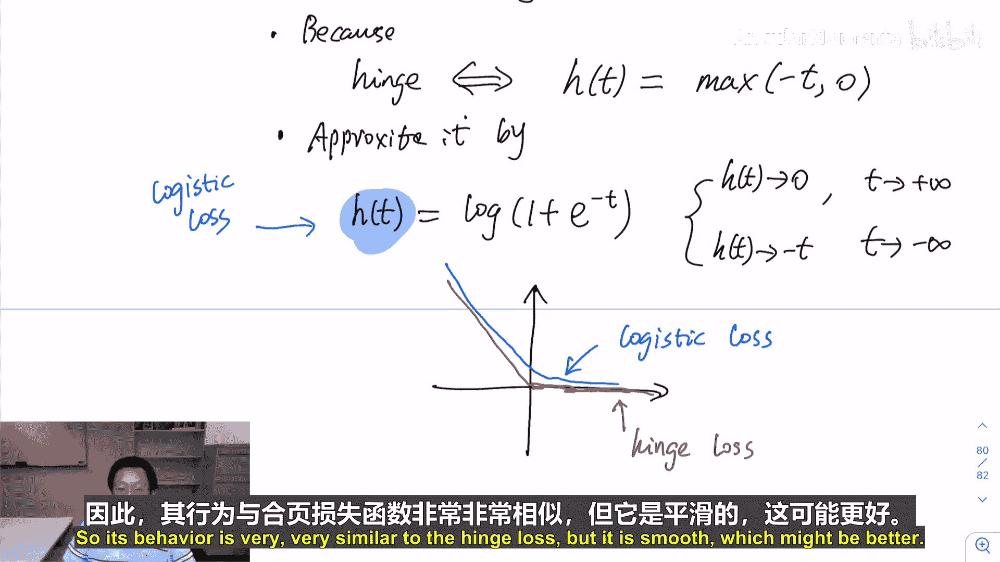
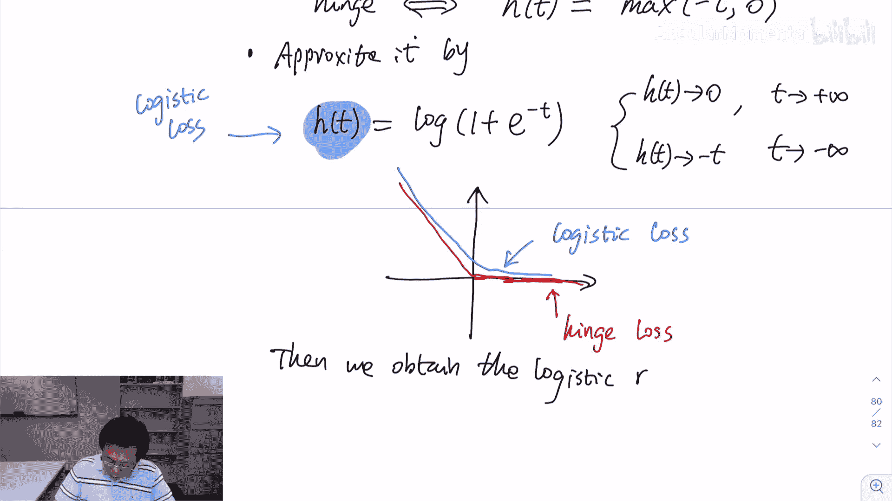
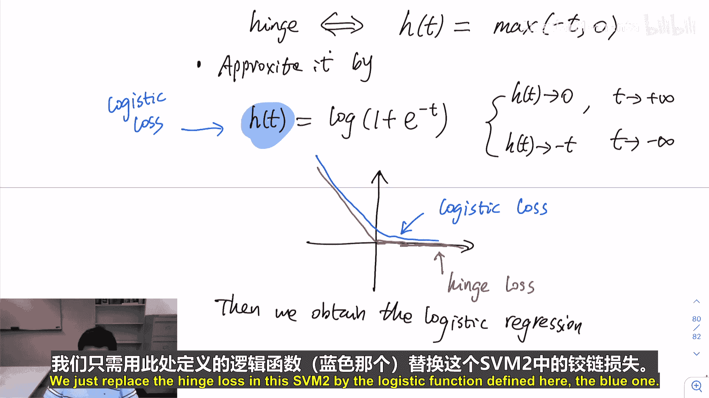
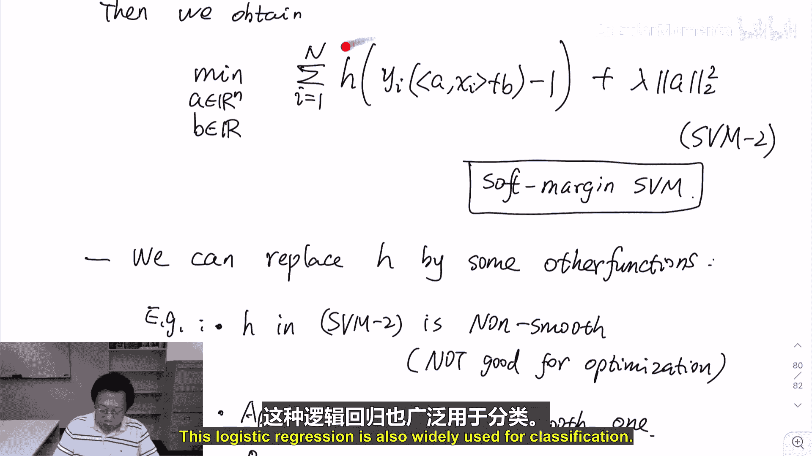

# 【香港科技大学】数据分析的数学方法 ｜ Mathematical Methods for Data Analysis p62 12-04-02-视频 -BV1DEFDzGEZW_p62-

Indeed， we can replace H by some other functions。

For example。A main drawback of this SVM2 is that the Hnge loss function here H is non smooth。

There is a sharp corner of this function， when t equals 0。If this happen。

 then the optimization algorithms for this SVM2 will be very difficult。

Many algorithms like the grid in the decent will be very slow because of this。Sharp corner here。

Then in order to improve the computational efficiency， or for some other reasons， we need to。

Have a smooth loss function here。We need to design a smooth edge here。H yin。S V M 2。Is non smooth。

It is not good for optimization。So we approximate this issue。By a smooth function。

We just approximate this function， this hengeos function by a smooth function so that there is no corner in the curve of the graph of this function。

Let's see。 how to do that。Smooth approximation。Because。This henge loss function。

It is the same as。We can rewrite。This h。This Ht is the same as the max of this。Minus t and 0。

So you can see when this t is smaller than all equals to 0， minus t will be larger than zeros。

 We choose minus t， which is just the absolute value of t。 When t is larger than all equals to 0。

 this0 will be larger than minus ts， we choose 0。 So this H T in the henge loss。

Here is exactly written as this one。Then for this one its a max， we can use a soft max approximation。

By we define a function H of T equals log of1 plus exponential of minus t。

You can see for this function， when T approaches。Plus， infinity。

Then this term will goes to 0 so that this log1 is just one。 So this H of T approaches 0。

When T goes to minus infinity。This will be very， very large。

 It will dominate this one so that the1 plus exponential minus t is just exponential minus t。

 Then you take the log， you get minus T。 So this H T approaches minus t。 asymptically。

 it is just similar to this minus T。 The graph of this H T。

 this new H T will be like its a smooth function is a very， very smooth function。

This is our Angelngeos function。For this smooth function。

 when t goes to plus infinity it just goes to0 when t goes to minus infinity just goes to minus t。

 So the asymptical behavior of this H T is the same as the Angelos function。 Gally， it is just。

A smooth approximation to this angelus function。Blue is just this new h function。This function。

 we call it。The logistic and。Loss function。So that this is just the logistic。Cl function。

The advantage of this logistic function is that it is smooth。 It is convex。AndBut asymptically。

 it is just the same as the hengeloos， so its behavior is very， very similar to the handngeloos。

 but it is a smooth。

Which might be better。Then， we just obtain。Their logistic and regression。

We just replace the handlos in this SVM2 by the logistic function defined here， the blue one。

 then we just get the so called logistic regression here。

This logistic regression is also widely used for classification。

