# 【香港科技大学】数据分析的数学方法 ｜ Mathematical Methods for Data Analysis p63 12-05-02-视频 -BV1DEFDzGEZW_p63-

All the SVM formulations mentioned above are just linear models are linear classifiers。

We used the hyperplanes to separate points in different classes。

They will not work for those nonlinear data， for example。We have a plus one class here。

And we have class minus1 around class plus one。For this kind of data。

 the S VMs will not work because。No matter standard SVM， soft margin SVM and logistic regression。

 they just use linear functions， they just use hyperplans to separate the data。

 but here the boundary between class1 and class minus-1 are obviously a circle。In this case。

 those SVMs， those linear SVMs just does not work。Then we have to go down linear。

Similar to the K meanss to kernel k meanss， similar to the linear regression to kernel ridge regression。

 we go the kernel trick。We studied the kernel SVM。Which means that we go long linear。Classifiers。

We just apply the linear SVM in the transform the domain。

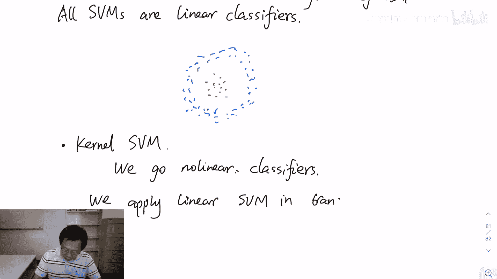

In particular， we first do a transform， transform the input data to the feature domain by the feature transform file。

Here， Phi is just the feature transform that maps the input data in R N。To the。Feature space H。

 which is a hereless space。This hairboard space is universally infinitely dimensional。

Then we apply S VM in the。H domain， we apply。SVM in H。To the data。 now the data will be。5hi x1。Y1。

In RN， the data is just X1， Y 1， but now that X Y is transformed by the feature mapping。

To the phi x1。And the Su on。5hi x capital n。Why cap。Again， similar to the regression case。

In the linear regression models in R， we actually used fine functions for the regression。But。

In the non nonlinear kernel rigid regression， we used the only linear functions。

Instead of a find functions， because a find functions in the feature domain is not necessary。

 otherwise， we can create a new feature transformation by adding one extra coordinate to find to get a new feature transform。

 then under this new feature transform， we just need to use linear function。Here。

 the situation is the same。 We just need to find a linear function in H for the classification。Then。

 we find。Just a vector in H， because any linear function in H by race representation theorem is an inner product。

So should that。We minimize that function。That is similar to the linear SVM case。Sigma I from1 to N。

 we have this H loss function。Applies to Yi times that。Function value。

That is a now the input is just a Phi X。Now we don't have a B here。

 we have only a because we use the linear function in H。

-1 plus the regularization lambda a the H norm squared。Here again。

 because we are in the hereput space， so the regularization is the norm。

In the hip was space under the Ben Square。Our A is just in H。

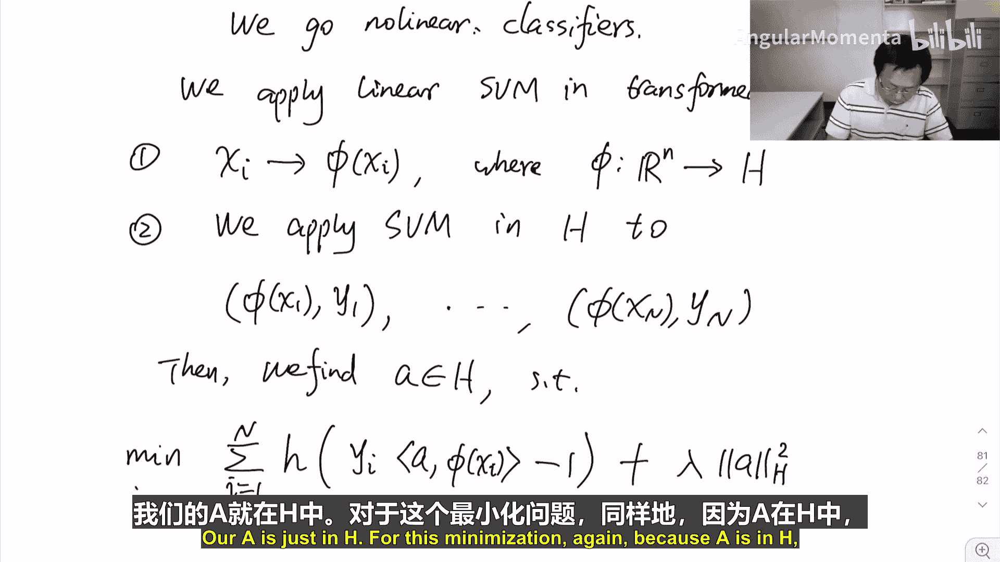

For this minimization， again， because a is in H， H is usually infinitely dimensional。

Then in order to parameterize this A， we need infinitely many numbers so that this minimization is just impractical。

Also， in this formulation， we needed the inner product in this H space explicitly。

 and we need these Phi transforms explicitly。 We need this H norm explicitly。

 So all those things we don't like。Again， we have the Re theorem here。To see this。

 we first again do an orthoology composition of A。This is a， and we orthogonally decompose it to。

This one。Plusas， this one。This is just the sigma of C5hi Xi。I from one to an。This is just the A。

So a is decomposed as A S plus sigma I from  one to。N C， I，5hi X， I。Where。

This ASS is just orthogon Phi X。For all I from one to end。This a is decomposed orthoally， onto a。

Linear combination of P X， I and A S， A S is just orthogonal to this linear combination。Now， our age。

Y I。A Phi X， I。us1 sigma i from 1 to n plus lambda a H norm squared is rewritten as sigma i from 1 to N H of this Y I。

 Now A is replaced by the decomposition A S plus sigma i from 1 to N C， I Phi X I。On the Phi Xi。

But now this eye is used for the outer sum。 Here， This eye is for the inner sum。

So I should use a different index for this I in the inner I。 I use J。

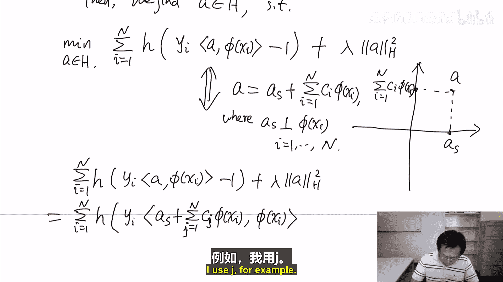

-1。Cl lambda， this a is again replaced by the。Decomposition J from1 to N， C， J 5， X， J。

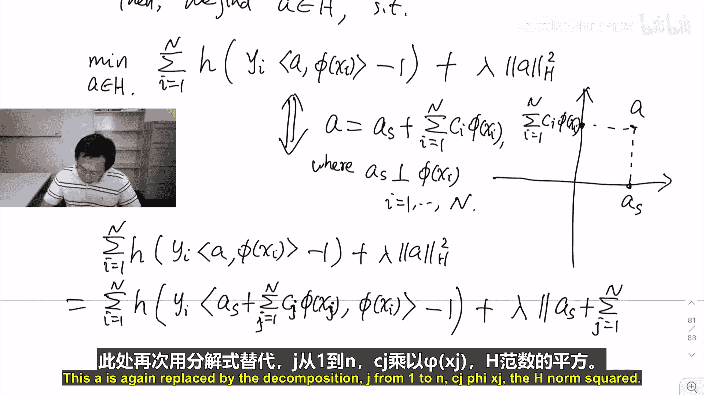

The ancient norm squared。By expand this inner product under this inner product here， we just obtain。

Now， this AES innerner product with5 X I is just 0。Sigma J from one to N， C J。Of this Phi X J。5hi X。

 I。in-1。plス 남だ。Here we use the Pythagoras theorem。A S the H Nor squared。唔识噶嘛？J from one to n。四。I X J。

A on square。We further expand this H norm squared to a double summation。Sigma J1 equals1，2， N。

 sigma J2 equals1，2 N， C， J1， C J2。5 x， J1。5 x， J 2。And then we just replace。This term by this term。

I would also like to move。This term。To the last。We just to obtain this。Now， to simplify the notation。

 we introduce the matrix K。Which is just the5 X， I。5hi x J。J， from one to capital N， it's a。

M by M matrix， this is the kernel matrix。

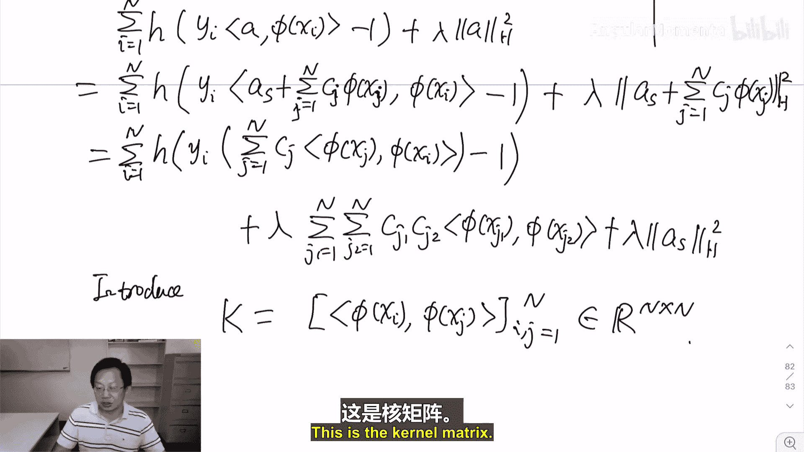

Then with the kernel matrix， so that this is further simplified the sigma i from 1 to N H applies to Yi times。

Similar to the kernel rigid regression case， this sigma C J Phi X J phi X I。

 this one is just K transpose C， the I component of this K transpose C。

I use this notation to denote the I component of K transport C。-1。Plus， lambda for。This term。

It is just a quadratic term of this K matrix and this C vector。 It is just C transportpose K C。Plus。

 this is still the A S H squared。Which we cannot simplify by the kernel matrix。

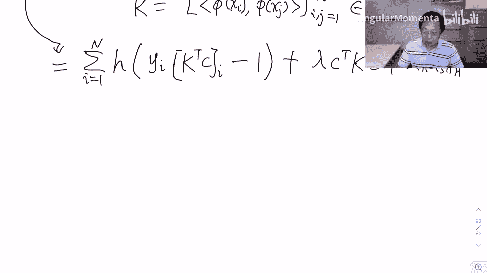

Now， again， we need to minimize this objective function in the vector C and A S vector。

 And this A S is just orthogon to find X I。We want to minimize this function。Yin。Vor C in R。

 N and vector A S in H。 And this A S is just authority to5hi X I。I from 1 to N。Of this function。

Again， just similar to the trick we used in the kernel region regression。

 We just temporarily drop this constraint so that this minimization will be equivalent to。

The minimization of this on C and this on AS separately。And for this one， definitely。

 the minimizer is just zero。

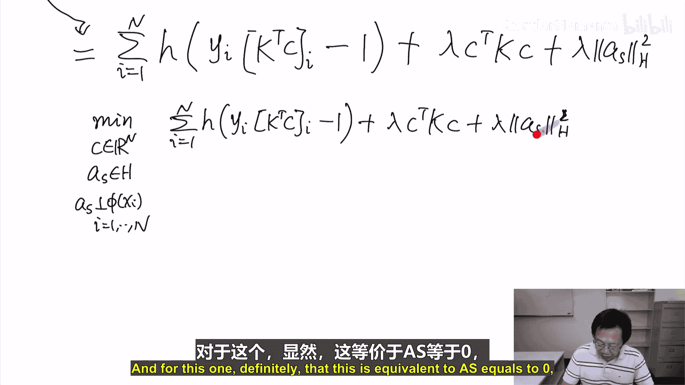

Then we obtain that this is equivalent to AS S equals to 0。And this sea star should be the Ar。

Of this。ミニマ士。So from here， we just see that's the solution of KSVN。

Is just this a star equals a star plus sigma C5hi X I。 now AS star is0。

 and the C star is given by this just a sigma i from 1 to N C star phi X。

This is just a Re theorem for the Colel SVM。We just proved that this a star must be in this form。

 must be a linear combination of this5 X I， where this C star is just obtained by this minimization。

So again， from here， you can see we can apply the kernel trick。

 We just needed to first to define this kernel matrix， which involves only the。

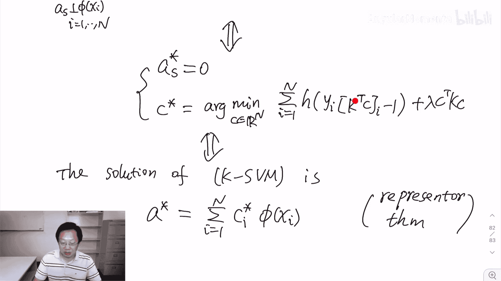

In the product of5 X， I and5 X J。So then instead of define this Phi and the inner product explicitly。

 we just define this to be a kernel function， this inner product of Phi X I， Phi X J to be K X I X J。

Then we can obtain C， Then we can obtain this A star。

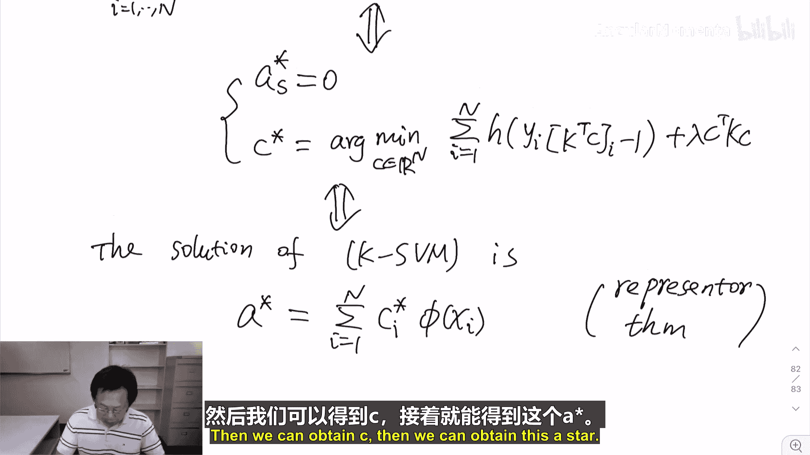

So the full algorithm of the kernel SVM is。We first define the kernel function， define。啊， kernelel方形。

K X Y。This K， X， Y is。This K， X， Y equals to the inner product of5 x5 y。For some。5 from R， N to H。

This is easy to be satisfied because。We have the Mercers theorem。

 the Mercers theorem tells us as long as this K is a so calledled symmetric positive semi definite。

 then we must can find a fact such that this is satisfied。For example。

 we can choose the Gausin kernel。We can also choose the polynomial kernel。Once we have the kernel。

 then we just form this kernel matrix in this minimization。

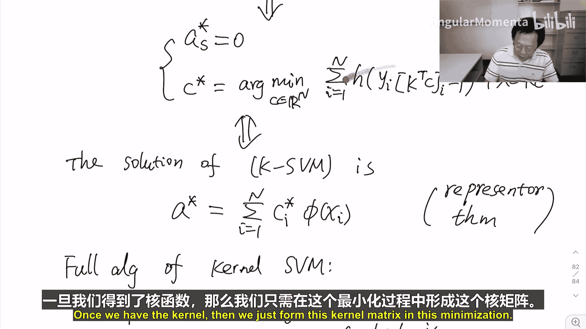

K equals K X， I。Exe chair。I J from one to an。This matrix is easy to form because here we have the function K now。

 X I and X J， they are just the input data。So this matrix is easy to obtain。

 then we just solve this C star。By this way， is the argument of。This optimization。Once this。

C star is solve but then we just get the classifier function。It is just。

Given because our classifier function is eventually applied to X in R N。 So given x in R N。

The classifier function will be the in product of this a star。

 The A vector found in the feature domain。To the phi x here。Just this a star applies to phi x。

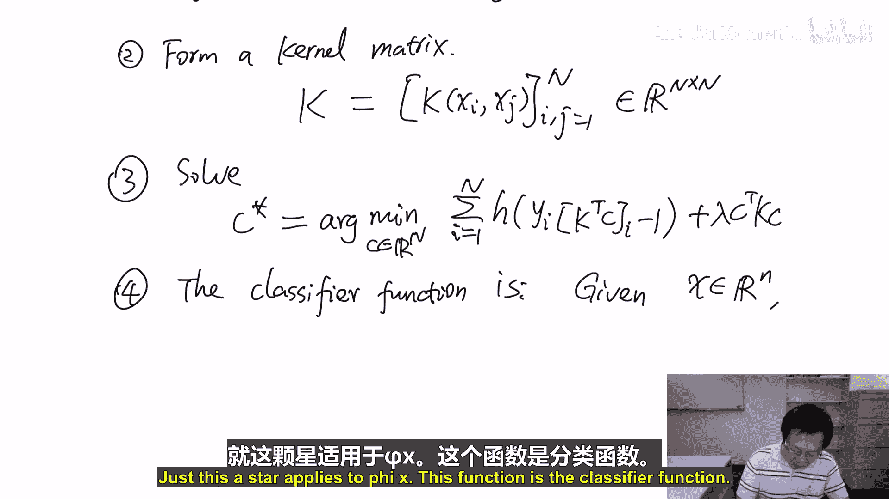

This function is the classifier function。It's a non nonlinear function on X。

 iss linear in the H domain， but。For this X input， it is non nonlinear。In this form。

 it is still not computable， but we know that this a star is in this form。So， it is。Sigma I from 12。

 N， C， I star， Phi X， I。5 x。This is just the sigma I from1 to N C I star。5 x。5 x。

In this classifier function， it involves only the inner product of Phi and file。

This is exactly our kernel function， do。

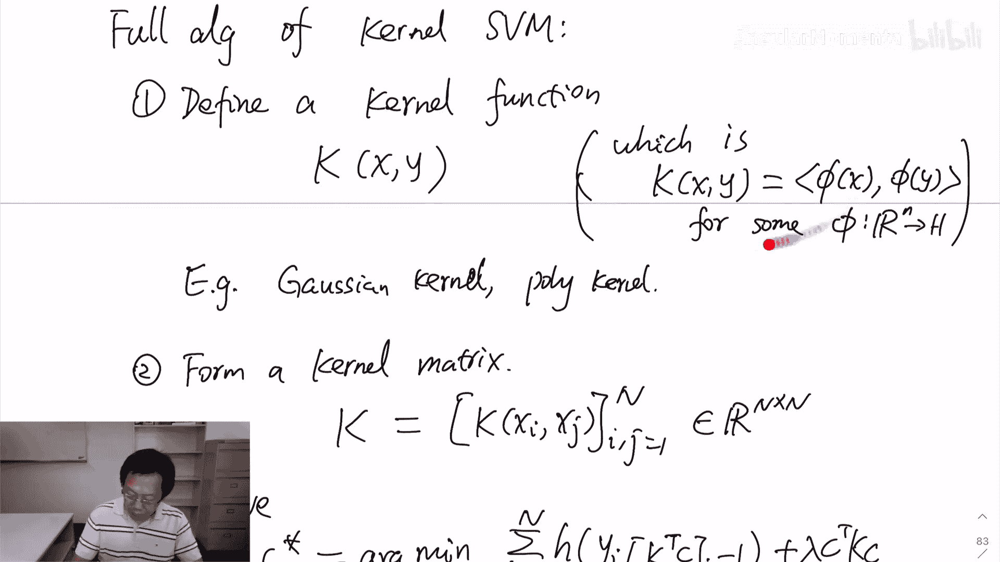

Then it is sigma I from1 to N C， I star。K of X， I X。Given this new input X under them。Existing。

X I in the training data set， this K， X， I X is easily computed。

By just applying this kernel function here。

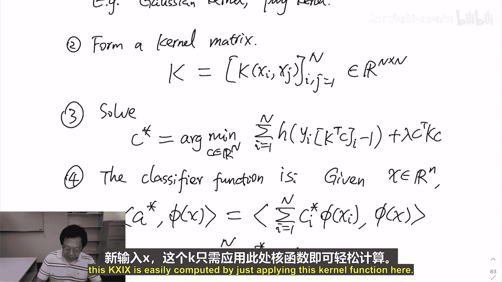

And this CI star is obtained here so that we can get this our final nonlinear classifier function just computed in this way。

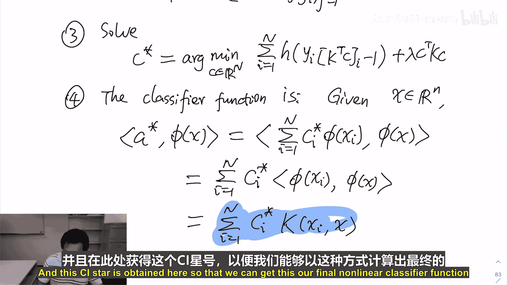

This is the full kernel S VM algorithm。 You can see it's just very similar to the the kernel ridge regression case。

 The only difference is that in the kernel rid regression。

We used this list square as the data fitting term。 But here in this。

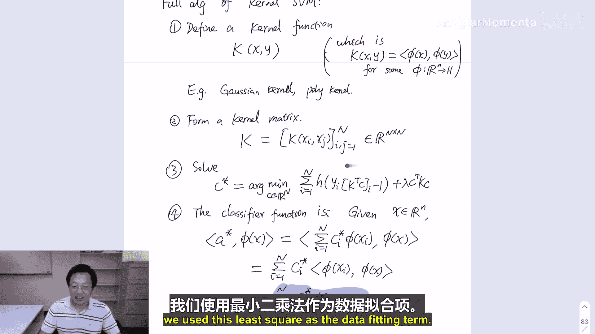

Colonnal V SVM， we changed the data fitting。You use the standard SVM。

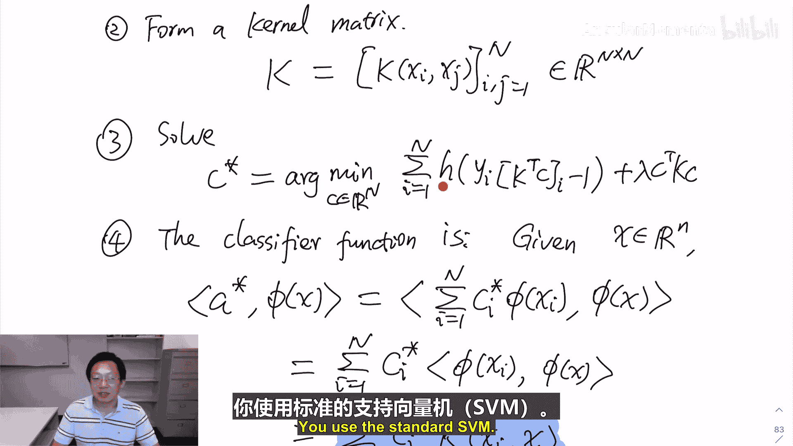

You just use this H， the indicator function， either0 or plus infinity。

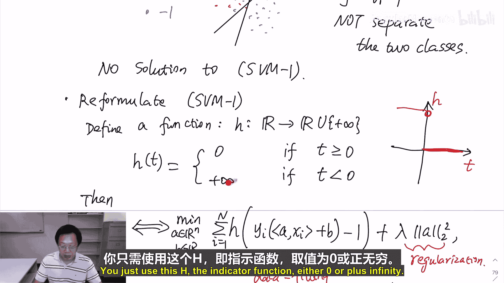

If you use the soft margin SVM， you just use this Hus H。If you wanted to use the logistic regression。

 then you just use this H define in this way。

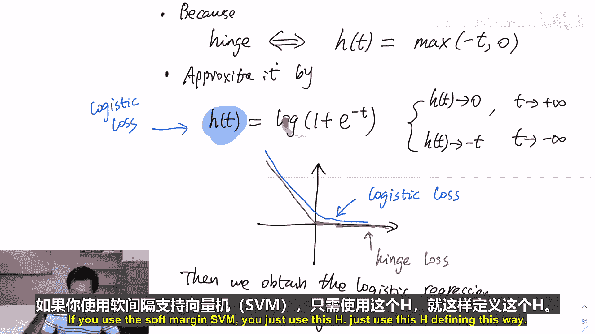

So the only difference of this kernel SVM to the。Currentlonnal rid regression is that we have a different data fitting term。

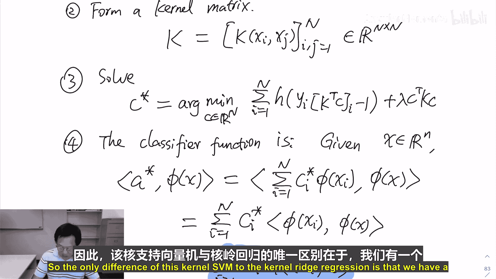

The regularization term is still the same。The whole procedure is just exactly the same。

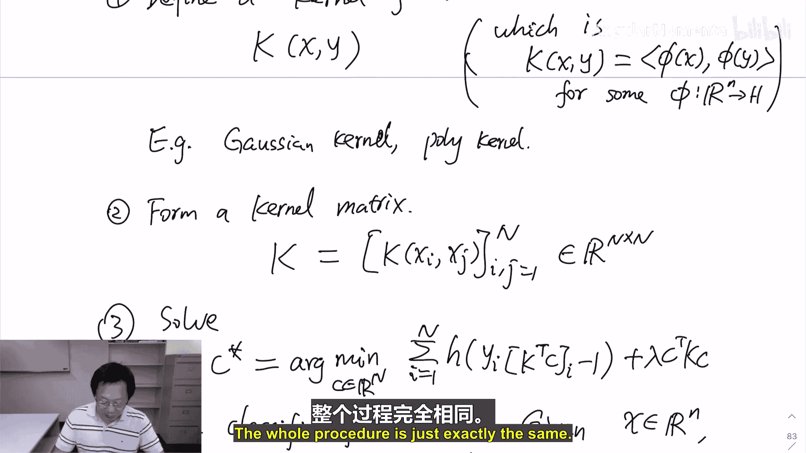

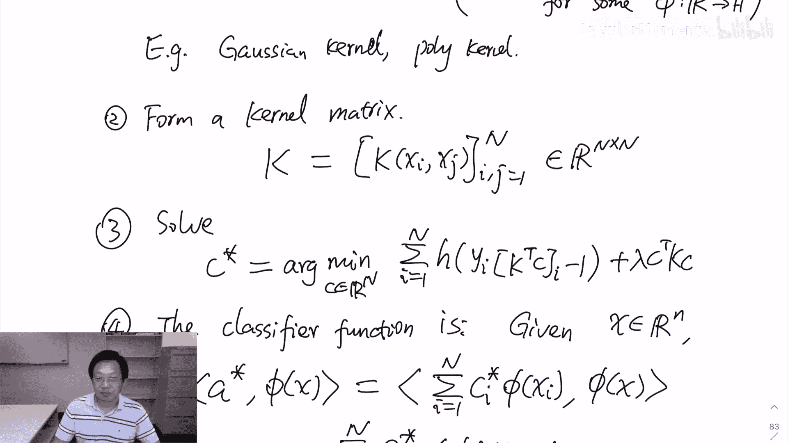

With this kernel SVM， then if we apply it to the curve data here。

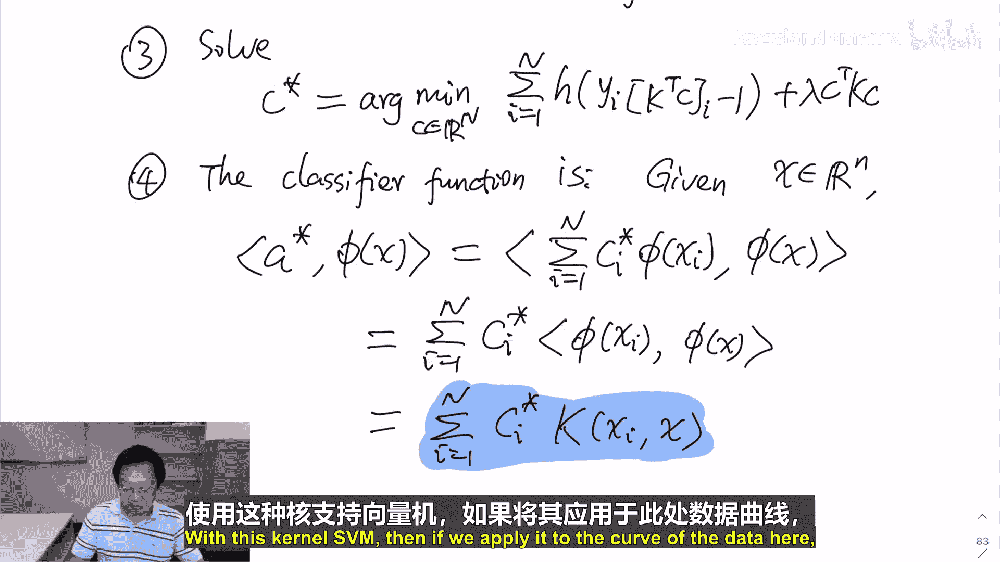

We will see that indeed， we will find a function。That separate this to data set。It will be a curve。

From this， you can see that this classifier functioning depends highly on this X。This curve。It is O。

 X such that this classifier function sigma I from one to N C， I star K of X， I， X。Equals one。

And this curve， it is just this X classifier function， C， I star K， X， I。E equals minus1。

Because this k is non nonlinear so that this function is non nonlinear。

Since it is non nonlinear the level set of this function， it is just a curve。

The one level set and the minus one level set， they are just the curves。

So we use the curves to separate two different classes。

Then we get us a successful nonlinear method for classification。

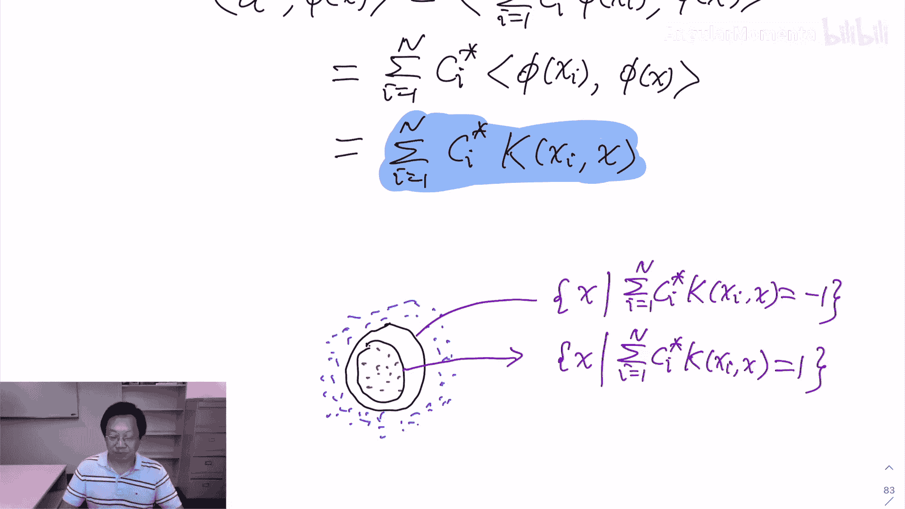