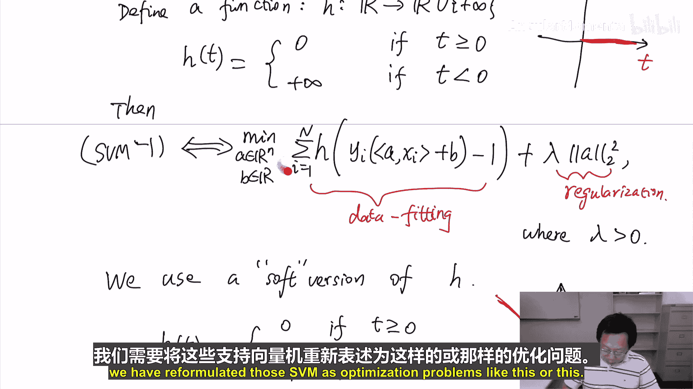
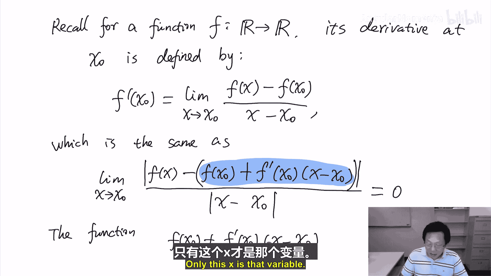
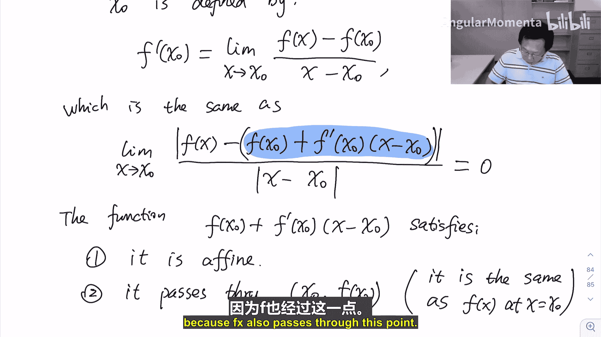
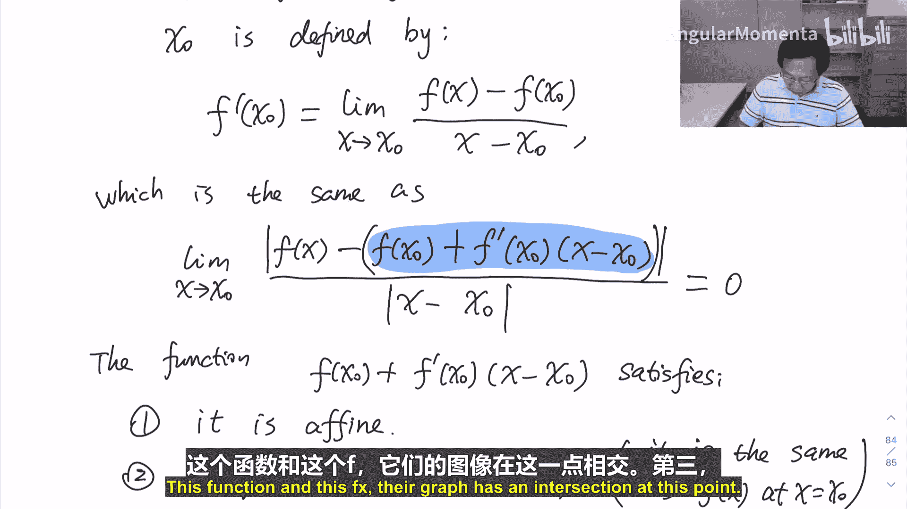
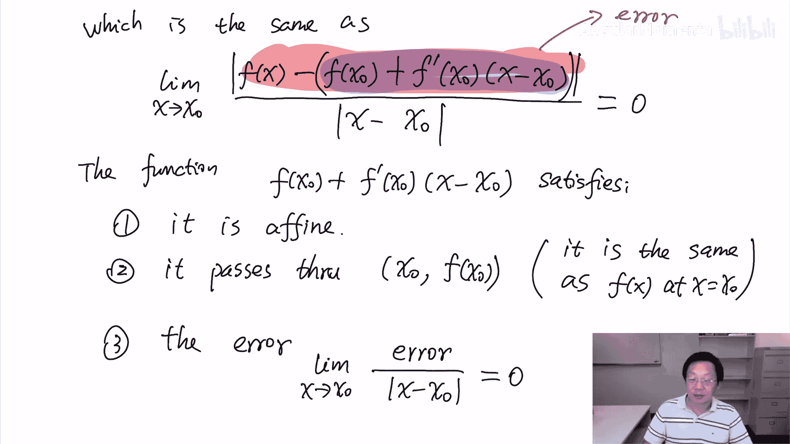
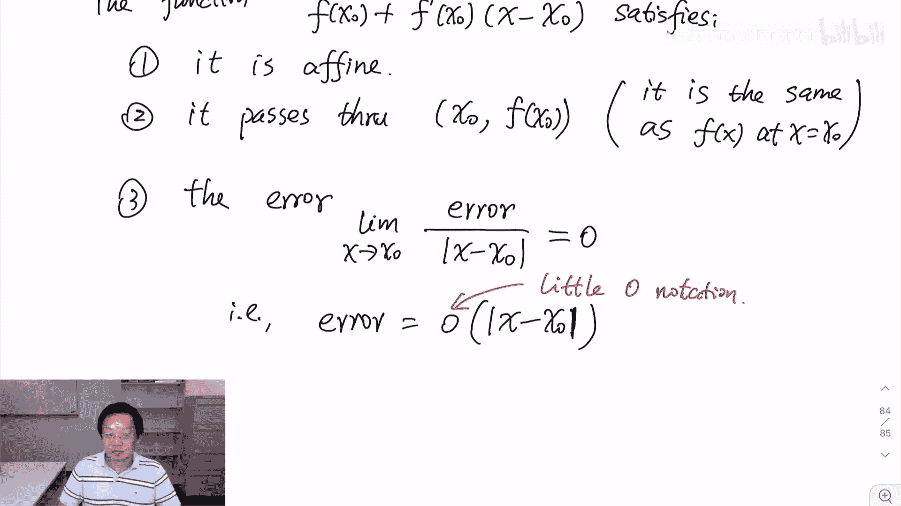

# 【香港科技大学】数据分析的数学方法 ｜ Mathematical Methods for Data Analysis p64 13-01-02-视频 -BV1DEFDzGEZW_p64-

We have studied linear and fine functions on vector spaces。

 in particular for linear functions on Hubal spaces， from Ri representation theorem。

 we know that any linear and bounded function on the Hubble space can be represented by an inner product。

And we have also successfully applied the linear functions for regression and classification。However。

 under many other situations， we still need to use long nonlinear functions。For example。

 in regression， in linear regression， we apply the linear function for the regression task。

And in the classification， we use the linear function to obtain the support vector machine method。

Though those two methods can achieve good results in many applications。

We sed wanted to improve their performance。Recently。

 people just consider those nonlinear functions produced by the neural network。

For functions produced by neural networks， they are just highly nonlinear。

They are just a class of special designed no nonlinear functions。This is the so called deep learning。

Now we know that deep learning is the main driven force of the recent dramatic development of the artificial intelligence technology。

Moreover， even for those linear models such as the SVM。If we wanted to solve the SV I model。

 we have reformted those S V A as optimization problems like this or this。

Here， this objective function in this optimization is just non nonlinear to this A and B。

Though we use the linear model here， but because this h function， the loss function is non nonlinear。

 it's not the sum of the squares。This is just a non nonlinear optimization。

So those long nonlinear functions arise also。In the optimization problem in linear models。

For these two purposes and for more reasons， we needed to learn nonlinear functions。In the foey。

 we will study long nonlinear functions on vector spaces。We will。Go to the linear approximation。

Of non nonlinear functions， this is also known as the differentiation。

The simple idea is that we approximate those nonlinear functions by linear functions。

 but if you just think about the quadratic function。

If we wanted to use an linear function to approximate it globally， it seems impossible。

Because no matter which linear function you use， you can see that there is a big difference between this linear function and this quadratic function。

So this linear approximation is only done locally。Which means that we just consider a small neighborhood of some point like here。

Now you can see that it is possible to use a linear function to approximate it very well。

This is the differentiation。Let's start with the differentiation of functions， from R to R。Recorll。

For a function。F。From R to R。It's derivative。Atter。And to some kind say x not。Is defined。Ae。

Usually in calculus， we define this F prime at x0 by a limit。

By consider the ratio of the difference in function values over the difference in x。

The difference in function values F x minus X X 0。Divided by the x minus x 0。We let x goes to x 0。

This is the usual definition of derivative of a single variable function at x not。Now。

 I would like to reformulate this definition from the linear approximation point of view。

For this purpose， we need a first to reformulate this definition。This definition is。The same as。

I will move this F prime x0 from the left hand side to the right hand side。

Then we get an limit equals to zero。Limit x approaches x 0， F， X minus F X 0。

 minus F prime x 0 times x minus x 0。Divided by x minus x 0 equals 0。

If I add an absolute value function to both the numerator and the denominator。

 this is still true in particular。I also rewrite these two subtractions by the subtraction of the summation。

Then。Let's focus on this term。This。Smation can be viewed as linear approximation。

To this function effort。Let's see some properties of this function。The function。

F x 0 plus F prime x 0 times x minus x 0。Now， this is a function of X。 X not is given。

 So this is a constant。 These are just a constant。 Only this X is the variable。

This function。Satisf。First of all， this function， it is an a function。That's quite obvious。

 It suggest F prime X0 times x plus a constant。And， secondly。If we set x equals x0。

 then this function is just Fx0。Which means that the graph of this function passes through。

This when x equals x is0， the function value is f x0。So this means that。Its。Is the same。

As this F x at x equals x 0。Because Fx also passes through this point。

This function and this FX their graph has an intersection at this point。

Thirdly。This error。We use this fine function to approximate Fx。Now。

 this difference will be the error。This equality just give us a quantitative description on how large this error is。

This equality just tells us that the limit。When x approaches x0， thearrow。Divided by x minus x0 is0。

This just means that。The arrow。Is a little O of this x minus x 0。Here， I use。The little of notation。

When I writearrow is the little o of x minus x0 the absolute value， it just means this one。

 they are the same definition。Do not confuse this little O notation with a big O notation。

 Big O just means that this limit is bounded by a constant。

This little O just means that this error compared to x minus x0 when x approaches x0 is neible。

It is even smaller than this one。It is even smaller than x minus x0。

Its order is just lower than x minus x0。

