# 【香港科技大学】数据分析的数学方法 ｜ Mathematical Methods for Data Analysis p66 13-03-02视频 -BV1DEFDzGEZW_p66-

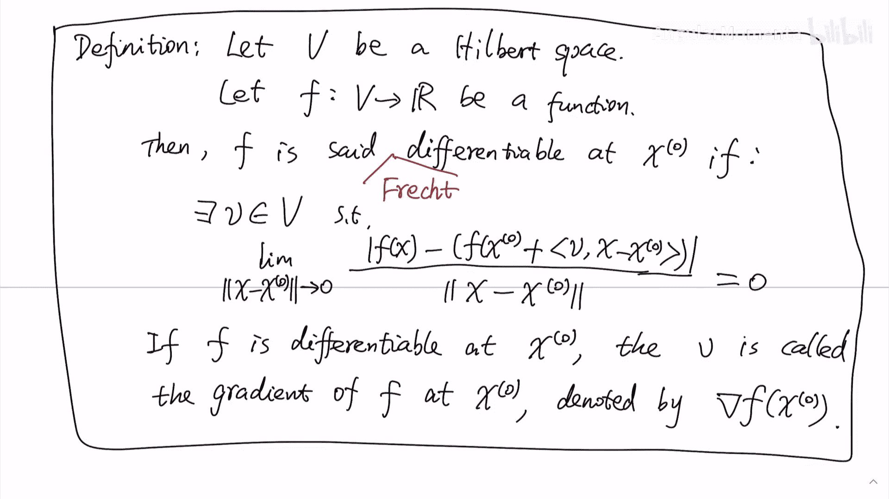

Let me give you some examples of fresher differentiation of functions on here spaces。

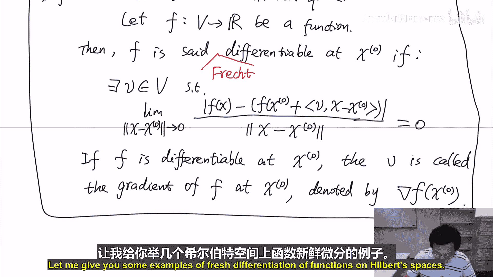

Example  one。We consider the function F of x equals x norm squared where。Nor。Here is the norm。

Only be induced by the inner protector。We consider at any x 0 at V。Now。

 we would like to use a fine function to approximate our F of x。And for X， it is。X norm squared。Then。

We want to use a function in the form of this， to approximate our F。

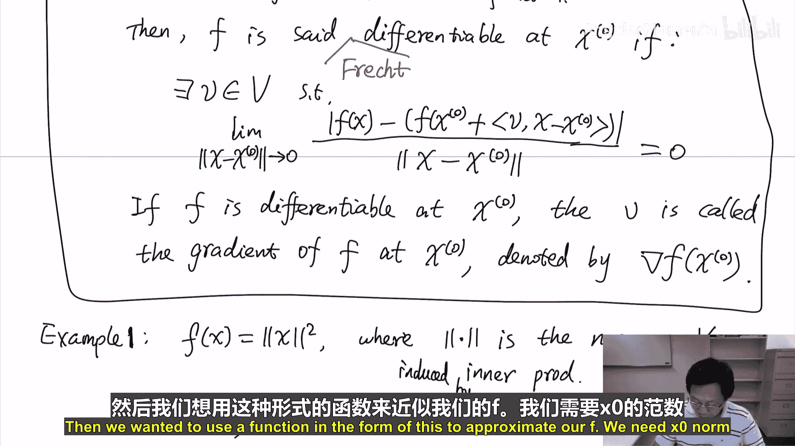

We need an x0 norm squared。We just have x0 plus。X minus x 0。Norm squared。

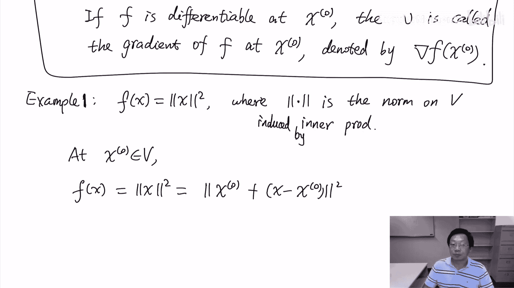

We expand this norm squared。 It equals x 0 norm squared。Class。X minus x 0 norm squared。

 And we have a cross term， which is2。X 0， x minus x0。This x0 squared， it is just f of x 0。Plus。

 now for this one， it is almost in the form of this。It is。2 x 0， x minus x 0。Plus。X minus x is0。

 Nor squared。Here you can see we are almost in this a fine function approximation plus the error。

Forum。This is the constant term。 This is the linear term。 So we have the error like this。

We just consider how large this arrow is， then we consider the limit。X minus x 0。Approaches 0。

We consider this arrow， F x。Minus F， X 0。Plus。2 x 0。X minus x is0。Divided by x minus x0。And one。

Obviously， this limit x minus x 0。Approach is 0。X minus x0 then warm。Now。

 this difference is just this term。Squaquid。Then the numerator and denominator can cancel this x minus x0。

Norm。It becomes this canceled， this canceled。This is just the ni of。X minus x0 norm approaches0。

 x minus x0 than norm。

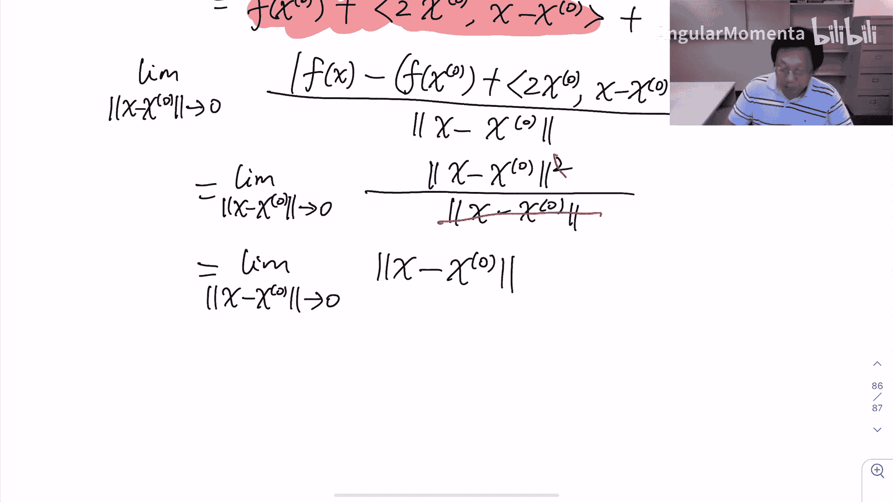

Which is， of course，0。Therefore， if we treat this as the a Phi approximation to Fx。

 then this arrow term is just a little o of this x minus x0。

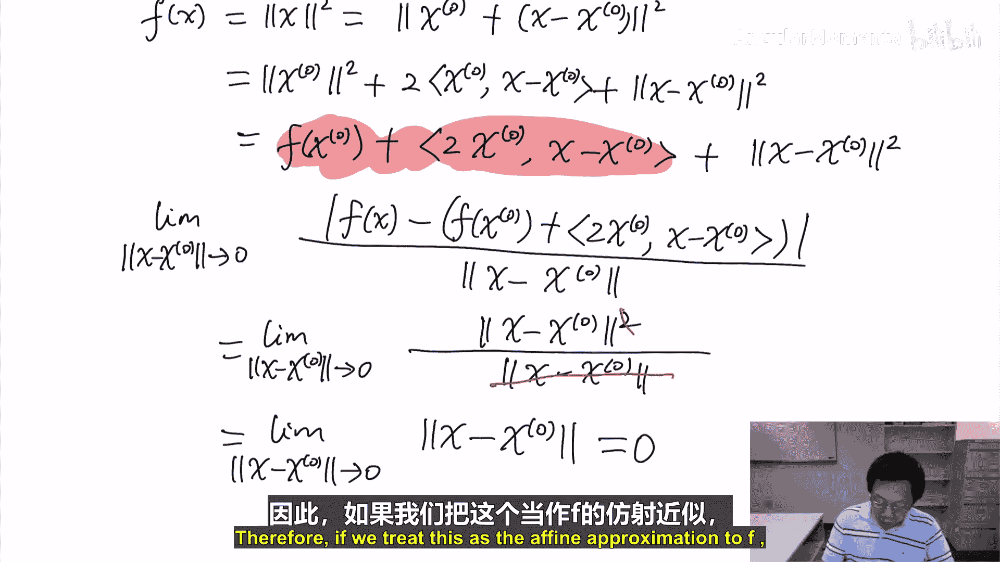

The norm， because this limit equals 0。

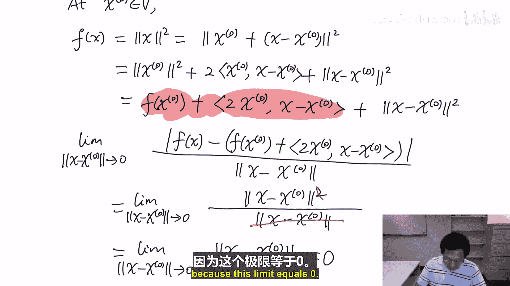

Then the vector here in blue is the gradient。Its just two times x to zero。Or if we replace x 0 by x。

Griient F at x is just 2 x。

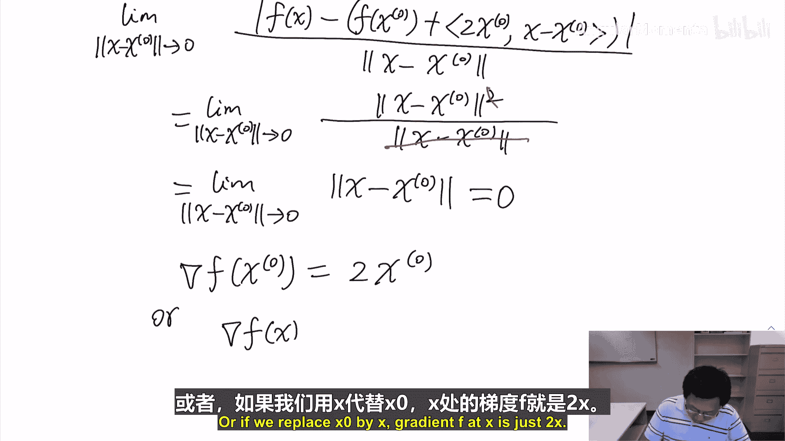

By this way， we obtain the gradient of this function f of x equals x norm squared。

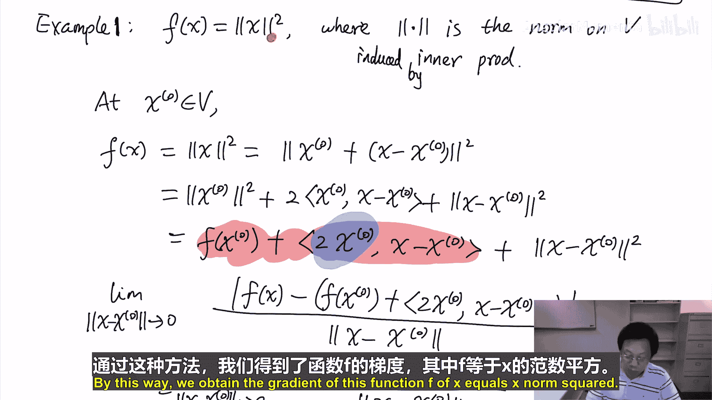

This is true for any hereable space。The example 2。We consider F x equals the inner product of a and X。

 We consider linear functions for some。A on V， linear and bounded functions on V。At x0 in B。Again。

 we approximate our FX by our functions。Then we need an Fx0， which is a x0。

And the difference is just a。X minus x 0。So this is just the Fx0。

And this term is an inner product of some vector with x minus x0。

So that this is already an a approximation to this F of x and the remainder term is just0。Therefore。

 this image。Of x minus x 0。Approaches。0， the arrow is just F x minus this F X 0。Plus A X minus x 0。

Absol of value divided by x minus x to 0。So that this。Is just zero because this arrow is zero here。

A vector， it is just the gradient。The gradients of。F at x 0， it equals to a。

Or we can replace x by x0。Greients f of x equals to a。For linear functions。

 the gradient is just the vector in the definition of this linear function。You example 3。

We consider F x equals。Where。This is the。Norm。On we。And of course， A is a vector only。

The norm is the norm induced by the inner product。We still consider at some fixed point on B。Then。

 F of x。By definition， it is just x minus a norm squared。Because we want Fx0。

 so we want this x0 minus a term。And the remainder， it is just plus。X。Minus x is0。Enorm squared。

By expanding this norm squared function， we obtain。It is the norm of the first term。Squared。This one。

Plus。The norm of the second term squared。And we have the cross term。

 which is two times the inner product of these two terms。Then。This is what we want。 It is F at x 0。

And the second term， we wanted to write it into an inner product。With x minus x0。

 it is obviously two times x 0。Minus8。X minus x is0。

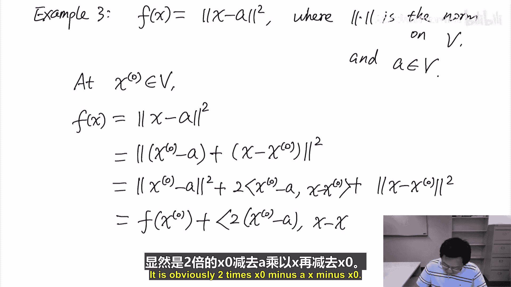

And this last term is just the approximation error。Then。This is the a approximation to Fx。

To discuss the differenti ability， we have to study how small thisarrow is。

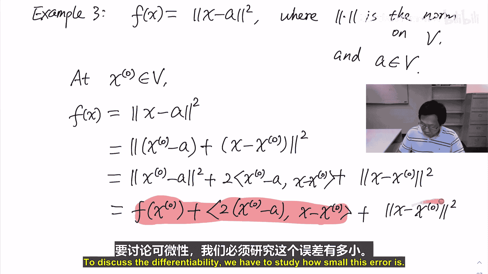

Then we just consider the name。Of this。When x minus x 0 approaches 0。The arrow。

This is the a function， The arrow is just this one。So this is the arrow term。

This is the a fine approximation。To the limit of the error。Divided by x minus x0。

It is just the limit。X minus x 0。Approaches 0。Thearrow is just x minus x0， the norm squared then。

Divided by x minus x 0。Then we have a cancellation。

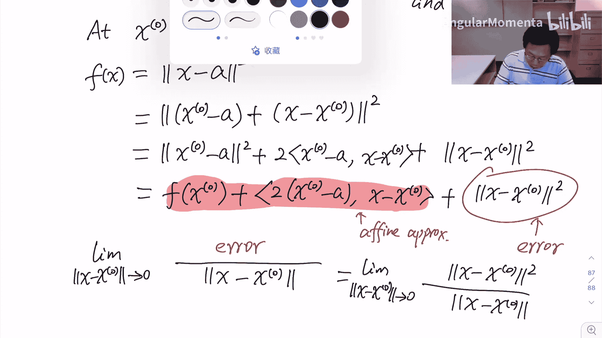

These's two kinds of this one。왜 okay？An image。X minus x is 0。Approaches 0。X minus x is 0。

Which is obvious there， because。This norm approaches 0。So then this arrow is just small enough。

 it's a little o of this one。So then this is a good a fine approximation in the differentiation。

The vector B in this。A fine approximation is the gradients。That is， this vector is the gradient。

At x 0。

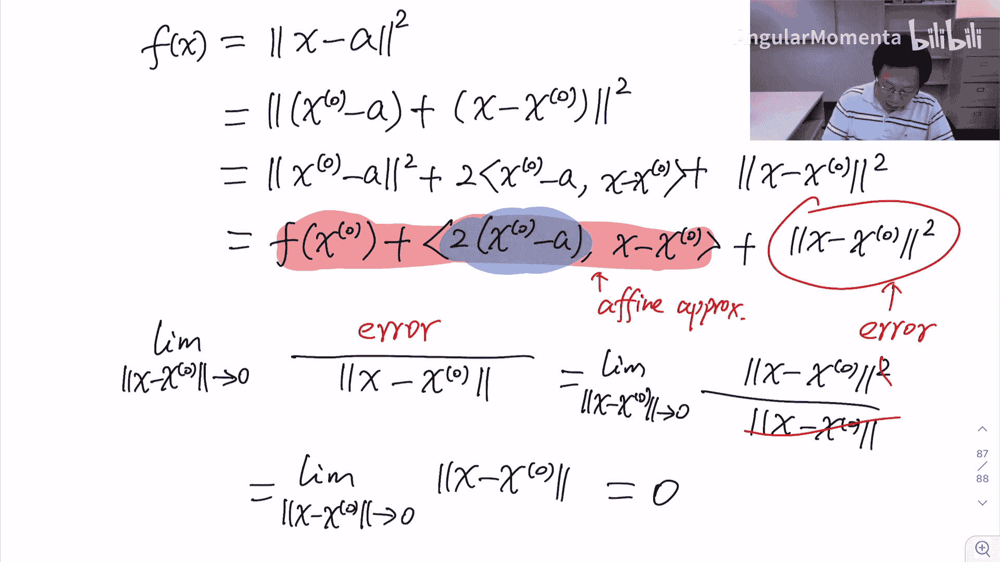

So we just obtained。Greedients F at x0。It is2 times x0 minus a。Or usually we use x as the variable。

 which has to replace x 0 by x。It is just2 x minus a。

So the gradients of this x minus a norm squared that is just 2 times x minus a。

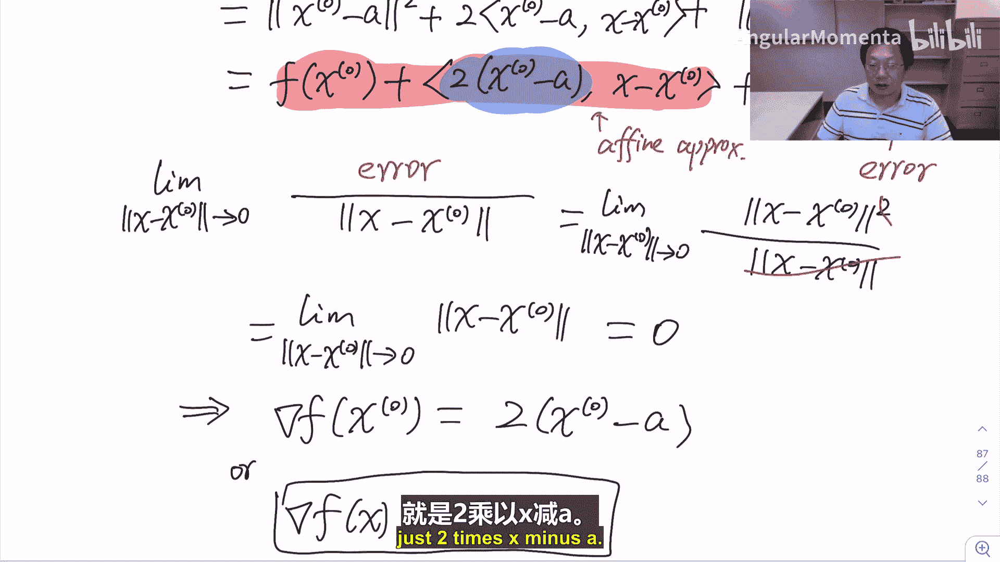