# 【香港科技大学】数据分析的数学方法 ｜ Mathematical Methods for Data Analysis p67 13-04-02-视频 -BV1DEFDzGEZW_p67-

Now we see properties of fresh air differentiation。Number one。

The fresh air differentiation is linear。In the function F。Which means that for any alpha and beta。

Real numbers。And for any function， F and G， they are from V to R。

 from a here blood space to a real number。We have the gradient of alpha F。主是贝塔机。At X。Of course。

Alpha gradient F at x。classus贝ta gradient的记忆。At X。Pvaded。The two functions， F and G。

 they are differentiable at x， that is。The gradients of F of x and the gradients of G at x exist。

Both of them exist。From here you see that if we have a linear combination of two functions。

 then we take the gradient。 it is equivalent to we first take the gradient of these two functions respectively and then do the linear combination。

So。Freer differentiation is linear in。Let's proof for this property。First of all， by definition。

 because this gradient F and the gradient。Of G exist。Then we have the limit of y approaches x。

Or equivalently。Y minus x， the norm approaches 0 ratio of thearrow and y minus x。你讲。

Because now we are using Y approaching x。 So then we are approximate F of y。By using。

And a fine function at X。マナ。F of x。Plus， the gradient F of x。And y minus x。

So this is the linear approximation or more precisely a fine approximation to this F of y viewed as a function of y。

So thisarrow under this y minus x the norm， their ratio when y approaches x should be 0。

That's the definition of the gradient of F of x。

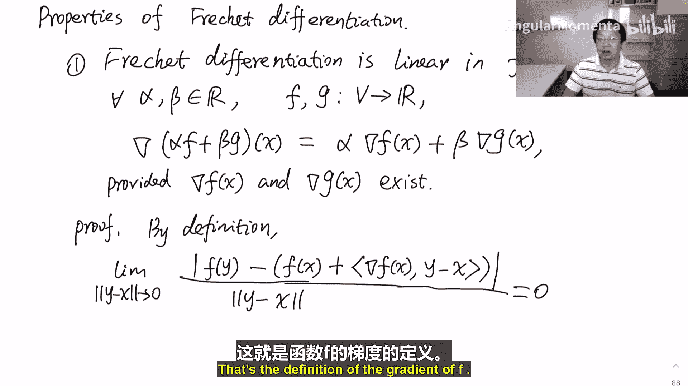

Similarly， since G is also differentiable at x， the limits of y approaches x or equivalently。

The norm of y minus x approaches 0。And the ratio of thearrow and the y minus x norm。

The error of this fine approximation is a g Y minus。G X plus gradients， G of X。Y and minus x。Eals 0。

 This is the a fine approximation to Gy viewed as a function of y it is a fine in y。

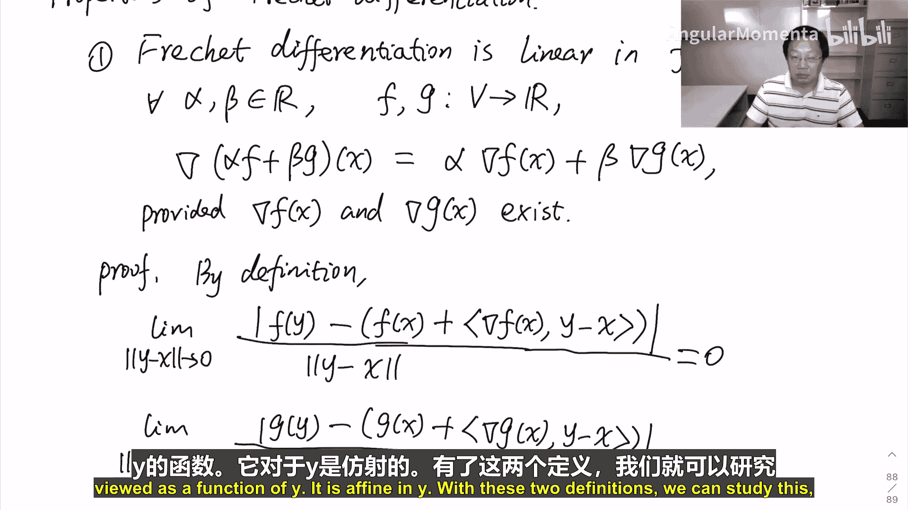

With these two definitions， we can study this。Which is that we want to study that。

Limits when y minus x approaches 0， the error。And y minus x， the norm， the ratio。

 The error is now because。

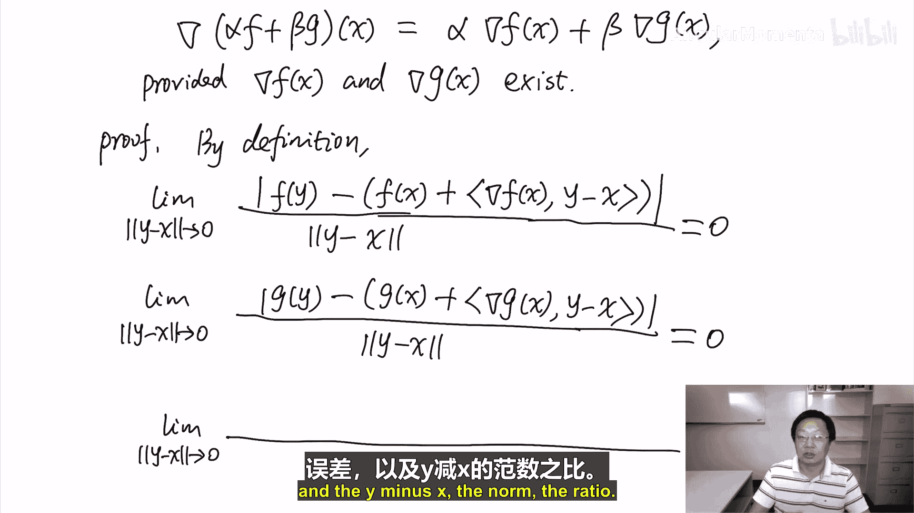

We are differentiating this alpha F plus beta G。Apha F plus beta G。

 So we just approximate this alpha F plus beta G at y。We use a fine approximation at x。

So minus this阿尔法 F plus beta G。At X。Plus。We wanted to show that this gradient is given by this。

 So we use our gradient F of x plus beta gradient of G。And the y minus X。

If we can prove this equals0， then we show that this。Greedient is just a given by this。

For this limit， obviously， it is larger than or equals to 0 because the denominator is non negative。

 The numerator is also non negative。

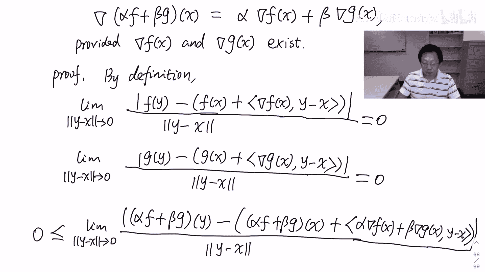

And we wanted to show that it is upper bounded by zero as well， so then the limit must be 0。For this。

 we just。Rearrange the your meritor。For the numerator， you can see that all the terms。

It is just linear with respect to F and G。So it is rewritten as R5 times FY。Minus。F X。Plus。

 gradient F， X。Y minus x。This is the first term。 The other term will be plus beta times the same thing on G。

 G，Y minus G X。Plus， gradient G of X。Y minus X。The numerator is now split into these two terms。

Then we apply the triangle in quantity for action to value function。It is just。

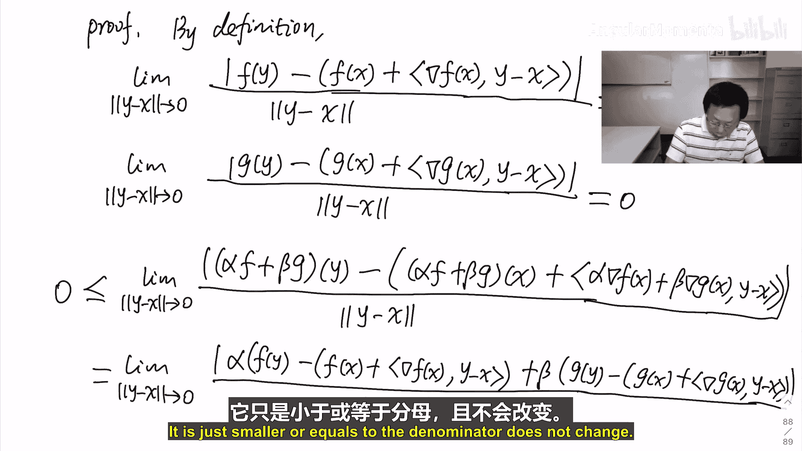

Smaller or equals to。The denominator does not change。For the numerator， it is。

Upper bounded by absolute value of alpha times this FY。Minus。Fx plus gradients， Fx。Y minus x。Plus。

 the absolute value of beta。Times the same thing of why of。Times the same thing of G。

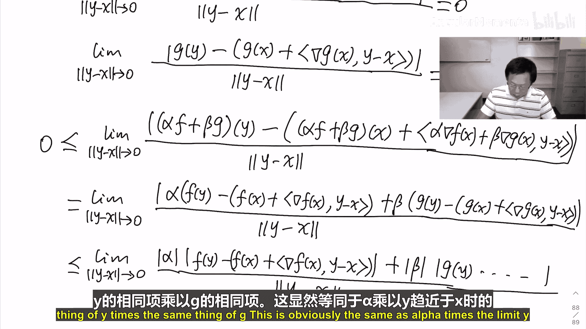

This is obviously the same as alpha times the limits。Y approaches X。Or equivalently。Y minus x。

 the norm approaches 0。Y and minus x。F，Y， minus F X。The gradient Fx。Y minus X。

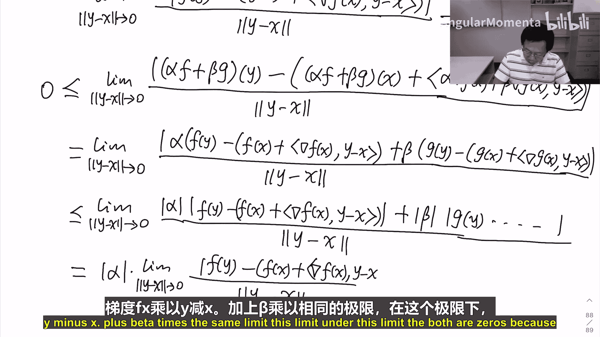

Plus。Beta times the same limit。

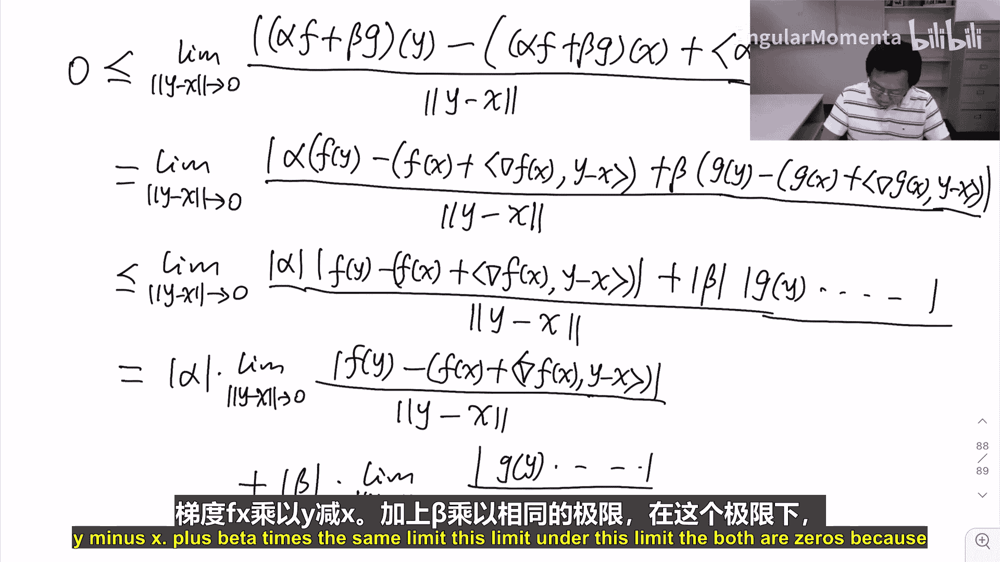

This limit。Under this limit。

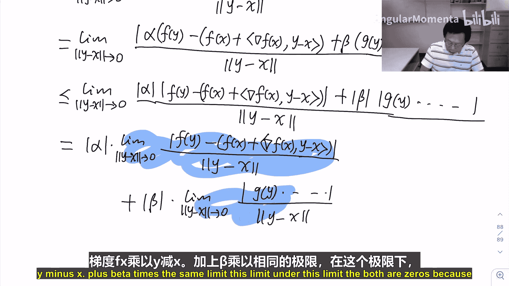

That both are zeros because of the differentiability of this F and G at x。

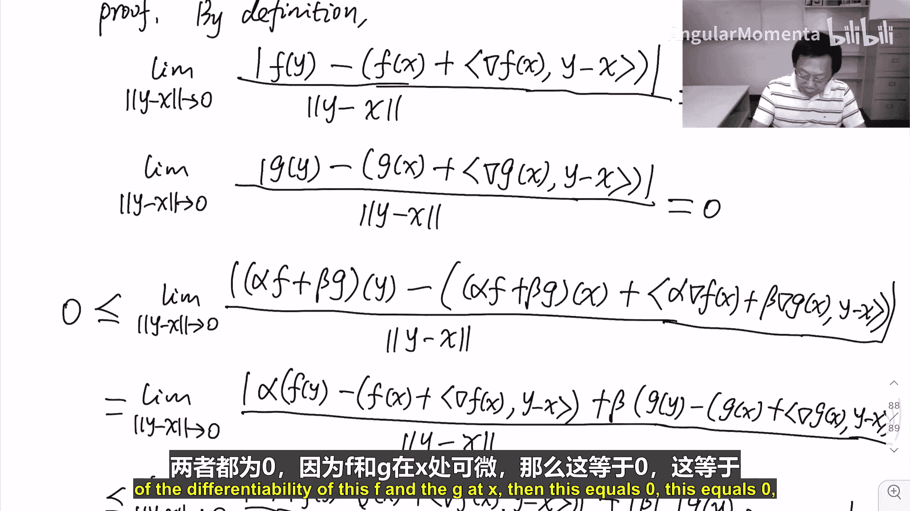

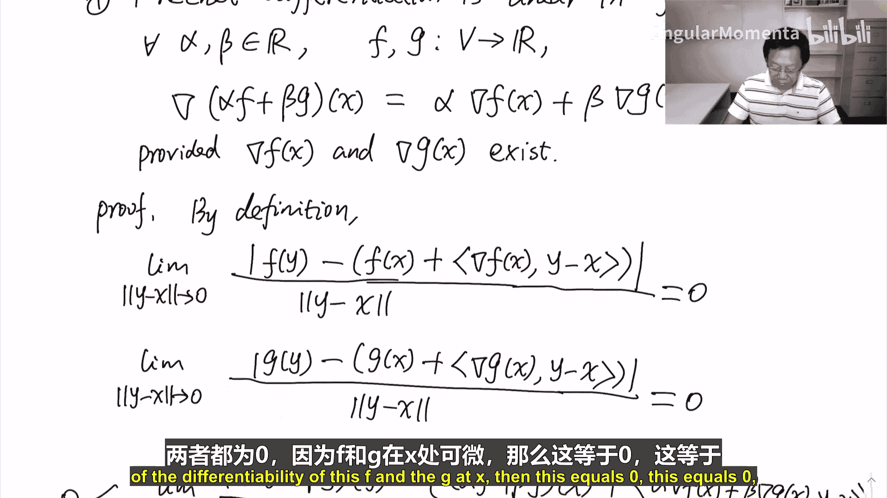

Then this equals0， this equals zero。 so this equals0。

 this equals to zero so that their sum is just zero。

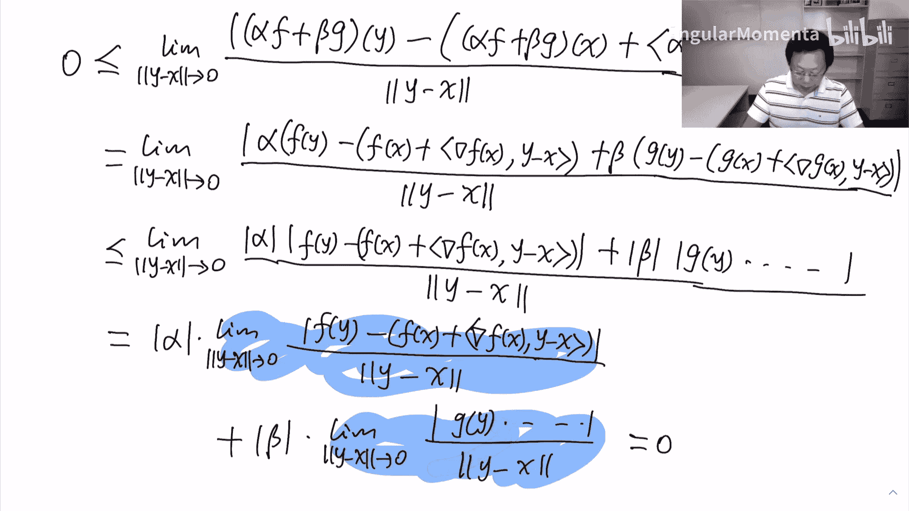

Then we have shown that this limit must be zero because this。

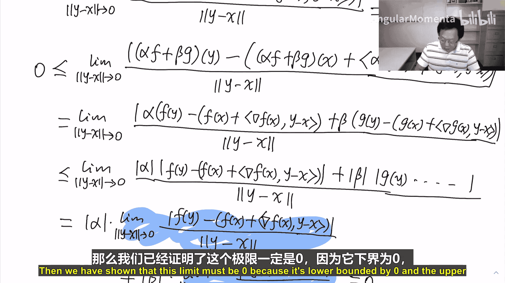

Lower bounded by0 and their upper bounded by0 as well， so that the limit must be 0。

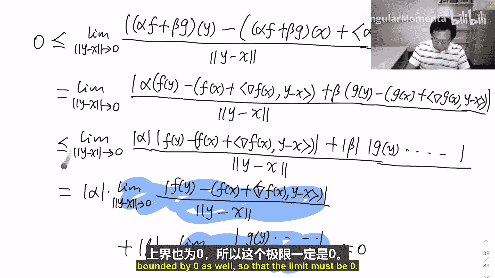

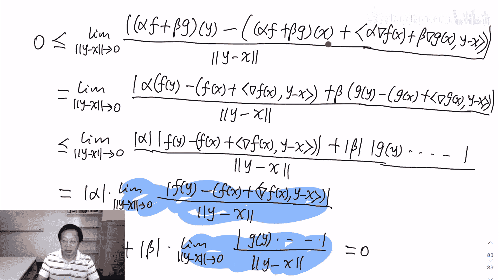

Then this just tells us the gradient of this。A F plus beta G， it is just given by this vector。

So we have proved that this linear holds true。

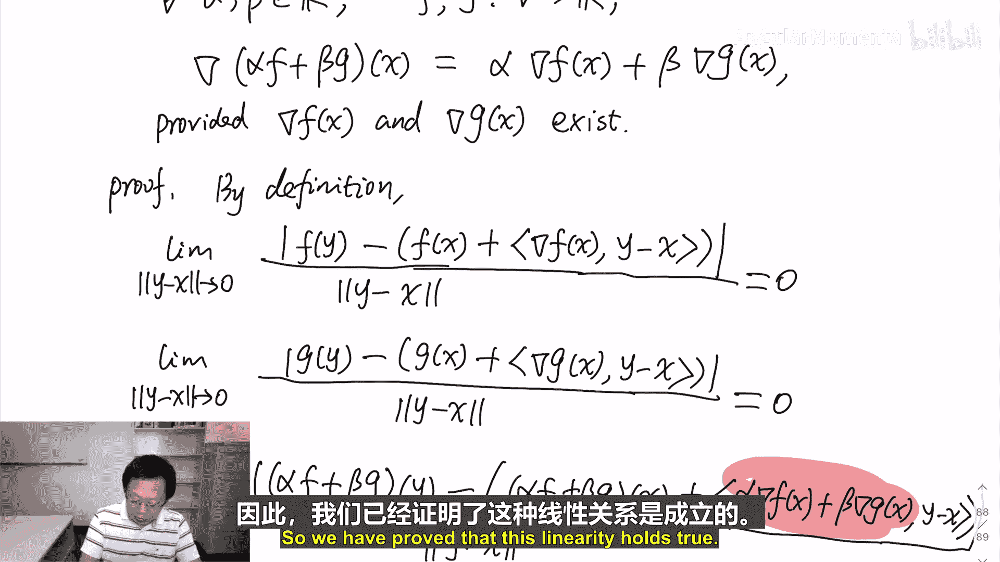

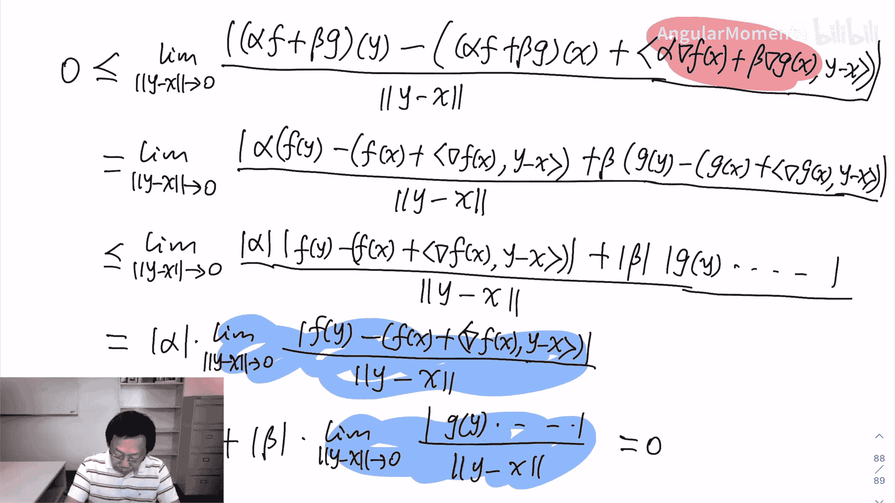

For any alpha法 and beta in R， for any functions， F and G from V to R。

If this gradient Fx and gradient。G of x exists。 Then gradient of alpha f plus beta G at X equals alpha times gradient of F at X plus beta times gradient the G at X。

