# 【香港科技大学】数据分析的数学方法 ｜ Mathematical Methods for Data Analysis p69 13-06-02-视频 -BV1DEFDzGEZW_p69-

In the following， I give you an application of the Qnru。Example 4。On f of x equals to the norm of x。

For any X on B。Of course， here this is the norm enbi。It is the norm induced by the inner product。

We have seen that the gradient of x norm squared is just two times x。

 But here this is just the norm of x without a square。What are the gradients of this one？

For this purpose， we just represent this Fx as a composition of two functions。 F is a composition。

Of these two functions are F1 of x。It is just the norm of X。And then squared。And F2 of T。

It is just a square root of tea。So FY is for。X on V。 So F Y is from V to R。 F2 is just for。TRR。Then。

F1 is from B to R。And F2 is from R to R。안 돼。F X equals。F 2， F1。Of x。

Which is just the square roots of this x norm squared。To obtain the gradient of F。

 we use the Qn rule。According to different X。Wen。X is non0。If x is none0 than both。F1 and F2。

AreDifferentiable。Because this F1 is always。Differentiable for any x。

 But this F 2 is only differentiable We t is strictly larger than 0。 Now， x is non 0。

 So this x norm squared is strictly positive。Both F1 and F2 are differentiable。Now。

 we apply the chainn rule。Greedientent of F of X， since it is a composition of these two functions。

The gradient is given by F2 prime F1 of x times the gradient of F1 of x。Also。The gradient of F1 of x。

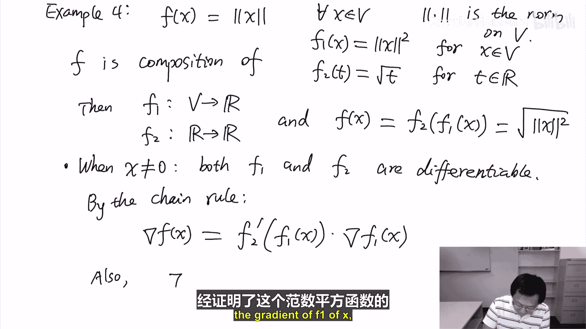

We have demonstrated。That the gradient of this。Norm squared the function is just2 times x。

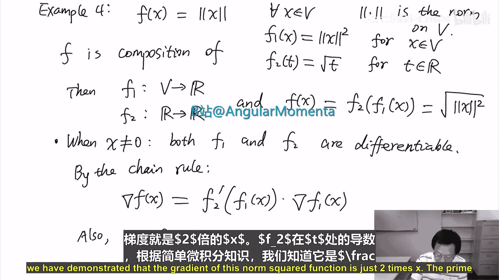

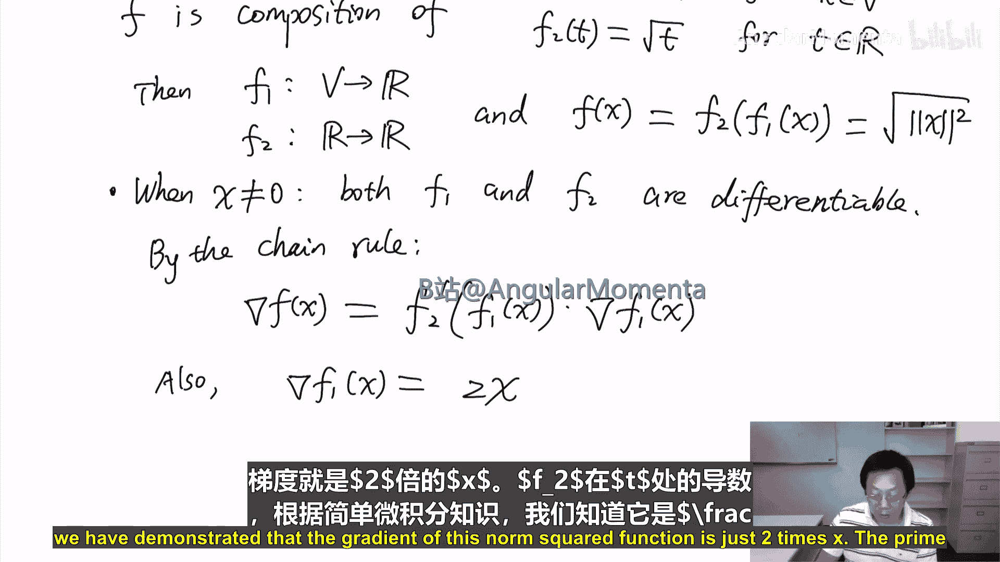

The prime。Of F2 at the T， it is。From simple calculus， we know what this is。

1 over two times squared of T。So from here， we see that this is just。

1 over2 times a square root of F1 of x， which is x norm squared times 2 times x。

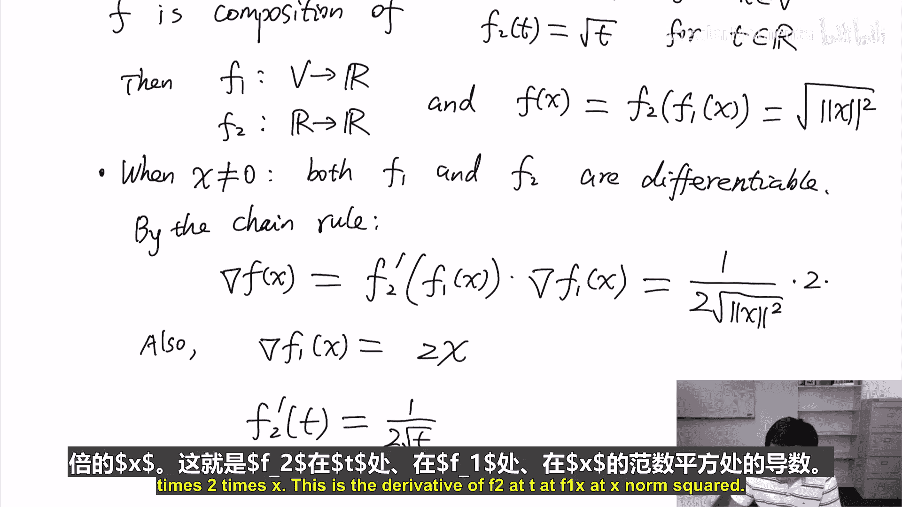

This is the derivative of F2 at T at F1 next at x norm squared。And this。Is the gradient of F1。

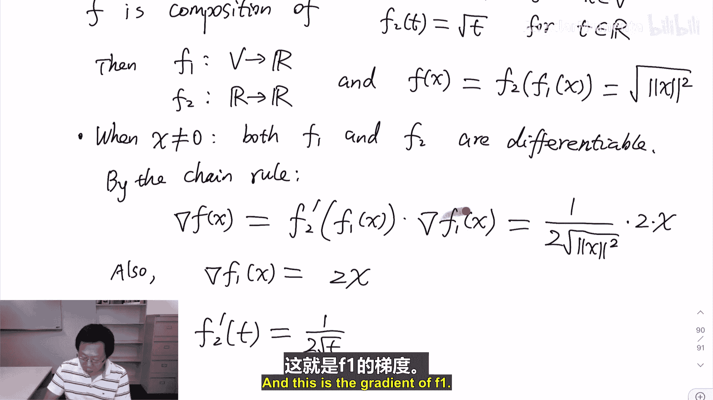

So from here we just see。That this gradient of F is just x over the。Norm of x。

We obtain the gradient of this dorm function。It is just x over the norm of x。

 It is just the unit direction of x。When x is non0。But when x equals 0。

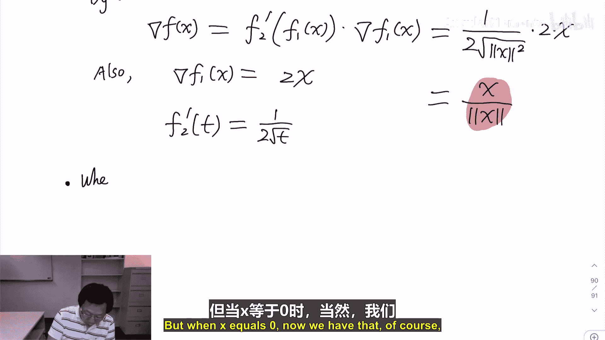

Now we have that， of course， F1 is still differentiable。

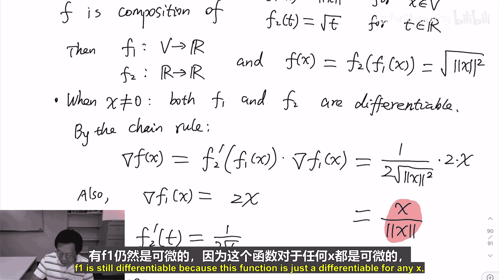

Because this function is just a different for any x。

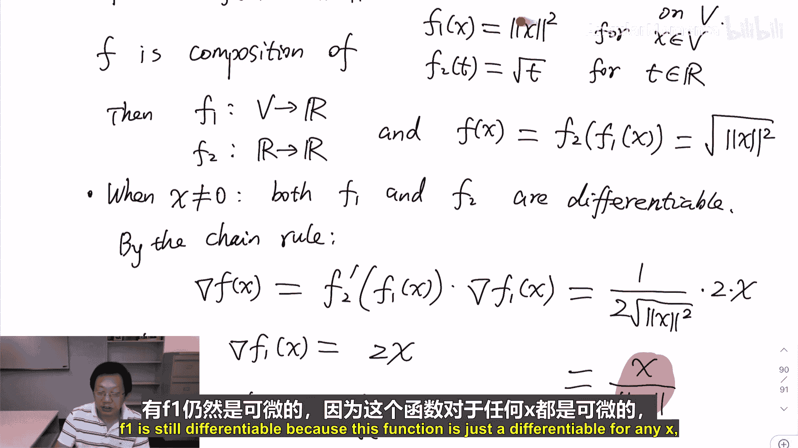

F1 is different。

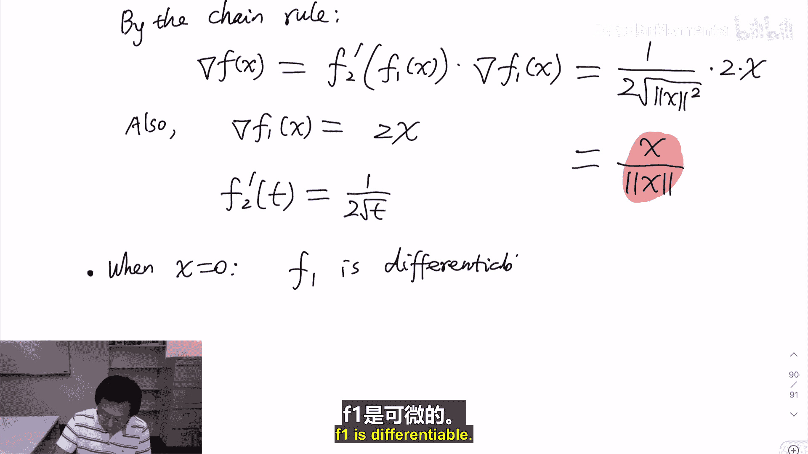

At x equals 0。How about this F2。

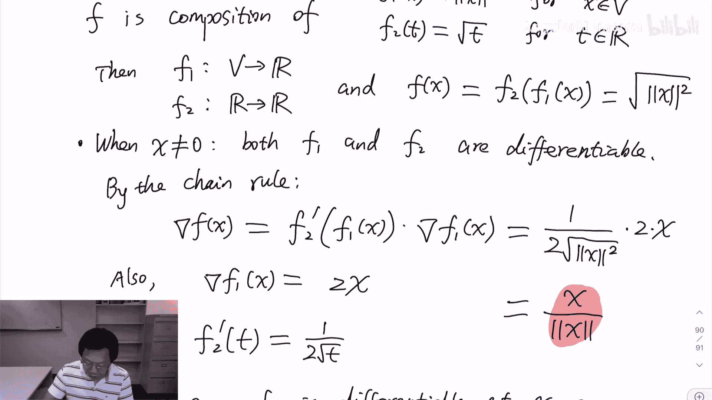

This F2， it is just differentiable when t is larger than0。

 but now this t equals to the norm of x squared。

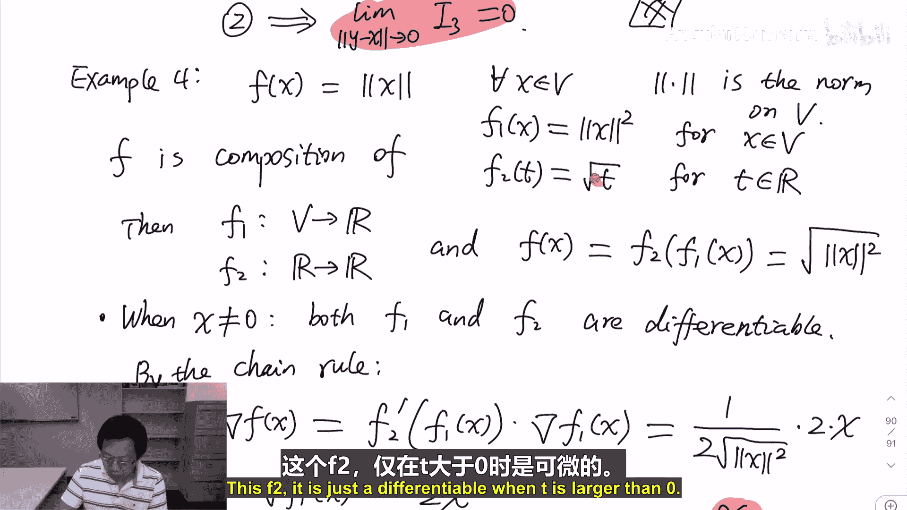

It is zero so that this one is not different。At。F1 of x， which is just 0。

So then we cannot apply the Qin rule。The Qin rule will not be applicable for this case。

But by some other means， we can prove that this。F will not be differentiable。

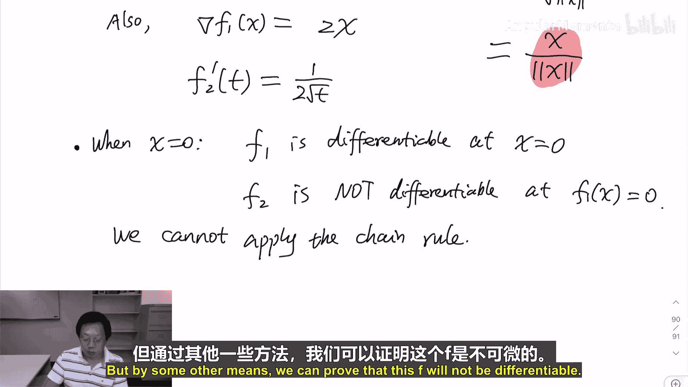

F is。Not。Differentiffer。When this x is zero。

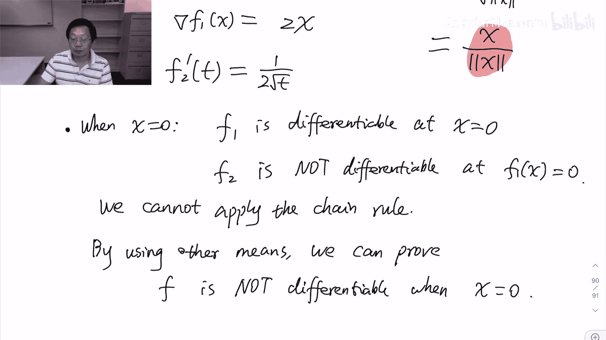