# 【香港科技大学】数据分析的数学方法 ｜ Mathematical Methods for Data Analysis p70 13-07-02-视频 -BV1DEFDzGEZW_p70-

In the third property of fresh differentiation， we consider functions。Uk Canadianinadian spaces。

For functions， F from R N to R。Where an is with the standard in productor。

For this class of functions， if F is differentpressciable at x。X is in x1 to X， N。In R N。Then。

The gradient F of x has an explicit form。Its first component is just the partial derivative of F with respect to the first variable。

And theす。This tells us that the fresher differentiation is the same as the standard differentiation that we have learned in multivarient calculus In multivarient calculus。

 we just defined the gradient through the partial derivatives Here， this property tells us。

Fressure differentiation will obtain the same gradient as the one in the。Mtivariant calculus。

This tells us fresh。Differentiation。Yes。Consistent。Ws。Standard。Differentiation。

In multivarient calculus。If R N。Is with the standard in the product。In this sense。

 the fresher differentiation is just a generalization of the standard differentiation that we learned in much calculus。

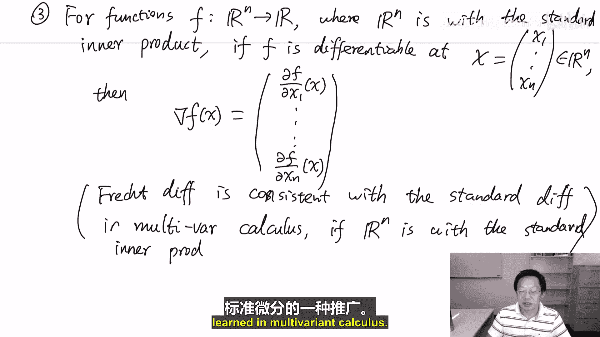

To prove this property。We still use the definition of fresher differentiation。

 since this F is differentiable。At X。In R。We should have that the zero equals the limit。

When y minus x approaches 0。

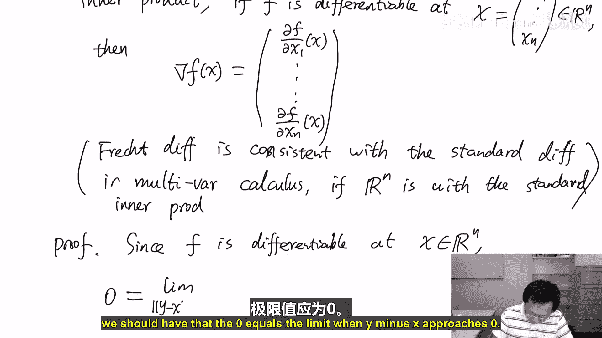

The linear approximation。F， Y， minus F X。Plus， gradient， F， X。Y minus x。Divided by y minus x。

 this limit should be 0。In this limit， y approaches x just means that y approaches x from any direction。

Because in the R N， the high dimensional space。

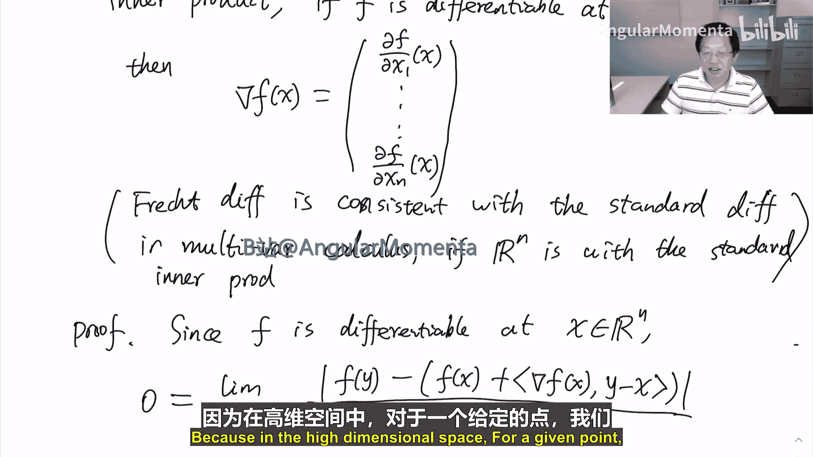

For our given point。We have many ways to approach that point。Graphically， this is x。

 Y can approach x by this direction or this direction by many， many different directions。Then。

In fresh differentiation， we just see no matter which direction we approach x。

 we should have that this limit equals 0。

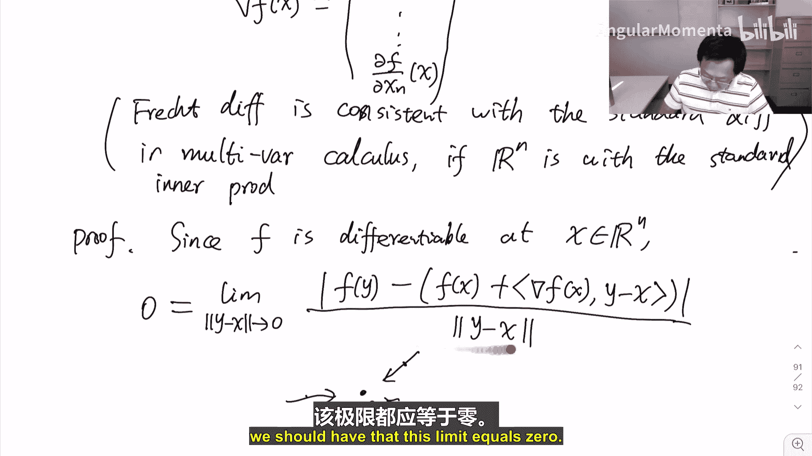

To prove that the I component of this gradient of Fx is given by the partial derivative。

We just construct a special why that approaches X from a specific direction。We choose。

Y equals x plus T， E， I。Where EI is the。Eth， natural basis。It's。Ice component is one。

And all the rest of his entries are just 0。T is a real number。Therefore。

 y equals x plus TEI means that this y approaches x from the EI direction。Assume x is here。

Assume this is the EI direction。Just means that this Y approaches x。From here。

 this is y Y approaches x on this horizontal line， either from this side or from this side。

 but the direction is just along the EI direction。This is our Y X plus T， E， I。

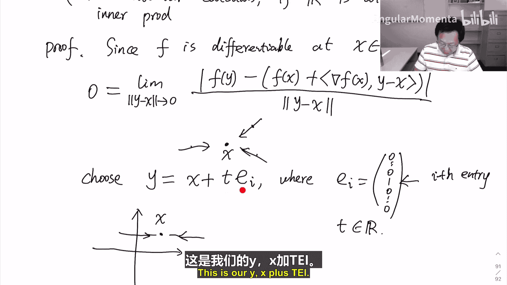

With this。We can see the ratio。In this limit will be F， Y is just F。X plus T， E， I。Minus。F，X。Plus。

Greedients， F， X。Y minus X is T E I is E I times T。

The denominator will be y minus x which is T E I the true norm。The norm of T， E I equals。

T times the norm of E I。 The norm of E I is just one。So this is the absolute value of T。

 So the denominator is just the absolute value of T。

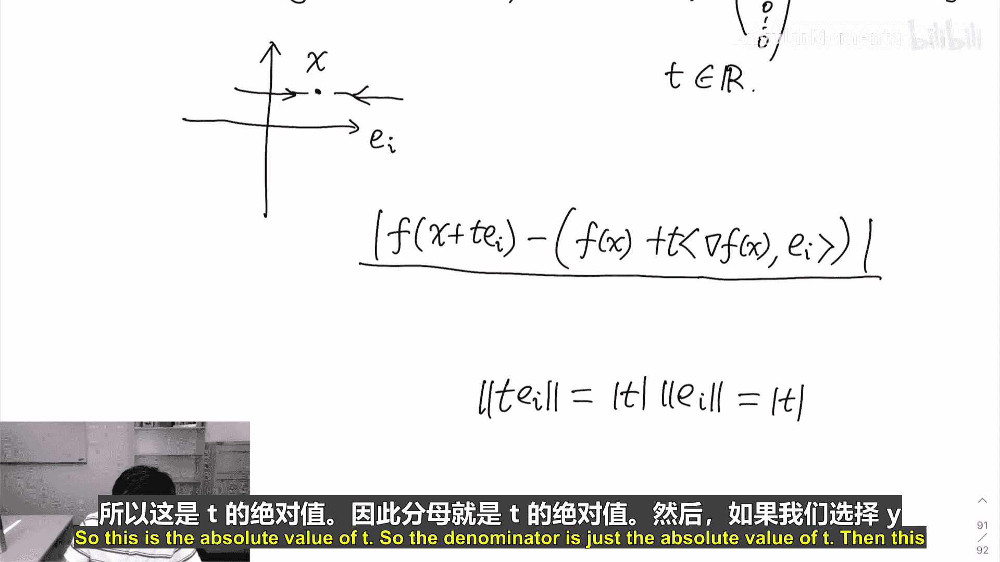

Then， this。Rio here becomes the ratio here if we choose y approaches x on this direction。

 on the EI direction。We send T goes to 0。Then y approaches x。When y approaches x。

 this limit should be0， no matter what direction we choose。So that this limit is just zero。

This function have only one variable T X is given EI is a fixed direction so that this is a function of T。

We call it a G T， for example。Once this is G T， then this is just。Gze。

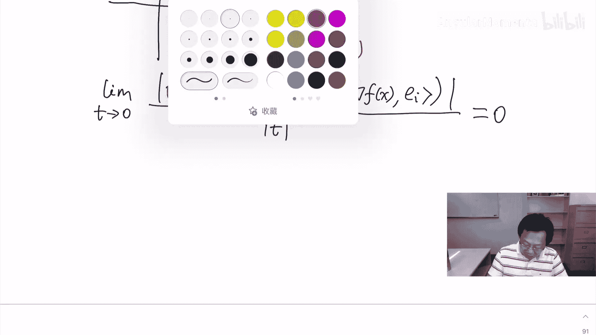

So this image becomes。G of T minus g of 0。Class。T times。Graient F。X。EI or more specifically。It is。

These times。T minus0。

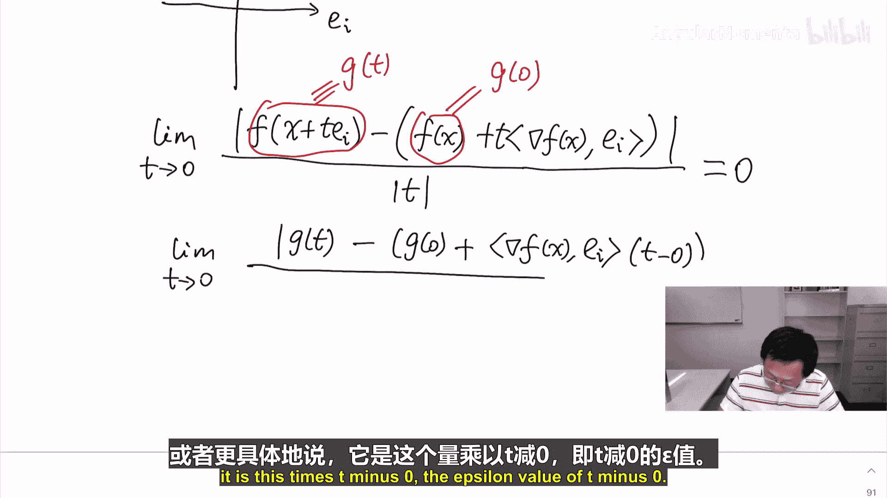

The absolute value of t minus 0。E equals 0。I just replaced the FX plus T E I to be GT。

Then this is exactly tells us the G prime。At0。E course。Graient， F， X， E， I。

This is just the G prime zero。According to the definition of derivative or the definition of the fresher differentiation。

 they are the same for one variable functions。We obtain this。Now， this G prime0。

 it is right into another notation， DDT。GTT一课是这吧。This is the same as DDT。F。X plus T， E， I。T equals0。

What does this mean？Because x plus T， E I means we change only the I coordinate of X。

All the rest of the coordinates of X are just fixed。

And then we take the derivative with respect to that coordinate。We obtain。This。

So this one is exactly the partial derivative。At X。We just obtain。Greent F， X， E， I。

 it is the partial derivative to you。Of F with respect to X I at x。This means that the I coordinates。

Is that？Ith partial derivative。So we finished with that proof。

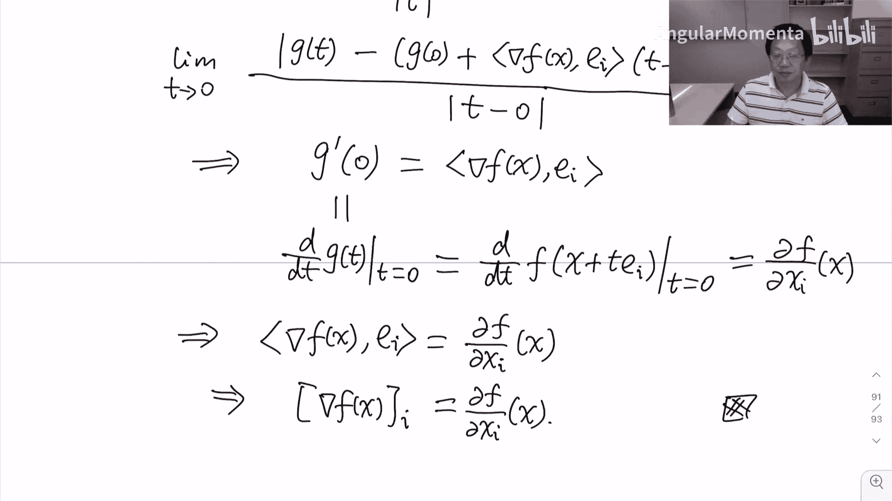

This property tells us that the fresh gradient of a function F from R N to R is just the vector of all partial derivatives。

You should be noted that this is true if and only if we used the standard inner product。

If we change the the inner product。This will change。Now， this gradient F of X， E。

 I will not be the I component of gradient of F of X。 It depends on the inner product you choose。

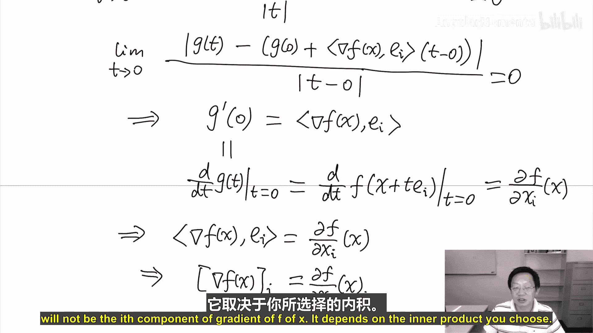

If we change the inner product。Then。

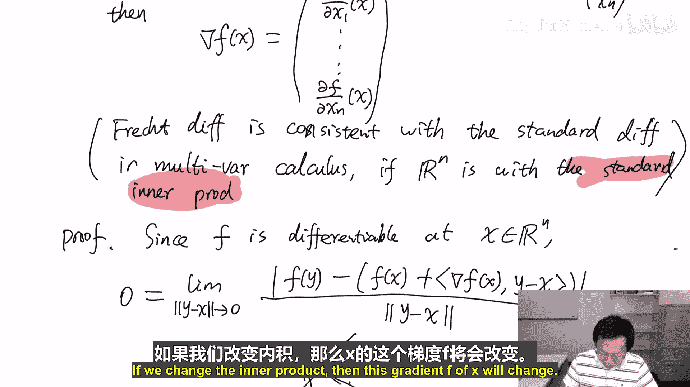

This gradient f of x will change。So from this example。

 we also see that the fresh differentiation depends on。The inner product we choose。

We change an inner product。 Then we change a differentiation。

It is consistent with the standard differentiation in March variance calculus if and only if we use the standard inner the product in R。

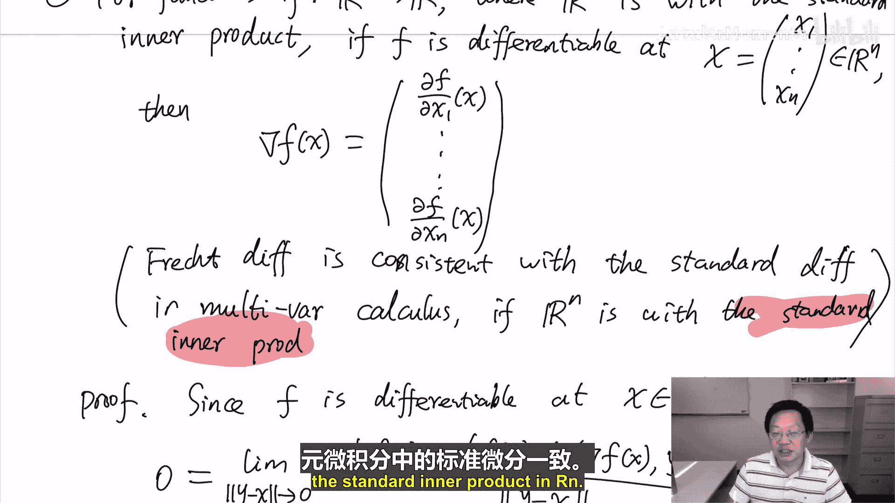

Remark。Freer。Differentiation。Depends on。In the product。Only。

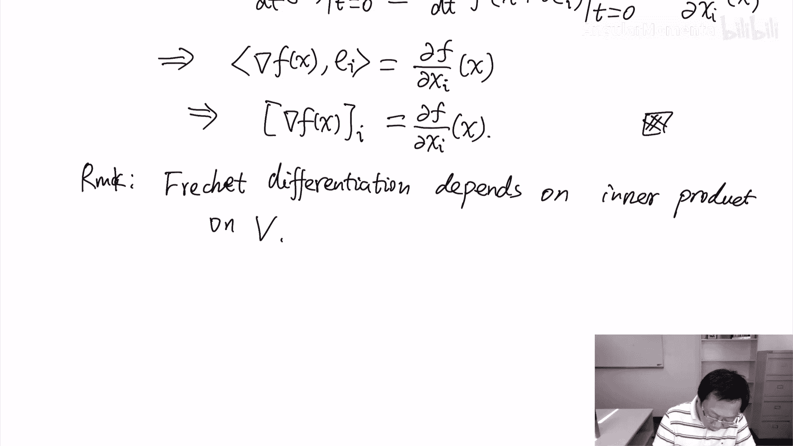