# 【香港科技大学】数据分析的数学方法 ｜ Mathematical Methods for Data Analysis p71 13-08-02-视频 -BV1DEFDzGEZW_p71-

The fourth property of fresher differentiation generalized the third one。 In the third one。

 we have seen that。

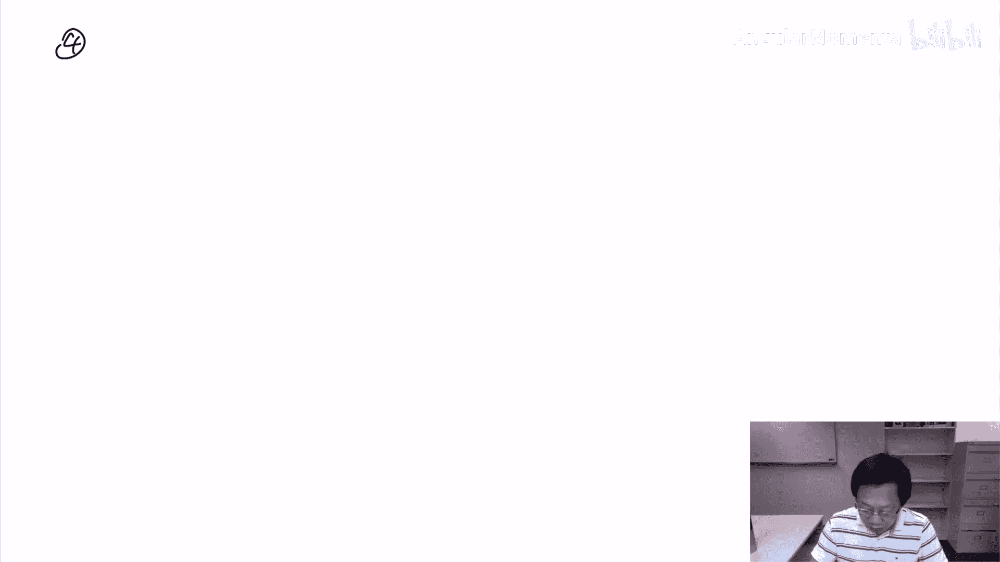

Y approaches X from a specific direction， EI。When y approaches x from EI direction。

 we obtain the partial derivative。

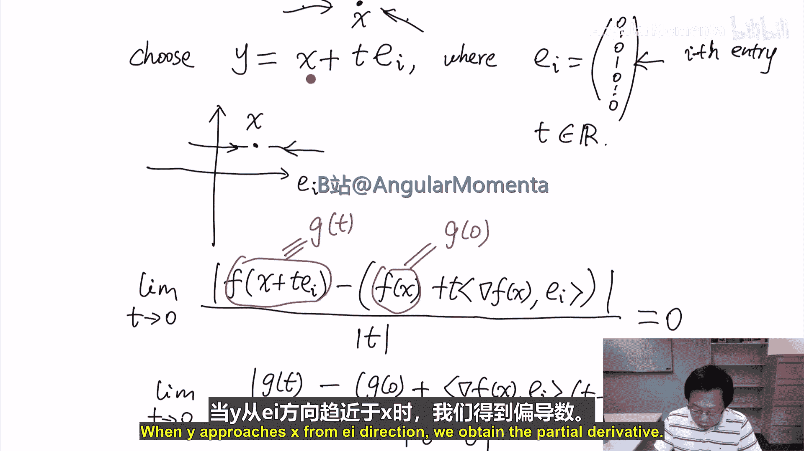

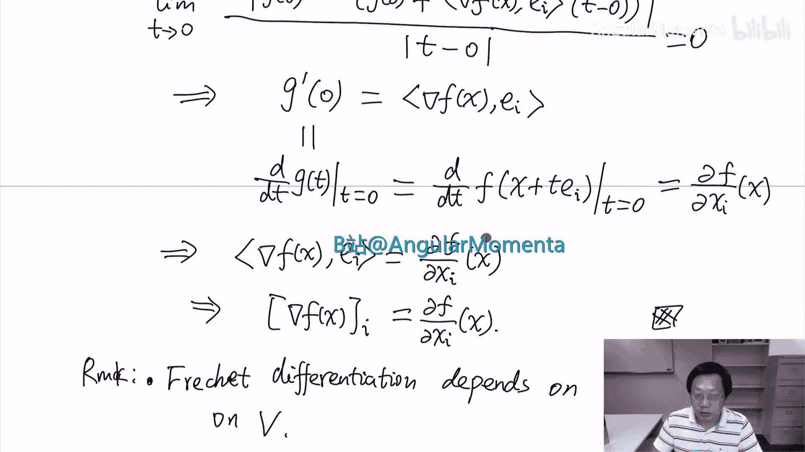

Actually， this EI can be replaced by any direction we will get the directional derivative。

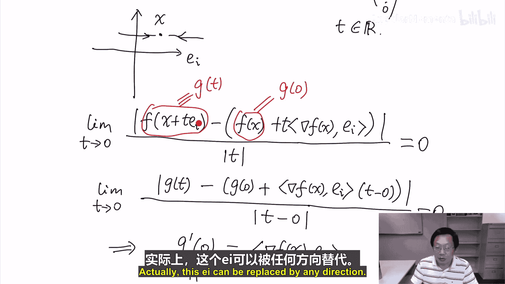

In particular， let F B are functioning。From B to R。Where we is a hub space。And assume。

F is differentiable。At。X。In儿人。And we choose a direction you let you be the direction。Wei。

The norm equals1， which means that U is a unit vector。Then。This gradient。

Of FX in the product with you is the D of Dt。F。X plus T U。T equal equals 0。That is。Greent， F x。

You is the。Direional。Derivity。Along the U direction。To prove this one。

We always start with the definition of differentiation。Because。

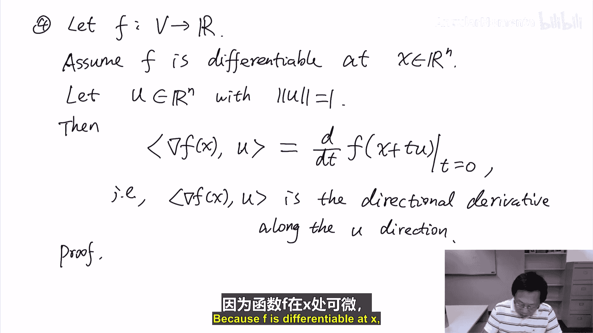

F is differentiable at x， the limit。Y minus x approaches 0。F，Y minus。F，X。Plus。Greent Fx。Y minus X？

Divided by y minus x， the norm equals0。

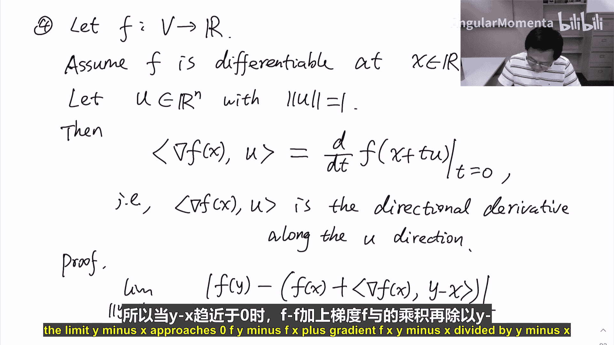

To prove this identity， we just choose a special direction。

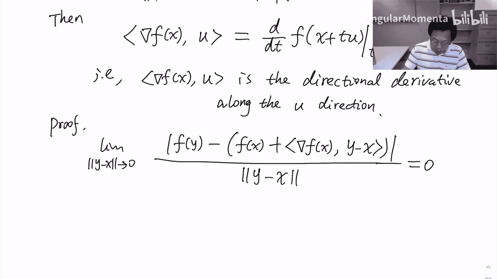

Choose。Y equal。X plus T U。70。2。That is， we approach X through the direction U。

Then similar to what we have done in the property 3。

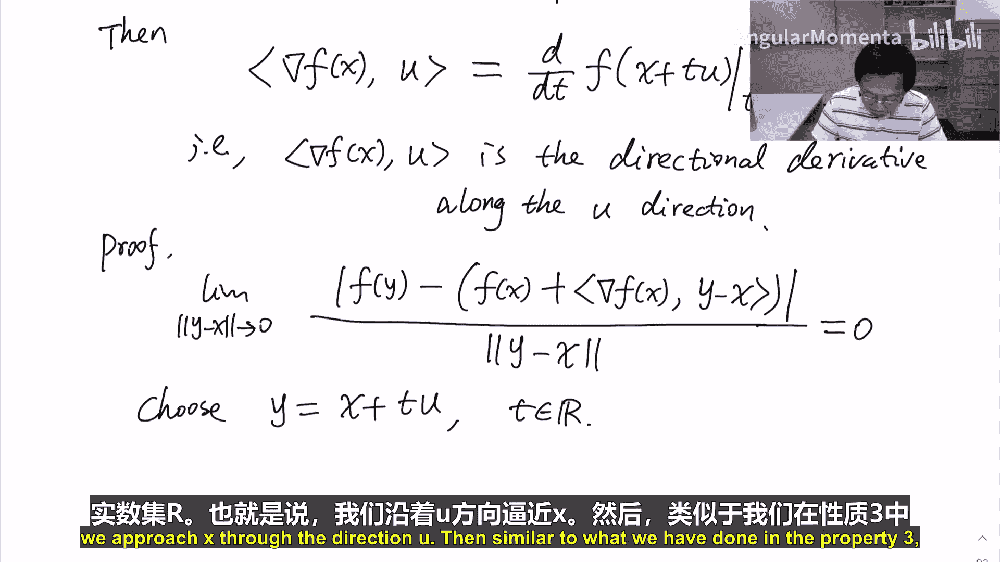

We just have F X plus T U。Minus。F of x。Plus。Grareient F X。Y minus x is now T U。YouT。Giv by Y minus x。

 It is just a。Qiy。It is just T times the norm of you。The norm of you is one。So。

 this denominator is just。T， the absolute value of T。This is an image。

Because y approaches x from any direction， this limit is just0。 We choose a specific direction。Thus。

 when t approaches 0， this is just 0。

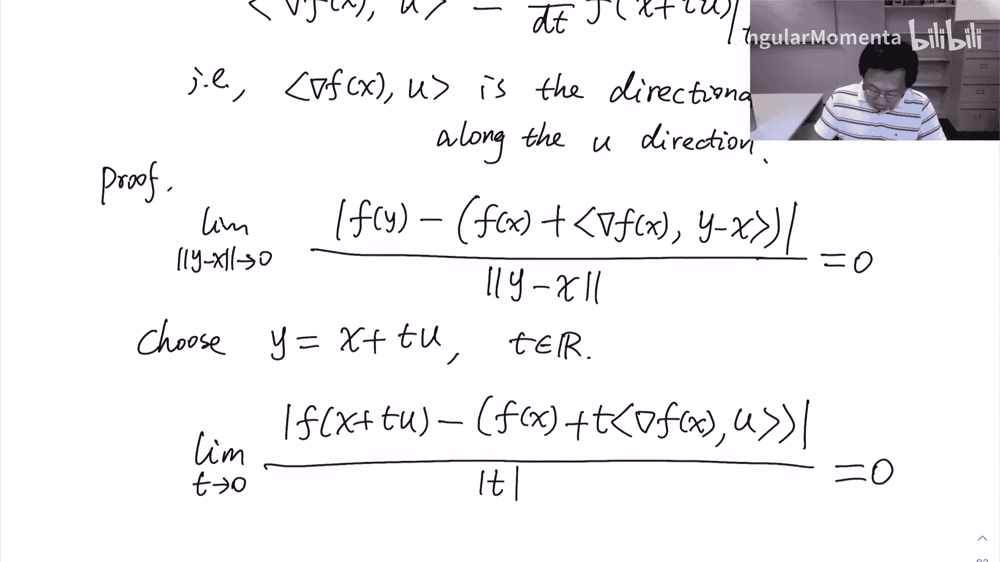

Again， was set。This to be our G of T。

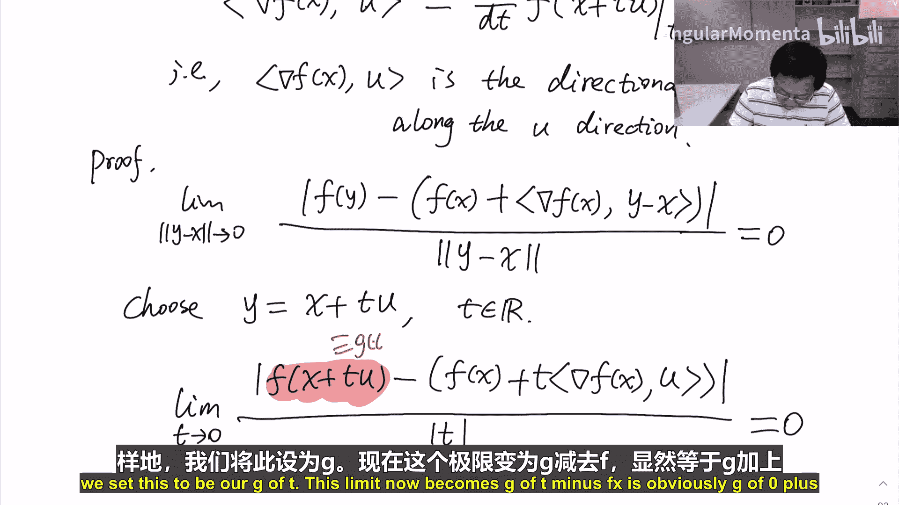

This image now becomes。G of T。Minus Fx is always an energy of 0。Plus。This inner product。

Times t minus0。Divided by t minus0 equal equals 0。

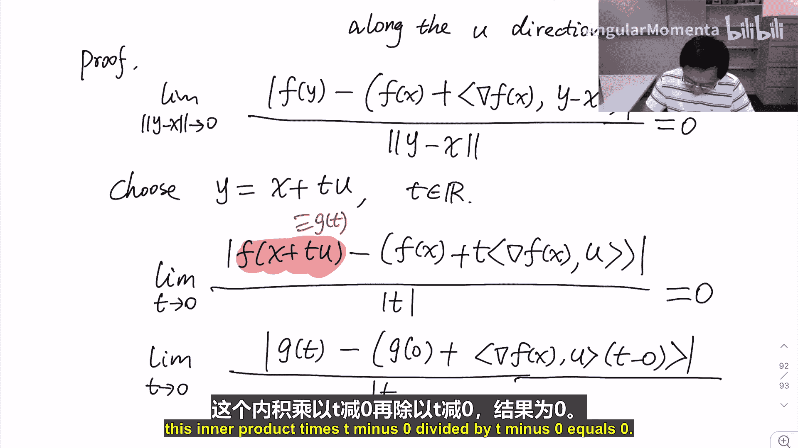

From definition of derivative， we just see that this implies。G prime at 0 equals。

Greient F X in the product with you。And again， this G prime 0 is just DDT。T of T T equals 0。

This is the same as D of D T。F X plus T U。Tー equal equal0。

This means that we allow only exchange change in the U direction。

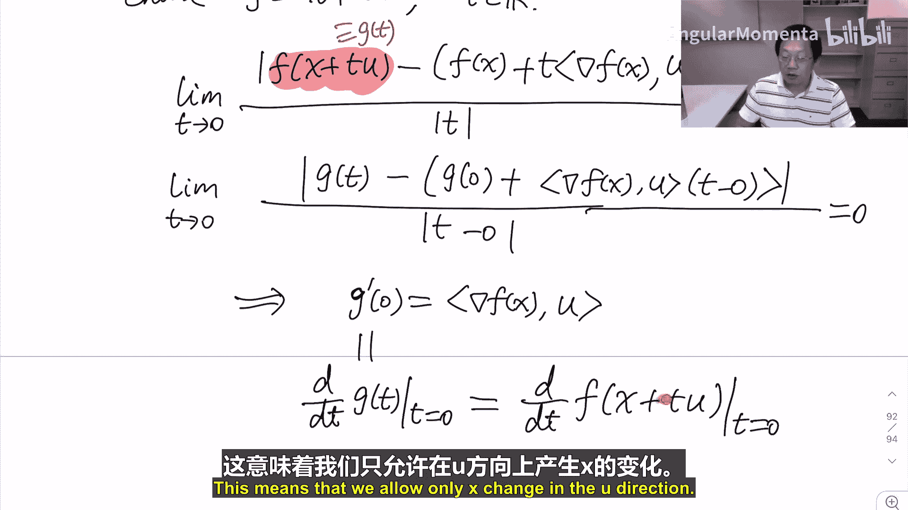

We calculate how fast this F changes along in the U direction。Therefore。

 this is just the direction of derivative。We finished and proof。

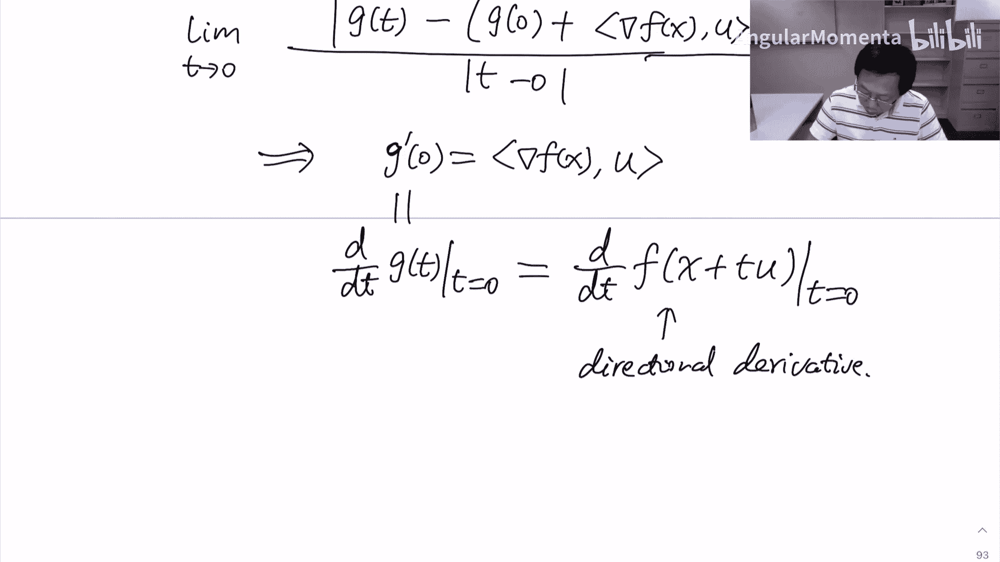